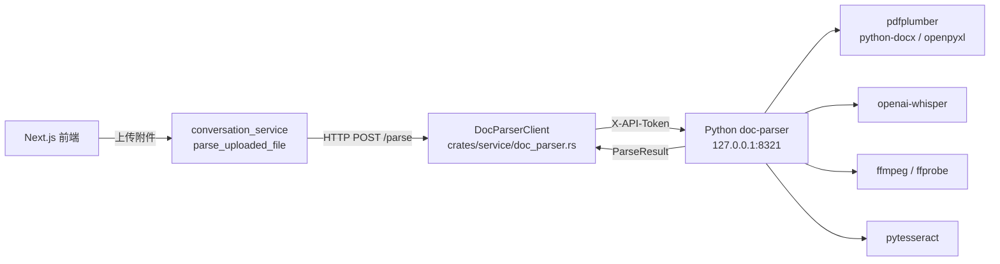
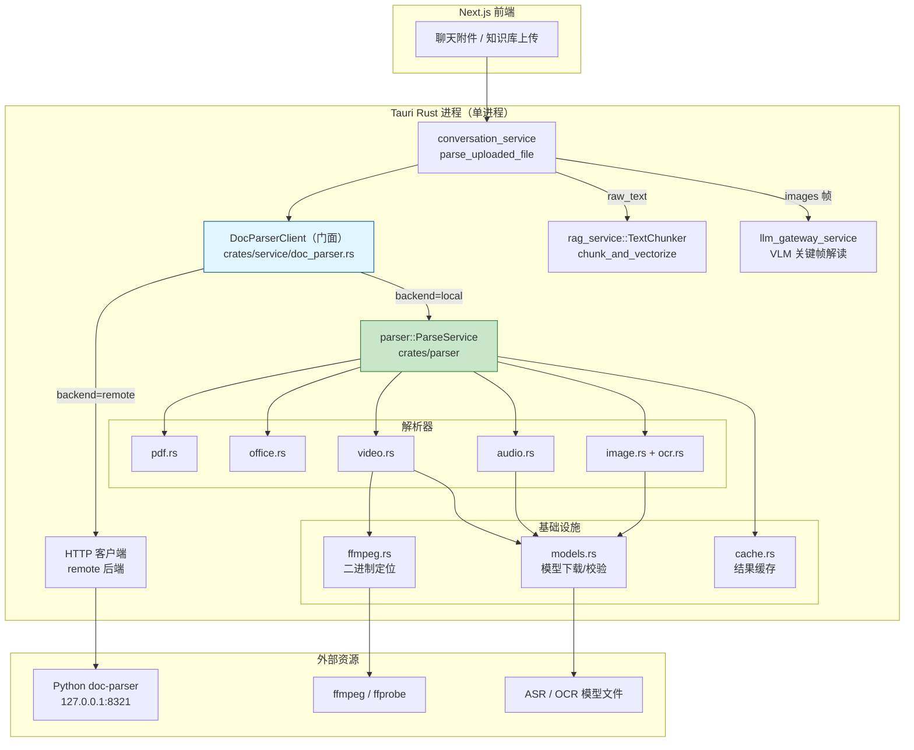
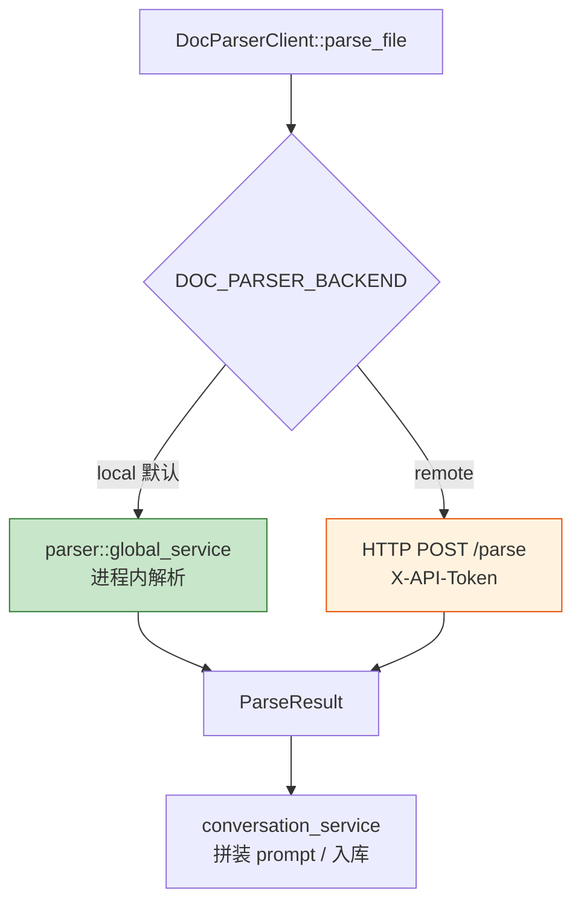
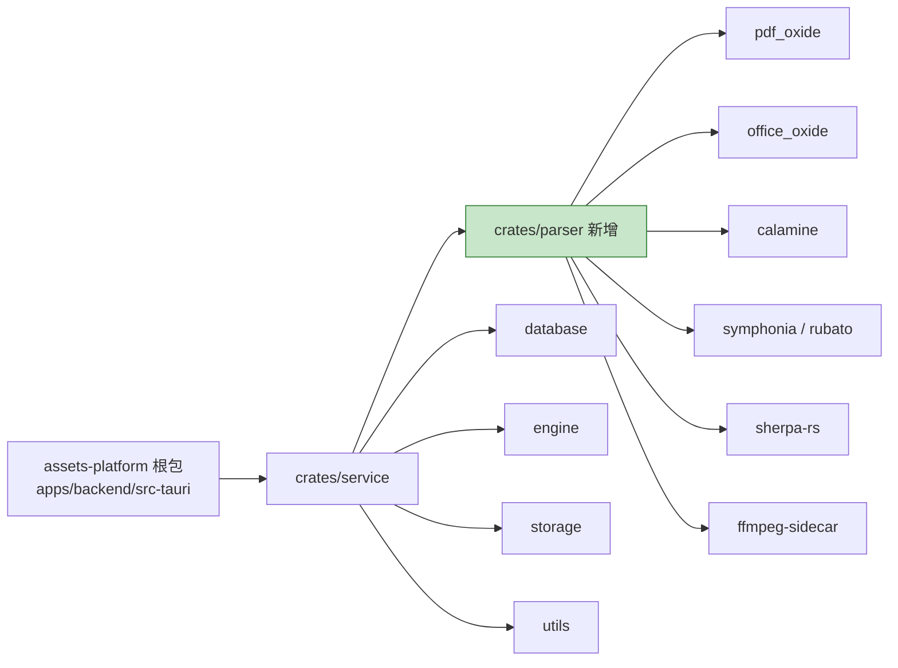
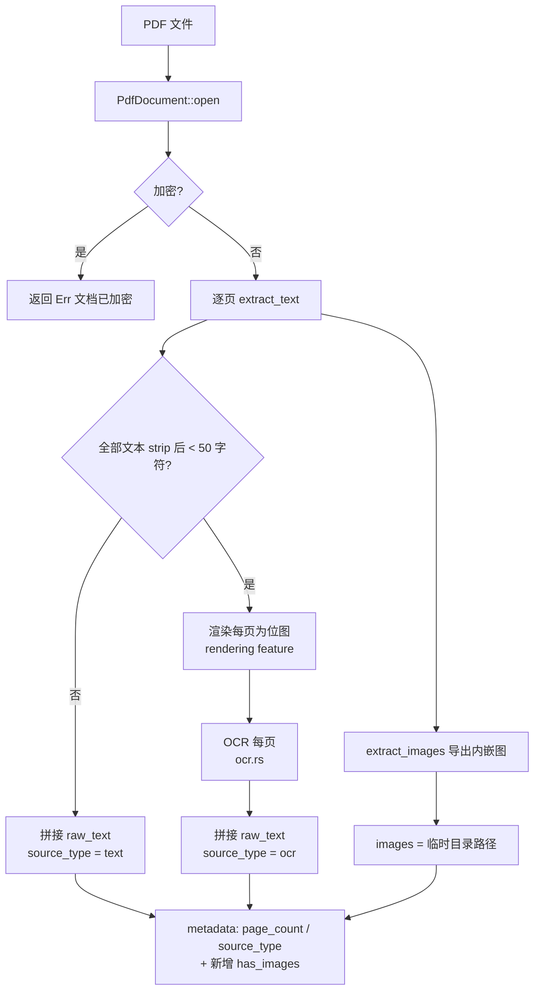
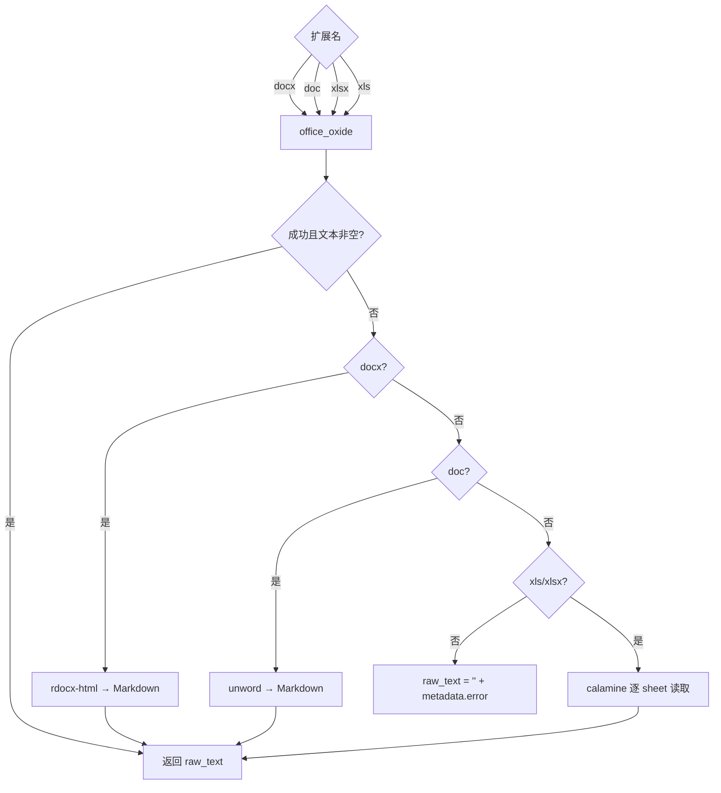
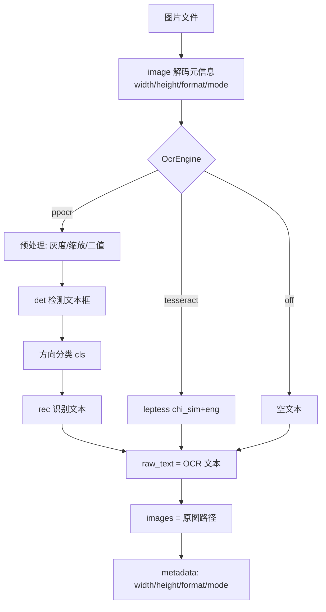
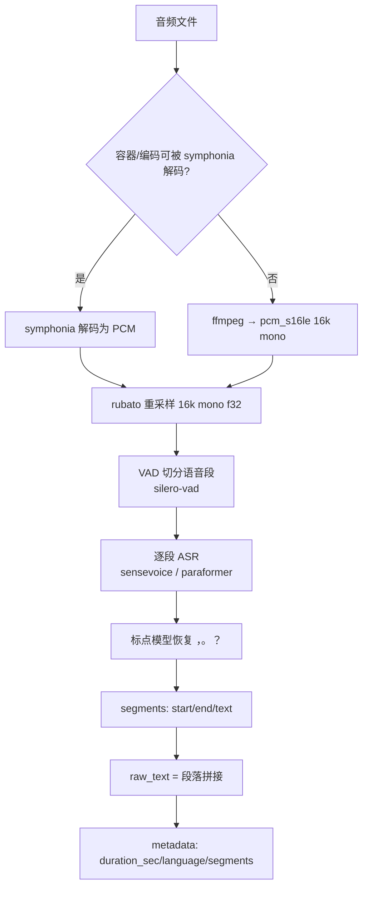
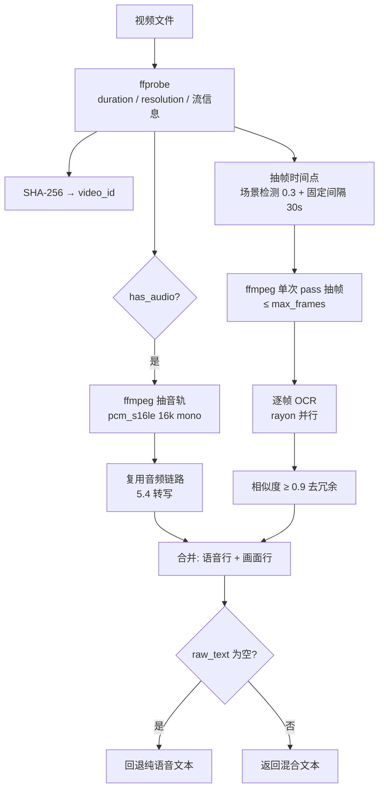
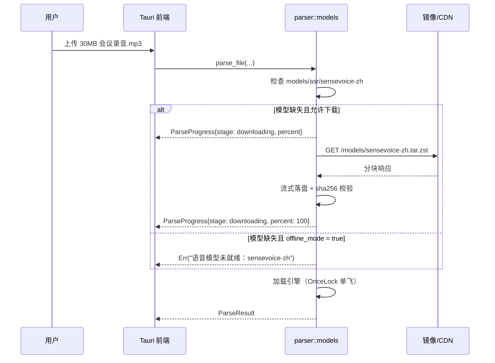

# Rust 原生多模态解析后端设计方案

> 用 Rust crates 替换 Python `doc-parser` 侧车，在进程内完成 PDF / Office / 图片 / 音频 / 视频的文本化归一，输出契约保持不变。

---

## 目录

1. [背景与目标](#1-背景与目标)
2. [技术选型](#2-技术选型)
3. [总体架构](#3-总体架构)
4. [核心抽象与代码骨架](#4-核心抽象与代码骨架)
5. [各模态解析流水线](#5-各模态解析流水线)
6. [模型与外部二进制资产管理](#6-模型与外部二进制资产管理)
7. [配置设计](#7-配置设计)
8. [与现有代码的集成](#8-与现有代码的集成)
9. [性能与容量](#9-性能与容量)
10. [测试与验收](#10-测试与验收)
11. [实施路线图](#11-实施路线图)
12. [风险与应对](#12-风险与应对)
13. [附录](#13-附录)

---

## 1. 背景与目标

### 1.1 现状

当前所有非文本文件的解析都在 **Python 侧车** `apps/doc-parser`（FastAPI + uvicorn）中完成：



相关代码位置：

| 位置 | 说明 |
|------|------|
| `crates/service/src/doc_parser.rs:12-27` | `ParseResult` 结构（`file_name` / `file_type` / `raw_text` / `images` / `metadata`） |
| `crates/service/src/doc_parser.rs:69` | `DocParserClient::parse_file(&self, file_path: &str, options: &serde_json::Value)`，唯一出口 |
| `crates/service/src/doc_parser.rs:135` | `start_doc_parser()`，应用启动时拉起 Python 进程 |
| `apps/backend/src-tauri/src/lib.rs:96` | `let _doc_parser_child = service::doc_parser::start_doc_parser();` |
| `crates/service/src/conversation_service.rs:291` | `parse_uploaded_file()`，唯一调用方 |
| `crates/service/src/conversation_service.rs:59-65` | `MAX_ATTACHMENTS_PER_MESSAGE` / `MAX_IMAGES_PER_MESSAGE` / `MAX_VIDEO_FRAMES` |
| `apps/backend/.env.example.toml:96` | `[doc_parser]` 配置段 |

### 1.2 为什么要迁移到 Rust 原生

| 问题 | 现状 | Rust 原生后 |
|------|------|-------------|
| **部署依赖** | 桌面端需 conda 环境 + 约 2GB Python 依赖（torch/whisper/paddle） | 单个可执行文件，无 Python |
| **启动耗时** | 每次启动要拉起 uvicorn，首次 import torch 数秒~数十秒 | 进程内调用，冷启动 < 50ms（模型按需懒加载） |
| **进程管理** | 子进程崩溃/端口占用/日志落 `/tmp/doc-parser.log` 需额外容错 | 无子进程，错误以 `Result` 直接返回 |
| **打包** | Tauri 安装包无法自带 Python 运行时 | 随包分发，或按需下载模型 |
| **离线可用** | 依赖本地 conda 环境是否完整 | 模型预置后可完全离线 |
| **性能** | Python GIL + 进程间 HTTP + base64 传输 | 零拷贝、可多线程并行、可直接复用 Rust 端 `TextChunker` |

**服务端形态保持不变**：服务器部署（`docs/doc-parser 独立部署指南.md`、Docker/systemd）继续使用 Python 侧车，通过 `backend = "remote"` 复用，不做任何裁剪。

### 1.3 目标与完成定义（DoD）

1. `DOC_PARSER_BACKEND=local` 时**不启动任何 Python 进程**，`tasklist` / `ps` 中无 uvicorn。
2. 输出契约 `ParseResult` **字段与 `metadata` 键名完全不变**，下游零改动：
   - 聊天链路：`conversation_service.rs:291-322`（含 `MAX_VIDEO_FRAMES` 关键帧转 data URL）
   - 知识库链路：`rag_service.rs:159 chunk_and_vectorize()` → `TextChunker`（`rag_service.rs:13`）
3. 覆盖格式与 `apps/doc-parser/services/parse_service.py:31` 的 `SUPPORTED_FORMATS` 一一对应：

| 类型 | 扩展名 |
|------|--------|
| `pdf` | `pdf` |
| `document` | `doc` `docx` `xls` `xlsx` |
| `image` | `jpg` `jpeg` `png` `gif` `bmp` `webp` `tiff` |
| `audio` | `mp3` `wav` `ogg` `flac` `m4a` `aac` |
| `video` | `mp4` `avi` `mov` `mkv` `wmv` `flv` |

4. `DOC_PARSER_BACKEND=remote` 时行为与今天**逐字节一致**（HTTP + `X-API-Token`）。
5. 干净机器（无 Python、无 ffmpeg）安装后，模型下载完成即可离线解析。

### 1.4 非目标

- 不修改 `TextChunker` 切分策略、不改 `RAGRetriever`、不改 LLM 网关。
- 不替换 VLM（图片/视频帧的语义理解仍走现有 `llm_gateway_service`）。
- 不实现向量化算法（`chunk_and_vectorize` 中 `similarity 0.0` 占位问题不在本方案范围）。
- 不做移动端（`mobile`）适配，仅在桌面端启用本地后端。

---

## 2. 技术选型

> 版本为当前仓库 `Cargo.lock` 中已锁定的版本（2026-10），`crates/parser` 直接引用同一版本，不新增下载。本仓库 `rustc 1.96.0`；`pdf_oxide` 与 `office_oxide` 的 `rust-version` 均为 1.88，满足。
>
> **实测事实（Phase 1 已验证）**：`pdf_oxide 0.3.78` 自身就依赖 `office_oxide 0.1.15`（非 optional），所以把 `office_oxide` 写成 `parser` 的直接依赖**不增加任何下载或编译成本**；`office_oxide` 的 `default = []`，`mmap` / `parallel` / `python` / `wasm` 全为可选 feature。

### 2.1 选型总表

#### 文档类

| 格式 | crate | 版本 | 许可证 | 能力 | 风险 |
|------|-------|------|--------|------|------|
| PDF 文本 | `pdf_oxide` | 0.3.78 | MIT OR Apache-2.0 | `PdfDocument::open/from_bytes`、`page_count()`、`extract_text(i)`、`extract_text_auto(i)`、`extract_spans(i)`、`extract_all_text()`、`extract_images(i)`、`to_markdown(i, opts)` | 低（**本仓库 `tests/pdf_tests.rs` 已跑通**） |
| PDF 渲染（扫描件） | `pdf_oxide` feature `rendering`（tiny-skia） | 同上 | 同上 | 页面 → 位图，供 OCR | 中（Phase 0 验证清晰度） |
| DOCX / DOC / XLSX / XLS / PPTX | `office_oxide` | 0.1.15 | MIT OR Apache-2.0 | `Document::open`（按扩展名 + 内容嗅探）、`as_docx()` / `as_xlsx()` / `as_doc()` / `as_xls()`、`plain_text()`；feature：`mmap` / `parallel`（默认全关） | 中（`.doc` 保真度待真实样本验收） |
| Excel 兜底（可选，Phase 1 未引入） | `calamine` | 0.37.0 | MIT | `xls` / `xlsx` / `xlsb` / `ods`，纯 Rust，成熟度最高 | 低 |
| DOCX 兜底（可选，Phase 1 未引入） | `rdocx-html` | 0.16.3 | MIT | DOCX → HTML / Markdown | 低 |
| `.doc` 兜底（可选，Phase 1 未引入） | `unword` | 0.2.0 | MIT | OLE/CFB（Word 97-2003）→ Markdown | **高**（代码量小，仅作降级） |
| 老编码解码 | `encoding_rs` | 0.8 | MIT OR Apache-2.0 | GBK / CP936 / GB18030 文本片段解码 | 低 |

#### 音视频类

| 环节 | crate | 版本 | 许可证 | 能力 | 风险 |
|------|-------|------|--------|------|------|
| probe / 抽音轨 / 抽帧 | `ffmpeg-sidecar` | 2.7.0 | MIT | 驱动独立 ffmpeg 二进制；`probe`、`-vf select='gt(scene,0.3)'`、进度回调 | 中（依赖外部二进制） |
| 纯 Rust 解码 | `symphonia` | 0.6.1 | **MPL-2.0** | `mp3` `aac` `isomp4` `flac` `ogg` `wav` `vorbis` | 低（文件级 copyleft，链接商用 OK） |
| 重采样 | `rubato` | 5.0.1 | MIT OR Apache-2.0 | 任意采样率 → 16kHz mono | 低 |
| ASR（中文优先） | `sherpa-rs` | 0.6.8 | MIT（绑定）+ Apache-2.0（sherpa-onnx） | Paraformer / SenseVoice / Zipformer 离线识别 + VAD + 标点 + 说话人分离 | 中（模型许可证逐个确认） |
| ASR（多语备用） | `whisper-rs` | 0.16.0 | Unlicense | whisper.cpp 绑定，`vulkan` / `cuda` / `coreml` / `metal` feature | 低 |
| ONNX 推理 | `ort` | 2.0.0-rc.15 | MIT OR Apache-2.0 | PP-OCR det/rec、embedding 自行组装 | 中（需分发 `onnxruntime.dll`） |

#### 通用

| crate | 用途 |
|------|------|
| `image` 0.25.10 / `imageproc` 0.25 | 帧编码、灰度化、OCR 预处理（`image` 当前为 dev-dependency，需提升为正式依赖） |
| `rayon` 1 | 帧级并行 OCR |
| `sha2` 0.10 | 文件指纹（缓存键、`video_id`） |
| `tempfile` 3 | 解析任务临时目录 |
| `async-trait` 0.1.91 | 与 `service` crate 现有风格一致 |
| `reqwest` 0.13（`rustls` + `stream`） | 模型 / ffmpeg 下载 |
| `serde` / `serde_json` / `tracing` | 与现有 crate 保持一致 |

### 2.2 明确不采用的方案

| 方案 | 不采用原因 |
|------|-----------|
| `pdf-extract` / `lopdf` 直接抽文本 | 中文 CID 字体缺 ToUnicode 时整段丢失，通过率不可接受；`pdf_oxide` 提供 `cjk-render-fallback` 等兜底 feature |
| `pdfium-render` | 能力最全（渲染/文本/表单），但需分发 `pdfium.dll` 且各平台构建差异大；仅当 `pdf_oxide` 渲染不达标时作为 Plan B |
| 只用 `whisper-rs` | 中文标点与专有名词效果弱于 SenseVoice / Paraformer；保留为 `asr_engine = "whisper"` 备用分支 |
| 只用 `leptess` / `rusty-tesseract` | 需用户安装 Tesseract + `chi_sim` 语言包，违背"零外部依赖"目标；仅作 `ocr_engine = "tesseract"` 兜底 |
| 调用 LibreOffice 转 `.doc` | 需分发约 500MB 的 LibreOffice 并管理进程；仅保留可选开关（默认关闭） |

### 2.3 许可证合规

| 组件 | 许可证 | 结论 |
|------|--------|------|
| `pdf_oxide` / `office_oxide` / `calamine` / `rubato` / `ffmpeg-sidecar` / `ort` | MIT 或 Apache-2.0 | 可闭源分发 |
| `symphonia` | MPL-2.0 | 文件级 copyleft：**不修改其源码**即可安全链接；若修改需开源被改文件 |
| `ffmpeg` 二进制 | LGPL-2.1+ / GPL-2.0+ | **必须使用 LGPL 构建**（不带 `--enable-gpl`），并在"关于"页附许可证声明与源码地址 |
| ASR / OCR 模型 | 各不相同 | 上线前逐个核对：Whisper 系列 MIT；Paraformer / SenseVoice 需确认模型卡是否允许商用；不确定时降级到 `whisper` + PP-OCR（PaddleOCR 模型 Apache-2.0） |

---

## 3. 总体架构

### 3.1 分层架构



### 3.2 双后端切换

**唯一开关是 `DOC_PARSER_BACKEND`**，门面内部按值分流，对外签名完全不变：



| 场景 | 推荐 backend | 理由 |
|------|-------------|------|
| 桌面端（Tauri 安装包） | `local` | 零 Python 依赖、可离线 |
| 服务器 / Docker | `remote` | 复用已有 GPU + 模型 + 运维体系 |
| 本地开发调试 Python 侧 | `remote` | 修改 `apps/doc-parser` 即时生效，无需编译 Rust |
| 本地开发调试 Rust 解析 | `local` | 无需启动 Python |

### 3.3 crate 依赖关系



`apps/backend/src-tauri/Cargo.toml` 的 `[workspace] members = ["crates/*"]` **已覆盖新增 crate**，无需修改 workspace 成员列表；只需在 `crates/service/Cargo.toml` 与根包 `[dependencies]` 中各加一行 `parser = { path = ... }`（根包加是为了让 `tests/` 集成测试可直接 `use parser::...`）。

### 3.4 新增目录结构

```text
apps/backend/src-tauri/crates/parser/
├── Cargo.toml
├── src/
│   ├── lib.rs          # ParseResult / ParseRequest / Parser trait / ParseService / SUPPORTED_FORMATS
│   ├── error.rs        # ParseError（Display 实现，对外统一转 String，与现有 Result<_, String> 风格一致）
│   ├── job_dir.rs      # JobDir（Drop 清理，等价 conversation_service.rs:68 的 ParseJobDir）
│   ├── pdf.rs          # PDF：文本 / Markdown / 扫描件判定 / 渲染 OCR / 内嵌图
│   ├── office.rs       # Office：office_oxide 单 crate 覆盖 docx/xlsx/doc/xls（兜底见 §5.2，可选）
│   ├── image.rs        # 图片：元数据 + OCR
│   ├── audio.rs        # 音频：解码 + 重采样 + VAD + ASR + 标点
│   ├── video.rs        # 视频：probe + 音轨 + 场景抽帧 + 帧 OCR + 时间轴合并
│   ├── ocr.rs          # OcrEngine trait：PpOcr（ort）/ TessOcr / Off
│   ├── asr.rs          # AsrEngine trait：Sherpa / Whisper / Off
│   ├── models.rs       # ModelSpec + ensure()（下载 / sha256 / 断点续传 / 进度）
│   ├── ffmpeg.rs       # ffmpeg / ffprobe 定位与版本自检
│   └── cache.rs        # sha256(file)+params → JSON 结果缓存
├── tests/              # 与根包 tests/pdf_tests.rs 同风格（中文断言）
└── examples/           # Phase 0 spike：spike_office / spike_pdf_ocr / spike_asr
```

---

## 4. 核心抽象与代码骨架

### 4.1 输出契约（与现有实现逐字段对齐）

`ParseResult` 从 `crates/service/src/doc_parser.rs:12-27` **上移到 `crates/parser`**，由 `doc_parser.rs` 再导出，避免两份结构体漂移：

```rust
// crates/parser/src/lib.rs
use serde::{Deserialize, Serialize};

/// 解析结果（字段与 Python doc-parser 的 ParseResult 一一对应）
#[derive(Debug, Clone, Serialize, Deserialize)]
pub struct ParseResult {
    pub file_name: String,
    /// pdf | document | image | audio | video
    pub file_type: String,
    pub raw_text: String,
    /// 图片路径或视频关键帧路径（供上层转 data URL / VLM）
    #[serde(default)]
    pub images: Vec<String>,
    #[serde(default)]
    pub metadata: Option<serde_json::Value>,
}
```

```rust
// crates/service/src/doc_parser.rs
pub use parser::ParseResult;   // 替换原有本地定义，调用方零改动
```

### 4.2 扩展名 → 解析器分发

```rust
// crates/parser/src/lib.rs
/// 与 apps/doc-parser/services/parse_service.py:31 的 SUPPORTED_FORMATS 保持一致
pub const SUPPORTED_FORMATS: &[(&str, &[&str])] = &[
    ("pdf",      &["pdf"]),
    ("document", &["doc", "docx", "xls", "xlsx"]),
    ("image",    &["jpg", "jpeg", "png", "gif", "bmp", "webp", "tiff"]),
    ("audio",    &["mp3", "wav", "ogg", "flac", "m4a", "aac"]),
    ("video",    &["mp4", "avi", "mov", "mkv", "wmv", "flv"]),
];

pub fn detect_type(ext: &str) -> Option<&'static str> {
    SUPPORTED_FORMATS
        .iter()
        .find(|(_, exts)| exts.contains(&ext))
        .map(|(kind, _)| *kind)
}
```

### 4.3 ParseService 与并发模型

```rust
// crates/parser/src/lib.rs
pub struct ParseService {
    pub pdf: pdf::PdfParser,
    pub office: office::OfficeParser,
    pub image: image::ImageParser,
    pub audio: audio::AudioParser,
    pub video: video::VideoParser,
}

impl ParseService {
    /// 全局单例：模型/引擎懒加载只发生一次
    pub fn global() -> &'static ParseService {
        static SVC: std::sync::OnceLock<ParseService> = std::sync::OnceLock::new();
        SVC.get_or_init(ParseService::new)
    }

    pub async fn parse_file(
        &self,
        file_path: &str,
        opts: &ParseOptions,
    ) -> Result<ParseResult, String> {
        let path = std::path::Path::new(file_path);
        if !path.is_file() {
            return Err(format!("文件不存在: {}", file_path));
        }
        let ext = path.extension().and_then(|e| e.to_str())
            .unwrap_or_default().to_ascii_lowercase();
        let kind = detect_type(&ext)
            .ok_or_else(|| format!("不支持的文件类型: .{}", ext))?;

        // 解析全部是 CPU/GPU 密集操作，禁止阻塞 tokio worker
        let owned = file_path.to_string();
        let opts = opts.clone();
        tokio::task::spawn_blocking(move || match kind {
            "pdf"      => self.pdf.parse(&owned, &opts),
            "document" => self.office.parse(&owned, &opts),
            "image"    => self.image.parse(&owned, &opts),
            "audio"    => self.audio.parse(&owned, &opts),
            "video"    => self.video.parse(&owned, &opts),
            _          => unreachable!(),
        })
        .await
        .map_err(|e| format!("解析任务异常: {}", e))?
    }
}
```

**并发与资源约束**

| 资源 | 约束 | 实现 |
|------|------|------|
| ASR 模型 | 同时只允许 1 个转写任务（内存占用大） | `tokio::sync::Semaphore::new(1)` |
| OCR | 并发 = `num_cpus / 2` | `Semaphore` + `rayon`（帧内并行） |
| PDF / Office | 并发 = 2（纯 CPU） | `Semaphore::new(2)` |
| 引擎加载 | 单飞 | `OnceLock<Mutex<Engine>>`，首个任务初始化，其余等待 |
| 长任务取消 | 每帧 / 每段检查 | `Arc<AtomicBool>`（token 由调用方或超时器置位） |
| 超时 | 文档 120s / 音频 30min / 视频 60min | `tokio::time::timeout` 包裹 `spawn_blocking` 的等待 |

### 4.4 进度事件

聊天附件场景不需要进度；知识库大文件入库需要，定义为：

```rust
#[derive(Debug, Clone, Serialize)]
pub struct ParseProgress {
    /// probe | decode | transcribe | frames | ocr | merge
    pub stage: String,
    pub done: u32,
    pub total: u32,
    /// 0.0 ~ 1.0
    pub percent: f32,
    pub message: Option<String>,
}
```

`ParseOptions` 内提供 `progress: Option<Box<dyn Fn(ParseProgress) + Send + Sync>>`；Tauri 命令层通过 `Channel<ParseProgress>` 或 `app.emit("parse-progress", ..)` 推前端。`crates/parser` **不依赖 tauri**，保持可独立单测。

### 4.5 错误与容错原则

沿用仓库现有风格：**对外 `Result<T, String>`**，内部用 `ParseError` 枚举组装可读信息。

| 场景 | 行为 | 理由 |
|------|------|------|
| 扩展名不支持 | `Err("不支持的文件类型: .exe")` | 与 Python `parse_service` 一致 |
| 文件不存在 | `Err("文件不存在: ...")` | 提前失败，不发无意义请求 |
| 单格式解析失败（如 `.doc` 解析器 panic） | `catch_unwind` 兜底 → `Err` | 不能让整个 Tauri 进程崩 |
| 文本为空但未报错 | 返回 `raw_text=""` + `metadata.error` | 对齐 Python 的"尽力解析"语义，避免聊天整条失败 |
| 加密 PDF / 带密码文档 | `Err("文档已加密，暂不支持")` | 明确告知用户，不静默丢内容 |
| 模型缺失且离线 | `Err("语音模型未就绪：<name>，请在设置中下载")` | 可引导到模型管理页 |
| ffmpeg 缺失 | 音频可降级到 `symphonia`；视频直接 `Err` | 视频无 ffmpeg 无法抽帧 |

---

## 5. 各模态解析流水线

### 5.1 PDF（`pdf_oxide`）



**关键实现点**

1. **扫描件判定阈值沿用 Python**：`apps/doc-parser/parsers/pdf_parser.py:12` 的 `MIN_TEXT_LENGTH = 50`，避免同一文件在两种后端下行为分叉。
2. **`source_type` 回退语义与 Python 一致**：`pdf_parser.py:33` 为 `source_type = "ocr" if raw_text.strip() else "text"`——OCR 后仍无文本则回落 `text`。
3. **结构化优先**：RAG 场景优先 `to_markdown(page, opts)` 的输出（保留标题层级与表格），纯文本作为降级；由 `ParseOptions.pdf_markdown` 控制（默认 `true`）。
4. **内嵌图导出（Rust 增强）**：`extract_images(page)` 的字节写入 `work_dir`，路径列表进 `images`。Python 侧 PDF 不返回图片（`images` 默认空），属能力增强，不影响下游——`conversation_service.rs:314` 用 `take(MAX_VIDEO_FRAMES)` 限流。
5. **加密 PDF**：`pdf_oxide` 默认 feature `legacy-crypto`；解析失败必须映射成明确错误，不能返回空文本。
6. **字体缺失**：中文 PDF 若走 `extract_text` 出现乱码，开启 `cjk-render-fallback`；仍不可读时直接降级到"渲染 + OCR"路径。

**metadata 契约**

| 键 | 类型 | 说明 | 来源 |
|----|------|------|------|
| `page_count` | int | 页数 | `page_count()`（Python `pdf_parser.py:42` 已有） |
| `source_type` | str | `text` / `ocr`（OCR 无果回落 `text`） | 阈值判定结果（Python `:43` 已有） |
| `parse_duration_ms` | int | 耗时 | Python `pdf_parser.py:44` 已有 |
| `has_images` | bool | 是否含内嵌图 | 预留键：Phase 1 **不写入**，保持 `metadata` 与 Python 完全一致；待 Phase 4 帧/图 OCR 落地后按需追加（只增不减） |

### 5.2 Office（`office_oxide` 单 crate 主路，兜底可选）



> **Phase 1 实测结论**：`office_oxide 0.1.15` 一个 crate 就能覆盖 docx / xlsx **以及** doc / xls，`Document::open` 会按扩展名并嗅探 CFB 头自动选择解析器；`as_docx()` 提供结构化的 `body.elements`（段落 / 表格 / 文本框），`as_xlsx()` 提供 `worksheets[].rows[].cells[]` + `shared_strings`，并已把「数字 + 日期样式」提前解析成 `CellValue::Date`。因此**兜底分支不是 Phase 1 的必需品**：`rdocx-html` / `unword` / `calamine` 仅在真实样本暴露缺口时再引入（上图保留为回退路径），避免一次性拉入三个低收益依赖。

**输出格式必须与 Python 逐字符对齐**（依据 `apps/doc-parser/parsers/docs_parser.py:36-66`）：

| 场景 | Python 现状 | Rust 实现要求 |
|------|-------------|---------------|
| Word 段落 | 非空段落按 `\n` 连接 | 完全一致，过滤纯空白段落 |
| Word 表格 | 每行非空单元格 `" \| "` 连接后**追加在段落之后** | 顺序一致：先全部段落，再全部表格行 |
| Excel 工作表头 | `【工作表: {sheet}】` | 完全一致（含中文全角冒号与方括号） |
| Excel 行 | 非 `None` 单元格 `" \| "` 连接 | 完全一致；空单元格跳过而非占位 |
| 解析失败 | `except` → `raw_text = ""`，仅打印日志 | `raw_text = ""` + `metadata.error`（比 Python 更可观测） |

**metadata 契约**：`sub_type`（扩展名小写）、`parse_duration_ms`；失败时追加 `error`。

**`.doc` / `.xls` 专项处理**

- `.doc`（OLE/CFB）：`office_oxide` 优先；FIB 中的文本片段可能为 CP936/GBK，需按 FIB 的 `lid`/`codepage` 用 `encoding_rs` 解码，禁止直接 `String::from_utf8_lossy`（会把中文变 `�`）。
- `.xls`（BIFF8）：`office_oxide` 直接读 `Sheet.rows`（`CellValue::as_text()` 已处理数字 / 布尔 / 错误码）；若真实样本暴露缺口，Phase 2 再接 `calamine`。
- **Python 侧实际能力对照**：`openpyxl` 读不了 `.xls`、`python-docx` 读不了 `.doc`，所以这两类文件在 `backend=remote` 下**原本就是空文本**；Rust 侧从「空」变成「尽力解析」，属于纯增量能力，不会造成回归。
- `.doc` 若两条路都失败：`raw_text=""` + `metadata.error="doc 格式解析失败"`，并记录样本到日志目录，供后续补测。

**PPTX 说明**：`office_oxide` 支持 PPTX，但 `SUPPORTED_FORMATS` 当前未包含 `pptx`（Python 侧也不支持）。Rust 侧实现预留 `parse_pptx`，配置开关 `office_enable_pptx` 默认关闭，避免悄悄扩大能力面导致前后端上传校验不一致。

---

### 5.3 图片与 OCR



**职责边界（与 Python 一致，见 `image_parser.py:11-36`）**：解析层只做「元数据 + OCR 文字」，**语义描述交给上层 VLM**；`images` 返回原图路径，由 `conversation_service` 转 data URL 送 VLM。二者是"文字"与"语义"互补，不重复。

**metadata 契约**：`width` / `height` / `format` / `mode` / `parse_duration_ms`。

**实现约束**

| 项 | 约束 |
|----|------|
| 预处理 | 长边 > 1600px 等比缩小（PP-OCR 最佳区间）；超大图（> 8192px）拒绝并报错 |
| 批处理 | 多图/多帧时 `rayon` 并行，单帧内部串行（det → rec） |
| 结果排序 | PP-OCR 识别结果按「文本框中心点 y → x」排序，避免多列排版串行 |
| 语言 | 默认 `ch + en`（PP-OCRv4/v5 中文模型自带英文）；`tesseract` 分支用 `chi_sim+eng` |
| 降级 | `ppocr` 初始化失败（模型缺失）→ 记录警告并切 `off`，返回空文本，不阻断整条链路 |
| 空白图 | `raw_text=""` 属正常结果（纯照片无文字），不报错 |

### 5.4 音频



**解码策略**：优先纯 Rust（`symphonia` 覆盖 `mp3 / aac / m4a / flac / ogg / wav`），失败再落 ffmpeg。这样"只装了 app、没下载 ffmpeg"的机器仍能处理常见音频。

**VAD 与分段**

| 参数 | 默认值 | 说明 |
|------|--------|------|
| `vad_threshold` | 0.5 | silero-vad 语音概率阈值 |
| `min_speech_sec` | 0.3 | 短于此的片段丢弃（噪音） |
| `max_segment_sec` | 30 | 超长连续语音强制切分，控制显存/内存 |
| `pad_sec` | 0.3 | 段首尾补静音，避免吞字 |

**ASR 输出对齐**

- 中文段落拼接**不加空格**（Whisper 会有前导空格，Rust 侧统一 `trim`）。
- `segments[i].start / end` 必须单调递增且不重叠（VAD 切分天然满足；强制切分时按等分计算）。
- `language` 由 SenseVoice 语言识别头输出（`zh` / `en` / `ja` / `ko` / `yue`），不具备时回退 `unknown`。

**metadata 契约（键名与 `audio_parser.py:58-65` 对齐）**

| 键 | 类型 | 说明 |
|----|------|------|
| `duration_sec` | int | 时长（四舍五入） |
| `language` | str | 语言代码，未知为 `unknown` |
| `segments_count` | int | 段落数 |
| `segments` | array | `[{start, end, text}]`，**视频混合文本依赖此字段** |
| `whisper_model` | str | 兼容键：sherpa 引擎下填实际模型名 |
| `asr_engine` | str | 新增键：`sherpa` / `whisper` |
| `parse_duration_ms` | int | 耗时 |

### 5.5 视频



**与 Python 的逐项对齐（依据 `video_parser.py:28-41, 60-62, 104-198, 202-244`）**

| 项 | Python 现状 | Rust 实现 |
|----|-------------|-----------|
| `video_id` | 文件 SHA-256（1MB 分块） | 完全一致，`sha2` + 1MB 分块流式读取 |
| 时间格式 | `_fmt_ts`：秒 → `mm:ss`（两位补零） | 完全一致 |
| 场景检测阈值 | `SCENE_DETECT_THRESHOLD = 0.3` | 一致，可配置 |
| 固定间隔 | `FRAME_INTERVAL_SEC`，默认 30 | 一致，可配置 |
| 时间点集合 | 场景时间点 ∪ 固定间隔，排序去重 | 一致 |
| 去冗余 | 连续帧 OCR 文本字符集合 Jaccard ≥ 0.9 跳过 | 一致（保证 `raw_text` 行数分布一致） |
| 语音行 | `[{start}-{end} 语音] {text}` | 完全一致 |
| 画面行 | `[{t}-{t+interval} 画面] {text}` | 完全一致（`interval` 取配置值，非实际帧间隔） |
| 兜底 | 混合文本为空时用 `audio_text` | 一致 |
| `metadata.segments` | `[{time, type: voice\|ocr, text}]`，按 `time` 排序 | 一致 |

**Rust 侧的三处工程改进（不改变输出语义）**

1. **抽帧只跑一次 ffmpeg**：Python 对每个时间点单独 spawn 一次 ffmpeg（10 分钟视频 ≈ 40 次进程），Rust 用 `select='gt(scene,0.3)'` + `fps=1/{interval}` 单次 pass 输出，配合 `-vsync vfr` 命名文件，耗时从分钟级降到秒级。
2. **上限保护**：`max_frames`（默认 300）与帧长边上限（默认 1280）、JPEG 质量 80，避免 2 小时视频撑爆磁盘。
3. **可取消 + 进度**：每抽一帧、每 OCR 一帧回调一次 `ParseProgress`，`AtomicBool` 取消（Python 版本无法中断）。

**帧文件生命周期（易踩坑，必须显式约定）**

`conversation_service.rs:312-322` 在**临时目录存活期间**把 `result.images` 转成 data URL，说明帧文件必须在 `parse_file` 返回后仍然存在。因此：

- 视频帧**不能**放在随 `ParseResult` 返回即删除的 `JobDir` 里；
- 统一写入 `ParseOptions.work_dir`（调用方传入的临时目录）或默认的 `<app_data>/parse-work/<uuid>/`；
- 默认目录由"启动时清理 24h 前残留"的定期任务回收，避免磁盘泄漏。

**metadata 契约（与 `video_parser.py:186-197` 对齐）**

| 键 | 类型 | 说明 |
|----|------|------|
| `video_id` | str | 文件 SHA-256 |
| `duration_sec` | int | 时长 |
| `resolution` | str | `{width}x{height}` |
| `has_audio` | bool | 是否含音轨 |
| `frames_extracted` | int | 抽帧总数（`images.len()`） |
| `frame_interval_sec` | int | 抽帧间隔配置值 |
| `ocr_frames` | int | 去冗余后保留的 OCR 行数 |
| `segments` | array | `[{time, type, text}]` |
| `scene_detect` | bool | 是否启用场景检测 |
| `parse_duration_ms` | int | 耗时 |

---

## 6. 模型与外部二进制资产管理

### 6.1 资产清单

| 资产 | 用途 | 体积（约） | 分发方式 | 校验 |
|------|------|-----------|----------|------|
| `ffmpeg` + `ffprobe`（LGPL 构建） | 视频 probe / 抽音轨 / 抽帧 | 80–150MB | **运行时下载**，或用户指定 `ffmpeg_path` | 版本号 + SHA-256 |
| `sherpa-onnx` 预编译库 | ASR / VAD 运行时 | 30–60MB | 随包（`sherpa-rs` 构建期拉取） | 随 crate |
| SenseVoice 小模型 | 中文 ASR（默认） | ~230MB | 运行时下载 | SHA-256 |
| Paraformer 中文模型 | 中文 ASR（备选） | ~230MB | 运行时下载 | SHA-256 |
| silero-vad | 语音活动检测 | ~2MB | 随包 | 随包 |
| 标点恢复模型 | `，。？` 恢复 | ~70MB | 运行时下载 | SHA-256 |
| PP-OCRv4/v5 det+rec | 图片 / 扫描件 / 帧 OCR | 15–20MB | 随包（可裁剪） | 随包 |
| `onnxruntime.dll` | `ort` 运行时 | ~12MB | 随包 | 随包 |

> **不使用 `download_ffmpeg` feature 做构建期下载**：那会把二进制塞进 Git 产物且平台不可切换，改为运行期下载 + 校验，便于换镜像和灰度。

### 6.2 运行时目录结构

```text
<app_data_dir>/
├── bin/
│   ├── ffmpeg.exe
│   └── ffprobe.exe
├── models/
│   ├── asr/sensevoice-zh/{model.onnx,tokens.txt,...}
│   ├── vad/silero_vad.onnx
│   ├── punct/zh-punct/...
│   └── ocr/ppocr-v4/{det.onnx,rec.onnx,cls.onnx,keys.txt}
├── parse-work/            # 视频帧等中间产物，启动时清理 24h 前残留
│   └── <uuid>/
└── parse-cache/           # sha256(json) → 解析结果缓存
    └── <sha256>.json
```

### 6.3 首次使用下载时序



**下载器要求**

1. 流式写入 `.part` 临时文件，完成后 `rename`（避免半包被当成完整模型）。
2. 校验失败删除并重试 1 次，再失败返回明确错误。
3. 支持 `DOC_PARSER_MODEL_MIRROR` 前缀替换（默认官方地址；国内可配镜像）。
4. 并发下载上限 2，避免占满带宽影响业务。
5. 所有下载在 `spawn_blocking` 的阻塞客户端中执行，不占 tokio worker。

### 6.4 缺失降级矩阵

| 缺失资产 | 影响 | 降级行为 |
|----------|------|----------|
| 无 ffmpeg | 视频不可解析；音频仅限 symphonia 支持格式 | 视频 → `Err("视频解析需要 ffmpeg，请在设置中下载")`；音频 → 纯 Rust 解码 |
| 无 ASR 模型 | 音频/视频无语音文本 | `asr_engine` 自动置 `off`，音频返回空文本 + `metadata.error` |
| 无 VAD 模型 | 长音频不分段 | 退化为固定 30s 切窗 + ASR |
| 无 OCR 模型 | 扫描件/图片无文字 | 图片返回空文本（仍送 VLM）；扫描件 PDF 返回空文本 + `metadata.error` |
| 无标点模型 | 转写无标点 | 保留原始输出，`metadata.punct = false` |

---

## 7. 配置设计

### 7.1 映射规则

`apps/backend/src-tauri/src/lib.rs:54-66` 会把 `.env` 中 `[doc_parser]` 段的 `key` 自动映射为环境变量 `DOC_PARSER_<KEY>`（`section.to_uppercase() + "_" + key.to_uppercase()`）。因此**新增配置项不需要改任何加载代码**。

### 7.2 配置项

```toml
[doc_parser]
# ─── 后端选择（本次新增，唯一开关）───────────────────────
# local  = Rust 进程内解析（桌面端安装包默认显式写 local）
# remote = Python 侧车 HTTP（服务端 / 联调 Python 时使用）
# 代码内缺省值 = remote（无此配置的历史部署行为保持不变）
backend = "local"

# ─── 既有配置（backend = remote 时语义完全不变）──────────
enabled = false                      # 仅 backend=remote 且本机自启动时有效
url     = "http://127.0.0.1:8321"
token   = ""
python  = "/home/ubuntu/conda/envs/aiagent/bin/python"
host    = "127.0.0.1"
port    = 8321

# ─── 资源目录（留空 = <app_data_dir>/ 下的默认位置）──────
model_dir = ""                       # 模型根目录
bin_dir   = ""                       # ffmpeg/ffprobe 所在目录
ffmpeg_path = ""                     # 显式指定 ffmpeg 可执行文件，优先于 bin_dir
model_mirror = ""                    # 下载镜像前缀，留空用官方地址
offline_mode = false                 # true = 禁止任何下载，缺失即报错（内网/信创环境）

# ─── ASR ────────────────────────────────────────────────
asr_engine = "sherpa"                # sherpa | whisper | off
asr_model  = "sensevoice-zh"         # sensevoice-zh | paraformer-zh | whisper-base
vad_enabled = true
punctuation_enabled = true

# ─── OCR ────────────────────────────────────────────────
ocr_engine = "ppocr"                 # ppocr | tesseract | off
ocr_language = "ch"                  # ch | en | ch+en

# ─── 视频 ───────────────────────────────────────────────
frame_interval_sec = 30
scene_detect = true
scene_threshold = 0.3
max_frames = 300
frame_max_edge = 1280

# ─── 通用限制 ───────────────────────────────────────────
pdf_markdown = true                  # PDF 优先输出 Markdown 结构
max_concurrent_parse = 2
cache_enabled = true
cache_ttl_hours = 168
```

### 7.3 配置项生效矩阵

| 配置 | 生效位置 | 说明 |
|------|----------|------|
| `backend` | `doc_parser.rs` 门面 | 唯一分叉点 |
| `model_dir` / `bin_dir` / `ffmpeg_path` | `models.rs` / `ffmpeg.rs` | 留空时由 `lib.rs` 注入 `<app_data>` 绝对路径 |
| `offline_mode` / `model_mirror` | `models.rs` | 内网部署关键开关 |
| `asr_engine` / `asr_model` | `audio.rs` | `off` 时音频直接返回空文本 |
| `ocr_engine` / `ocr_language` | `ocr.rs` | `tesseract` 需系统已安装 |
| 视频参数 | `video.rs` | 与 `apps/doc-parser` 的 `FRAME_INTERVAL_SEC` 语义一致 |
| `cache_enabled` | `cache.rs` | 关闭后每次都全量解析 |
| `enabled/url/token/python/host/port` | 既有逻辑 | **仅 `backend=remote` 时被读取**，本地模式不再启动 Python |

> 原 `.env.example.toml:91-95` 中"`autostart` / `timeout_secs` / `health_path` 当前不生效"的说明，在本方案落地后建议一并更新为"仅 remote 模式生效/仍不生效"，避免运维误解。

---

## 8. 与现有代码的集成

### 8.1 改动清单

| 文件 | 改动 | 风险 |
|------|------|------|
| `crates/parser/**`（新增） | 全部解析实现 | 无（新 crate） |
| `crates/service/Cargo.toml` | 新增 `parser = { path = "../parser" }` | 低 |
| `crates/service/src/doc_parser.rs` | ① 删除本地 `ParseResult`（`:14-27`）改为 `pub use parser::ParseResult`<br/>② `parse_file()`（`:69`）内按 `backend` 分流<br/>③ `start_doc_parser()`（`:135`）首行加"非 remote 直接返回 None" | 中（调用方唯一，可回归） |
| `crates/service/src/conversation_service.rs` | 仅 `parse_uploaded_file`（`:291`）调用处按需传 `work_dir`；`MAX_VIDEO_FRAMES`（`:63`）不变 | 低 |
| `apps/backend/src-tauri/Cargo.toml` | `[dependencies]` 加 `parser = { path = "crates/parser" }`（供 `tests/` 使用）；`image` 从 dev-dependency 提升为正式依赖由 `parser` crate 自行管理 | 低 |
| `apps/backend/src-tauri/src/lib.rs` | `:96` 前注入 `DOC_PARSER_MODEL_DIR` / `DOC_PARSER_BIN_DIR`（`app.path().app_data_dir()`）；`start_doc_parser()` 调用点保持不变（内部已会早退） | 低 |
| `apps/backend/.env.example.toml` | `[doc_parser]` 增补 §7.2 配置与注释 | 无（仅样例） |
| `apps/backend/src-tauri/tauri.conf.json` | `bundle.resources` 增加随包 OCR/VAD 模型（若选择随包）；ffmpeg 不加 `externalBin` | 中（打包体积） |
| `docs/多模态文档解析与文本化归一设计方案.md` | 增补"Rust 原生后端"交叉引用 | 无 |

> **不需要改**：`crates/api`（上传校验的扩展名白名单若存在，需在 Phase 1 核对一次）、`crates/engine`、`crates/database`、前端任何代码。

### 8.2 `doc_parser.rs` 门面改造

```rust
// crates/service/src/doc_parser.rs
pub use parser::ParseResult;   // 契约单一来源

fn backend() -> String {
    std::env::var("DOC_PARSER_BACKEND").unwrap_or_else(|_| "remote".to_string())
}

impl DocParserClient {
    /// 对外签名与现有实现完全一致（doc_parser.rs:69-73），
    /// conversation_service.rs:308-310 的调用无需改动
    pub async fn parse_file(
        &self,
        file_path: &str,
        options: &serde_json::Value,
    ) -> Result<ParseResult, String> {
        if backend() == "local" {
            // skip_index 仅对远端入库有意义；本地后端天然"只解析不入库"
            let opts = parser::ParseOptions::from_json(options);
            return parser::ParseService::global()
                .parse_file(file_path, &opts)
                .await;
        }
        // ……以下保持现有 HTTP 实现（doc_parser.rs:74-113）逐行不变
    }
}

pub fn start_doc_parser() -> Option<std::process::Child> {
    // 本地后端不需要 Python 进程
    if backend() != "remote" {
        tracing::info!("[doc-parser] 本地 Rust 解析后端已启用，跳过 Python 侧车启动");
        return None;
    }
    // ……以下保持现有实现（:137 起）不变
}
```

### 8.3 `lib.rs` 目录注入

```rust
// apps/backend/src-tauri/src/lib.rs —— 在 run() 中、start_doc_parser() 之前
if std::env::var("DOC_PARSER_MODEL_DIR").map(|v| v.trim().is_empty()).unwrap_or(true) {
    if let Ok(dir) = app.path().app_data_dir() {
        std::env::set_var("DOC_PARSER_MODEL_DIR", dir.join("models"));
        std::env::set_var("DOC_PARSER_BIN_DIR", dir.join("bin"));
        std::env::set_var("DOC_PARSER_WORK_DIR", dir.join("parse-work"));
    }
}
```

> 注：`app_data_dir()` 在 `Builder::setup` 闭包内才可用；也可直接在 `setup` 里注入，随后 `global()` 首次懒加载时读取环境变量。`crates/parser` **不依赖 tauri**，只读环境变量，保持可独立单测。

### 8.4 聊天链路不变性核对

| 调用点 | 依赖字段 | 本方案保证 |
|--------|----------|-----------|
| `conversation_service.rs:308-310` | `parse_file(local_path, &options)`，`options = {"skip_index": true}` | 签名不变；`skip_index` 在本地后端被忽略（本地只解析不入库） |
| `conversation_service.rs:312-322` | `result.images` 为本地文件路径，`take(MAX_VIDEO_FRAMES)` 转 data URL | 视频帧仍写入本地目录且返回后仍存在（§5.5 生命周期约定） |
| `conversation_service.rs:63` | `MAX_VIDEO_FRAMES = 6` | 不变（解析侧 `max_frames` 只影响落盘数） |
| 文本拼装 | `result.raw_text` 直接进 prompt | 视频/音频/Office 文本格式逐字符对齐（§5.2、§5.4、§5.5） |

### 8.5 知识库入库链路


本地后端只替换 A→B 这一段，C 之后完全复用。若后续要做"解析后向量化数据缓存"，缓存键建议为 `sha256(file) + 解析参数指纹`，与本方案 §9.3 的 `parse-cache` 保持一致（可合并为同一份缓存）。

### 8.6 前端是否需要改

**不需要。** 上传类型校验走 `crates/api` 与前端常量，格式集合未变化。可选增强（非本期）：

- 设置页新增"解析后端 / 模型管理"页签（触发模型下载、显示进度）；
- 聊天附件解析阶段显示进度条（消费 §4.4 的 `ParseProgress`）。

---

## 9. 性能与容量

### 9.1 预估基准（开发机，8 核 / 16GB / 无独立 GPU）

| 场景 | 样本 | Python 侧车现状 | Rust 本地（预估） | 主要成本 |
|------|------|----------------|------------------|----------|
| 文本 PDF | 30 页文字版 | 1–2s（含 HTTP） | 0.2–0.6s | 字体解析 |
| 扫描 PDF | 10 页 300dpi | 15–25s | 6–10s | 渲染 + OCR |
| Word | 50 页带表格 | 0.5s | 0.1–0.3s | 无 |
| Excel | 5 sheet × 1000 行 | 0.8s | 0.2–0.4s | 无 |
| 图片 | 1920×1080 截图 | 1.2s（tesseract） | 0.3–0.8s（PP-OCR） | det+rec |
| 音频 | 10 分钟中文录音 | Whisper base ≈ 60–90s | sensevoice ≈ 20–40s | ASR |
| 视频 | 10 分钟 1080p | ≈ 4–6min（逐帧 spawn ffmpeg） | ≈ 1–2min（单次抽帧） | 抽帧 + OCR |

> 以上为量级预估，Phase 0/2/3 结束时会用真实样本替换为实测值并回填本表。

### 9.2 资源占用

| 阶段 | 内存峰值 | 说明 |
|------|----------|------|
| PDF 文本 | < 200MB | 流式逐页 |
| PDF 渲染 + OCR | 600MB–1.2GB | 单页位图 + ONNX |
| ASR（sensevoice） | 800MB–1.5GB | 模型常驻，`OnceLock` 只加载一次 |
| 视频 | ASR 峰值 + 帧缓冲（≤ 300 帧 × ~150KB） | 帧落盘而非全内存 |

### 9.3 结果缓存

| 项 | 设计 |
|----|------|
| 键 | `sha256(file_content)` + `sha256(canonical_json(解析参数))` |
| 值 | 完整 `ParseResult` JSON（`images` 中的帧路径替换为相对 `parse-work` 的路径） |
| 位置 | `<app_data>/parse-cache/<key>.json` |
| TTL | 默认 168h，启动时清理过期项 |
| 失效 | 解析器版本号参与键计算（`PARSER_VERSION` 常量），升级即失效 |
| 收益 | 同一文件重复入库/重发消息零成本；视频类收益最大 |

### 9.4 大文件保护

| 类型 | 限制 | 行为 |
|------|------|------|
| 通用 | 单文件 > 200MB | 直接 `Err("文件过大")`，由上传层先拦截 |
| PDF | 页数 > 1000 | 只解析前 1000 页 + `metadata.truncated = true` |
| 音频 | 时长 > 4h | 超过部分截断 + 警告日志 |
| 视频 | `max_frames` 300 / 长边 1280 | 超出按时间均匀降采样 |
| 图片 | 长边 > 8192 | `Err("图片尺寸过大")` |

---

## 10. 测试与验收

### 10.1 单元测试矩阵

新增 `crates/parser/tests/parser_*_tests.rs`，沿用 `apps/backend/src-tauri/tests/pdf_tests.rs` 的风格（内存构造样本 + 中文断言 + `println!` 输出）；私有纯函数（如 `fmt_ts`、`txt_similarity`）用模块内 `#[cfg(test)] mod tests` 覆盖。

| 测试文件 | 覆盖点 |
|----------|--------|
| `crates/parser/tests/parser_pdf_tests.rs` | 文本 PDF 抽取、页数、Markdown 结构、扫描件判定阈值、加密 PDF 报错 |
| `crates/parser/tests/parser_office_tests.rs` | docx 段落+表格顺序、`" \| "` 分隔、xlsx `【工作表: x】` 格式、空单元格跳过、损坏文件返回空文本 |
| `crates/parser/tests/parser_image_tests.rs` | 尺寸/格式元数据、OCR 关闭时返回空文本、`images` 含原图路径 |
| `crates/parser/tests/parser_audio_tests.rs` | 16k 重采样正确性、`segments` 单调递增、`metadata` 键完整性（引擎 off 时走 mock） |
| `crates/parser/tests/parser_video_tests.rs` | `fmt_ts` 等价性（`65.7 → "01:05"`）、混合文本行格式、`video_id` 与 SHA-256 一致 |
| `crates/parser/tests/parser_dispatch_tests.rs` | `SUPPORTED_FORMATS` 与 Python 列表一致性、未知扩展名报错 |

**关键：`fmt_ts` 与文本拼接用纯函数实现并单测**，保证与 Python 逐字符一致（`video_parser.py:28-31`、`:153-167`）。

### 10.2 与 Python 后端的黄金对比

新增 `script/compare-parser-output.cjs`（与 `script/install-deps.cjs` 同目录、同风格）：

1. 固定样本集（`crates/parser/tests/fixtures/`）：文本 PDF、扫描 PDF、docx、doc、xlsx、png、10s mp3、10s mp4。
2. 两个取数入口：
   - 本地：`cargo run -p parser --example parse_cli -- <file> --json`（新增 example，输出 `ParseResult` JSON）
   - 远端：直接 `POST {DOC_PARSER_URL}/parse`（需 Python 侧车已启动）
3. 归一化（去多余空白、统一换行）后计算：
   - 文本：字符集合 Jaccard + 行级 diff 行数
   - `metadata`：键集合一致性（必须是超集关系：Rust 可新增键，**不可缺键**）
   - `images`：数量与文件存在性
4. 输出报告：任一样本 Jaccard < 0.9 或 metadata 缺键 → 非零退出码，进 CI 卡点。

### 10.3 验收清单

| # | 验收项 | 通过标准 |
|---|--------|----------|
| 1 | 无 Python 环境启动 | `tasklist \| findstr uvicorn` 无输出；应用正常启动 |
| 2 | 8 类格式解析 | 每类至少 1 个真实样本，`raw_text` 非空（允许纯图片无文字） |
| 3 | 聊天附件链路 | 上传 pdf/docx/图片/音频/视频各 1 个，模型能正确回答文件内容 |
| 4 | 知识库入库 | 解析 → 切片 → `document_chunk` 落库 → 检索命中 |
| 5 | remote 回退 | `backend=remote` 后行为与改造前一致（回归用例） |
| 6 | 离线 | 断网 + 模型已预置，全部格式可用 |
| 7 | 取消/超时 | 长视频解析中点取消，10s 内返回且无残留进程 |
| 8 | 磁盘 | 连续解析 20 个视频后 `parse-work` 与 `parse-cache` 不无限增长 |

### 10.4 回归红线

1. `metadata` 现有键**一个都不能少**（§5 各表）。
2. 视频混合文本行格式必须为 `[mm:ss-mm:ss 语音] ` / `[mm:ss-mm:ss 画面] `。
3. Excel 工作表标题必须为 `【工作表: {name}】`。
4. `ParseResult.images` 必须是**本地可读文件路径**（不是 URL、不是 data URL）。

---

## 11. 实施路线图

| 阶段 | 内容 | 交付物 | 验收 | 估时 |
|------|------|--------|------|------|
| **Phase 0**<br/>技术验证 | ① `office_oxide` 真实 `.doc`/`.xls` 输出质量与 API<br/>② `pdf_oxide` `rendering` + `ocr` 中文效果<br/>③ `sherpa-rs` SenseVoice 中文准确率 + 模型清单<br/>④ `ffmpeg-sidecar` Windows 下 probe / 抽帧 / 场景检测 | `crates/parser/examples/spike_*.rs` 四个可运行示例 + 一页结论 | 四个示例全部跑通；**确定 OCR 走 PP-OCR 还是 `pdf_oxide` ocr**；确定 ASR 默认模型 | 1–1.5d |
| **Phase 1**<br/>骨架 + 文档类 | `crates/parser` 骨架、`ParseResult` 上移、PDF、Office、`doc_parser.rs` 分流、`start_doc_parser` 早退、配置项 | 可编译的 crate + 单测 | 8 类文档格式全绿；无 Python 启动；Jaccard ≥ 0.9 | 3–4d |
| **Phase 2**<br/>音频 | `symphonia` + `rubato` 解码链、`sherpa-rs` ASR/VAD/标点、`models.rs` 下载器 | 音频解析可用 | 10min 中文录音转写，`segments` 时间轴正确 | 3–4d |
| **Phase 3**<br/>视频 | `ffmpeg-sidecar` 抽音轨/单次抽帧、复用音频链路、去冗余、混合文本 | 视频解析可用 | 输出与 `video_parser.py` 同构；10min 视频 < 3min | 3–4d |
| **Phase 4**<br/>OCR + 串联 | 图片/扫描件 OCR、帧 OCR、知识库入库串联、进度事件 | 全链路可用 | 扫描版 PDF、截图、录屏三类样本可检索 | 2–3d |
| **Phase 5**<br/>打包与回归 | 模型分发与首启引导、打包资源、文档更新、黄金对比脚本 | 可发布版本 | 干净机器离线可用；对比脚本进 CI | 2d |

**阶段依赖**：Phase 1 不依赖任何模型（纯 Rust），可立即开工；Phase 2/3 依赖 Phase 0 的 ASR 结论；Phase 4 依赖 OCR 结论。

**并行建议**：Phase 1 与 Phase 0 的 ASR spike 可并行（不同人/不同分支）。

**当前进度（2026-10-23）**：Phase 1 的「骨架 + PDF + Office」已落地并通过测试（明细见 §13.4）。Phase 0 的 Office 验证已顺带完成（`office_oxide` 覆盖 docx/xlsx/doc/xls，docx/xlsx 已用内存构造的 OOXML 夹具端到端跑通）；**仍待执行**：`pdf_oxide` `rendering`+`ocr` 中文扫描件、`sherpa-rs` ASR、`ffmpeg-sidecar` Windows 三项 spike。

---

## 12. 风险与应对

| 风险 | 等级 | 触发信号 | 应对 |
|------|------|----------|------|
| `.doc`（Word 97-2003）保真度不足 | 中高 | Phase 0 样本出现大段丢失或乱码 | 一级：`unword` 兜底；二级：可选 LibreOffice 转换开关（默认关）；三级：文档说明"建议另存为 docx" |
| 中文扫描件 OCR 精度 | 中 | 低分辨率扫描件识别率 < 85% | PP-OCRv4 → PP-OCRv5；加入透视矫正与二值化预处理；必要时上 PaddleOCR server 模型 |
| ASR 模型许可证不明确 | 中 | 模型卡未标注商用许可 | 默认切 `whisper-base`（MIT）；SenseVoice 仅在法务确认后启用 |
| 编译时长显著增加 | 中 | `cargo build` 增加 > 3min | 用 cargo feature `parse-audio` / `parse-ocr` 门控；CI 缓存 `target`；dev 默认只开文档类 |
| 安装包 / 磁盘体积膨胀 | 中 | 安装包 > 200MB | ffmpeg 与 ASR 模型全部运行时下载；OCR/VAD 小模型随包 |
| `onnxruntime.dll` 分发与平台差异 | 中 | macOS 签名 / Linux glibc 版本问题 | `ort` 使用 `download-binaries`；打包脚本按平台拷贝；Phase 5 实机验证 |
| 视频帧文件泄漏 | 中 | `parse-work` 持续变大 | 启动清理 + 单任务上限 + 每次解析后清理未被引用的旧目录 |
| 双后端行为分叉 | 中 | 同一文件两后端输出差异大 | 黄金对比脚本进 CI；`metadata` 缺键即失败 |
| ffmpeg GPL 传染 | 中 | 分发包被判 GPL | 只用 LGPL 构建；发布前 `ffmpeg -buildconf` 核对不含 `--enable-gpl` |
| 模型下载被墙 / 内网无法外联 | 低 | 首次使用下载超时 | `model_mirror` 配置 + `offline_mode` + 支持离线导入 zip |

---

## 13. 附录

### 13.1 能力矩阵

| 格式 | 纯 Rust 可完成 | 需外部二进制 | 需模型 | 备注 |
|------|:---:|:---:|:---:|------|
| PDF 文本 | ✅ | ✖ | ✖ | `pdf_oxide` |
| PDF 扫描件 | ⚠️（渲染） | ✖ | ✅ OCR | 需 `rendering` + OCR |
| DOCX | ✅ | ✖ | ✖ | `office_oxide` / `rdocx-html` |
| DOC | ⚠️ | ✖ | ✖ | 保真度待验证 |
| XLSX / XLS | ✅ | ✖ | ✖ | `office_oxide` / `calamine` |
| 图片 | ⚠️（元数据） | ✖ | ✅ OCR | 语义描述仍走 VLM |
| 音频（wav/mp3/m4a/flac/ogg/aac） | ⚠️（解码） | ✖ | ✅ ASR | 无 ffmpeg 也可解码 |
| 音频（其他容器） | ✖ | ✅ ffmpeg | ✅ ASR | 如 amr/wma |
| 视频 | ✖ | ✅ ffmpeg | ✅ ASR + OCR | 画面理解另走 VLM |

### 13.2 参考

| 资源 | 链接 |
|------|------|
| `pdf_oxide` | https://crates.io/crates/pdf_oxide |
| `office_oxide` | https://crates.io/crates/office_oxide |
| `calamine` | https://crates.io/crates/calamine |
| `ffmpeg-sidecar` | https://crates.io/crates/ffmpeg-sidecar |
| `symphonia` | https://crates.io/crates/symphonia |
| `rubato` | https://crates.io/crates/rubato |
| `sherpa-rs` | https://crates.io/crates/sherpa-rs |
| `whisper-rs` | https://crates.io/crates/whisper-rs |
| `ort` | https://crates.io/crates/ort |
| Python 侧车现状 | [FastAPI文档解析服务设计方案.md](./FastAPI文档解析服务设计方案.md) |
| 文本化归一总体设计 | [多模态文档解析与文本化归一设计方案.md](./多模态文档解析与文本化归一设计方案.md) |
| 侧车独立部署 | [doc-parser 独立部署指南.md](./doc-parser%20独立部署指南.md) |
| 知识库解析链路 | [知识库模块/文档解析与RAG记忆链路设计方案.md](./知识库模块/文档解析与RAG记忆链路设计方案.md) |

### 13.3 术语

| 术语 | 含义 |
|------|------|
| 侧车（sidecar） | 与应用并行运行的独立进程，本方案指 Python `doc-parser` |
| 文本化归一 | 所有非文本模态统一转为纯文本 `raw_text`，复用同一套 RAG 链路 |
| 本地后端 | `backend = local`，解析在 Tauri 进程内由 Rust 完成 |
| 远端后端 | `backend = remote`，解析通过 HTTP 交由 Python `doc-parser` 完成 |
| 关键帧 | 视频抽帧产物，供 OCR 与 VLM 使用，上限 300 张 |
| 黄金对比 | 同一输入文件在两套后端下输出的相似度与结构一致性校验 |

### 13.4 实施记录（Phase 1：文档类已落地）

**代码位置**：`apps/backend/src-tauri/crates/parser/`

| 文件 | 职责 |
|------|------|
| `Cargo.toml` | `pdf_oxide 0.3.78`（default：`icc` + `legacy-crypto`）、`office_oxide 0.1.15`（default 空）、`tokio`（仅 `rt`，用于 `spawn_blocking`）；dev-dep 仅 `zip 2.4.2`（测试里内存构造 OOXML 夹具） |
| `src/lib.rs` | `SUPPORTED_FORMATS`、`detect_file_type`、`is_locally_supported_ext`、`parse_file`（async）/ `parse_file_blocking`（同步）、分发与错误文案 |
| `src/types.rs` | `ParseResult`（字段与 `models/parse_result.py`、`doc_parser.rs` 完全一致） |
| `src/options.rs` | `ParseOptions`（`ocr_language` / `frame_interval` / `max_frames` / `work_dir` / `skip_index`），`from_json` 容错 |
| `src/text.rs` | 扩展名 / 文件名 / 数字 / 布尔 / 耗时格式化（Python `str()` 对齐点集中在此） |
| `src/pdf.rs` | 逐页 `extract_text` → 失败退 `extract_text_auto` → `\n` 拼接 → 50 字符阈值 → OCR 兜底 → `metadata` |
| `src/office.rs` | docx 正文 + 表格、xlsx/xls `【工作表: x】` 分组、失败降级 |
| `src/ocr.rs` | OCR 接口占位（Phase 2/4 接入 `pdf_oxide` `rendering` + `ort` PP-OCR） |
| `tests/office_tests.rs` | 用 `zip` 现场构造最小 docx / xlsx，断言输出逐字符符合 Python 语义 |

**实测数据**

| 项目 | 结果 |
|------|------|
| `cargo check -p parser --all-targets`（冷） | 3m18s（`pdf_oxide`/`office_oxide` 为主要成本，二者此前仅作为 dev-dep 编过一次） |
| `cargo check -p parser --all-targets`（增量） | ~20s |
| `cargo test -p parser`（冷） | 6m27s（含测试二进制链接）；增量 3.2s |
| 测试 | 22 个 lib 单测 + 2 个集成测试，全绿；`cargo clippy -p parser --all-targets` 0 warning |
| 解析耗时（1 页 63 字符 PDF） | 单测内 < 10ms（不含 OCR） |

**服务层接线（同步完成）**

| 文件 | 变更 |
|------|------|
| `crates/service/Cargo.toml` | 新增 `parser = { path = "../parser" }` |
| `crates/service/src/doc_parser.rs` | `ParseResult` 改为 `pub use parser::ParseResult`；新增 `Backend` / `backend()` / `parse_backend_value`；`parse_file` 按后端分发到 `parse_file_local` / `parse_file_remote`；`start_doc_parser` 在非 `remote` 时早退（不拉起 Python） |
| `apps/backend/.env.example.toml` | `[doc_parser]` 新增 `backend = "remote"`（附 local 覆盖范围与切换提示），并在「生效状态」清单登记 |

接线语义：`local` 模式下若扩展名不在 `pdf/doc/docx/xls/xlsx` 内，**不会**静默改走远端，而是返回
`本地解析后端尚未支持 .{ext}（{type}），请将 DOC_PARSER_BACKEND 设为 remote`——避免 local 模式下误连不存在的侧车、把错误拖成 10 分钟超时。

**契约对比结论（与 Python 逐条核对）**

| # | 结论 | 处理 |
|---|------|------|
| 1 | `SUPPORTED_FORMATS` 实际为 **5 类 / 24 个扩展名**（video 是 6 个，不是 7 个：`mp4 avi mov mkv wmv flv`） | 常量与 Python 逐项一致，单测锁死总数 = 24 |
| 2 | 错误文案需逐字一致：`不支持的文件类型: .{ext}`、`文件不存在: {path}` | 已完全一致（单测断言） |
| 3 | PDF 文本 < 50 字符时 Python 走 OCR，OCR 不可用则**静默降级为空文本**且 `source_type="text"` | 一致；Phase 1 的 `ocr::ocr_pdf` 返回 `None`，行为等价 |
| 4 | openpyxl `values_only=True` 对整数值返回 `int`，`str()` 后是 `3` 而不是 `3.0` | `text::num_to_text` 折叠整数值，单测覆盖 |
| 5 | `CellValue::Date` 由 `office_oxide` 自动产出（依据数字格式），输出形如 `2024-01-02` | 与 Python 的 `2024-01-02 00:00:00` 略有差异，属于可接受的展示差异（下游仅做文本检索） |
| 6 | `.doc` / `.xls` 在 Python 侧恒为空文本（`python-docx` / `openpyxl` 不支持） | Rust 侧由 `office_oxide` 尽力解析，属纯增量能力 |
| 7 | `metadata` 键：PDF 为 `page_count` / `source_type` / `parse_duration_ms`；Office 为 `sub_type` / `parse_duration_ms` | Phase 1 不追加 `has_images`，保持键集与 Python 一致；失败时 Office 追加 `error`（比 Python 更可观测） |
| 8 | Word 输出顺序 = 「全部正文段落 → 全部表格行」，单元格 `strip()` 后非空才入行 | 单测断言精确串 `第一段\n第二段\n表后段落\n名称 \| 数量\n苹果 \| 3` |

### 13.5 变更记录

| 版本 | 日期 | 变更 |
|------|------|------|
| v1.0 | 2026-10-23 | 初稿：选型、架构、各模态流水线、配置、集成、路线图 |
| v1.1 | 2026-10-23 | Phase 1 文档类落地：新建 `crates/parser`（PDF + Office，24 测试全绿）；`doc_parser.rs` 接入 `local` / `remote` 单开关与 `start_doc_parser` 早退；回填实测依赖与编译数据（§2.1、§5.2、§11、§13.4）；`office_oxide` 单 crate 覆盖 doc/xls，兜底 crate 降级为可选；`has_images` 改为 Phase 4 预留 |

---

*文档结束*

