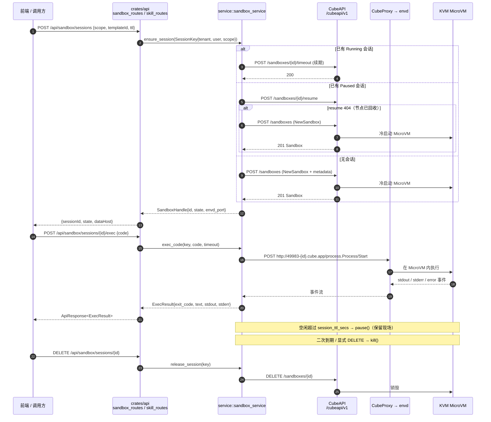
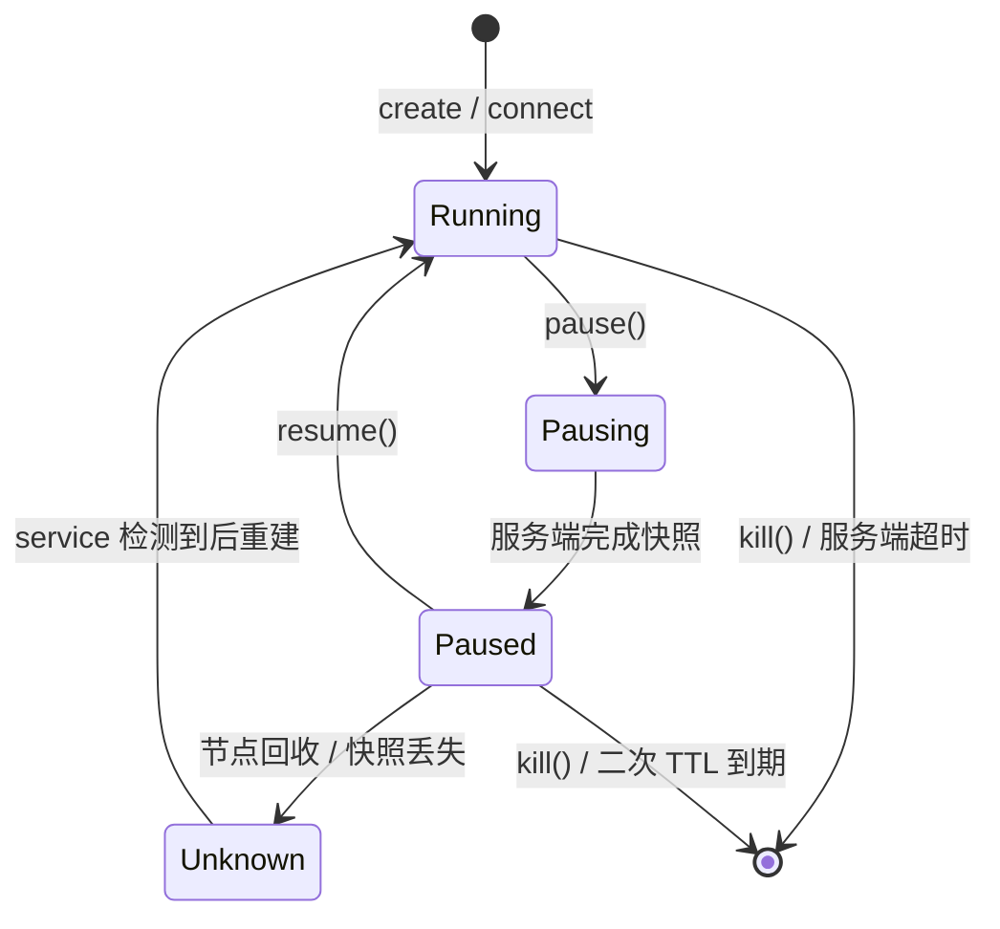

# CubeSandbox 沙箱 crate 整合设计方案（crates/sandbox + crates/sandbox-cube）

> 契约 crate 只放 trait 与数据类型（零 HTTP），CubeAPI / CubeProxy 的实现独立成 crate，对齐 `crates/llm` + `llm-openai` 与 `crates/vector` + `vector-*` 的分层模式

---

## 目录

1. [设计目标](#1-设计目标)
2. [现状与问题](#2-现状与问题)
3. [分层架构](#3-分层架构)
4. [crates/sandbox 契约层](#4-cratessandbox-契约层)
5. [crates/sandbox-cube 实现层](#5-cratessandbox-cube-实现层)
6. [service 层接入](#6-service-层接入)
7. [执行链路时序与状态机](#7-执行链路时序与状态机)
8. [错误模型与降级策略](#8-错误模型与降级策略)
9. [依赖与构建变更](#9-依赖与构建变更)
10. [测试方案](#10-测试方案)
11. [实施计划](#11-实施计划)
12. [部署与配置](#12-部署与配置)
13. [风险与权衡](#13-风险与权衡)
14. [变更文件清单](#14-变更文件清单)
15. [变更记录](#15-变更记录)

---

## 1. 设计目标

| 目标 | 说明 | 优先级 |
|------|------|--------|
| 🧩 **契约与实现分离** | `crates/sandbox` 只定义 trait / 数据类型 / 错误，**不依赖 reqwest**；`crates/sandbox-cube` 独持 HTTP 驱动 | P0 |
| 🔌 **硬件级隔离执行** | 用户代码 / 命令在 KVM MicroVM 内运行，不污染 Tauri 进程与宿主 OS | P0 |
| ♻️ **会话级复用** | 一个对话（或一次工作流运行）复用一个沙箱，空闲 `pause` / 复用 `resume`，摊薄冷启动 | P0 |
| 🛑 **缺省安全降级** | `SANDBOX_ENABLED=false`（缺省）时所有能力返回 `Unsupported`，**现有桌面功能零退化**，启动不失败 | P0 |
| 🚦 **可分类错误** | `401/404/409/429/5xx/超时` 可区分，提供 `kind()` / `hint()` / `is_retryable()`，供重试策略与前端提示 | P1 |
| 🧾 **可替换实现** | 未来接 E2B 官方 / 本地 Docker / Daytona，只需新增一个实现 crate，`service` 与 `api` 不动 | P1 |
| 🪪 **多租户隔离** | `metadata` 打 `tenant_id` / `user_id` / `session_id`，`list` 必须按 metadata 过滤，并与 `authz` 权限点双重约束 | P1 |
| 📉 **可观测** | 创建 / 执行 / 回收全链路 `tracing` span，失败必带 `hint()` | P2 |

**非目标**（本轮不做）：

- 模板构建流水线（`/templates` 的 `create_template` / `rebuild_template` / `TemplateBuildJob` / 兼容矩阵）；
- `Fork` 沙箱（`ForkRequest` / `ForkResult`）与跨节点迁移；
- GPU 沙箱；
- 进程内 Python 运行时（PyO3）——见 §3.5 的取舍说明；
- 前端页面（第一波只提供 HTTP / Tauri 能力，UI 后置）。

---

## 2. 现状与问题

### 2.1 仓库内现状

| 位置 | 现状 | 问题 |
|------|------|------|
| `crates/engine/src/skill_sandbox.rs` | 只有 `allowed_imports` / `blocked_imports` 白名单，加 `validate_output_size()` 与超时字段 | **没有任何执行能力**，是「静态校验器」而不是沙箱 |
| `crates/engine/src/python_runtime.rs` | 桩模块，`// TODO: 实际 PyO3 初始化`，状态恒为 `Ready` | PyO3 会把 Python 运行时拖进桌面进程，GIL 与 Tokio 协调成本高，且隔离性来自「白名单字符串」，可绕过 |
| `crates/api/src/skill_routes.rs:102` | `// TODO: 实际调用 Python 运行时`，返回模拟 markdown | 前端拿到的是假执行结果 |
| `crates/service/src/doc_parser.rs` | 仓库内唯一的「外部服务客户端」范式：`DOC_PARSER_URL` / `DOC_PARSER_TOKEN` + `reqwest::Client` + `Backend` 枚举 + 非法值回落 | 说明仓库既定风格是「外部服务 = HTTP 客户端 + 环境变量」，而不是进程内嵌 |
| `crates/bootstrap/src/config.rs` | `.env.toml` 的 `[section] key` → 环境变量 `SECTION_KEY`（`[sandbox] base_url` → `SANDBOX_BASE_URL`） | 新配置段**零改动**即可生效 |
| `crates/api/src/authz.rs` | `ROUTE_PERMS` 代码侧兜底表 + `AUTHZ_MODE`（缺省 `warn`，`enforce` 时未映射即 403，fail-closed） | 新路由必须同步登记，否则线上 403 |
| 桌面形态 | Windows / macOS 无 `/dev/kvm` | **CubeSandbox 只能远端部署**，桌面端必须可降级 |
| `apps/backend/src-tauri/Cargo.toml` | `members = ["crates/*"]`；`[workspace.dependencies]` 是唯一版本来源；**该表不允许 `optional`** | 新 crate 必须走「契约 + 实现」两段式，开关靠环境变量而非 optional |

### 2.2 结论

> 代码执行能力必须从「进程内白名单」升级为「远程隔离执行」，并且必须按仓库既有的 **契约 crate（零驱动）+ 实现 crate（独持驱动）** 模式落地，否则 reqwest / 沙箱协议细节会顺着依赖树渗进 `api` 与 `engine`。

---

## 3. 分层架构

### 3.1 CubeSandbox 是什么 / 不是什么

| 维度 | 事实 |
|------|------|
| 是什么 | 腾讯开源的 AI Agent 沙箱服务（Apache-2.0），基于 Cloud Hypervisor / KVM MicroVM，提供**硬件级隔离** + 快照暂停恢复 + 高并发密度 |
| 是什么 | 一套**独立部署的服务集群**：控制面 CubeAPI + 数据面 CubeProxy/envd + 计算面 Cubelet/CubeMaster/CubeVS/CubeEgress |
| 是什么 | HTTP 协议：控制面 `/cubeapi/v1`，数据面与 **E2B 协议兼容** |
| **不是什么** | **不是一个可以写进 `Cargo.toml` 的 Rust 库**（CubeAPI 本体是 Rust/axum 的 **bin**，无 lib target，不能 `path` 依赖复用类型） |
| **不是什么** | 不是 Windows / macOS 可本地运行的东西（依赖 `/dev/kvm`） |

### 3.2 组件与端口

| 组件 | 角色 | 对外暴露 | 备注 |
|------|------|----------|------|
| **CubeAPI** | 控制面（Rust/axum，`servers: /cubeapi/v1`） | `:3000` | 认证：`X-API-Key` 或 `Authorization: Bearer <JWT>`；支持 `--export-openapi` 导出规范 |
| **CubeProxy** | 反向代理，按 `Host` 前缀把请求路由到具体沙箱，**E2B 协议兼容** | `49983-<sandboxId>.cube.app`（另有 `49999-` 数据口） | 数据面入口 |
| **Cubelet** | 单节点沙箱生命周期管理 | 内网 | — |
| **CubeMaster / cube-lifecycle-manager** | 集群调度与状态 | 内网 | — |
| **CubeVS** | eBPF 虚拟交换机，内核级网络隔离与策略执行 | 内网 | 出网管控的基础 |
| **CubeEgress** | L7 出网网关（域名过滤 / 凭证注入 / 审计） | 内网 | 与 CubeVS 配合，沙箱流量不可绕行 |
| **CubeHypervisor + CubeShim** | KVM MicroVM + containerd Shim v2 | 内网 | 需 Linux + `/dev/kvm` |
| **CubeObservability** | 指标 / 日志（Prometheus / Loki / Grafana） | 内网 | `/sandboxes/{id}/logs` 的底层 |

### 3.3 分层图

```mermaid
graph TB
    subgraph 业务层
        SKILL[Skill 执行<br/>/api/skills/execute]
        WF[工作流 sandbox 节点]
        CHAT[智能问答代码解释]
        TAURI[桌面 Tauri 命令]
    end

    subgraph service 层（保留）
        SVC[sandbox_service<br/>配置 / 会话粘连 / TTL 回收 / 降级]
        SESS[(session_key → sandbox_id<br/>DashMap + last_used_at)]
        CFG[SandboxConfig::from_env<br/>SANDBOX_*]
    end

    subgraph crates/sandbox（契约，零 HTTP）
        MODEL[model.rs<br/>SandboxSpec / ExecRequest / ExecResult]
        TRAIT[runtime.rs<br/>SandboxRuntime trait]
        ERR[error.rs<br/>SandboxError + kind/hint]
    end

    subgraph crates/sandbox-cube（实现，独持 reqwest）
        CTRL[control.rs<br/>/cubeapi/v1 控制面]
        DATA[dataplane.rs<br/>CubeProxy + envd]
        WIRE[wire.rs / convert.rs<br/>DTO ↔ 契约类型]
        CERR[error.rs<br/>状态码 → SandboxError]
    end

    subgraph CubeSandbox 集群（外部，Linux + KVM）
        API[CubeAPI<br/>:3000]
        PROXY[CubeProxy<br/>49983-&lt;id&gt;.cube.app]
        VM[Cubelet + KVM MicroVM]
        EGRESS[CubeVS / CubeEgress<br/>出网策略]
    end

    SKILL --> SVC
    WF --> SVC
    CHAT --> SVC
    TAURI --> SVC
    SVC --> CFG
    SVC --> SESS
    SVC -.->|BoxedSandboxRuntime| TRAIT
    CTRL -.->|impl| TRAIT
    DATA -.->|impl| TRAIT
    CTRL --> WIRE --> CERR
    DATA --> WIRE
    CTRL --> API
    DATA --> PROXY
    API --> VM
    PROXY --> VM
    VM --> EGRESS

    style TRAIT fill:#e1f5fe,stroke:#01579b
    style CTRL fill:#e8f5e9,stroke:#1b5e20
    style DATA fill:#e8f5e9,stroke:#1b5e20
    style SVC fill:#fff3e0,stroke:#e65100
    style PROXY fill:#f3e5f5,stroke:#4a148c
```

### 3.4 分层纪律（硬约束）

与 `crates/vector` / `crates/llm` 完全一致：

1. `crates/sandbox`：**只放 trait、数据类型、错误**，不依赖 `reqwest` / `tokio` / `sqlx`；
2. `crates/sandbox-cube`：独持 `reqwest`，把 CubeAPI / envd 的差异**全部在内部消化**，向上只暴露契约类型；
3. `crates/service`：只做配置读取、会话亲和、TTL 回收、降级与 DTO 桥接，**不做 HTTP**；
4. 依赖方向：`api → service → sandbox`（契约）；`service → sandbox-cube`（实现）；`engine → sandbox`（只依赖契约，**不**依赖实现）；
5. 禁止 `sandbox` 反向依赖 `database` / `service`；禁止 `sandbox-cube` 回灌驱动到其它 crate。

### 3.5 被否方案

| 方案 | 做法 | 否决原因 |
|------|------|----------|
| A. 单 crate `sandbox`（契约 + reqwest 混在一起） | 一个 crate 搞定 | 违反「契约 crate 零驱动」纪律；`engine` / `api` 引用它会被动拉入 reqwest、TLS 与整套 wire DTO |
| C. 复用官方 Python SDK，走 `apps/doc-parser` 侧车代理 | 在 doc-parser 加 `/sandbox/*` 转发 | 多一跳进程与一次序列化；桌面端要装 Python；Windows 桌面仍连不上 KVM，只是把「不可用」藏得更深；错误分类散落在 Python 侧 |
| D. `path` 依赖 CubeSandbox 仓库的 `CubeAPI` crate | 复用其类型 | CubeAPI 是 **bin**（`src/routes.rs` / `handlers/` / `openapi.rs`，无 lib target），且会把 KVM 相关构建链拖进本仓 |

---

## 4. crates/sandbox 契约层

### 4.1 依赖

```toml
[package]
edition = "2024"
name = "sandbox"
version = "0.1.0"

[lints]
workspace = true

# 契约 crate：只放类型、错误与 trait，刻意「零 HTTP / 零 IO 驱动」。
# CubeSandbox 的具体实现（reqwest + CubeAPI/CubeProxy）在 crates/sandbox-cube，
# 未来接 E2B / 本地 Docker 只需再新增一个实现 crate，本 crate 不动。
# 所有依赖版本均在根 Cargo.toml 的 [workspace.dependencies] 中定义
[dependencies]
async-trait.workspace = true
serde.workspace = true
# ToSchema：api 直接把契约类型作为 OpenAPI 响应体（与 database::models 的做法一致）
utoipa.workspace = true
thiserror.workspace = true

[dev-dependencies]
tokio.workspace = true
```

> 刻意**不**引入 `chrono`：时间统一以 RFC3339 字符串在契约层透传，格式归一化由实现层负责（Cube 原生与 E2B v2 的时间格式不一致）。
>
> `utoipa` 是**文档 schema 推导**依赖（不是 HTTP 运行时），`crates/database` 的模型同样 derive `ToSchema`；不引入它就只能把每个响应体降级成 `serde_json::Value`，Swagger 会失去字段说明。

### 4.2 数据类型（`model.rs`）

```rust
use std::collections::BTreeMap;

/// 沙箱创建规格
#[derive(Debug, Clone, Default)]
pub struct SandboxSpec {
    /// 模板 ID 或模板别名（空 → 使用 `CubeOptions::default_template_id`）
    pub template_id: String,
    /// 存活时长（秒），到期由服务端自动暂停 / 销毁
    pub timeout_secs: u32,
    /// 业务标签：tenant_id / user_id / session_id / conversation_id 等
    /// 约定：本平台固定写入 `tenant_id`、`user_id`、`session_id` 三个键，用于 list 过滤与审计
    pub metadata: BTreeMap<String, String>,
    /// 注入沙箱的环境变量（**禁止**放平台密钥，见 §8.4）
    pub env: BTreeMap<String, String>,
    /// 出网策略
    pub network: NetworkPolicy,
    /// 持久卷挂载
    pub volume_mounts: Vec<VolumeMount>,
}

/// 出网策略（缺省全禁：沙箱内不联网）
#[derive(Debug, Clone, PartialEq, Eq, Default)]
pub enum NetworkPolicy {
    /// 禁止一切出网（缺省）
    #[default]
    DenyAll,
    /// 仅允许访问列出的域名（由 CubeEgress 执行 L7 过滤）
    AllowDomains(Vec<String>),
}

/// 持久卷挂载
#[derive(Debug, Clone, PartialEq, Eq)]
pub struct VolumeMount {
    /// 沙箱内挂载点
    pub path: String,
    /// CubeAPI 返回的卷 ID
    pub volume_id: String,
    pub read_only: bool,
}

/// 沙箱句柄：后续所有操作只需要它
#[derive(Debug, Clone, PartialEq, Eq)]
pub struct SandboxHandle {
    /// 服务端沙箱 ID
    pub id: String,
    pub state: SandboxState,
    pub template_id: Option<String>,
    /// RFC3339 UTC，由实现层归一化
    pub created_at: Option<String>,
    /// 数据面 Host 后缀（如 `cube.app`）
    pub data_host_suffix: String,
    /// envd 端口（缺省 49983）
    pub envd_port: u16,
}

impl SandboxHandle {
    /// 拼出数据面虚拟主机：`{port}-{id}.{suffix}`
    pub fn data_host(&self, port: u16) -> String {
        format!("{}-{}.{}", port, self.id, self.data_host_suffix)
    }
}

/// 沙箱状态（只保留业务需要区分的四种）
#[derive(Debug, Clone, Copy, PartialEq, Eq)]
pub enum SandboxState {
    Running,
    /// 暂停中（Cube 原生 `pausing` 与 E2B `paused` 都落到这里）
    Paused,
    /// 请求暂停、尚未完成
    Pausing,
    /// `stopped` / `error` / 未知取值
    Unknown,
}

/// 执行请求：`code` 与 `command` 二选一（同时给出以 `code` 为准）
#[derive(Debug, Clone, Default)]
pub struct ExecRequest {
    /// 代码片段（Python：按行执行并保留上下文；其它语言按模板内置解释器）
    pub code: Option<String>,
    /// shell 命令（等价于 SDK 的 `commands.run`）
    pub command: Option<String>,
    /// 命令参数（与 `command` 配合，避免自行拼 shell 字符串）
    pub argv: Vec<String>,
    pub cwd: Option<String>,
    pub env: BTreeMap<String, String>,
    /// 执行身份，缺省 `root`
    pub user: Option<String>,
    /// 单次执行超时（秒），缺省取 `CubeOptions::timeout`
    pub timeout_secs: Option<u32>,
}

/// 执行结果
#[derive(Debug, Clone, PartialEq, Eq)]
pub struct ExecResult {
    pub exit_code: i32,
    /// 最终表达式 / 主输出（对应 SDK 的 `result.text`）
    pub text: Option<String>,
    /// 逐行 stdout
    pub stdout: Vec<String>,
    /// 逐行 stderr
    pub stderr: Vec<String>,
    /// 执行异常（Python traceback 等）
    pub error: Option<ExecFailure>,
    pub duration_ms: u64,
}

impl ExecResult {
    /// 是否成功（退出码 0 且无执行异常）
    pub fn is_ok(&self) -> bool {
        self.exit_code == 0 && self.error.is_none()
    }
}

/// 执行异常详情
#[derive(Debug, Clone, PartialEq, Eq)]
pub struct ExecFailure {
    /// 异常类型，如 `ZeroDivisionError`
    pub name: String,
    pub value: String,
    pub traceback: Vec<String>,
}
```

```rust
/// 沙箱内文件条目
#[derive(Debug, Clone, PartialEq, Eq)]
pub struct FileEntry {
    pub path: String,
    pub name: String,
    pub is_dir: bool,
    pub size: u64,
}

/// 列表项
#[derive(Debug, Clone, PartialEq, Eq)]
pub struct SandboxSummary {
    pub id: String,
    pub state: SandboxState,
    pub template_id: Option<String>,
    pub metadata: BTreeMap<String, String>,
    pub started_at: Option<String>,
}

/// 列表过滤条件（`metadata` 全量匹配；`limit` 缺省 100）
#[derive(Debug, Clone, Default)]
pub struct SandboxFilter {
    pub metadata: BTreeMap<String, String>,
    pub states: Vec<SandboxState>,
    pub limit: Option<u32>,
}

/// 健康检查结果
#[derive(Debug, Clone, PartialEq, Eq)]
pub struct HealthInfo {
    pub ok: bool,
    pub version: Option<String>,
    pub message: Option<String>,
}

/// 快照信息
#[derive(Debug, Clone, PartialEq, Eq)]
pub struct SnapshotInfo {
    pub name: String,
    pub sandbox_id: String,
    pub created_at: Option<String>,
}
```

### 4.3 运行时契约（`runtime.rs`）

```rust
use async_trait::async_trait;

use crate::error::SandboxResult;
use crate::model::{
    ExecRequest, ExecResult, FileEntry, HealthInfo, SandboxFilter, SandboxHandle, SandboxSpec,
    SandboxSummary, SnapshotInfo,
};

/// 沙箱运行时契约：所有实现（CubeSandbox / E2B / 本地 Docker）都收敛到它
///
/// 约定：
/// 1. 所有方法都必须是**可取消**的（上层用 `tokio::time::timeout` 包裹，不要求实现层兜住）；
/// 2. `read_file` / `write_file` 一次调用的载荷上限见 `MAX_TRANSFER_BYTES`，
///    超限返回 [`SandboxError::InvalidRequest`]，大文件走对象存储中转；
/// 3. 可选能力（快照 / 卷 / 日志）默认返回 `Unsupported`，实现层按需覆盖，避免契约膨胀。
#[async_trait]
pub trait SandboxRuntime: Send + Sync {
    /// 控制面健康检查
    async fn health(&self) -> SandboxResult<HealthInfo>;

    /// 创建沙箱
    async fn create(&self, spec: SandboxSpec) -> SandboxResult<SandboxHandle>;

    /// 连接既有沙箱（断线重连 / 跨端接管）
    async fn connect(&self, id: &str) -> SandboxResult<SandboxHandle>;

    /// 暂停（保留内存快照，可 `resume` 恢复现场）
    async fn pause(&self, id: &str) -> SandboxResult<()>;

    /// 恢复
    async fn resume(&self, id: &str) -> SandboxResult<SandboxHandle>;

    /// 销毁（不可恢复）
    async fn kill(&self, id: &str) -> SandboxResult<()>;

    /// 按 metadata / 状态列出沙箱
    async fn list(&self, filter: SandboxFilter) -> SandboxResult<Vec<SandboxSummary>>;

    /// 续期（避免长会话被服务端回收）
    async fn set_timeout(&self, id: &str, timeout_secs: u32) -> SandboxResult<()>;

    /// 执行代码 / 命令
    async fn exec(&self, id: &str, request: ExecRequest) -> SandboxResult<ExecResult>;

    /// 读文件
    async fn read_file(&self, id: &str, path: &str, user: &str) -> SandboxResult<Vec<u8>>;

    /// 写文件
    async fn write_file(&self, id: &str, path: &str, user: &str, data: Vec<u8>)
    -> SandboxResult<()>;

    /// 列目录
    async fn list_files(&self, id: &str, dir: &str, user: &str) -> SandboxResult<Vec<FileEntry>>;

    // ── 可选能力：默认 Unsupported ─────────────────────────────────────

    /// 创建快照
    async fn create_snapshot(&self, _id: &str, _name: &str) -> SandboxResult<SnapshotInfo> {
        Err(crate::error::SandboxError::unsupported("create_snapshot"))
    }

    /// 回滚到快照
    async fn rollback(&self, _id: &str, _name: &str) -> SandboxResult<()> {
        Err(crate::error::SandboxError::unsupported("rollback"))
    }

    /// 拉取沙箱日志（stdout / stderr）
    async fn logs(&self, _id: &str) -> SandboxResult<Vec<String>> {
        Err(crate::error::SandboxError::unsupported("logs"))
    }
}

/// 装箱后的沙箱运行时（便于在 `service` 中按配置选择实现）
pub type BoxedSandboxRuntime = Box<dyn SandboxRuntime>;
```

### 4.4 错误类型（`error.rs`）

```rust
use std::time::Duration;

/// 沙箱调用结果
pub type SandboxResult<T> = Result<T, SandboxError>;

/// 沙箱错误（分类方式对齐 `llm::LlmError` / `vector::VectorError`）
#[derive(Debug, Clone, PartialEq, Eq, thiserror::Error)]
pub enum SandboxError {
    /// 配置缺失或非法（base_url / api_key / template_id）
    #[error("配置错误：{0}")]
    Config(String),
    /// 鉴权失败（401 / 403）
    #[error("鉴权失败：{0}")]
    Auth(String),
    /// 沙箱 / 模板 / 卷不存在（404）
    #[error("资源不存在：{0}")]
    NotFound(String),
    /// 状态冲突（409：resume 一个已在运行的沙箱、kill 一个已销毁的沙箱）
    #[error("状态冲突：{0}")]
    Conflict(String),
    /// 触发限流（429）
    #[error("触发限流：{message}")]
    RateLimited {
        message: String,
        retry_after: Option<Duration>,
    },
    /// 请求非法（400 / 422），重试无意义
    #[error("请求非法（HTTP {status}）：{message}")]
    InvalidRequest { status: u16, message: String },
    /// 服务端错误（5xx）
    #[error("服务端错误（HTTP {status}）：{message}")]
    Server { status: u16, message: String },
    /// 传输层错误（DNS / TLS / 连接重置）
    #[error("网络错误：{0}")]
    Transport(String),
    /// 响应体解析失败
    #[error("响应解析失败：{0}")]
    Decode(String),
    /// 执行超时
    #[error("执行超时（{0}s）")]
    Timeout(u64),
    /// 当前实现不支持该能力（含 `SANDBOX_ENABLED=false`）
    #[error("能力不支持：{0}")]
    Unsupported(String),
    /// 调用被取消
    #[error("调用已取消")]
    Cancelled,
}
```

构造器与判据（同文件 `impl`）：

```rust
impl SandboxError {
    pub fn config(m: impl Into<String>) -> Self { Self::Config(m.into()) }
    pub fn auth(m: impl Into<String>) -> Self { Self::Auth(m.into()) }
    pub fn not_found(m: impl Into<String>) -> Self { Self::NotFound(m.into()) }
    pub fn conflict(m: impl Into<String>) -> Self { Self::Conflict(m.into()) }
    pub fn invalid_request(status: u16, m: impl Into<String>) -> Self { /* ... */ }
    pub fn server(status: u16, m: impl Into<String>) -> Self { /* ... */ }
    pub fn transport(m: impl Into<String>) -> Self { Self::Transport(m.into()) }
    pub fn decode(m: impl Into<String>) -> Self { Self::Decode(m.into()) }
    pub fn unsupported(m: impl Into<String>) -> Self { Self::Unsupported(m.into()) }

    /// 是否值得原样重试（传输抖动 / 限流 / 5xx / 超时）
    pub fn is_retryable(&self) -> bool { /* Transport | RateLimited | Server | Timeout */ }

    /// 服务端建议的重试间隔
    pub fn retry_after(&self) -> Option<Duration> { /* RateLimited.retry_after */ }

    /// 供前端分类展示的稳定标识
    pub fn kind(&self) -> &'static str { /* 见下表 */ }

    /// 面向用户的排查建议（一次一句，直接展示）
    pub fn hint(&self) -> &'static str { /* 见下表 */ }
}
```

| 变体 | `kind()` | `is_retryable()` | `hint()` |
|------|----------|------------------|----------|
| `Config` | `config` | ❌ | 检查 `[sandbox]` 段的 `base_url` / `api_key` / `template_id` |
| `Auth` | `auth` | ❌ | CubeAPI 密钥无效或权限不足，请更新 `SANDBOX_API_KEY` |
| `NotFound` | `not_found` | ❌ | 沙箱或模板已不存在，重新创建会话或更换 `SANDBOX_TEMPLATE_ID` |
| `Conflict` | `conflict` | ❌ | 沙箱状态已变化，请刷新会话状态后重试 |
| `RateLimited` | `rate_limited` | ✅ | 触发 CubeAPI 限流，稍后重试或提升配额 |
| `InvalidRequest` | `invalid_request` | ❌ | 请求参数不被接受，检查代码长度 / 文件大小 / 模板能力 |
| `Server` | `server` | ✅ | CubeSandbox 服务端异常，稍后重试或切换节点 |
| `Transport` | `transport` | ✅ | 检查到 CubeAPI / CubeProxy 的网络连通性与 `SANDBOX_BASE_URL` |
| `Decode` | `decode` | ❌ | 响应格式与预期不符，可能 CubeSandbox 版本升级导致协议变化 |
| `Timeout` | `timeout` | ✅ | 执行超时，缩短任务或调大 `SANDBOX_TIMEOUT_SECS` |
| `Unsupported` | `unsupported` | ❌ | 该能力未启用（`SANDBOX_ENABLED=false`）或当前实现不支持 |
| `Cancelled` | `cancelled` | ❌ | 调用被取消，无需处理 |

### 4.5 常量与上限

| 常量 | 默认值 | 说明 |
|------|--------|------|
| `DEFAULT_TIMEOUT_SECS` | `60` | `ExecRequest::timeout_secs` 与 `CubeOptions::timeout` 的共同缺省值 |
| `MAX_TIMEOUT_SECS` | `3600` | 单次执行 / 沙箱存活上限，超过返回 `InvalidRequest` |
| `MAX_CODE_BYTES` | `256 KiB` | 单次 `code` 载荷上限 |
| `MAX_TRANSFER_BYTES` | `32 MiB` | 单次 `read_file` / `write_file` 载荷上限（大文件走对象存储中转） |
| `MAX_LIST_LIMIT` | `500` | `SandboxFilter::limit` 上限，超出截断并告警 |
| `DEFAULT_ENVD_PORT` | `49983` | 数据面 envd 端口缺省值 |

### 4.6 契约层单测清单

| 用例 | 断言 |
|------|------|
| `data_host` 拼接 | `SandboxHandle{id:"sb-1", suffix:"cube.app"}.data_host(49983) == "49983-sb-1.cube.app"` |
| `ExecResult::is_ok` | `exit_code=0` 且 `error=None` 才算成功；带 traceback 时失败 |
| `NetworkPolicy::default` | 必须是 `DenyAll`（安全缺省，防止后续改动放松） |
| 错误全覆盖 | 遍历全部变体，断言 `kind()` / `hint()` / `to_string()` 非空；`is_retryable()` 集合与 §4.4 表一致 |
| 可选能力缺省 | 用空实现结构体调用 `create_snapshot` / `rollback` / `logs`，断言得到 `Unsupported` |

> 对齐 `crates/llm/src/error.rs::every_variant_carries_kind_and_hint`：新增变体必须同步补这条用例，否则测试期就会暴露漏改。

---

## 5. crates/sandbox-cube 实现层

### 5.1 依赖

```toml
[package]
edition = "2024"
name = "sandbox-cube"
version = "0.1.0"

[lints]
workspace = true

# CubeSandbox 实现：控制面 CubeAPI（/cubeapi/v1）+ 数据面 CubeProxy/envd。
# 驱动（reqwest）只属于本 crate：crates/sandbox 与 crates/engine 都不感知它。
# 所有依赖版本均在根 Cargo.toml 的 [workspace.dependencies] 中定义
[dependencies]
sandbox.workspace = true
async-trait.workspace = true
reqwest.workspace = true
serde.workspace = true
serde_json.workspace = true
tracing.workspace = true
```

### 5.2 客户端与配置（`client.rs`）

```rust
use std::fmt;
use std::time::Duration;

use sandbox::{SandboxError, SandboxResult};

use crate::control::CubeSandboxRuntime;

/// CubeSandbox 连接参数
#[derive(Clone)]
pub struct CubeOptions {
    /// CubeAPI 根地址，如 `http://10.0.0.12:3000`
    pub base_url: String,
    /// `X-API-Key`（为空则退回 `Authorization: Bearer`，兼容 JWT 部署）
    pub api_key: String,
    /// 缺省模板（ID 或别名）
    pub default_template_id: String,
    /// 数据面 Host 后缀，如 `cube.app`
    pub data_host_suffix: String,
    /// 数据面 envd 端口
    pub envd_port: u16,
    /// 无 DNS 环境：直连该 IP 并保留虚拟 Host 头（对应官方 `CUBE_PROXY_NODE_IP`）
    pub proxy_node_ip: Option<String>,
    /// 控制面请求超时
    pub timeout: Duration,
}

/// 手写 `Debug`：`api_key` 必须脱敏（对齐 `llm::LlmClientConfig`）
impl fmt::Debug for CubeOptions {
    fn fmt(&self, f: &mut fmt::Formatter<'_>) -> fmt::Result {
        f.debug_struct("CubeOptions")
            .field("base_url", &self.base_url)
            .field("api_key", &mask(&self.api_key))
            .field("default_template_id", &self.default_template_id)
            .field("data_host_suffix", &self.data_host_suffix)
            .field("envd_port", &self.envd_port)
            .field("proxy_node_ip", &self.proxy_node_ip)
            .field("timeout", &self.timeout)
            .finish()
    }
}

/// 密钥脱敏：保留前 3 后 2，长度不足 8 时整体打码
fn mask(key: &str) -> String { /* ... */ }

impl CubeOptions {
    /// 从环境变量构造（`SANDBOX_*`，由 `.env.toml` 的 `[sandbox]` 段映射而来）
    ///
    /// 校验规则：
    /// - `SANDBOX_BASE_URL` 为空 → `SandboxError::Config`
    /// - `SANDBOX_API_KEY` 为空**不报错**（CubeAPI 允许关闭鉴权，仅告警）
    /// - `template_id` 为空**不报错**（调用 `create` 时才要求）
    pub fn from_env() -> SandboxResult<Self> { /* ... */ }

    /// `{base_url}/cubeapi/v1`（去掉尾部 `/`，容忍用户误配 `/cubeapi/v1` 后缀）
    pub fn control_base(&self) -> String { /* ... */ }
}

impl CubeSandboxRuntime {
    /// 构造实现：校验 base_url、创建 `reqwest::Client`
    ///
    /// `reqwest::Client::builder().timeout(...).user_agent("assets-platform/sandbox-cube")`
    /// 实现 `SandboxRuntime`（见 `control.rs` / `dataplane.rs`）
    pub fn new(options: CubeOptions) -> SandboxResult<Self> { /* ... */ }
}
```

### 5.3 控制面端点映射（`control.rs`）

`base = {cubeapi}/cubeapi/v1`，所有请求都过 `with_auth()` 注入鉴权与 `X-Request-Id`。

| 契约方法 | 方法 + 路径 | wire 请求 / 响应 | 备注 |
|----------|-------------|------------------|------|
| `health` | `GET /health` | `HealthResponse` | 失败不 panic，映射 `ok=false` |
| `create` | `POST /sandboxes` | `NewSandbox` → `201 Sandbox` | `template` 取 `spec.template_id`，空则用 `default_template_id`；`metadata` 打 tenant/user/session |
| `connect` | `POST /sandboxes/{id}/connect` | `ConnectSandbox` → `Sandbox` | 409 → `Conflict`（已在运行也视为可用，见下） |
| `pause` | `POST /sandboxes/{id}/pause` | 无体 → `{state}` | 已 `paused` 视为幂等成功 |
| `resume` | `POST /sandboxes/{id}/resume` | `ResumedSandbox` → `Sandbox` | 404 → `NotFound`（调用方据此重建） |
| `kill` | `DELETE /sandboxes/{id}` | → `204/200` | 404 视为幂等成功 |
| `list` | `GET /sandboxes?metadata=…&state=…&limit=…` | → `[ListedSandbox]` | metadata 以 `k=v&k2=v2` 拼装并 percent-encode |
| `set_timeout` | `POST /sandboxes/{id}/timeout` | `SetTimeoutRequest` | 值做 `1..=MAX_TIMEOUT_SECS` 校验 |
| `logs` | `GET /sandboxes/{id}/logs` | `SandboxLogs(V2Response)` | 归一化为 `Vec<String>` |
| `create_snapshot` | `POST /sandboxes/{id}/snapshots` | `CreateSnapshotRequest` → `SnapshotInfo` | 可选能力 |
| `rollback` | `POST /sandboxes/{id}/rollback`（或 `/snapshots/{name}/rollback`） | `RollbackRequest` → `RollbackResponse` | 可选能力 |
| （不做） | `/templates*`、`/v2/sandboxes`、`Fork`、`/volumes*` 写操作 | `CreateTemplateRequest` / `NewSandboxV2` / `ForkRequest` / `NewVolume(V2)` | 列为非目标，仅保留 schema 备注 |

> ⚠️ **路径必须以部署实例的 OpenAPI 为准。** 上表的 method / path 段来自 CubeSandbox 仓库的 `CubeAPI/src/handlers/*.rs` 与 `src/openapi.rs` 的 schema 清单（`NewSandbox` / `ConnectSandbox(V2)` / `ResumedSandbox` / `SetTimeoutRequest` / `SandboxLogsV2Response` / `CreateSnapshotRequest` / `RollbackRequest` / `NewVolume` …），但 CubeAPI 迭代较快（`/v2/*` 兼容层仍在收口），落地时用 `cube-api --export-openapi` 或 `GET /cubeapi/openapi.json` 对齐一次，并把差异限定在 `control.rs` 的常量表里：

```rust
/// 控制面路径常量（唯一改 URL 的地方）
const PATH_HEALTH: &str = "/health";
const PATH_SANDBOXES: &str = "/sandboxes";
const PATH_SANDBOX_CONNECT: &str = "/sandboxes/{id}/connect";
const PATH_SANDBOX_PAUSE: &str = "/sandboxes/{id}/pause";
const PATH_SANDBOX_RESUME: &str = "/sandboxes/{id}/resume";
const PATH_SANDBOX_TIMEOUT: &str = "/sandboxes/{id}/timeout";
const PATH_SANDBOX_LOGS: &str = "/sandboxes/{id}/logs";
const PATH_SANDBOX_SNAPSHOTS: &str = "/sandboxes/{id}/snapshots";
```

**幂等约定**（避免上层写一堆 if）：

| 场景 | 处理 |
|------|------|
| `pause` 一个已暂停的沙箱 | 返回 `Ok(())`（幂等） |
| `kill` 一个 404 的沙箱 | 返回 `Ok(())`（幂等） |
| `connect` 返回 409（已在运行） | 再 `GET /sandboxes/{id}` 取状态，`Running` 则返回句柄 |
| `resume` 返回 404 | 返回 `NotFound`，由 `service` 决定重建会话 |

### 5.4 数据面（`dataplane.rs`）

数据面不走 CubeAPI，而是 **CubeProxy 按 Host 前缀路由到沙箱内的 envd**（E2B 协议）。

| 能力 | 请求 | 关键细节 |
|------|------|----------|
| 读文件 | `GET http://<host>/files?path=<p>&username=<user>` | `host` = `{envd_port}-{sandbox_id}.{suffix}` |
| 写文件 | `POST http://<host>/files?path=<p>&username=<user>` | **先** `Content-Type: application/octet-stream`，遇 4xx 再退 `multipart/form-data`（官方 `sdk/files-api-streaming.md` 记录的兼容坑） |
| 列目录 | `GET http://<host>/files?path=<dir>&username=<user>`（目录时返回条目数组）或 envd 的目录 RPC | 归一化成 `Vec<FileEntry>` |
| 执行 | `POST http://<host>/process.Process/Start` | envd 的 gRPC-over-HTTP 风格端点，返回 `stdout` / `stderr` 事件流，需聚合成 `ExecResult` |

```rust
/// 数据面请求统一走这里，负责三件事：
/// 1. 拼虚拟 Host（`{port}-{id}.{suffix}`）；
/// 2. 无 DNS 部署：直连 `proxy_node_ip` 但保留虚拟 Host 头；
/// 3. 把网络层错误统一映射为 SandboxError::Transport / Timeout。
fn data_request(&self, handle: &SandboxHandle, port: u16) -> reqwest::RequestBuilder;
```

**两种连通模式**：

| 模式 | 条件 | 行为 |
|------|------|------|
| DNS 模式（缺省） | `SANDBOX_PROXY_NODE_IP` 为空 | 直接请求 `http://49983-<id>.cube.app`，依赖 DNS 解析 `*.cube.app` |
| IP 直连模式 | `SANDBOX_PROXY_NODE_IP` 非空 | 请求 `http://<ip>:<port>`，手动塞 `Host: 49983-<id>.cube.app`（等价官方 `IPOverrideTransport`） |

**执行结果聚合**（`exec`）：

0. 请求翻译（`dataplane::split_request`）：
   - `code` → `python3 -c "<code>"`（解释器可用 `SANDBOX_PYTHON` 覆盖）；
   - `command` 且无 `argv` → `/bin/sh -lc "<command>"`（保留管道 / 重定向语义）；
   - `command` + `argv` → 直接以 `command` 为可执行文件，不经过 shell；
1. 组装请求体：`{"cmd","args","cwd","envs","user"}`（envd `process.Process/Start`）；
2. 逐条消费事件流，把 `stdout` / `stderr` 追加到 `Vec<String>`，保留最后一条 `text`；
3. 遇到异常事件（`error` 非空）填充 `ExecFailure{name, value, traceback}`；
4. 汇总 `exit_code` 与 `duration_ms`，返回 `ExecResult`。

> **变量上下文**：当前实现每次 `exec` 起一个新进程 —— 同一次调用内的多行脚本共享上下文，**跨调用不保持变量**。若模板内置常驻 kernel（Cube 的 code-interpreter 端口），应在 `dataplane.rs` 改用该端点，这属于 Phase 0 的校准项之一。

> 事件流的字段名与 E2B envd 版本相关；把解析集中在 `wire.rs::ExecEvent`，用 `#[serde(default)]` + `serde_json::Value` 兜住未知字段，避免上游新增字段即解析失败。

### 5.5 wire DTO ↔ 契约类型（`wire.rs` + `convert.rs`）

| 方向 | 规则 |
|------|------|
| 请求 | `SandboxSpec` → `NewSandbox`：`template`（空则回退 `default_template_id`）、`timeout`、`metadata`；`NetworkPolicy::DenyAll` 不传网络字段（走服务端缺省拒绝），`AllowDomains` 转 `SandboxNetworkConfig{rules}` |
| 请求 | `ExecRequest` → 数据面 body：`code` / `command` 二选一，`timeout_secs` 超 `MAX_TIMEOUT_SECS` 直接 `InvalidRequest` |
| 响应 | `Sandbox` / `ListedSandbox` → `SandboxHandle` / `SandboxSummary`：`state` 字符串走 `parse_state()`（`running` → `Running`，`paused`/`pausing` → 对应变体，其余 → `Unknown`） |
| 响应 | 时间字段：`created_at` / `started_at` 统一归一化为 **RFC3339 UTC 字符串**（Cube 原生与 E2B v2 格式不一致，解析失败的填 `None` 并 `debug!` 日志，**不报错**） |
| 响应 | `HealthResponse` → `HealthInfo{ok, version, message}` |
| 未知字段 | 所有 wire 结构加 `#[serde(default)]`；`SandboxDetail` 这类扩展字段一律忽略，不进契约 |

### 5.6 错误映射（`error.rs`）

```rust
/// HTTP 状态码 + 响应体 → 分类错误（对齐 llm-openai::error::map_error）
pub fn map_error(status: u16, body: &str, retry_after: Option<Duration>) -> SandboxError {
    let message = extract_message(body); // 优先 ApiError.message，其次 message / error 字段，最后截断纯文本
    match status {
        401 | 403 => SandboxError::auth(message),
        404 => SandboxError::not_found(message),
        409 => SandboxError::conflict(message),
        429 => SandboxError::RateLimited { message, retry_after },
        400 | 422 => SandboxError::invalid_request(status, message),
        s if s >= 500 => SandboxError::server(status, message),
        _ => SandboxError::invalid_request(status, message),
    }
}
```

| 传输异常 | 映射 |
|----------|------|
| `reqwest::Error::is_timeout()` | `SandboxError::Timeout(timeout_secs)` |
| `is_connect()` / `is_request()` / 其它 | `SandboxError::Transport(e.to_string())` |
| 响应体 JSON 反序列化失败 | `SandboxError::Decode(e.to_string())` |

### 5.7 实现层测试

| 用例 | 断言 |
|------|------|
| `create` 发给假服务的请求 | `POST {base}/cubeapi/v1/sandboxes`，带 `X-API-Key`，body 命中 `NewSandbox` 字段 |
| `create` 响应 201 | 反序列化为 `SandboxHandle`，`state == Running`，`data_host(49983) == "49983-<id>.cube.app"` |
| `pause` / `kill` 404 幂等 | 返回 `Ok(())`，不报错 |
| `resume` 404 | 返回 `NotFound`（`is_retryable() == false`） |
| 401 / 429 / 500 / 400 | 分别映射 `Auth` / `RateLimited`（含 `retry_after`）/ `Server` / `InvalidRequest` |
| 写文件 octet-stream 被 415 拒绝 | 自动重试一次 `multipart/form-data`，最终成功 |
| 数据面 Host | 请求头 `Host` 为 `49983-<id>.cube.app`（IP 直连模式下尤为重要） |
| `parse_state` | `running`/`paused`/`pausing`/`stopped`/`error`/未知 共 6 条断言 |

> 测试用 `tokio::net::TcpListener` 手写假服务，可直接照抄 `crates/ops/src/connector/docker.rs::spawn_fake_docker`（`TcpListener::bind("127.0.0.1:0")` + 路由表 + `FakeResponse`）的写法；仓库无 `wiremock` / `httpmock`，**不引入新测试依赖**。

---

## 6. service 层接入

### 6.1 `sandbox_service` 职责

新增 `crates/service/src/sandbox_service.rs`（并在 `crates/service/src/lib.rs` 注册 `pub mod sandbox_service;`），只做四件事：

| 职责 | 说明 |
|------|------|
| 配置装载 | `SandboxConfig::from_env()` 读 `SANDBOX_*`；非法值回落缺省并 `warn!` |
| 运行时单例 | `OnceLock<Arc<dyn SandboxRuntime>>`，`SANDBOX_ENABLED=false` 时装 `DisabledRuntime` |
| 会话亲和 | `DashMap<SessionKey, SessionEntry>`：`session_key → sandbox_id + last_used_at` |
| TTL 回收 | 后台任务按 `SANDBOX_SESSION_TTL_SECS` 扫描，空闲会话 `pause()`（不 `kill`） |

**不做的事**：不解析 HTTP、不碰 `authz`（权限判定留在 `api`，见设计文档《OAuth2.1与API Key统一鉴权设计方案》§16 T-1 的归属边界）。

### 6.2 会话与并发（`sandbox_service.rs`）

```rust
/// 会话键：租户 + 用户 + 业务会话（对话 ID / 工作流运行 ID / Skill ID）
///
/// `tenant` 用 **schema 名**：HTTP 层只有 `UserContext::schema_name`，
/// 桌面层只有 `database::current_schema_name()`，都拿不到数值租户 ID。
#[derive(Debug, Clone, PartialEq, Eq, Hash)]
pub struct SessionKey {
    pub tenant: String,
    pub user_id: i64,
    pub scope: String, // 例：conv:123 / wf:456 / skill:excel-helper
}

/// 会话条目（存整份句柄，复用时无需再回查服务端）
struct SessionEntry {
    handle: SandboxHandle,
    last_used_at: Instant,
}

/// 全局运行时（`SANDBOX_ENABLED=false` 时为 DisabledRuntime）
static RUNTIME: OnceLock<Arc<dyn SandboxRuntime>> = OnceLock::new();
static SESSIONS: OnceLock<DashMap<SessionKey, SessionEntry>> = OnceLock::new();
/// 每键一把锁，避免并发请求重复建沙箱
static LOCKS: OnceLock<DashMap<SessionKey, Arc<Mutex<()>>>> = OnceLock::new();

/// 取得（或创建）会话对应的沙箱句柄
///
/// 逻辑：
/// 1. 命中且 `Running` → `set_timeout` 续期后直接返回；
/// 2. 命中但 `Paused` → `resume`，失败（404）则移除并重建；
/// 3. 未命中 → `create`，metadata 写 `tenant_id` / `user_id` / `session_id`。
pub async fn ensure_session(key: SessionKey) -> Result<SandboxHandle, String>;

/// 执行代码（会话级复用 + 统一错误信息 = `hint()`）
pub async fn exec_code(key: SessionKey, code: String, timeout_secs: Option<u32>)
    -> Result<ExecResult, String>;

/// 执行命令
pub async fn run_command(key: SessionKey, command: String, argv: Vec<String>)
    -> Result<ExecResult, String>;

/// 上传 / 下载 / 列目录
pub async fn upload_file(key: SessionKey, path: String, data: Vec<u8>) -> Result<(), String>;
pub async fn download_file(key: SessionKey, path: String) -> Result<Vec<u8>, String>;
pub async fn list_files(key: SessionKey, dir: String) -> Result<Vec<FileEntry>, String>;

/// 显式释放（`DELETE` 会话时调用）
pub async fn release_session(key: SessionKey) -> Result<(), String>;

/// 后台回收任务：在 `api::start_http_server_with` 里 `tokio::spawn`
pub fn spawn_idle_reaper();
```

**并发安全要点**：

1. `ensure_session` 用「先查后建」+ 每键一把 `tokio::sync::Mutex`（`DashMap<SessionKey, Arc<Mutex<()>>>`）避免并发重复建沙箱；
2. `exec` 不持锁，只持句柄；同一会话串行执行由调用方（对话 / 工作流）自行保证；
3. 后台回收只 `pause`，`kill` 只在 `release_session` 与 TTL 二次到期（可配 `SANDBOX_KILL_AFTER_SECS`）时发生；
4. `DisabledRuntime` 的所有方法返回 `Unsupported("sandbox disabled")`，**不 panic**。

### 6.3 配置与降级

```rust
/// 沙箱配置（`SANDBOX_*`）
#[derive(Debug, Clone)]
pub struct SandboxConfig {
    pub enabled: bool,
    pub base_url: String,
    pub api_key: String,
    pub template_id: String,
    pub data_host_suffix: String,
    pub envd_port: u16,
    pub proxy_node_ip: Option<String>,
    pub timeout_secs: u64,
    pub session_ttl_secs: u64,
}

impl SandboxConfig {
    /// 读取环境变量；全部有缺省值，读不到不报错
    pub fn from_env() -> Self;

    /// `enabled && base_url 非空` 才真正装配 CubeSandbox，
    /// 否则装 `DisabledRuntime`（保证「不配置也能启动」）
    pub fn should_enable(&self) -> bool;
}
```

降级实现（**定义在 `crates/sandbox/src/runtime.rs`**，不放 service）：

```rust
/// 未启用时使用的空实现：所有能力返回 Unsupported，保证调用方只需处理一种错误
///
/// 放在契约 crate 的原因：12 个 trait 方法的样板实现属于契约的一部分，
/// 任何实现方（E2B / 本地 Docker）都能直接复用；放进 service 会把
/// 「未启用」这一状态与业务层耦合。
pub struct DisabledRuntime;

#[async_trait]
impl SandboxRuntime for DisabledRuntime {
    async fn create(&self, _spec: SandboxSpec) -> SandboxResult<SandboxHandle> {
        Err(SandboxError::unsupported("sandbox disabled: SANDBOX_ENABLED=false"))
    }
    // 其余方法同理；health() 返回 Ok(HealthInfo { ok: false, .. })
}
```

### 6.4 调用点影响

| 调用点 | 现状 | 接入后 |
|--------|------|--------|
| `crates/api/src/skill_routes.rs::execute_skill_handler` | `// TODO: 实际调用 Python 运行时` + 模拟 markdown | 调 `sandbox_service::exec_code`，`SkillResult` 用真实 stdout / text 组装；失败时 `hint()` 进 markdown |
| `crates/engine/src/skill_sandbox.rs` | 纯白名单校验 | 保留为**预检**（`is_import_allowed` / `validate_output_size` 前置拦截），实际执行委托 `SandboxRuntime`；`engine` 只加 `sandbox.workspace = true`（不依赖 `sandbox-cube`） |
| `crates/workflow` | 无代码执行节点 | 新增 `sandbox_exec` 节点：`WorkflowManager` 注入 `Arc<dyn SandboxRuntime>`，节点内 `exec_code` |
| `crates/service/src/rag_service.rs`（可选） | 无 | 代码解释 / 数据计算场景按会话建沙箱 |
| 前端 `apps/web` | 无入口 | 第一波不加页面；Skill 执行结果直接复用现有展示 |

> 关键收益：`skill_routes` 那个 `TODO` 与 `python_runtime` 的桩模块可以一起下线，桌面端不再需要 PyO3。

---

## 7. 执行链路时序与状态机

### 7.1 创建 → 执行 → 复用 → 回收



### 7.2 沙箱生命周期状态机



**状态与业务动作对应表**：

| 服务端状态 | 契约 `SandboxState` | `ensure_session` 的动作 |
|-----------|---------------------|--------------------------|
| `running` | `Running` | `set_timeout` 续期后直接用 |
| `paused` | `Paused` | `resume`；404 则重建 |
| `pausing` | `Pausing` | 视为 `Paused`（等一个 200ms 的重试窗口后 `resume`） |
| `stopped` / `error` / 未知 | `Unknown` | 直接 `kill`（忽略错误）+ 重建 |

### 7.3 一次 exec 的内部步骤

1. `service::exec_code` → 校验 `code.len() <= MAX_CODE_BYTES`，超限直接 `InvalidRequest`；
2. `ensure_session` 拿句柄（必要时创建 / 恢复）；
3. `tokio::time::timeout(timeout_secs, runtime.exec(...))` 包一层，超时映射 `Timeout`；
4. 写 `SESSIONS` 的 `last_used_at`；
5. 失败时把 `err.hint()` 一并返回（前端只展示 `hint()` + 原始 `message`）。

---

## 8. 错误模型与降级策略

### 8.1 三层错误出口

| 层 | 类型 | 出口 |
|----|------|------|
| `crates/sandbox` / `sandbox-cube` | `SandboxError`（12 变体，见 §4.4） | 契约层统一，绝不返回 `String` |
| `crates/service` | `Result<T, String>`（与 `doc_parser` / `ops_service` 一致） | 映射规则：`format!("{}（{}）", err.hint(), err)` |
| `crates/api` | `ApiError`（400 / 403 / 404 / 409 / 429 / 500 / 503） | `SandboxError → ApiError` 一一映射见下方 `to_api_error` |

```rust
// crates/api/src/sandbox_routes.rs
fn to_api_error(err: SandboxError) -> ApiError {
    // 提示信息统一拼进 message：ApiError 只有 {code, message, scope}，不新增字段
    let message = format!("{}（{}）", err.hint(), err);
    match err {
        SandboxError::Config(_) | SandboxError::InvalidRequest { .. } | SandboxError::Cancelled => {
            ApiError::bad_request(message) // 400
        }
        SandboxError::Auth(_) => ApiError::forbidden(message),            // 403
        SandboxError::NotFound(_) => ApiError::not_found(message),        // 404
        SandboxError::Conflict(_) => ApiError::conflict(message),         // 409（新增）
        SandboxError::RateLimited { .. } => ApiError::too_many_requests(message), // 429（已有）
        SandboxError::Unsupported(_) => ApiError::service_unavailable(message),   // 503（新增）
        SandboxError::Timeout(_)
        | SandboxError::Server { .. }
        | SandboxError::Transport(_)
        | SandboxError::Decode(_) => ApiError::internal_error(message),   // 500（已有）
    }
}
```

`crates/api/src/response.rs` 的现状与需补项（按当前代码实测）：

| 项 | 现状 |
|----|------|
| 结构 | `ApiError { code: i32, message: String, scope: Option<Vec<String>> }` —— **没有 `hint` 字段**，提示串请拼进 `message`，不要新增字段（否则破坏既有 `{code,message}` 响应契约） |
| 已有构造器 | `new(code, msg)` / `bad_request(400)` / `unauthorized(401)` / `forbidden(403)` / `forbidden_with_scope(403)` / `not_found(404)` / `too_many_requests(429)` / `internal_error(500)` |
| 需新增构造器 | `conflict(409)`、`service_unavailable(503)`（各一行 `Self::new(...)`） |
| **必须同步修改** | `impl IntoResponse for ApiError` 里的 `match self.code` 当前是 `_ => INTERNAL_SERVER_ERROR`；若不补 `409 => CONFLICT`、`503 => SERVICE_UNAVAILABLE`，409 / 503 会被渲染成 **500** |

### 8.2 重试策略

| 错误 | 自动重试 | 建议 |
|------|----------|------|
| `Transport` | ✅ 立即重试 1 次，再指数退避 2 次（100ms / 400ms） | 仅**幂等**调用（`health` / `list` / `connect` / `pause` / `kill` / `exec` 的只读场景） |
| `RateLimited` | ✅ 按 `retry_after` 等待（缺省 1s），最多 2 次 | 超限后返回 429，前端提示 |
| `Server(5xx)` | ✅ 退避 2 次 | — |
| `Timeout` | ⚠️ 不自动重试 | 重复执行可能产生副作用（写文件、跑长任务），交由调用方决策 |
| `Auth` / `NotFound` / `Conflict` / `InvalidRequest` / `Unsupported` / `Decode` / `Config` | ❌ | 重试无意义，直接报错并展示 `hint()` |
| `Cancelled` | ❌ | 静默 |

**禁止在 `service` 里对 `create` 做盲重试**：创建不是幂等操作，重复调用会泄漏沙箱（用 `metadata.session_id` + `list` 去重，逻辑见 §7.2）。

### 8.3 降级矩阵

| 场景 | 触发条件 | 行为 | 用户可见 |
|------|----------|------|----------|
| **未启用**（缺省） | `SANDBOX_ENABLED=false` | 装配 `DisabledRuntime`，全部 `Unsupported` | Skill 执行返回「沙箱未启用」+ 配置指引，**桌面其它功能不受影响** |
| **CubeAPI 不可达** | `Transport` / DNS 失败 | 不重试超过 3 次，5 分钟内熔断（进程内计数） | 提示检查 `SANDBOX_BASE_URL` / 网络，本地功能照常 |
| **鉴权失败** | `Auth` | 不重试，熔断 5 分钟 | 提示更新 `SANDBOX_API_KEY` |
| **模板缺失** | `NotFound`（模板） | 不重试 | 一次性提示更换 `SANDBOX_TEMPLATE_ID` |
| **会话 TTL 到期** | 空闲 ≥ `SANDBOX_SESSION_TTL_SECS` | 后台 `pause()`（保留现场） | 下次使用 `resume()`，用户无感 |
| **resume 失败** | `NotFound`（沙箱已被回收） | 移除会话 → 透明重建，并清理旧 `metadata` | UI 提示「沙箱环境已重置，变量与临时文件丢失」 |
| **执行超时** | 超过 `timeout_secs` | 返回 `Timeout`，**不** kill 沙箱（现场仍可查） | 提示「执行超时」，附带已产出的部分 stdout |
| **CubeSandbox 整体故障** | 熔断打开 | `/api/sandbox/*` 直接 503，前端入口置灰 | 明确告知「代码执行暂不可用」 |

**熔断实现**：进程内 `DashMap<&'static str, Instant>` 记录「最近失败时间」，`5 分钟`窗口内同类错误直接短路（不写库、不加依赖，与 `authz` 的 `DashMap` 缓存风格一致）。

### 8.4 安全边界（硬要求）

1. **禁止**把平台密钥注入沙箱 `env`：LLM Key、DB 连接串、S3 凭证、`JWT_SECRET` 一律不下发；需要外部能力时在 `service` 侧代理调用。
2. 出网缺省 `NetworkPolicy::DenyAll`；需要联网时用 `AllowDomains` 白名单，由 **CubeEgress** 执行 L7 过滤，不依赖沙箱内 iptables。
3. `metadata` 只放标识（`tenant_id` / `user_id` / `session_id`），不放业务数据；`list` 必须按 `tenant_id` 过滤，防止跨租户枚举。
4. `exec` 的 `user` 缺省 `root`（模板内已是隔离 VM），但**不允许**由前端直接指定任意 `user`；HTTP DTO 不暴露该字段。
5. 文件上传落盘前做路径归一化（拒绝 `..`），并把大小限制在 `MAX_TRANSFER_BYTES`。
6. 沙箱内执行的输出在返回前端前做长度截断（`MAX_OUTPUT_BYTES`，缺省 1 MiB，与 `SkillSandbox::max_output_size` 语义对齐）。

---

## 9. 依赖与构建变更

### 9.1 根 `apps/backend/src-tauri/Cargo.toml`

在 `[workspace.dependencies]` 的「内部业务 crate」区追加两条（**唯一版本来源**，成员内不写 version）：

```toml
# AI Agent 沙箱：crates/sandbox 只放 trait 与数据类型（零 HTTP），
# CubeAPI / CubeProxy 的实现在 crates/sandbox-cube（独持 reqwest）。
sandbox = {path = "crates/sandbox"}
sandbox-cube = {path = "crates/sandbox-cube"}
```

> 注意该表的三条硬约束（文件头注释）：**不允许 `optional`**；成员的 `features` 只能追加；`default-features` 默认只在此处定一次。因此沙箱开关走 `SANDBOX_ENABLED` 环境变量，而不是 Cargo feature —— 这样 `service` / `api` / Tauri 三个入口永远编译同一个形态，不会出现「桌面版忘了开 feature」的运行时缺功能。

### 9.2 成员 crate 变更

| crate | 变更 |
|-------|------|
| `crates/sandbox`（新） | `async-trait` / `serde` / `utoipa` / `thiserror`（+ dev `tokio`） |
| `crates/sandbox-cube`（新） | 上述 + `reqwest` / `serde_json` / `tracing`（+ dev `tokio`） |
| `crates/service` | 追加 `sandbox.workspace = true`、`sandbox-cube.workspace = true`、`async-trait.workspace = true`（已有） |
| `crates/api` | 追加 `sandbox.workspace = true`（响应类型 + ToSchema）；**不**依赖 `sandbox-cube` |
| `crates/engine` | 追加 `sandbox.workspace = true`（只依赖契约，`skill_sandbox` 构造 `ExecRequest`） |
| `crates/workflow` | 追加 `sandbox.workspace = true`（`sandbox_node` 节点助手） |
| Tauri 根包 | 追加 `sandbox.workspace = true`（命令层返回类型） |

### 9.3 构建影响

| 项 | 说明 |
|----|------|
| 编译时 | 新增 2 个轻量 crate；`reqwest` 已在 workspace 中（`llm-openai` 已引入），不新增第三方依赖树 |
| 共享 feature | 为实现 `RequestBuilder::query`，根 `[workspace.dependencies]` 的 `reqwest` 追加了 `query` feature（reqwest 0.13 起该方法在 feature 之后），对既有调用方是纯增量 |
| 目标平台 | 全部 crate 跨平台可编译；**运行时**才要求远端 Linux + KVM |
| 离线构建 | 无新增 build script / 代码生成，`cargo build --offline` 不受影响 |
| `Cargo.lock` | 仅新增本仓两个 path 依赖，无版本漂移 |

---

## 10. 测试方案

| 层级 | 用例 | 方式 | 命令 |
|------|------|------|------|
| 契约 `sandbox` | `data_host` 拼接、`is_ok`、`NetworkPolicy::default`、错误 `kind/hint` 全覆盖、可选能力默认 `Unsupported` | 纯函数单测 | `cargo test -p sandbox` |
| 实现 `sandbox-cube` | 创建/暂停/恢复/销毁请求形状与鉴权头、状态码映射、`parse_state`、`Host` 头、octet-stream→multipart 回退 | `tokio::net::TcpListener` 假服务 | `cargo test -p sandbox-cube` |
| 实现 `sandbox-cube`（真实集群） | 端到端建箱 → 执行 → 暂停 → 恢复 → 销毁 | `#[ignore]`，需 `SANDBOX_BASE_URL` / `SANDBOX_API_KEY` / `SANDBOX_TEMPLATE_ID` | `cargo test -p sandbox-cube -- --ignored` |
| service | 会话复用（同 key 只建一次）、TTL 回收、`enabled=false` 降级、resume 404 重建 | 注入 stub `SandboxRuntime` | `cargo test -p service sandbox` |
| api | 新路由已登记 `ROUTE_PERMS`；`SandboxError → ApiError` 映射 | 现有 `authz` 自检 + 单测 | `cargo test -p api authz` / `cargo test -p api sandbox` |
| 全量 | lint 门禁（`correctness` / `suspicious` = deny） | clippy | `cargo clippy --workspace --all-targets` |

**手工冒烟清单**（接入后按序执行）：

1. `curl -H "X-API-Key: $KEY" $SANDBOX_BASE_URL/cubeapi/v1/health` → 200；
2. `POST /api/sandbox/sessions` → 201 + `sessionId`；
3. `POST /api/sandbox/sessions/{id}/exec`（`print(1+1)`）→ `text == "2"`；
4. 同参数再执行一次 `x + 1`（先执行 `x = 41`）验证**会话内变量保持**；
5. `DELETE` 会话后再 `exec` → 404 / 409（会话不存在）；
6. `SANDBOX_ENABLED=false` 重启 → Skill 执行返回「沙箱未启用」且**桌面登录 / 资产列表 / 上传均正常**（回归项，对齐 `TODO.md` 第 35~37 条的验证思路）。

---

## 11. 实施计划

| 阶段 | 内容 | 交付物 | 验收标准 | 状态 |
|------|------|--------|----------|------|
| **Phase 0** | 运维前置：部署 CubeSandbox（Linux + KVM），拿到 `base_url` / `api_key` / `template_id`；导出 `openapi.json` 校准路径 | 部署记录 + 校准后的路径常量 | `GET /cubeapi/v1/health` 返回 200 | ⬜ 未开始（需要 Linux + KVM 环境） |
| **Phase 1** | `crates/sandbox` 契约层：model / runtime trait / error / 常量 + 单测 | `crates/sandbox`（4 源文件） | `cargo test -p sandbox` → 11 passed | ✅ 已完成（2026-11-12） |
| **Phase 2** | `crates/sandbox-cube` 实现层：client / control / dataplane / wire / convert / error + 假服务测试 | `crates/sandbox-cube` | `cargo test -p sandbox-cube` → 24 unit + 10 integration passed | ✅ 已完成（2026-11-12） |
| **Phase 3** | 根 `Cargo.toml` 登记 + `service::sandbox_service`（配置 / 单例 / 会话 / TTL / 降级） | 根清单 + `sandbox_service.rs` | `cargo test -p service sandbox_service` → 4 passed | ✅ 已完成（2026-11-12） |
| **Phase 4** | `api::sandbox_routes`（11 条路由 + DTO + utoipa + `ROUTE_PERMS` + `sys_menu`）+ Tauri `sandbox_commands`（10 个命令） | 路由 + 命令 + SQL 种子 | `cargo check -p api` 通过；`pub_migration.sql` 幂等插入 280–290 | ✅ 已完成（2026-11-12） |
| **Phase 5** | 业务接入：`skill_routes` 去 TODO 改调沙箱；`engine::SkillSandbox` 增 `precheck` / `build_exec_request`（并修正黑名单优先级）；`workflow::sandbox_node` 节点助手 | 3 处改造 | `cargo test -p engine sandbox` / `-p workflow sandbox_node` 通过 | ✅ 已完成（2026-11-12） |
| **Phase 6** | 文档与配置收口：`.env.example.toml` 的 `[sandbox]` 段、`docs/知识库模块/README.md` 索引、本设计文档 | 3 个文件 | 新人按 `.env.example.toml` 配置即可跑通冒烟清单 | ✅ 已完成（2026-11-12） |

**里程碑**：Phase 0~3 完成即可在 `service` 层被内部调用（无对外接口）；Phase 4 完成即可前端联调；Phase 5 是业务价值兑现点。

---

## 12. 部署与配置

### 12.1 部署前置（CubeSandbox 侧）

| 项 | 要求 |
|----|------|
| 宿主 | Linux（x86_64 / arm64），**必需 `/dev/kvm`**；桌面 Windows / macOS 不可本地部署 |
| 部署方式 | 裸金属（`docs/guide/bare-metal-deploy.md`）/ Docker / K8s / 腾讯云 Terraform，按官方指南执行 |
| 必需组件 | CubeAPI + CubeMaster + Cubelet + CubeProxy（最小可用集），出网管控再加 CubeVS + CubeEgress |
| DNS | 若使用默认数据面域名，需能解析 `*.cube.app`；否则配置 `proxy_node_ip` 走 IP 直连 + Host 头 |
| 认证 | 生成 API Key（对应 `X-API-Key`），或用 JWT（`Authorization: Bearer`） |
| 模板 | 至少准备一个含 Python 运行时的模板，记录其 ID 或别名 → `SANDBOX_TEMPLATE_ID` |

### 12.2 平台侧配置（`apps/backend/.env.example.toml`）

新增段落（注释风格对齐现有 `[doc_parser]` 段：说明语义、缺省行为、何时该改）：

```toml
# ======================== 沙箱（CubeSandbox）========================
# CubeSandbox 是独立部署的服务（控制面 CubeAPI + 数据面 CubeProxy），需要 Linux + KVM；
# 桌面端（Windows / macOS）无法本地运行，只能连远端。
#   enabled = false（缺省）→ 所有代码执行能力返回「沙箱未启用」，其余功能完全不受影响
#   迁移 / 本地无沙箱环境时保持 false 即可，无需注释掉 url / token
[sandbox]
# 总开关：false = 装配 DisabledRuntime（能力不可用但进程正常）
enabled = false
# CubeAPI 根地址（不含 /cubeapi/v1，程序会自动拼接；误拼也会被容错去掉）
base_url = "http://127.0.0.1:3000"
# CubeAPI 鉴权：对应 X-API-Key；留空则退回 Authorization: Bearer（JWT 部署）
api_key = ""
# 默认模板（ID 或别名）；创建沙箱时可按会话覆盖
template_id = ""
# 数据面虚拟主机后缀：{端口}-{沙箱ID}.{后缀}
data_host_suffix = "cube.app"
# 数据面 envd 端口（执行命令 / 读写文件走这里）
envd_port = 49983
# 无 DNS 环境：直连该 IP 并保留虚拟 Host 头（对应官方 CUBE_PROXY_NODE_IP），留空走 DNS
proxy_node_ip = ""
# 单次执行超时（秒）
timeout_secs = 60
# 会话空闲多久后自动 pause（秒）；保留现场，下次使用 resume
session_ttl_secs = 900
```

> `.env.toml` 的 `[section] key` 由 `bootstrap::config::apply_table` 自动映射为 `SECTION_KEY` 环境变量（见 `crates/bootstrap/src/config.rs`），因此新增本段**不需要改任何加载代码**。

### 12.3 校验命令

```bash
# 1) 控制面连通性
curl -H "X-API-Key: $SANDBOX_API_KEY" "$SANDBOX_BASE_URL/cubeapi/v1/health"

# 2) 数据面连通性（创建后替换 <id>）
curl "http://49983-<id>.cube.app/files?path=/tmp&username=root"

# 3) 平台侧（HTTP 形态）
curl -H "Authorization: Bearer $TOKEN" -X POST \
  "$API_BASE/api/sandbox/sessions" -H 'Content-Type: application/json' \
  -d '{"scope":"smoke","templateId":"'"$SANDBOX_TEMPLATE_ID"'"}'
```

---

## 13. 风险与权衡

| 风险 | 影响 | 缓解措施 |
|------|------|----------|
| **桌面端无法本地跑沙箱** | Windows / macOS 用户缺少代码执行能力 | `SANDBOX_ENABLED=false` 缺省 + `Unsupported` 友好提示；企业内网部署中心化 CubeAPI 供桌面连 |
| **CubeSandbox API 漂移**（`/v2/*` E2B 兼容层仍在收口） | 升级后 4xx / 解析失败 | URL 与字段全部收敛在 `control.rs` / `dataplane.rs` / `wire.rs`；`wire.rs` 用 `#[serde(default)]`；加 `#[ignore]` 真实集群回归 |
| **数据面 `/files` 的已知坑**（streaming 请求体、部分部署 502） | 文件读写偶发失败 | 先 `octet-stream` 再退 `multipart/form-data`；请求体一次读入内存并受 `MAX_TRANSFER_BYTES` 约束；失败时给出 envd / CubeProxy 排查指引 |
| **冷启动延迟**（MicroVM 拉取） | 首次执行慢 | 会话级复用 + `pause/resume`；模板预热（`template_aliases`）；必要时提前 `ensure_session` |
| **沙箱泄漏**（创建成功但业务异常） | 资源占用 | `metadata.session_id` + 定期 `list` 对账；服务端 `timeout` 兜底；TTL 二次到期 `kill` |
| **多租户越权** | 跨租户读取他人沙箱 | `list` 强制 `tenant_id` 过滤 + `authz` 权限点；服务身份（API Key）禁止调用 `system:sandbox:*` |
| **密钥外泄** | 严重 | 见 §8.4：不注入平台密钥；`CubeOptions` 的 `Debug` 脱敏；`api_key` 只走环境变量 |
| **引入 PyO3 的诱惑** | 桌面进程体积与稳定性 | 本文档明确把 `python_runtime.rs` 桩模块列为下线项，执行能力统一走远端沙箱 |

---

## 14. 变更文件清单

### 新增

| 文件 | 说明 |
|------|------|
| `crates/sandbox/Cargo.toml` | 契约 crate 清单（§4.1） |
| `crates/sandbox/src/lib.rs` | 模块声明 + `pub use` + `BoxedSandboxRuntime` |
| `crates/sandbox/src/model.rs` | 契约数据类型（§4.2） |
| `crates/sandbox/src/runtime.rs` | `SandboxRuntime` trait（§4.3） |
| `crates/sandbox/src/error.rs` | `SandboxError` + `kind/hint/is_retryable`（§4.4） |
| `crates/sandbox-cube/Cargo.toml` | 实现 crate 清单（§5.1） |
| `crates/sandbox-cube/src/lib.rs` | 模块声明 + 重导出 |
| `crates/sandbox-cube/src/client.rs` | `CubeOptions` + `reqwest::Client`（§5.2） |
| `crates/sandbox-cube/src/control.rs` | 控制面 `/cubeapi/v1` 实现（§5.3） |
| `crates/sandbox-cube/src/dataplane.rs` | 数据面 CubeProxy / envd 实现（§5.4） |
| `crates/sandbox-cube/src/wire.rs` | 私有 wire DTO（`NewSandbox` / `Sandbox` / `ExecEvent` …） |
| `crates/sandbox-cube/src/convert.rs` | wire ↔ 契约类型转换（§5.5） |
| `crates/sandbox-cube/src/error.rs` | 状态码 → `SandboxError` 映射（§5.6） |
| `crates/service/src/sandbox_service.rs` | 配置 / 单例 / 会话亲和 / TTL 回收 / 降级（§6） |
| `crates/api/src/sandbox_routes.rs` | HTTP 路由 + DTO + utoipa 标注 |
| `apps/backend/src-tauri/src/commands/sandbox_commands.rs` | 桌面 Tauri 命令（`rename_all = "camelCase"`） |
| `docs/知识库模块/CubeSandbox沙箱crate整合设计方案.md` | **本文档** |

### 修改

| 文件 | 变更 |
|------|------|
| `apps/backend/src-tauri/Cargo.toml` | `[workspace.dependencies]` 增 `sandbox` / `sandbox-cube`（§9.1）；`reqwest` 增 `query` feature；根包 `[dependencies]` 增 `sandbox` |
| `crates/service/Cargo.toml` | 增 `sandbox` / `sandbox-cube` |
| `crates/service/src/lib.rs` | `pub mod sandbox_service;` |
| `crates/api/Cargo.toml` | 增 `sandbox` |
| `crates/api/src/lib.rs` | `pub mod sandbox_routes;` + `protected_routes` 挂载 11 条路由 + `spawn_idle_reaper()` |
| `crates/api/src/authz.rs` | `ROUTE_PERMS` 增 `sandbox:*` 权限点（含 API Key 禁调项） |
| `crates/api/src/response.rs` | 增 `conflict(409)` / `service_unavailable(503)` 构造器与 `IntoResponse` 状态码分支 |
| `crates/api/src/skill_routes.rs` | 去掉 `TODO` 模拟输出，改调 `sandbox_service::exec_code` |
| `crates/engine/Cargo.toml` / `src/skill_sandbox.rs` | 增 `sandbox` 依赖；增 `precheck` / `build_exec_request`，修正 `is_import_allowed` 黑名单优先级 |
| `crates/workflow/{Cargo.toml,src/lib.rs}` + 新增 `src/sandbox_node.rs` | 增 `sandbox` 依赖与 `sandbox_node` 模块（节点配置解析 + 执行 + 输出） |
| `apps/backend/src-tauri/src/lib.rs` / `commands/mod.rs` / 新增 `commands/sandbox_commands.rs` | 注册 10 个沙箱命令到 `invoke_handler` |
| `apps/backend/.env.example.toml` | 新增 `[sandbox]` 段（§12.2） |
| `crates/database/src/sql/public_migration.sql` | 幂等插入 `sys_menu` 280–290（沙箱权限点） |
| `docs/知识库模块/README.md` | 文档索引增一行 |

### 不改（零破坏）

| 范围 | 说明 |
|------|------|
| `crates/llm` / `llm-openai` / `llm-anthropic` | 完全无关 |
| `crates/vector*` | 完全无关 |
| `crates/parser` / `apps/doc-parser` | 解析链路独立；沙箱不复用其侧车 |
| `crates/bootstrap` | `[sandbox]` 段由既有 `apply_table` 自动映射，无需改代码 |
| `apps/web` | 第一波不加页面 |
| `database` 表结构 | 除 `sys_menu` 权限点外不改业务表 |

---

## 15. 变更记录

| 日期 | 版本 | 变更 |
|------|------|------|
| 2026-11-12 | v1.0 | 初稿：确定 `crates/sandbox` + `crates/sandbox-cube` 双层结构、控制面/数据面拆解、契约与错误模型、会话亲和与降级矩阵、实施计划与变更清单 |
| 2026-11-12 | v1.1 | 落地 Phase 1~6：新增 `crates/sandbox`（11 测试）与 `crates/sandbox-cube`（24 单测 + 10 集成测试）、`service::sandbox_service`（4 测试）、`api::sandbox_routes`（11 条路由）、`api/src/authz.rs` 权限点、Tauri `sandbox_commands`（10 个命令）、`workflow::sandbox_node`；`skill_routes` 接真实执行、`engine::SkillSandbox` 增预检与请求构造（修正黑名单优先级）；`response.rs` 补 409/503 与 `IntoResponse` 分支；根 `reqwest` 增 `query` feature；`.env.example.toml` 增 `[sandbox]`；`public_migration.sql` 增 280–290 权限点 |

---

*文档结束*
