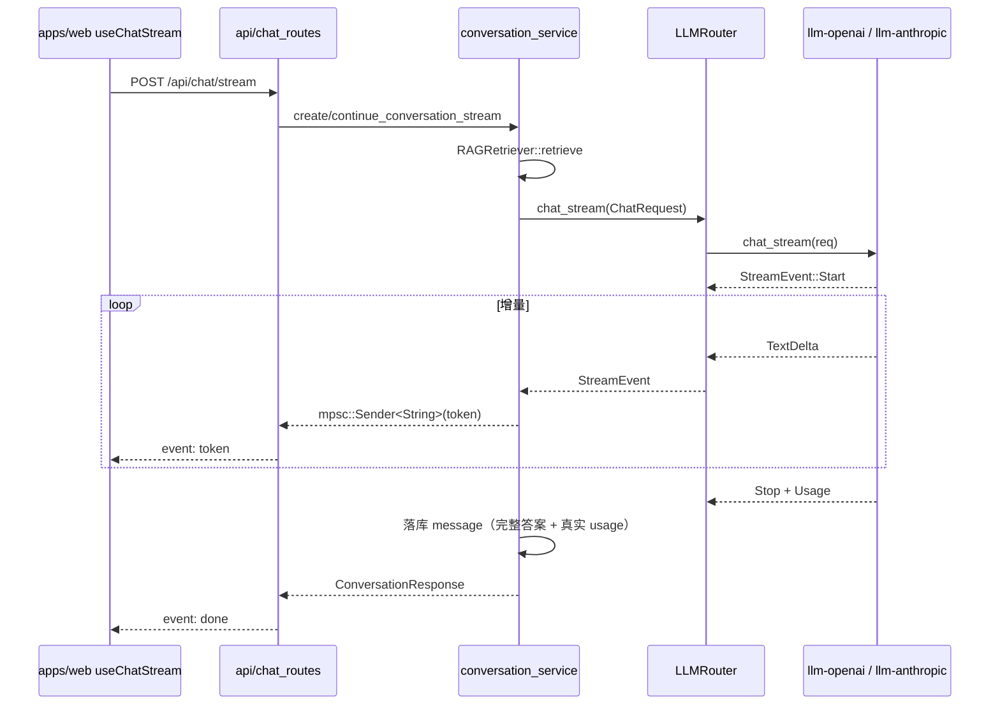

# LLM 协议适配 crate 设计方案（OpenAI Chat Completions / Anthropic Messages）

> 双协议统一接入：契约 crate 只放类型与 trait，协议实现各自独立成 crate，对齐 `crates/vector` + `vector-*` 的分层模式

---

## 目录

1. [设计目标](#1-设计目标)
2. [现状与问题](#2-现状与问题)
3. [分层架构](#3-分层架构)
4. [crates/llm 契约层](#4-cratesllm-契约层)
5. [crates/llm-openai](#5-cratesllm-openai)
6. [crates/llm-anthropic](#6-cratesllm-anthropic)
7. [service 层接入](#7-service-层接入)
8. [流式（SSE）链路](#8-流式sse链路)
9. [错误模型与重试/熔断](#9-错误模型与重试熔断)
10. [依赖与构建变更](#10-依赖与构建变更)
11. [测试方案](#11-测试方案)
12. [实施计划](#12-实施计划)
13. [风险与权衡](#13-风险与权衡)
14. [变更文件清单](#14-变更文件清单)
15. [变更记录](#15-变更记录)

---

## 1. 设计目标

| 目标 | 说明 | 优先级 |
|------|------|--------|
| 🔌 **双协议统一** | 同一份业务代码既能调 OpenAI Chat Completions，也能调 Anthropic Messages | P0 |
| 🧩 **契约与实现分离** | `llm` 只定义类型/trait（零 HTTP 依赖），协议实现独立 crate，互不牵连 | P0 |
| 🌊 **真流式** | SSE 增量输出，首 token 延迟 = 模型首个 chunk，不再「整段生成后逐行 sleep」 | P0 |
| 🛠 **工具调用** | 统一 `tool_use` / `tool_result` 语义，两套协议双向映射 | P1 |
| 🖼 **多模态** | 图片 URL / base64 统一表达，Anthropic 侧自动转 base64 source | P1 |
| 🚦 **可分类错误** | 429 / 5xx / 401 / 上下文超长 可区分，供熔断与重试策略使用 | P1 |
| 🧾 **厂商零改码扩展** | 新增 OpenAI 兼容厂商只改预设表，不改逻辑 | P2 |

**非目标**（本轮不做）：ASR / TTS、Batch API、Files API、Responses API、本地 llama.cpp 接入。

---

## 2. 现状与问题

现有实现集中在 `crates/service/src/llm_gateway_service.rs`（985 行），协议细节与业务路由（负载均衡 / 熔断 / 数据库刷新）混在同一文件。

| 位置 | 现状 | 问题 |
|------|------|------|
| `adapters::OpenAIAdapter` (L624-849) | `POST {base}/v1/chat/completions` + Bearer | `"stream": false` 硬编码 (L682)；无 tool calling；错误只透传字符串 |
| `adapters::ClaudeAdapter` (L851-984) | `POST {base}/v1/messages` + `x-api-key` | `extract_system` 只取首条 system 且丢弃其余 (L868)；响应只取 `content[0].text` (L940)；无 `stop_reason`；`list_models` 硬编码 3 个 2024 模型 (L977) |
| 类型定义 | `database::models::{ChatMessage, LLMChatRequest, TokenUsage}` (models.rs L1023-1108) | DB DTO 与协议类型耦合；无法表达 `tool_use`/`tool_result`/`stop_reason`/缓存 token |
| 厂商映射 | `match provider.provider_code` (L565-583) | 新增厂商必须改代码；火山方舟 `/api/v3`、腾讯混元路径与 `/v1` 假设冲突 |
| 流式 | `conversation_service.rs` L1114-1121：逐行推送 + `sleep(5ms)` | 「模拟流式」，首 token 延迟等于整段生成时间 |
| 错误 | 全部 `String` | 熔断器无法按错误类型计数，429 与 401 被同等对待 |
| 密钥 | `key.len() > 20` 启发式解密，gateway L548 与 provider_service L259 重复两遍 | 加密判定逻辑分散 |

> 结论：协议层必须从 service 抽出，否则每加一个厂商/一种能力都在改同一个巨型文件。

---

## 3. 分层架构

```mermaid
graph TB
    subgraph 业务层 Business
        RAG[知识库 RAG]
        CHAT[智能问答]
        DOC[文档解析]
    end

    subgraph service 层（保留）
        ROUTER[LLMRouter<br/>路由 / 故障转移]
        LB[LoadBalancer<br/>权重选择]
        CB[CircuitBreaker<br/>熔断]
        FACTORY[llm_factory<br/>厂商→协议映射]
        DB[(llm_provider / llm_model)]
    end

    subgraph crates/llm（契约，零 HTTP）
        TYPES[model.rs<br/>统一类型]
        ERR[error.rs<br/>LlmError]
        TRAIT[provider.rs<br/>LlmProvider trait]
        PRESET[presets.rs<br/>厂商预设表]
    end

    subgraph 协议实现（各自持驱动）
        OAI[crates/llm-openai<br/>Chat Completions + Embeddings]
        ANT[crates/llm-anthropic<br/>Messages API]
    end

    subgraph 外部 API
        OAIAPI[OpenAI / Azure / Qwen / DeepSeek<br/>火山 / 混元 / Ollama / GLM ...]
        ANTAPI[Anthropic Claude]
    end

    RAG --> ROUTER
    CHAT --> ROUTER
    DOC --> ROUTER
    ROUTER --> LB --> CB --> FACTORY
    FACTORY --> DB
    FACTORY -->|Protocol::OpenAiCompatible| OAI
    FACTORY -->|Protocol::AnthropicMessages| ANT
    OAI --> TYPES
    ANT --> TYPES
    OAI -.-> TRAIT
    ANT -.-> TRAIT
    TRAIT --> ERR
    FACTORY --> PRESET
    OAI --> OAIAPI
    ANT --> ANTAPI

    style ROUTER fill:#fff3e0,stroke:#e65100
    style TYPES fill:#e1f5fe,stroke:#01579b
    style OAI fill:#e8f5e9,stroke:#1b5e20
    style ANT fill:#f3e5f5,stroke:#4a148c
```

**分层纪律**（与 `crates/vector` 一致）：

- `crates/llm`：只放 trait 与数据类型，**不依赖 reqwest**；
- `crates/llm-openai` / `crates/llm-anthropic`：各自持有 `reqwest`，互不依赖；
- `crates/service`：只做厂商选择、故障转移、熔断、数据库交互与 DTO 桥接。

---

## 4. crates/llm 契约层

### 4.1 依赖

```toml
[dependencies]
async-trait.workspace = true
futures.workspace = true
serde.workspace = true
serde_json.workspace = true
thiserror.workspace = true
```

### 4.2 统一会话模型（model.rs）

```rust
/// 消息角色
pub enum Role { System, User, Assistant, Tool }

/// 一条消息（内容统一为片段数组，纯文本即单片段）
pub struct Message {
    pub role: Role,
    pub content: Vec<ContentPart>,
}

/// 内容片段：文本 / 图片 / 工具调用 / 工具结果
pub enum ContentPart {
    Text { text: String },
    Image { source: ImageSource },
    ToolUse { id: String, name: String, input: serde_json::Value },
    ToolResult { tool_use_id: String, content: Vec<ContentPart>, is_error: bool },
}

/// 图片来源：远程 URL 或 base64
pub enum ImageSource {
    Url { url: String },
    Base64 { media_type: String, data: String },
}

/// 工具定义（JSON Schema 参数）
pub struct ToolDef {
    pub name: String,
    pub description: Option<String>,
    pub parameters: serde_json::Value,
}

/// 工具选择策略
pub enum ToolChoice { Auto, None, Any, Required, Named(String) }

/// 统一请求
pub struct ChatRequest {
    pub messages: Vec<Message>,
    pub model: String,
    pub temperature: Option<f32>,
    pub top_p: Option<f32>,
    pub max_tokens: Option<i32>,
    pub stop: Vec<String>,
    pub tools: Vec<ToolDef>,
    pub tool_choice: Option<ToolChoice>,
    pub stream: bool,
    pub user: Option<String>,
}

/// 统一响应
pub struct ChatResponse {
    pub id: String,
    pub model: String,
    pub content: Vec<ContentPart>,   // text 与 tool_use 混合
    pub stop_reason: StopReason,
    pub usage: Usage,
}

/// 结束原因
pub enum StopReason {
    EndTurn, MaxTokens, ToolUse, StopSequence, ContentFilter, Other(String),
}

/// Token 用量（含 Anthropic 缓存 token）
pub struct Usage {
    pub input_tokens: i32,
    pub output_tokens: i32,
    pub cache_creation_input_tokens: Option<i32>,
    pub cache_read_input_tokens: Option<i32>,
}

/// 流式事件（两套协议归一化后的事件）
pub enum StreamEvent {
    Start { id: String, model: String },
    TextDelta { text: String },
    ToolUseStart { id: String, name: String },
    ToolUseArgsDelta { id: String, partial_json: String },
    ToolUseEnd { id: String },
    Usage(Usage),
    Stop(StopReason),
}

/// Embedding
pub struct EmbeddingRequest { pub model: String, pub input: Vec<String> }
pub struct EmbeddingResponse { pub model: String, pub embeddings: Vec<Vec<f32>>, pub usage: Usage }

/// 模型条目
pub struct ModelInfo { pub id: String, pub owned_by: Option<String>, pub created: Option<i64> }
```

### 4.3 Provider trait（provider.rs）

```rust
pub type ChatStream = Pin<Box<dyn Stream<Item = LlmResult<StreamEvent>> + Send>>;

#[async_trait]
pub trait LlmProvider: Send + Sync {
    fn provider_code(&self) -> &str;
    fn protocol(&self) -> Protocol;

    async fn chat(&self, request: ChatRequest) -> LlmResult<ChatResponse>;
    async fn chat_stream(&self, request: ChatRequest) -> LlmResult<ChatStream>;

    /// 默认实现：Unsupported（Anthropic 无 embeddings）
    async fn embed(&self, request: EmbeddingRequest) -> LlmResult<EmbeddingResponse>;

    async fn list_models(&self) -> LlmResult<Vec<ModelInfo>>;
    async fn health_check(&self) -> LlmResult<()>;
}

/// 线上协议族
pub enum Protocol { OpenAiCompatible, AnthropicMessages }
```

### 4.4 厂商预设表（presets.rs）

新增厂商只改这张表，不改任何逻辑代码：

| provider_code | Protocol | 默认 base_url | 默认模型 |
|---------------|----------|---------------|----------|
| `openai` | OpenAiCompatible | `https://api.openai.com/v1` | `gpt-4o` |
| `claude` | AnthropicMessages | `https://api.anthropic.com` | `claude-sonnet-4-20250514` |
| `qwen` | OpenAiCompatible | `https://dashscope.aliyuncs.com/compatible-mode/v1` | `qwen-plus` |
| `deepseek` | OpenAiCompatible | `https://api.deepseek.com/v1` | `deepseek-chat` |
| `volcengine` | OpenAiCompatible | `https://ark.cn-beijing.volces.com/api/v3` | `doubao-pro-32k` |
| `tencent` | OpenAiCompatible | `https://api.hunyuan.cloud.tencent.com/v1` | `hunyuan-lite` |
| `ollama` | OpenAiCompatible | `http://localhost:11434/v1` | `llama3.2` |
| `glm` | OpenAiCompatible | `https://open.bigmodel.cn/api/paas/v4` | `glm-4-plus` |
| `moonshot` | OpenAiCompatible | `https://api.moonshot.cn/v1` | `moonshot-v1-8k` |
| `openrouter` | OpenAiCompatible | `https://openrouter.ai/api/v1` | `openai/gpt-4o` |
| `groq` | OpenAiCompatible | `https://api.groq.com/openai/v1` | `llama-3.3-70b-versatile` |
| `xai` | OpenAiCompatible | `https://api.x.ai/v1` | `grok-2-latest` |
| `siliconflow` | OpenAiCompatible | `https://api.siliconflow.cn/v1` | `Qwen/Qwen2.5-72B-Instruct` |

### 4.5 错误类型（error.rs）

分类风格对齐 `crates/vector/src/error.rs`（`kind()` / `hint()` / `is_retryable()`）：

```rust
pub enum LlmError {
    Config(String),                               // 配置缺失/非法
    Auth(String),                                 // 401 / 403
    RateLimited { message: String, retry_after: Option<Duration> }, // 429 / overloaded
    ContextLength { limit: Option<i32>, message: String },          // 上下文超长
    InvalidRequest { status: u16, message: String },                // 400 / 422
    Server { status: u16, message: String },                        // 5xx
    Transport(String),                                              // DNS / TLS / 超时
    Decode(String),                                                 // 响应体解析失败
    Unsupported(String),                                            // 能力不支持
    Cancelled,                                                      // 上游断开
}

impl LlmError {
    pub fn is_retryable(&self) -> bool;   // Transport | RateLimited | Server
    pub fn is_auth_error(&self) -> bool;  // Auth
    pub fn is_context_length(&self) -> bool;
    pub fn kind(&self) -> &'static str;
    pub fn hint(&self) -> &'static str;
}
```

### 4.6 客户端配置（config.rs）

```rust
pub struct LlmClientConfig {
    pub base_url: String,
    pub api_key: String,          // Debug 输出为 ****（掩码）
    pub default_model: String,
    pub headers: Vec<(String, String)>,
    pub timeout: Duration,        // 默认 120s
    pub max_retries: u32,         // 传输层重试次数，默认 2
}
```

---

## 5. crates/llm-openai

### 5.1 端点与鉴权

| 项 | 值 |
|----|-----|
| 对话 | `POST {base_url}/chat/completions` |
| 向量 | `POST {base_url}/embeddings` |
| 模型 | `GET {base_url}/models` |
| 鉴权 | `Authorization: Bearer {api_key}`；Azure 走 `api-key` 头（配置项 `auth_style`） |
| 路径 | `base_url` 已含 `/v1` 或 `/api/v3` 时不再重复拼接；`chat_path` 可覆盖 |

### 5.2 请求映射

| 统一模型 | OpenAI Chat Completions |
|----------|--------------------------|
| `Role::System` | `{"role":"system","content":"..."}` |
| 纯文本 Message | `content` 为字符串 |
| 含 `Image` | `content: [{"type":"text","text":...},{"type":"image_url","image_url":{"url":"data:image/png;base64,..."}}]` |
| `ToolUse` | assistant 消息的 `tool_calls: [{"id","type":"function","function":{"name","arguments"(JSON 字符串)}}]` |
| `ToolResult` | 独立消息 `{"role":"tool","tool_call_id","content"}` |
| `ToolDef` | `tools: [{"type":"function","function":{"name","description","parameters"}}]` |
| `ToolChoice` | `"auto"` / `"none"` / `"required"` / `{"type":"function","function":{"name"}}` |
| `max_tokens` | 原生厂商用 `max_tokens`；新模型可配 `max_completion_tokens` |

### 5.3 响应映射

| OpenAI 字段 | 统一模型 |
|-------------|----------|
| `choices[0].message.content`（string 或 parts 数组） | 聚合为 `ContentPart::Text` |
| `choices[0].message.tool_calls[]` | `ContentPart::ToolUse` |
| `finish_reason=stop` | `StopReason::EndTurn` |
| `finish_reason=length` | `StopReason::MaxTokens` |
| `finish_reason=tool_calls` | `StopReason::ToolUse` |
| `finish_reason=content_filter` | `StopReason::ContentFilter` |
| `usage.prompt_tokens` / `completion_tokens` | `Usage::input_tokens` / `output_tokens` |
| `usage.prompt_tokens_details.cached_tokens` | `Usage::cache_read_input_tokens` |

### 5.4 流式

请求体追加：

```json
{ "stream": true, "stream_options": { "include_usage": true } }
```

> `stream_options` 部分兼容厂商会报 400，配置项 `supports_stream_options` 控制；关闭时以最后一个 chunk 的 `usage`（若存在）为准，否则 usage 留空。

SSE 归一化：

| OpenAI SSE 片段 | 统一事件 |
|-----------------|----------|
| 首个 chunk（`id` + `model`） | `StreamEvent::Start` |
| `choices[0].delta.content` | `StreamEvent::TextDelta` |
| `choices[0].delta.tool_calls[i]`（首次出现含 `id`/`function.name`） | `ToolUseStart` + 后续 `ToolUseArgsDelta`（按 `index` 累积） |
| `finish_reason` 非空 | `ToolUseEnd`（如为工具）+ `Stop` |
| 末尾 chunk 携带 `usage` | `StreamEvent::Usage` |
| `data: [DONE]` | 正常结束 |

### 5.5 错误映射

响应体 `{"error":{"message","type","code"}}`：

| 条件 | LlmError |
|------|----------|
| HTTP 401 / 403 | `Auth` |
| HTTP 429（读 `retry-after`） | `RateLimited` |
| HTTP 400 且 message 含 `context_length` / `maximum context` | `ContextLength` |
| HTTP 400 / 422 其它 | `InvalidRequest` |
| HTTP 5xx | `Server` |
| 连接/超时 | `Transport` |
| 响应非 JSON | `Decode` |

---

## 6. crates/llm-anthropic

### 6.1 端点与鉴权

| 项 | 值 |
|----|-----|
| 对话 | `POST {base_url}/v1/messages` |
| 模型 | `GET {base_url}/v1/models`（404 时回落静态预设表） |
| 向量 | **不支持** → `LlmError::Unsupported` |
| 鉴权 | `x-api-key: {api_key}` + `anthropic-version: 2023-06-01`（可配） |
| Beta | 可选 `anthropic-beta`（prompt caching / interleaved thinking） |

### 6.2 请求映射

| 统一模型 | Anthropic Messages |
|----------|--------------------|
| **全部** `Role::System` 消息 | 合并为顶层 `system`（string，或 `[{"type":"text","text","cache_control"}]` 块） |
| `Role::User` / `Role::Assistant` | `messages: [{"role","content":[blocks]}]`，连续同角色自动合并 |
| `Text` | `{"type":"text","text":...}` |
| `ImageSource::Base64` | `{"type":"image","source":{"type":"base64","media_type","data"}}` |
| `ImageSource::Url` | **不支持** → `Unsupported`（提示先下载转 base64） |
| `ToolUse` | assistant 的 `{"type":"tool_use","id","name","input"}` |
| `ToolResult` | **user 轮**的 `{"type":"tool_result","tool_use_id","content","is_error"}` |
| `ToolDef` | 顶层 `tools: [{"name","description","input_schema"}]` |
| `ToolChoice` | `{"type":"auto"}` / `{"type":"any"}` / `{"type":"tool","name"}`；`None` 则不传 `tools` |
| `max_tokens` | **必填**：未指定时用配置默认值 4096（避免旧实现 2048 截断） |
| `stop` | `stop_sequences` |

### 6.3 响应映射

| Anthropic 字段 | 统一模型 |
|----------------|----------|
| `content[]` 中多个 `{"type":"text"}` | 依次产出 `ContentPart::Text` |
| `content[]` 中 `{"type":"tool_use"}` | `ContentPart::ToolUse` |
| `stop_reason=end_turn` | `StopReason::EndTurn` |
| `stop_reason=max_tokens` | `StopReason::MaxTokens` |
| `stop_reason=tool_use` | `StopReason::ToolUse` |
| `stop_reason=stop_sequence` | `StopReason::StopSequence` |
| `stop_reason=refusal` | `StopReason::ContentFilter` |
| `usage.input_tokens` / `output_tokens` | 直接映射 |
| `usage.cache_creation_input_tokens` / `cache_read_input_tokens` | 同名字段 |

### 6.4 流式事件归一化

| Anthropic SSE `event` | 统一事件 |
|-----------------------|----------|
| `message_start` | `Start { id, model }` + 初始 `Usage(input_tokens, cache_*)` |
| `content_block_start`（`type=text`） | 无事件（等待 delta） |
| `content_block_start`（`type=tool_use`） | `ToolUseStart { id, name }` |
| `content_block_delta`（`text_delta`） | `TextDelta` |
| `content_block_delta`（`input_json_delta`） | `ToolUseArgsDelta` |
| `content_block_stop`（工具块） | `ToolUseEnd` |
| `message_delta` | `Usage(output_tokens)` + `Stop(stop_reason)` |
| `message_stop` | 流结束 |
| `ping` | 忽略 |
| `error` | 转 `LlmError` 并终止流 |

### 6.5 错误映射

响应体 `{"type":"error","error":{"type","message"}}`：

| `error.type` | LlmError |
|--------------|----------|
| `authentication_error` / `permission_error` | `Auth` |
| `rate_limit_error` | `RateLimited`（读 `retry-after`） |
| `overloaded_error`（529） | `Server`（可重试） |
| `invalid_request_error` 且 message 含 `prompt is too long` | `ContextLength` |
| `invalid_request_error` 其它 | `InvalidRequest` |
| `api_error` | `Server` |
| 流中断 / 连接重置 | `Transport` |

---

## 7. service 层接入

### 7.1 工厂：厂商 → 协议

`crates/service/src/llm_factory.rs`（新增）：

```rust
/// 依据厂商配置与预设表构造协议实现
pub fn create_provider(provider: &LlmProvider) -> Result<Box<dyn LlmProvider>, LlmError> {
    let preset = llm::presets::lookup(&provider.provider_code)
        .ok_or_else(|| LlmError::Config(format!("未知厂商: {}", provider.provider_code)))?;
    let base_url = provider.base_url.clone().unwrap_or_else(|| preset.base_url.to_string());
    let api_key = resolve_api_key(&provider.api_key)?;   // 密钥解密收敛到一处

    match preset.protocol {
        Protocol::OpenAiCompatible => Ok(Box::new(OpenAiProvider::new(...))),
        Protocol::AnthropicMessages => Ok(Box::new(AnthropicProvider::new(...))),
    }
}
```

> 现存 `get_default_base_url` / `get_default_model` 改为读 `llm::presets`，调用点签名不变。

### 7.2 Router 改造

- `WeightedProvider.adapter`：`Arc<Box<dyn LLMProviderAdapter>>` → `Arc<dyn llm::LlmProvider>`；
- `LLMRouter::chat` / `chat_with_provider_id` / `chat_with_vision` 保留，内部只改类型；
- 新增 `LLMRouter::chat_stream(request, provider_id) -> LlmResult<ChatStream>`：选 provider → 订阅流 → 失败且未产出任何 token 时回退下一家；
- 熔断器计数改为 `error.is_retryable()`，`Auth` / `InvalidRequest` 不计入失败。

### 7.3 DTO 桥接（前端零改动）

`database::models` 的 `LLMChatRequest` / `LLMChatResponse` / `ContentPart` 继续作为 Tauri/DB DTO，在 service 内做双向转换（规避孤儿规则）：

```rust
impl From<&database::models::LLMChatRequest> for llm::ChatRequest { /* ... */ }
impl From<llm::ChatResponse> for database::models::LLMChatResponse { /* ... */ }
```

转换要点：

| database::models | llm |
|------------------|-----|
| `ChatMessage.role: String` | `Role`（`"system"/"user"/"assistant"/"tool"`，未知 → `User`） |
| `ChatMessage.content: String` + `content_parts: Option<Vec<ContentPart>>` | `Vec<llm::ContentPart>`（`content_parts` 优先，与旧逻辑一致） |
| `ContentPart::Image { image_url: { url: "data:image/..." } }` | 解析 data URL → `ImageSource::Base64`；`http(s)://` → `ImageSource::Url` |
| `LLMChatResponse.usage: TokenUsage` | `Usage`（`cost` 由 service 按价格表另算） |

### 7.4 调用点影响

| 调用点 | 改动 |
|--------|------|
| `llm_provider_service::fetch_models_from_api` | 改走工厂 + `list_models()`，不再直接 `new OpenAIAdapter` |
| `llm_provider_service::classify_model_name` | 补 vision 识别（`vl` / `-v` / `vision` / `omni`） |
| `conversation_service::retrieve_and_answer_stream` | 改真流式（见 §8） |
| `api/chat_routes.rs` | **不改**：仍是 `token` / `done` / `error` 三种事件 |

---

## 8. 流式（SSE）链路

### 8.1 端到端



### 8.2 与旧实现的差异

| 项 | 旧 | 新 |
|----|----|----|
| 首 token 延迟 | 整段生成后 | 模型首个 chunk |
| 前端事件 | `token` / `done` / `error` | **完全不变** |
| usage | `question.len()` / `answer.len()` 字符数 | 协议返回的真实 token 数 |
| 中断 | 无 | 前端 Abort → 丢弃 sender → `ChatStream` drop 取消请求 |
| Anthropic | 不支持流式 | `message_start…message_stop` 归一化 |

### 8.3 SSE 解码器（两个协议 crate 各自实现，思路一致）

- 按 `\n\n` 分帧，保留不完整尾巴；
- 支持 `event:` / `data:` / `:` 注释行 / 多行 `data:` 以 `\n` 拼接；
- 提供 `finish()` 处理流末尾残留帧；
- 解码器为纯函数式状态机，**可脱离网络单测**（喂 `&str` 产出事件）。

---

## 9. 错误模型与重试/熔断

| 错误类 | 是否可重试 | 是否计入熔断 | 处置 |
|--------|-----------|--------------|------|
| `Transport` | ✅ | ✅ | 立即换 Provider |
| `RateLimited` | ✅（受 `retry_after` 约束） | ✅ | 换 Provider，优先跳过同厂商 |
| `Server` | ✅ | ✅ | 换 Provider |
| `Auth` | ❌ | ❌ | 直接报错，提示检查密钥 |
| `InvalidRequest` | ❌ | ❌ | 直接报错（配置/参数问题） |
| `ContextLength` | ❌ | ❌ | 报错并提示缩短上下文或换长窗口模型 |
| `Decode` | ❌ | ⚠️ 计一次 | 记录原始 body 片段便于排查 |
| `Unsupported` | ❌ | ❌ | 报错并提示换模型 |

对上层（Tauri command / HTTP）返回时统一格式：`"{kind}: {message}"`，前端可据此分类提示。

---

## 10. 依赖与构建变更

| 位置 | 变更 |
|------|------|
| 根 `Cargo.toml` `[workspace.dependencies]` | 新增 `llm = { path = "crates/llm" }`、`llm-openai`、`llm-anthropic` |
| 根 `Cargo.toml` `reqwest` | features 追加 `"stream"`（`bytes_stream()` 必需，用于 SSE） |
| `crates/llm/Cargo.toml` | `async-trait` / `futures` / `serde` / `serde_json` / `thiserror` |
| `crates/llm-openai/Cargo.toml` | `llm` / `async-trait` / `futures` / `reqwest` / `serde` / `serde_json` / `tracing` |
| `crates/llm-anthropic/Cargo.toml` | 同上 |
| `crates/service/Cargo.toml` | `llm` / `llm-openai` / `llm-anthropic` / `futures` |

> `members = ["crates/*"]` 会自动纳入新 crate，无需额外注册。
> 不引入 `eventsource-stream` 等第三方 SSE 库，解码器自研可控且可单测。

---

## 11. 测试方案

| crate | 用例 |
|-------|------|
| `llm` | `ContentPart` 文本聚合；`StopReason` 字符串互通；`Usage::total()`；`LlmError::is_retryable/kind/hint`；`Debug` 输出不含明文密钥 |
| `llm-openai` | 请求体 golden JSON（纯文本 / 图片 / 工具）；响应解析（含 `tool_calls`、`cached_tokens`）；**SSE 分帧**（跨 chunk 边界、`[DONE]`、usage 尾块、工具参数按 index 累积）；错误体 → `LlmError` 分类 |
| `llm-anthropic` | 多条 system 合并；`tool_use` / `tool_result` 双向映射；data URL → base64 source；`message_start…message_stop` 事件序列；`stop_reason` 映射；错误体分类（`overloaded_error` → `Server`） |
| 真机冒烟 | `#[ignore]` + 环境变量 `OPENAI_API_KEY` / `ANTHROPIC_API_KEY`，`cargo test -- --ignored` |

验收命令：

```bash
cargo check -p llm -p llm-openai -p llm-anthropic
cargo test  -p llm -p llm-openai -p llm-anthropic
cargo check -p service -p api
cargo clippy -p llm -p llm-openai -p llm-anthropic --all-targets
```

---

## 12. 实施计划

| 阶段 | 内容 | 产出 |
|------|------|------|
| **P1** | `crates/llm`：类型 / 错误 / trait / 预设表 + 单测 | 契约编译通过 |
| **P2** | `crates/llm-openai`：chat + embeddings + models + SSE + 错误映射 + 单测 | 可独立调用 OpenAI |
| **P3** | `crates/llm-anthropic`：messages + SSE + 错误映射 + 单测 | 可独立调用 Claude |
| **P4** | 根 `Cargo.toml` 注册；`service` 工厂 / DTO 桥接 / router 换实现；删除 `adapters` 模块 | 存量功能不回归 |
| **P5** | `conversation_service` + `chat_routes` 接真流式 | 首 token 延迟显著下降 |
| **P6** | 全量 `check` / `test` / `clippy`；文档同步 | 收口 |

每阶段独立可编译、可测试，P4 之前不触碰 `service`。

### 12.1 落地状态（2026-11-05）

| 阶段 | 状态 | 验证方式 |
|------|------|----------|
| **P1** `crates/llm` | ✅ 已完成 | `cargo test -p llm` → 15 passed |
| **P2** `crates/llm-openai` | ✅ 已完成 | `cargo test -p llm-openai` → 22 passed |
| **P3** `crates/llm-anthropic` | ✅ 已完成 | `cargo test -p llm-anthropic` → 23 passed |
| **P4** service 接入 | ✅ 已完成 | `cargo test -p service` → 32 passed；`cargo check -p service -p api` 通过 |
| **P5** 真流式 | ✅ 已完成 | `stream_llm_answer()` 替代逐行 + `sleep(5ms)`；前端事件名不变 |
| **P6** 全量校验 | ✅ 已完成 | `cargo clippy -p llm -p llm-openai -p llm-anthropic --all-targets` 无 error |

**实现与设计的差异记录**：

| 项 | 设计稿 | 实际实现 | 原因 |
|----|--------|----------|------|
| `LlmClientConfig.headers` | `BTreeMap<String, String>` | `Vec<(String, String)>` | 避免为两个协议 crate 引入 `std::collections::BTreeMap` 之外的序列化语义，且请求头顺序无意义 |
| `CircuitBreaker::is_allowed` | `&self` | `&mut self` | 需要在超时后真正切到 `HalfOpen` 状态，否则该状态永远不会被构造（dead_code） |
| `llm_provider_service` | 直接 `new OpenAIAdapter` | `llm_factory::create_provider` | 复用统一工厂；因该文件已有同名 `create_provider`（厂商 CRUD），导入时别名为 `build_provider` |
| 流式失败降级 | — | 降级时一次性推送 RAG 拼接全文 | 保证前端仍能拿到回答，只是失去逐字效果 |

---

## 13. 风险与权衡

| 风险 | 影响 | 对策 |
|------|------|------|
| crate 名 `llm` 与 crates.io 同名 | 将来发布需改名 | 本地 path 依赖无影响；若需发布改 `llm-core` |
| `reqwest` 加 `stream` feature 全仓生效 | 二进制略增（Tauri 已链 hyper，影响小） | 接受；如敏感可只在协议 crate 本地覆写 features |
| `stream_options` 被部分兼容厂商拒绝 | 400 报错 | 配置开关，失败自动去掉该字段重试一次 |
| Anthropic 不支持 URL 图片 | 多模态场景需转换 | 返回 `Unsupported` + 明确 hint；后续可加「服务端下载转 base64」 |
| Anthropic 不支持 embeddings | 向量仍只能走 OpenAI 兼容 | 保持现状，向量模型选择时过滤 |
| 现有 `database::models` DTO 不变 | 旧字段仍有 `content: String` 限制 | 桥接层做聚合，未来可评估统一到 `llm` 类型 |

**备选方案**：单 crate `crates/llm`（`openai` / `anthropic` 子模块 + feature）。优点是文件少；缺点是与仓库既有 `vector` + `vector-*` 分层惯例不一致，且两个协议的驱动无法独立裁剪。本方案采用三 crate。

---

## 14. 变更文件清单

### 新增

| 路径 | 说明 |
|------|------|
| `crates/llm/Cargo.toml` | 契约 crate 依赖（零 HTTP） |
| `crates/llm/src/lib.rs` | crate 文档 + re-export |
| `crates/llm/src/model.rs` | 统一类型 |
| `crates/llm/src/error.rs` | `LlmError` |
| `crates/llm/src/provider.rs` | `Protocol` / `LlmProvider` / `ChatStream` |
| `crates/llm/src/config.rs` | `LlmClientConfig`（密钥 `Debug` 掩码） |
| `crates/llm/src/presets.rs` | 厂商预设表 |
| `crates/llm-openai/src/{lib,client,wire,convert,sse,embed}.rs` | Chat Completions + Embeddings + SSE |
| `crates/llm-anthropic/src/{lib,client,wire,convert,sse}.rs` | Messages + SSE |
| `crates/service/src/llm_factory.rs` | 厂商 → 协议工厂、密钥解密收敛、DTO 桥接 |

### 修改

| 路径 | 改动 |
|------|------|
| `Cargo.toml`（根） | 新增 3 个 workspace 依赖；`reqwest` 追加 `"stream"` |
| `crates/service/Cargo.toml` | 新增 `llm` / `llm-openai` / `llm-anthropic` / `futures` |
| `crates/service/src/lib.rs` | 注册 `llm_factory` |
| `crates/service/src/llm_gateway_service.rs` | 删除 `adapters` 模块（L619-984）；adapter 类型换 `Arc<dyn LlmProvider>`；熔断按可重试计数；新增 `chat_stream` |
| `crates/service/src/llm_provider_service.rs` | `fetch_models_from_api` 走工厂；`classify_model_name` 补 vision |
| `crates/service/src/conversation_service.rs` | 真流式，删除逐行 + `sleep(5ms)`（L1114-1121） |

### 不改（零破坏）

`database::models` LLM DTO、全部 Tauri command 签名、`api/chat_routes.rs` 事件名、`apps/web` 前端、`LLMRouter` 公开方法签名。

---

## 15. 变更记录

| 日期 | 变更 | 文件 |
|------|------|------|
| 2026-11-05 | 新建：双协议 crate 拆分方案（OpenAI Chat Completions / Anthropic Messages） | 本文档 |
| 2026-11-05 | 完成 P1-P6 落地：新增 `crates/llm` / `llm-openai` / `llm-anthropic`，重写 `llm_gateway_service`，`conversation_service` 改真流式 | `crates/llm*`、`crates/service/src/{llm_factory,llm_gateway_service,llm_provider_service,conversation_service}.rs`、根 `Cargo.toml` |

---

*文档结束*
