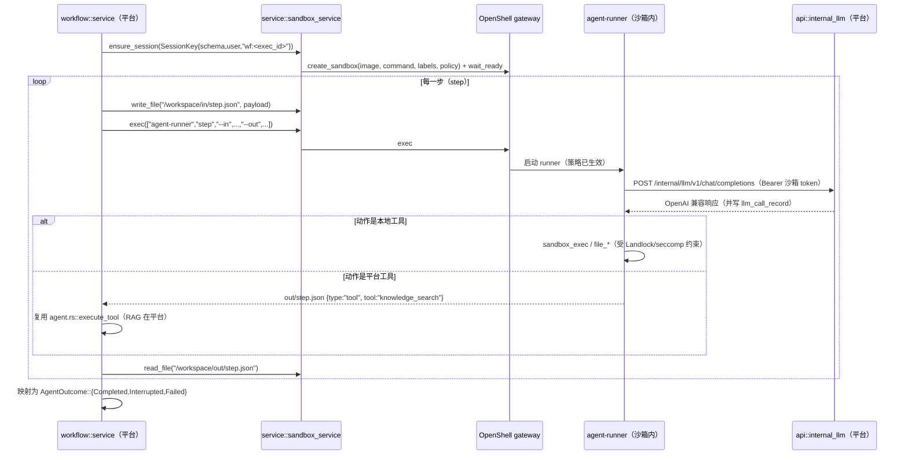

# OpenShell 沙箱 Agent 落地设计（Rust 版）

> 上游文档：[OpenShell 沙箱整合可行性分析（嵌入 vs 独立部署）](./OpenShell沙箱整合可行性分析（嵌入vs独立部署）.md)
> 本文只回答一个问题：**本项目的 AI Agent 如何放进 OpenShell 沙箱**。部署形态（独立 gateway）、契约扩展、错误映射等沿用上游文档结论，本文不重复。
>
> 结论先行：
> 1. Agent 全链路是 **Rust**（`workflow/src/agent.rs` + `service::llm_gateway_service` + `service::rag_service`），**不引入 Python runner**；沙箱内运行的是从仓库现有逻辑抽取后编译出的 Rust 二进制。
> 2. 落地分两形态：**B-Ⅰ 工具执行进沙箱**（改动最小，先拿隔离收益）→ **B-Ⅱ agent 循环进沙箱**（上游文档 M1b 终态）。
> 3. 新增两个 crate：`agent-core`（纯逻辑、零 IO）+ `agent-runner`（沙箱内 bin），依赖方向严格单向，`agent-runner` **禁止**依赖 `service` / `database` / `sqlx`。

---

## 目录

1. [结论与范围](#1-结论与范围)
2. [代码事实核对](#2-代码事实核对)
3. [两种落地形态](#3-两种落地形态)
4. [crate 设计](#4-crate-设计)
5. [从 agent.rs 抽取什么](#5-从-agentrs-抽取什么)
6. [step 协议 v1](#6-step-协议-v1)
7. [平台内部 LLM 端点](#7-平台内部-llm-端点)
8. [工具设计：平台回调与沙箱本地](#8-工具设计平台回调与沙箱本地)
9. [沙箱镜像与构建](#9-沙箱镜像与构建)
10. [平台侧接线](#10-平台侧接线)
11. [中断与审批](#11-中断与审批)
12. [计量缺口与补齐](#12-计量缺口与补齐)
13. [审计与可观测](#13-审计与可观测)
14. [配置项](#14-配置项)
15. [测试方案](#15-测试方案)
16. [实施计划](#16-实施计划)
17. [风险与待确认](#17-风险与待确认)
18. [变更文件清单](#18-变更文件清单)
19. [变更记录](#19-变更记录)

---

## 1. 结论与范围

| 项 | 结论 |
|---|---|
| 运行模式 | **默认 `in_process`（同进程，不启用沙盒）**；沙盒为配置可选：`mode = "cube"` / `"openshell"`；`agent_in_sandbox` 仅在 `openshell` 下有效 |
| 语言栈 | **全 Rust**：沙箱内为 `agent-runner` 二进制，复用 `llm` / `llm-openai`（仓库已统一 `reqwest + rustls + ring`） |
| 模型调用归属 | **L1**：沙箱内 runner 调**平台内部 LLM 端点**，密钥/计量/限流留平台（上游文档 §6.7） |
| RAG 归属 | **平台**：`service::rag_service::RAGRetriever` 依赖 DB + 向量库，不进沙箱；沙箱通过 step 输出「要调工具」的意图 |
| 状态归属 | **平台**：`adk-graph` 的 `PostgresCheckpointer` 留在平台；沙箱只回传 `state_patch` |
| 协议实现 | **单一实现**：prompt 拼装与 JSON 动作解析从 `agent.rs` 抽到 `agent-core`，两侧共用 |
| 沙箱镜像 | 多阶段构建，运行镜像只有 glibc + CA + 一个二进制，非 root，无解释器 |

**非目标**：不改造 `sandbox-cube`、不改 `api/sandbox_routes.rs`、不改 Tauri 命令、不在沙箱内建数据库连接。

---

## 2. 代码事实核对

> 以下均为本次实测（文件:行号），用于防止设计与代码脱节。

| 事实 | 位置 |
|---|---|
| Agent 运行时是 adk-graph StateGraph，跑在 assets-server 进程内 | `crates/workflow/src/agent.rs`（`AgentGraphRunner`） |
| Agent 入参：`thread_id / node_id / config / input / approval` | `agent.rs:121`（`AgentInvocation`） |
| LLM 调用走进程内 `LLMRouter::chat(LLMChatRequest)` | `agent.rs:391`（`call_llm`）；`service/src/llm_gateway_service.rs:437` |
| 系统提示词与用户消息就地拼装 | `agent.rs:398-417` |
| LLM 调用点 | `agent.rs:440`（`self.llm.chat`）、`:441`（`parse_llm_json`） |
| 动作 JSON 解析与校验 | `agent.rs:512`（`parse_llm_json`）、`agent.rs:541`（`validate_action`） |
| 工具仅 `knowledge_search` / `current_time` | `agent.rs:444-492`（`execute_tool`） |
| 中断走 `NodeOutput::interrupt_with_data` → `AgentOutcome::Interrupted` | `agent.rs:331` / `:369` / `:231` |
| 审批恢复走 `TOPIC_AGENT_RESUME` 重新进 worker | `workflow/src/service.rs:187-330` |
| 沙箱契约只有 exec/file/生命周期，无会话/流式 | `crates/sandbox/src/runtime.rs:21-80` |
| `SandboxSpec` 无 `image/command/labels/policy_yaml` | `crates/sandbox/src/model.rs:9-23` |
| `SandboxHandle` 有 Cube 专有的 `data_host_suffix/envd_port` | `crates/sandbox/src/model.rs:47-61` |
| `runtime()` 直接装配 Cube，失败降级 `DisabledRuntime` | `service/src/sandbox_service.rs:130`（`runtime`）、`:143`（`CubeSandboxRuntime::from_env`） |
| 会话亲和键 `SessionKey{tenant,user_id,scope}` | `service/src/sandbox_service.rs:29` |
| `should_enable` / `ensure_session` | `service/src/sandbox_service.rs:107` / `:234` |
| HTTP 鉴权中间件已支持 API Key，并 `with_schema` 包裹请求 | `api/src/auth.rs:469-510`（分支）、`:482`（`resolve_tenant_schema`） |
| 统一主体结构 `AuthPrincipal` | `api/src/auth.rs:71` |
| **Service 身份在 `authz` 层被统一 403**（显式列出全部沙箱路由） | `api/src/authz.rs:101-118`（`SERVICE_FORBIDDEN_ROUTES`）、`:589`（判定函数） |
| 沙箱路由全部挂 `protected_routes` | `api/src/lib.rs:810-843`、`:869`（合并） |
| `/api/llm/*` 只有 provider/model 管理，**无 chat 端点** | `api/src/llm_routes.rs` |
| `llm-openai` 的线上结构体是私有模块 | `llm-openai/src/lib.rs:35`（`mod wire;`） |
| `OpenAiProvider` 支持任意 base_url | `llm-openai/src/client.rs:83`（`OpenAiProvider::new`） |
| `LLMRouter::chat` **不写**调用记录 | `llm_gateway_service.rs:437-445` |
| `llm_call_record` 只有 DDL，**无任何 Rust 写入** | `database/src/sql/tenant_tables.sql:826-845` |
| `[sandbox]` 配置只支持扁平标量 | `bootstrap/src/config.rs:48`（`apply_table`）、`:84-107`（标量循环）；`apps/backend/.env.example.toml:135` |
| `docker-compose.yml` 当前只有 `otel-collector` | 根 `docker-compose.yml` |
| 工作区依赖唯一来源，不允许 optional | `apps/backend/src-tauri/Cargo.toml` |

两处与上游文档不一致、需要在实施时修正：

1. 上游文档 §6.7 称「平台已有 `llm_call_record` 计量」——**代码里没有写入逻辑**，只有表结构（见 §12）。
2. 上游文档 §6.6 的 M1b 默认「Agent 整体跑在沙箱内」，但未说明**状态与工具无法随迁**（DB 凭证禁入沙箱），本文用「单步无状态 + 平台驱动」补上这个空白（见 §3）。

---

## 3. 两种落地形态

### 3.1 形态对比

| 维度 | **B-Ⅰ 工具执行进沙箱**（先做） | **B-Ⅱ agent 循环进沙箱**（终态） |
|---|---|---|
| 平台上运行 | `AgentGraphRunner`（adk-graph 全保留） | 只保留 graph 驱动 + 检查点 + 平台工具执行 |
| 沙箱内运行 | 一次性 `exec`（Python/Shell 片段、命令） | `agent-runner` 二进制：prompt → LLM → 动作 → 本地工具 |
| 新增 crate | 0（在 `agent.rs` 增 `sandbox_exec` / `file_*` 工具） | `agent-core` + `agent-runner` |
| 新增端点 | 0 | `/internal/llm/v1/chat/completions` |
| 计量 | 沿用平台 `LLMRouter` 调用点 | 内部端点必须写 `llm_call_record` |
| 中断/审批 | 完全不变 | 需把沙箱中断映射回 `agent_interrupt` |
| 隔离收益 | 命令 / 文件 / 出网（**风险最高的部分**） | 再加 prompt / 规划 / 上下文 |
| 工作量 | 小 | 中（约 3~5 倍） |

### 3.2 推荐路径

```
P0 运维前置 → P1 契约扩展 → P2 sandbox-openshell → P3 service 后端切换     （见上游文档）
      ↓
B-Ⅰ：新增 sandbox_exec / file_read / file_write 工具 → 走 sandbox_service
      ↓
B-Ⅱ：agent-core + agent-runner + 内部 LLM 端点 + 单步协议 → workflow 接 SandboxAgentRunner
```

理由：本项目 agent 目前**没有任何 shell / 文件工具**（`agent.rs:444-492` 只有 `knowledge_search` / `current_time`），真正需要隔离的能力尚未存在；先补工具（B-Ⅰ）能立即把「跑命令」放进 OpenShell，收益最大；B-Ⅱ 面向「第三方/不可信 Skill、长任务」再上。

### 3.3 B-Ⅱ 时序



---

## 4. crate 设计

```
crates/agent-core/          # 纯逻辑：零 IO、零 DB、零 HTTP
  Cargo.toml                # serde, serde_json
  src/lib.rs
  src/prompt.rs             # build_system(tools) / build_user(prompt, input, observations)
  src/action.rs             # parse_llm_json / validate_action（从 agent.rs 逐字搬）
  src/protocol.rs           # StepInput / StepOutput / StepKind / StepUsage（serde）
  tests/fixtures/*.json     # golden 用例，Rust 两侧共用

crates/agent-runner/        # 沙箱内可执行体
  Cargo.toml                # agent-core, llm, llm-openai, tokio, clap, anyhow, tracing
  src/main.rs               # step 子命令 + probe 子命令
  src/llm.rs                # 构造指向平台内部端点的 OpenAiProvider
  src/tools.rs              # sandbox_exec / file_read / file_write / artifact_write
  src/limits.rs             # 超时、输出截断、路径归一化
```

依赖边界（硬约束）：

| crate | 允许 | 禁止 |
|---|---|---|
| `agent-core` | `serde`、`serde_json` | `tokio`、`reqwest`、`sqlx`、`adk-graph`、`database` |
| `agent-runner` | `agent-core`、`llm`、`llm-openai`、`tokio`、`clap`、`anyhow`、`tracing` | `service`、`database`、`sqlx`、`axum`、`workflow` |
| `workflow` | 新增 `agent-core` | 不依赖 `agent-runner` |

> 为什么关键是「runner 不依赖 service」：`service` 一旦引入，`sqlx`/配置/密钥管理整条链会被拽进沙箱镜像，等于从架构上破坏「平台主密钥不入沙箱」（上游文档 §9.1）。

命名备选：`agent-core` ↔ `agent`（仓库既有 `llm` / `vector` / `sandbox` 是裸名契约）。本文统一用 `agent-core` / `agent-runner` 以便与业务「agent」区分。

工作区注册：`members = ["crates/*"]` 自动收录；在根 `Cargo.toml` 的 `[workspace.dependencies]` 中补 `agent-core = { path = "crates/agent-core" }`（`agent-runner` 只作为 bin，不需要被其他 crate 依赖，可只做成员）。

---

## 5. 从 agent.rs 抽取什么

| 现有代码 | 去向 | 说明 |
|---|---|---|
| `agent.rs:398-405` 系统提示词 | `agent_core::prompt::build_system(tools: &[String]) -> String` | 逐字搬，含「只输出 JSON」等约束 |
| `agent.rs:408-417` 用户消息 | `agent_core::prompt::build_user(prompt, input, observations) -> String` | 逐字搬，`to_string_pretty` 行为保持一致 |
| `agent.rs:512` `parse_llm_json` | `agent_core::action::parse_llm_json` | **原单测一起搬**（json 代码围栏容错、前后说明文字、截断 300 字符） |
| `agent.rs:541` `validate_action` | `agent_core::action::validate_action` | `final`/`tool` 校验、缺字段报错文案保持一致 |
| `agent.rs:444-492` `execute_tool` | **平台保留** | RAG 依赖 DB/向量，不进沙箱 |
| `agent.rs` 中 `self.llm.chat(...)` | 平台保留 `LLMRouter`；沙箱侧换 `llm-openai` | 两侧都走 OpenAI 线格式 |

重构后 `agent.rs::call_llm` 语义不变：

```rust
async fn call_llm(&self, state: &State, config: &AgentConfig, observations: &[Value]) -> Result<Value, String> {
    let system = agent_core::prompt::build_system(&config.tool_names());
    let input = state.get("input").cloned().unwrap_or(Value::Null);
    let user = agent_core::prompt::build_user(&config.prompt, &input, observations);
    let response = self.llm.chat(LLMChatRequest { /* 与现状一致 */ }).await?;
    agent_core::action::parse_llm_json(&response.content)
}
```

**零漂移的机械保证**：`cargo test -p workflow` 在重构前后必须一条不改地通过；`agent-core` 的 `action` 测试与 `agent.rs` 原测试同源。

**已落地（B1'，2026-11-24）**：`crates/agent-core` 已创建（`prompt.rs` / `action.rs`，零 IO 依赖）；`workflow/src/agent.rs` 改为调用 `agent_core::prompt::{build_system, build_user}` 与 `agent_core::action::parse_llm_json`，本地 `parse_llm_json` / `validate_action` 已删除。`cargo test -p workflow` **19 passed（零漂移）**，`cargo test -p agent-core` **12 passed**。

---

## 6. step 协议 v1

协议 ID：`assets-agent-step/v1`。传输方式复用现有契约：平台 `write_file` 写 `in/step.json` → `exec` → `read_file` 读 `out/step.json`（**不需要给 `SandboxRuntime` 加 stdin/流式**）。

### 6.1 输入

```json
{
  "protocol": "assets-agent-step/v1",
  "thread_id": "exec-123:task_1",
  "node_id": "task_1",
  "step": 0,
  "agent": {
    "prompt": "根据业务输入完成任务",
    "model": "gpt-4o-mini",
    "temperature": 0.2,
    "max_tokens": 1024,
    "tools": ["knowledge_search", "sandbox_exec", "file_read", "file_write"],
    "interrupt_policy": "before_tool",
    "max_iterations": 6
  },
  "input": { "asset_id": "123" },
  "observations": [],
  "approval": null,
  "llm": {
    "base_url": "http://assets-server:3001/internal/llm/v1",
    "token_env": "AGENT_TOKEN",
    "default_model": "gpt-4o-mini",
    "timeout_secs": 120
  },
  "workspace": "/workspace",
  "limits": { "exec_timeout_secs": 60, "max_output_bytes": 1048576, "max_file_bytes": 33554432 }
}
```

### 6.2 输出

```json
{
  "protocol": "assets-agent-step/v1",
  "kind": "final | tool | interrupt | error",
  "action": { "action": "tool", "tool": "sandbox_exec", "arguments": { "command": "ls -la" } },
  "observation": { "exit_code": 0, "stdout": "...", "stderr": "" },
  "final": { "answer": "最终答案" },
  "interrupt": { "kind": "before_tool", "tool": "knowledge_search", "arguments": {} },
  "state_patch": { "observations": [], "iterations": 1 },
  "usage": { "input_tokens": 0, "output_tokens": 0 },
  "error": null
}
```

### 6.3 `kind` 语义

| `kind` | 平台处理 |
|---|---|
| `final` | `AgentOutcome::Completed { output: final, state }`，写 `agent_output` / `result` / `output_<node_id>` |
| `tool` | 平台执行该工具（`knowledge_search` 等），把结果追加进 `observations`，继续下一步 |
| `interrupt` | 生成 `AgentOutcome::Interrupted`（形状见 §11），流程挂起等审批 |
| `error` | `AgentOutcome::Failed`，节点失败；`error` 字段给出可展示文案 |

### 6.4 退出码

| 退出码 | 含义 | 平台处理 |
|---|---|---|
| `0` | 已写出 `out/step.json`（含 `kind=error`） | 读文件判定 |
| `2` | 输入不合法（JSON/schema） | `SandboxError::invalid_request(400)` |
| `3` | LLM 调用失败（401/429/5xx 已重试后） | `SandboxError::server(502)`（429 单独映射 `rate_limited`） |
| `4` | 本地工具超时/越界 | 转 observation 错误，不中断流程 |

> 约定：**优先写文件**；退出码只用于平台无法读取输出文件时的兜底分类。

**已落地（B2'，2026-11-24）**：

| 组成 | 说明 |
|---|---|
| `agent-core/src/protocol.rs` | `PROTOCOL = "assets-agent-step/v1"`；`StepInput`（`agent` / `llm` / `workspace` / `limits`）、`StepOutput`（`kind` / `action` / `observation` / `final` / `interrupt` / `usage` / `error`）、`StepKind`、`StepUsage`；全部 `serde(default)` 友好 |
| `crates/agent-runner/src/{runner,llm,tools,main}.rs` | 单步状态机：LLM → 动作 → 本地工具 / 中断；`llm-openai` 指向平台内部端点；本地工具限 `workspace` 内、含 `..` 越界拒绝、超时与输出截断 |
| CLI | `agent-runner step --in /workspace/in/step.json --out /workspace/out/step.json`；`agent-runner probe` 输出 `{"protocol":"assets-agent-step/v1","version":"..."}` |
| 退出码 | `0` 已写输出 / `2` 输入非法 / `3` LLM 失败 / `4` 本地工具失败（与 §6.4 一致） |

测试：`cargo test -p agent-core` **18 passed**（prompt 4 + action 8 + protocol 6）、`-p agent-runner` **13 passed**（本地工具 7 + 单步状态机 6，含假 LLM 服务）；`cargo clippy` 两个 crate **0 告警**。

---

## 7. 平台内部 LLM 端点

### 7.1 为什么做 OpenAI 兼容

因为沙箱里的客户端就是 `llm-openai`：`OpenAiProvider` 只认 `POST {base}/chat/completions`（`client.rs:83`），端点做成 OpenAI 兼容后**沙箱侧零新增代码**：

```rust
let provider = OpenAiProvider::new(OpenAiOptions::new(
    "platform",
    LlmClientConfig::new(base_url, token, default_model), // base_url = http://<platform>/internal/llm/v1
))?;
```

### 7.2 规格

| 项 | 值 |
|---|---|
| 路径 | `POST /internal/llm/v1/chat/completions` |
| 鉴权 | `Authorization: Bearer <sandbox token>`；走 `auth_middleware` 的 API Key 分支（`auth.rs:469`），`AuthPrincipal.kind = Service` |
| 租户 | 由 `ApiKeyAuth.tenant_id` → `resolve_tenant_schema`（`auth.rs:482`）→ `with_schema` 自动落库租户 |
| 中间件 | **只挂 `auth_middleware`**，不挂 `authz_middleware`（后者通过 `SERVICE_FORBIDDEN_ROUTES` + Service 判定拒绝服务身份） |
| 请求体 | `llm-openai::wire::ChatCompletionRequest` 子集（`model` / `messages` / `temperature` / `max_tokens` / `stream:false`） |
| 响应体 | `wire::ChatCompletionResponse`（`choices[0].message.content` + `usage`） |
| 内部映射 | `wire` → `database::models::LLMChatRequest` → `LLMRouter::chat`（`llm_gateway_service.rs:437`）→ `wire` |
| 计量 | 必须写 `llm_call_record`（见 §12） |
| 限流 | API Key 的 `rate_limit_per_min` 未被 `authz` 施加（未挂该层），需在 handler 自检或加一个轻量 middleware |

需要的小改动：把 `llm-openai` 的 `mod wire;`（`llm-openai/src/lib.rs:35`）改为 `pub mod wire;`（或 `pub use wire::{ChatCompletionRequest, ChatCompletionResponse, ...}`），让 `api` 侧复用同一套序列化，避免第二份 OpenAI 结构体。

### 7.3 与 `/api/*` 的隔离

- 沙箱**不能**调 `/api/sandbox/*`：`authz.rs:101-118` 的 `SERVICE_FORBIDDEN_ROUTES` 显式列出了全部沙箱路由，Service 身份一律 403；`/api/chat/stream` 需要 `UserContext`，同样不可用。
- 内部端点不挂在 `protected_routes` 上（`api/lib.rs:869` 是受保护路由的合并点），单独 `Router` + 单独 layer 合并；`authz::audit_route_coverage()` 不会把它算作业务路由。
- 端口建议：仅内网可达（`API_BIND` + 防火墙/NetworkPolicy），公网入口不反代 `/internal/*`。

**已落地（B3'，2026-11-24）**：

| 组成 | 说明 |
|---|---|
| `crates/api/src/internal_llm_routes.rs` | `POST /internal/llm/v1/chat/completions`（OpenAI 兼容、非流式）；只挂 `auth_middleware`，要求 `PrincipalKind::Service` + `sandbox:llm` scope；映射 `OpenAiChatRequest → LLMChatRequest → LLMRouter::chat → OpenAiChatResponse` |
| `crates/service/src/llm_call_record.rs` | 成功与失败都写 `{schema}.llm_call_record`（`call_type='sandbox_chat'`、耗时、token、`request_id`；失败时 `provider_id/model_id=0`）；写失败只 WARN |
| `crates/api/src/lib.rs` | 在 `build_router` 中以独立 `InternalLlmState { llm, pool }` 挂载并合并，不进入 `protected_routes` |

> `total_cost` 暂不写入（等待 `llm_model` 价格联动，列默认 0）；`stream=true` 返回 400（runner 按单步非流式调用）。

---

## 8. 工具设计：平台回调与沙箱本地

| 工具 | 执行位置 | 实现 | 说明 |
|---|---|---|---|
| `knowledge_search` | **平台** | 现有 `AgentGraphRunner::execute_tool`（`agent.rs:444`）→ `RAGRetriever` | 沙箱 runner 只输出 `kind=tool`，平台执行后把 observation 写入下个 step |
| `current_time` | 平台或沙箱 | 平台沿用；沙箱可选本地 | 无副作用 |
| `sandbox_exec`（新增） | **沙箱** | `tokio::process::Command::new("sh").arg("-lc")` + `timeout` + 输出截断 + `cwd=/workspace` | 子进程继承 Landlock/seccomp 策略，这是 M1b 的核心价值 |
| `file_read` / `file_write`（新增） | **沙箱** | 限 `/workspace`，路径归一化拒绝 `..`（对齐上游文档 §9.7） | 单文件上限 `MAX_TRANSFER_BYTES`（32 MiB） |
| `artifact_write`（新增） | **沙箱** | 写 `/workspace/artifacts/` | 平台事后 `read_file` 取回，不需要产物上传接口 |

**B-Ⅰ 已落地（2026-11-24）**：`sandbox_exec` / `file_read` / `file_write` 已在 `workflow/src/agent.rs` 实现，统一走 `service::sandbox_service`（`cube` 或 `openshell` 后端均可）：

- **可用性门控**：仅 `mode != in_process` 时进入提示词与工具列表（`filter_tools`）；`in_process` 下调用返回可操作错误（提示配置 `[sandbox] mode`）；
- `sandbox_exec`：支持 `command`（shell）或 `command + argv`（可执行文件 + 参数）、`cwd`、`timeout_secs`；
- `file_read`：仅接受 UTF-8 文本，按 8000 字符截断并标记 `truncated`；
- `file_write`：支持 `content`（文本）或 `content_base64`（二进制）；
- **会话键**：`SessionKey(tenant=current_schema, user_id=流程变量 user_id/created_by（缺省 0）, scope=wf:<execution_id>)`；
- 工具输出统一经 `truncate_chars` 截断，避免撑爆 LLM 上下文。

`knowledge_search` 走「意图回传」而不是「沙箱直接回调」，好处：

1. 不需要 `/internal/agent/tools/*` 端点（少一个外部面）；
2. RAG 的 DB/向量依赖完全不出平台；
3. step 边界天然是审计边界（一次 step 一条记录）。

代价：一次平台工具调用 = 一次额外 `exec` 往返（每次几十毫秒）。若后续对延迟敏感，再补内部工具端点让沙箱在单 step 内完成多轮工具循环。

### 8.1 Skill 执行（不涉及 Python）

本项目 RAG / LLM / Skill 全部是 Rust，**不引入任何解释器**。实测现状：

| 事实 | 位置 |
|---|---|
| 15 个内置 Skill 的 `file_path` 均指向不存在的 `skills/builtin/*.py`（仓库无 `skills/` 目录） | `engine/src/skill_registry.rs:59-229` |
| `ZenEngine` 的任务循环为空（仅日志，无执行逻辑） | `engine/src/lib.rs:37-47` |
| `python_runtime.rs` 是桩（注释「待 PyO3 依赖就绪后启用」） | `engine/src/python_runtime.rs:1-8` |
| 前端定义了 `executeSkill` 但全仓无调用点 | `apps/web/src/services/skillService.ts:63` |

因此：

- `in_process` 模式下 `/api/skills/execute` 返回 200 +「执行器未实现 / 自定义 Skill 需要开启沙盒」的诚实提示；
- `cube` / `openshell` 模式下沿用现有沙盒执行路径；
- 后续若要内置 Skill 可用，新增 `engine/src/skill_executor.rs`（Rust `SkillHandler`），复用 `RAGRetriever` / `LLMRouter`，与本轮解耦。

---

## 9. 沙箱镜像与构建

### 9.1 Dockerfile（已落地，B4'）

```dockerfile
# apps/agent-sandbox/Dockerfile（节选；完整文件见仓库）
FROM rust:${RUST_VERSION}-slim-bookworm AS build
WORKDIR /src
COPY apps/backend/src-tauri ./apps/backend/src-tauri
RUN --mount=type=cache,target=/usr/local/cargo/registry \
    --mount=type=cache,target=/src/apps/backend/src-tauri/target \
    cargo build --release --locked -p agent-runner --bin agent-runner

FROM debian:bookworm-slim
RUN apt-get update \
 && apt-get install -y --no-install-recommends ca-certificates \
 && rm -rf /var/lib/apt/lists/* \
 && groupadd -g 10001 agent \
 && useradd -m -u 10001 -g agent -s /bin/bash agent \
 && mkdir -p /workspace/in /workspace/out /workspace/artifacts \
 && chown -R 10001:10001 /workspace
COPY --from=build /src/apps/backend/src-tauri/target/release/agent-runner /usr/local/bin/agent-runner
WORKDIR /workspace
USER 10001:10001
HEALTHCHECK CMD ["agent-runner", "probe"]
CMD ["sleep", "infinity"]
```

- 构建上下文是**仓库根**：`docker build -f apps/agent-sandbox/Dockerfile -t assets-platform/agent-runner:0.1.0 .`
  （或 `docker compose --profile build build agent-runner`）；根 `.dockerignore` 排除前端 / `node_modules` / `target`。
- 运行镜像**没有编译器、没有解释器和包管理器**；`reqwest` 使用 rustls/ring（仓库统一），不需要 OpenSSL。
- **主进程是 `sleep infinity`**：`agent-runner serve` 尚未实现，当前「一次 exec = 一步」，由平台 exec 调起
  `agent-runner step --in /workspace/in/step.json --out /workspace/out/step.json`。
  不要改成 `ENTRYPOINT ["agent-runner"]` —— gateway 传入的 `command` 会与 ENTRYPOINT 拼接，argv 错位。
- 非 root（`10001:10001`）与策略 `process.run_as_user/run_as_group` 一致；`HEALTHCHECK` 用 `probe`（不联网、不写盘）。
- 若要静态 musl：`--target x86_64-unknown-linux-musl` + builder 内装 `musl-gcc`（ring 需要 CC），可跑在 distroless/scratch；成本是构建复杂，P6 再评估。
- 镜像 tag 与 `quay.io/ai-openshell/gateway` / supervisor 镜像一并登记在同一张版本矩阵，一起升级（上游文档 §10「版本耦合」）。

配套交付（B4'）：

| 文件 | 内容 |
|---|---|
| `apps/agent-sandbox/Dockerfile` | 上图的完整实现（构建缓存挂载、非 root、`/workspace/{in,out,artifacts}`） |
| `apps/agent-sandbox/policies/agent.yaml` | 版本化策略：`filesystem_policy` / `landlock` / `process` / `network_policies.platform_llm` |
| `apps/agent-sandbox/README.md` | 构建、gateway 起停、策略应用、平台配置、验收与排障 |
| `.dockerignore`（根） | 限制构建上下文（只保留 Cargo workspace） |
| `docker-compose.yml` | 新增 `openshell-gateway`（`quay.io/ai-openshell/gateway:latest`）与 `agent-runner`（`--profile build`） |

### 9.2 OpenShell 侧要求

`SandboxSpec` 需要（P1 契约扩展后）：

```rust
SandboxSpec {
    image: Some("assets-platform/agent-runner:0.1.0".into()),
    command: vec!["sleep".into(), "infinity".into()],  // 主进程常驻；step 由 exec 调起
    labels: { tenant, user_id, session_id },
    network: NetworkPolicy::AllowDomains(vec!["assets-server.internal:3001".into()]),
    policy_yaml: None,   // 策略走 gateway 侧（§9.1），平台只在 spec 里留空
    timeout_secs: 900,
    ..
}
```

策略如何生效（B4' 定稿）：

- 平台侧 `policy_yaml` 显式 `Unsupported`（proto 的 policy 是结构化字段，不做 YAML→proto 一次性映射）；
- 版本化策略文件是 `apps/agent-sandbox/policies/agent.yaml`，由运维在建箱前 `openshell policy set --global`
  或 `openshell sandbox create --policy ...` 应用；出网白名单变更随策略文件一起评审 / 发布。

出网白名单的两个关键约束（B6' 对 vendored proto 复核，`sandbox.proto:139-167`）：

| 约束 | proto 依据 | 落地 |
|---|---|---|
| `host` 支持 glob：`*` 匹配单个 label，`**` 可跨 label | `NetworkEndpoint.host` 注释（`.` 为分隔符） | K8s 用 `host: "**.svc.cluster.local"` 覆盖任意 namespace 的平台 Service，**不需要按 namespace 各写一份策略** |
| `allowed_ips` 为空 → 默认 SSRF 内网拦截；非空 → 改为 allowlist 校验（loopback / link-local 恒拒） | `NetworkEndpoint.allowed_ips` 注释 | ClusterIP（`10.x`/`172.x`）与 compose bridge（`172.x`）都会被拦成 `403 policy denied`，**必须**写 service CIDR |

> `allowed_ips` 的具体网段是环境参数（`kubectl get svc ... -o jsonpath='{.spec.clusterIP}'`），
> 仓库内给的是常见 service CIDR 占位，需在目标集群实测后收窄。

主进程入口（当前实现）：

- `agent-runner step --in /workspace/in/step.json --out /workspace/out/step.json`：单步（由平台 `exec` 调起）；
- 镜像 `CMD ["sleep", "infinity"]`：常驻主进程（`agent-runner serve` 为「常驻会话 + 流式」预留，首版未实现）。

---

## 10. 平台侧接线

### 10.1 `SandboxAgentRunner`（已实现，B5'；B4' 补 token 注入）

```rust
// crates/workflow/src/sandbox_agent.rs
#[async_trait]
pub trait SandboxIo: Send + Sync {
    /// 执行前准备（生产实现把 AGENT_TOKEN 登记到沙箱环境；缺省 no-op）
    async fn prepare(&self, key: &SessionKey) -> Result<(), String> { Ok(()) }
    async fn write_file(&self, key: &SessionKey, path: &str, data: Vec<u8>) -> Result<(), String>;
    async fn read_file(&self, key: &SessionKey, path: &str) -> Result<Vec<u8>, String>;
    async fn exec(&self, key: &SessionKey, command: String, argv: Vec<String>,
                  cwd: Option<String>, timeout_secs: Option<u32>) -> Result<ExecResult, String>;
    /// 审计事件（生产实现后台写 sys_oper_log；缺省 no-op，单测注入 FakeIo 收集）
    async fn audit(&self, event: Value) {}
}

/// 生产实现：`sandbox_service::{prepare_session_env, upload_file, download_file, run_command_with_options}`
pub struct ServiceSandboxIo {
    token_env: String,      // 沙箱内读取 token 的变量名（AGENT_TOKEN）
    token: Option<String>,  // SANDBOX_AGENT_TOKEN；空 = 不注入
}

pub struct SandboxAgentRunner {
    io: Arc<dyn SandboxIo>,          // 单测注入 FakeIo，生产用 ServiceSandboxIo
    step_timeout_secs: u32,          // SANDBOX_AGENT_STEP_TIMEOUT_SECS（默认 120）
    max_steps: u32,                  // SANDBOX_AGENT_MAX_STEPS（默认 6）
    llm_base_url: String,            // SANDBOX_AGENT_LLM_BASE_URL（写进 step.json）
    token_env: String,               // SANDBOX_AGENT_TOKEN_ENV（默认 AGENT_TOKEN）
    default_model: String,           // SANDBOX_AGENT_MODEL
    exec_timeout_secs: u64,          // SANDBOX_AGENT_EXEC_TIMEOUT_SECS（默认 60）
    audit_steps: bool,               // SANDBOX_AGENT_AUDIT_STEPS（默认 true）
}

impl SandboxAgentRunner {
    /// 与 AgentGraphRunner::run 同签名，返回同一个 AgentOutcome
    pub async fn run(&self, invocation: AgentInvocation) -> AgentOutcome { /* step 循环 */ }
}
```

单步循环（`run`）：

1. `SessionKey::new(database::current_schema_name(), user_id, sandbox_scope)`（`scope = wf:<execution_id>`）；
2. `serde_json::to_vec_pretty(&StepInput)` → `write_file("/workspace/in/step.json")`；
3. `exec("agent-runner", ["step","--in","/workspace/in/step.json","--out","/workspace/out/step.json"], cwd="/workspace", timeout=step_timeout+10)`；
4. `read_file("/workspace/out/step.json")` → `StepOutput`，按 `kind` 映射：

| `StepOutput.kind` | 平台动作 |
|---|---|
| `final` | `AgentOutcome::Completed { output: final, state: {sandbox:true, steps, limit, tokens:{input,output}, observations} }` |
| `tool` + `observation` | 本地工具已执行 → 追加 `observations`，`step += 1` 继续 |
| `tool` 无 `observation` | 平台工具（`knowledge_search` / `current_time`）由 `agent::execute_platform_tool` 执行后回灌 |
| `interrupt` | 组装 `AgentOutcome::Interrupted`（`data` 里额外带 `observations` / `step` / `steps_used`）；`interrupt` 非对象或缺少 `kind` → `Failed("沙箱 Agent 返回非法中断：…")` |
| `error` | `AgentOutcome::Failed(error)` |

护栏（B6' 起）：有效上限 `limit = min(config.max_iterations, max_steps)`（`max_iterations` 已 clamp 1..=30），
恢复步 `step` 先 clamp 到 `0..=limit`；**达到上限返回 `Completed`（不是 `Failed`）**：

```json
{ "answer": "Agent 达到最大步数 6，已停止。", "steps": 6, "limit": 6 }
```

> 为什么改：`Failed` 会经 `service.rs::fail_service_task(retry=1)` 触发重试，导致同一节点反复建箱 / 重建 Agent；
> 达到上限是「正常终止」而非「基础设施故障」。该行为变更记入 §19 v2.1。
> IO/协议错误仍转 `Failed`（交给 Worker 现有重试/事故逻辑）。

Token 注入（B4'）：`run` 在建箱前先 `io.prepare(&key)`，生产实现把 `SANDBOX_AGENT_TOKEN` 以
`token_env`（缺省 `AGENT_TOKEN`）登记到 `sandbox_service::prepare_session_env`，建箱时写进 `SandboxSpec.env`；
`prepare` 失败直接 `Failed("准备沙箱环境失败：…")`，不会带着缺 token 的沙箱去调 LLM。
token 为空时 `SandboxAgentRunner::new` 只 WARN 一次（配置项见 §14）。

选择逻辑放 `workflow/src/service.rs::process_service_task`：

```rust
let outcome = if crate::sandbox_agent::enabled() {
    sandbox_runner.run(invocation).await
} else {
    runner.run(invocation).await
};
```

`TenantWorkflowRuntime` 新增 `pub sandbox_runner: Arc<SandboxAgentRunner>`，随运行时创建一次。

开关判定（`sandbox_agent::enabled()` = `enabled_with(SANDBOX_AGENT_IN_SANDBOX, sandbox_service::mode())`）：

- `SANDBOX_AGENT_IN_SANDBOX=true` 且 `mode=openshell` → 沙箱路径；
- 其它组合（含 `mode=in_process/cube`）→ **WARN 一次**并回退 M1a（避免「agent 常驻 Cube 沙箱」这种未实现的组合）；
- 默认 `in_process` + 开关 false → 与改造前逐字节一致（`cargo test -p workflow` 原有 19 个用例零改动通过）。

因为两者都返回 `AgentOutcome`，下游变量（`agent_status` / `agent_interrupt` / `agent_output` / `result` / `output_<node_id>`）与 `TOPIC_AGENT_RESUME` 流程完全不用改。

### 10.2 会话与租户

- `SessionKey::new(database::current_schema_name(), user_id, format!("wf:{execution_id}"))`：worker 已在 `database::with_schema(schema)` 内（`service.rs:196-208`），无需额外传参。
- `user_id` 从流程变量取；取不到填 `0` 并在 `labels` 里显式标注 `user_id=0`（不伪造）。
- `ensure_session` 复用现有 TTL 回收（`sandbox_service.rs:234`）；OpenShell 的 `pause` 是语义降级（新 generation、丢内存态），单步形态下**不依赖 pause**，空闲直接 `kill` 即可。

### 10.3 错误映射

| runner/沙箱错误 | 平台表现 |
|---|---|
| 输入 JSON 非法（退出码 2） | `SandboxError::invalid_request(400)` → `ApiError::bad_request` → 节点失败可重试 |
| LLM 401/403 | `SandboxError` 的 auth 类（**不可重试**，提示检查沙箱 token / API Key scope） |
| LLM 429 | `rate_limited`（可重试，退避） |
| 网络中断 | `transport`（重试 1 次） |
| 超时 | `timeout(secs)` |
| 策略拒绝（OCSF） | 不入错误链，只进审计与 `sys_oper_log` |

### 10.4 运行模式矩阵

| mode | 沙箱 runtime | Agent | Skill | 外部依赖 |
|---|---|---|---|---|
| `in_process`（默认） | `DisabledRuntime` | 同进程（现状） | 200 +「未实现 / 需开沙盒」 | 无 |
| `cube` | `CubeSandboxRuntime` | 同进程 | 沙盒执行 | CubeAPI / CubeProxy |
| `openshell` | `OpenShellRuntime`（P2 后） | 同进程；`agent_in_sandbox=true` 才搬进沙箱 | 沙盒执行 | OpenShell gateway |

兼容映射：`SANDBOX_ENABLED=false → in_process`；`SANDBOX_ENABLED=true + SANDBOX_BACKEND`（缺省 cube）→ `cube|openshell`；`mode=in_process` 且 `agent_in_sandbox=true` → WARN + 强制同进程。

### 10.5 P0/P2 spike 结论（2026-11-24 实测）

| 结论项 | 实测结果 |
|---|---|
| 官方 SDK 位置 | git tag `v0.1.9` 的 `crates/openshell-sdk`；crates.io 上确实不存在 `openshell-sdk`（API 404） |
| 构建前置 | `openshell-core` 的 `[build-dependencies]` 已含 `tonic-prost-build` + **`protoc-bin-vendored`** → **不需要宿主安装 protoc** |
| 公开 API | `ClientConfig::new(gateway)` → `OpenShellClient::connect` → `health` / `create_sandbox(SandboxSpec)` / `wait_ready(name, dur)` / `get_sandbox` / `list_all_sandboxes(ListOptions)` / `delete_sandbox(name, DeleteOptions)` / `suspend_sandbox` / `resume_sandbox(name, ResumeOptions)` / `exec(name, &[String], ExecOptions)` |
| 类型映射 | `openshell_sdk::types::{SandboxSpec, SandboxRef, SandboxPhase, ExecOptions, ExecResult(exit_code/stdout/stderr), ListOptions, DeleteOptions, ResumeOptions}`；`SdkError` 共 9 个变体（InvalidConfig / Tls / Connect / Auth / Io / NotFound / AlreadyExists / Rpc / OutOfRange） |
| 依赖体量 | tonic + hyper + hyper-util + tokio-tungstenite + oauth2 + rustls + miette（`openshell-core` 默认 feature 还带 telemetry/reqwest）→ 桌面二进制与构建时间都会明显增加 |
| 本机网络 | `cargo` 的 git 依赖抓取（libgit2 与 `git fetch` 两种方式）均被 GitHub 重置：`Recv failure: Connection was reset`；同环境的小 blob `git show` 与浅克隆可成功，说明是大包传输受限 |

**最终落地方案（已实现，2026-11-24）**：放弃 git 依赖，改为 **vendored `.proto` + `tonic` + `protoc-bin-vendored`** 自建客户端（全部依赖来自 crates.io）：

| 组成 | 说明 |
|---|---|
| `crates/sandbox-openshell/proto/*.proto` | 从 tag `v0.1.9` 的 `proto/` 原样复制（含 `openshell.proto` / `datamodel.proto` / `sandbox.proto` / `options.proto` / `pagination.proto` 等 14 个） |
| `build.rs` | `tonic-prost-build::configure()` + `protoc-bin-vendored`，`include_file("_includes.rs")`，只生成客户端 |
| `src/lib.rs` | `OpenShellRuntime` 实现 `SandboxRuntime`：health / create（+ `wait_ready` 轮询）/ connect / pause（Suspend）/ resume / kill / list / exec（server-streaming 聚合）/ 文件读写（`base64` + `exec` 兜底） |
| `src/{client,convert,error}.rs` | 连接选项（TLS / Bearer / 超时，`Debug` 脱敏）、proto↔契约映射、gRPC Code → `SandboxError` |
| `service` | `mode=openshell` 装配 `OpenShellRuntime`；初始化失败降级 `DisabledRuntime` |

遗留（已写入代码注释）：`pause/resume` 语义降级（不保证内存快照）；`policy_yaml` 显式 `Unsupported`（proto 的 policy 是结构化字段，策略放 gateway 侧）；`list_files` 暂不返回字节数。

---

## 11. 中断与审批

> 现状（v2.1 起两条路径统一）：`agent.rs`（M1a，进程内）与 `sandbox_agent.rs`（M1b，沙箱）都产出**同一种**
> `agent_interrupt` 结构；恢复时 `service.rs:279-308` 从 `agent_interrupt.data` 取出 payload 并注入
> `approved` / `comment`，`approval_field` 同时兼容顶层与 `data` 嵌套。

统一契约（§11）：

```json
{
  "kind": "agent_approval_required",
  "message": "沙箱 Agent 等待人工审批",
  "data": {
    "kind": "before_tool",
    "tool": "sandbox_exec",
    "arguments": {"command": "rm -rf /tmp/x"},
    "thought": null,
    "observations": [],
    "step": 0,
    "steps_used": 1
  },
  "thread_id": "...", "checkpoint_id": "...", "node_id": "...", "step": 0
}
```

要点：

1. **顶层 `kind` 恒为 `agent_approval_required`**；中断类型（`before_tool` / `before_final`）只在 `data.kind`，
   前端与审批 UI 只依赖顶层 `kind` 判断「这是 Agent 审批」，不依赖 `data` 的字段形状；
2. runner 在 `before_tool` / `before_final` 时输出 `kind=interrupt`，并带上 `kind/tool/arguments/thought`；
3. `SandboxAgentRunner` 组装成 `AgentOutcome::Interrupted { thread_id, checkpoint_id, payload }`；
   `interrupt` 必须是对象且含非空 `kind`，否则 `Failed("沙箱 Agent 返回非法中断：…")`（不再静默当 `{}` 处理，
   避免恢复时 approve 一个「空操作」）；
4. 恢复所需的 `observations` / `step` / `steps_used` 一并写进 `data`，`TOPIC_AGENT_RESUME` 无需新增流程变量；
5. 恢复时 `approval` 原样放进下一个 `in/step.json` 的 `approval` 字段，runner 直接执行被挂起的工具 / 返回被挂起的答案。

> `checkpoint_id`（沙箱路径）仍是合成值 `sandbox:<thread_id>:<step>`：沙箱不接触 DB，也不写 adk-graph 检查点。

> 关键点：`data` 嵌套必须保留——`approval_field` 的兼容逻辑是既有行为，改形状会让历史中断记录无法恢复。
> 因此 v2.1 只改「顶层 `kind` 的取值」，不删除 `data.kind`。

---

## 12. 计量缺口与补齐

实测：`llm_call_record` 有完整 DDL（`tenant_tables.sql:826-845`），但**没有任何 Rust 代码写入**；`LLMRouter::chat`（`llm_gateway_service.rs:437`）也不计量。上游文档 §6.7 的「平台已有计量」不成立。

补齐方案（放在内部 LLM 端点，而非 `LLMRouter`，避免影响既有调用点行为）：

| 表列 | 来源 |
|---|---|
| `user_id` | step 输入里的业务用户（`AuthPrincipal.user_id` 为 `None` 时用 `labels.user_id`） |
| `conv_id` | 工作流场景写 `NULL`（保持列语义） |
| `provider_id` / `model_id` | `LLMChatResponse.provider_id` / `model_id` |
| `call_type` | `'chat'`（沙箱内调用统一标记） |
| `input_tokens` / `output_tokens` | `LLMChatResponse.usage` |
| `total_cost` | 由 `llm_model` 价格计算（缺失价格记 0） |
| `duration_ms` | handler 内 `Instant` |
| `status` | `success` / `error`（失败也写，便于排查） |
| `error_msg` | 失败原因（截断） |
| `request_id` | `LLMChatResponse.request_id` |
| `created_at` | 默认 `NOW()` |

写入失败只 `WARN`，不阻塞沙箱链路（与上游文档 §6.8 的背压策略一致）。

**已落地（B3'）**：`service::llm_call_record::record()` 已实现并接入内部 LLM 端点——成功/失败都写 `{schema}.llm_call_record`（`call_type='sandbox_chat'`），写失败只 WARN；`total_cost` 暂留 0，待价格联动。

---

## 13. 审计与可观测

沿用上游文档 §6.8 的双通道，本文只补「agent 维度」：

| 事件 | OCSF（gateway/supervisor） | `sys_oper_log` |
|---|---|---|
| 建箱/销毁 | `session_open` / `process_start` | `oper_module='sandbox'`，scope 写 `client_info` 的 `scope=wf:<exec_id>`（`target_id` 为 `BIGINT`，保持 `NULL`） |
| 策略拒绝（如 `sandbox_exec` 访问未白名单域名） | `NET:OPEN … DENIED` | `oper_type='policy_denied'` |
| 每次 step | — | `oper_type='agent_step'`（step 序号、耗时、token、tool 名） |
| 审批申请 / 放行 | — | `oper_type='agent_approval'`（`status=requested` / `approved` / `rejected`） |
| 触达步数上限 | — | `oper_type='agent_limit'` |

`client_info` 统一格式：`agent=<runner>, sandbox=<name>, node=<node_id>, step=<n>, generation=<n>, scope=wf:<exec_id>`
（gateway 事件缺省 `runner=openshell`，平台 Agent 事件为 `sandbox` / `platform`）。

### 13.1 Agent 事件实现（B6' 已落地）

| 组成 | 说明 |
|---|---|
| `service::sandbox_audit::AGENT_EVENTS` | `["agent_step", "agent_approval", "agent_limit"]`；`classify()` **白名单直通**，否则这三类会被关键字规则误判成 `security_event` |
| `service::sandbox_audit::AgentEvent` | 平台侧事件构造器：`kind / scope / user_id / runner / node / step / tool / status / detail / duration_ms / tokens / approved / comment / limit` → OCSF JSON（`class_name="Agent Activity"`、`labels.session_id=scope`、`labels.user_id`、`unmapped.*`） |
| `SandboxIo::audit()` | 默认 no-op；`ServiceSandboxIo` 用 `tokio::spawn` + `database::get_write_pool()` 调 `record_agent()`，失败只 WARN，不阻塞 step 循环；`FakeIo` 收集事件供单测断言 |
| `agent_step` | 沙箱每一步（final / tool / interrupt / error），含 `duration_ms` 与单步 `tokens`；由 `SANDBOX_AGENT_AUDIT_STEPS` 控制（默认 true） |
| `agent_limit` | 达到上限时写一条（`status=exceeded`，`limit`、`step`） |
| `agent_approval`（申请） | `workflow::service::process_service_task` 在 `Interrupted` 落库成功后写（M1a/M1b 都覆盖），`runner` 按是否沙箱区分 |
| `agent_approval`（结论） | `workflow_service::complete_user_task` 在人工审批完成后写（`approved` / `rejected` / `pending`），`user_id` = 审批人；仅当实例变量里有 `agent_interrupt` 时写（普通审批节点不受影响） |

**脱敏边界（硬约束）**：只写 tool 名、中断 kind、状态、耗时、token、审批意见（截断 200 字，绝对路径→`<path>`）；
**不写** tool arguments、提示词、LLM 输出原文——`AgentEvent` 结构体根本没有这些字段，避免未来误加。

**单测覆盖**：`service` 侧 `classify` 白名单 / `AgentEvent.build()` → `to_row` 的 scope、user、step、tokens、comment 截断；
`workflow` 侧断言 `agent_step` / `agent_limit` 事件内容且不含 `arguments` 原文。

**P5 已落地（2026-11-24）**：

| 组成 | 说明 |
|---|---|
| `crates/service/src/sandbox_audit.rs` | OCSF → `public.sys_oper_log`：`oper_type` 归一化（`policy_denied` / `config_change` / `process_start` / `session_open` / `session_stop` / `security_event`）、`user_id` / `ip` / `client_info`（`agent=openshell, sandbox=…, generation=…, scope=…`）、家目录→`~`、绝对路径→`<path>`、8 KiB 截断、`event_uid` 应用层去重、单批 200 条、保留期清理 |
| `crates/api/src/sandbox_audit_routes.rs` | `POST /internal/sandbox/audit`：只挂 `auth_middleware`（API Key），要求 `PrincipalKind::Service` + `sandbox:audit` scope；**不挂 `authz` / `protected_routes`** |
| `crates/api/src/lib.rs` | 挂载内部端点 + 每日清理任务（`SANDBOX_AUDIT_RETENTION_DAYS`，缺省 180） |
| `otel-collector-config.yaml` | logs pipeline 增加 `file` exporter（`/tmp/ocsf.log`），需要 SIEM 时再加 `otlphttp` |

表结构差异：`sys_oper_log.target_id` 是 `BIGINT`，无法承载 `wf:<id>` 这类业务 scope，因此 scope 写入 `client_info`（`scope=...`），`target_id` 保持 `NULL`。

---

## 14. 配置项

`bootstrap::config` 只映射扁平标量（`config.rs:84-107`），因此全部写标量：

```toml
[sandbox]
# 运行模式：in_process（默认，不启用沙盒）| cube | openshell
mode = "in_process"
# 兼容旧键（deprecated，仅在未设置 mode 时生效）：enabled + backend
# enabled = false
# backend = "cube"
# ---- OpenShell ----
openshell_gateway_url = "http://127.0.0.1:8080"
openshell_token = ""
openshell_ca_cert = ""
openshell_workspace = "default"
openshell_image = "assets-platform/agent-runner:0.1.0"
# 主进程命令（逗号串）：serve 未实现 → 用 sleep,infinity 常驻，step 由平台 exec 调起
openshell_command = "sleep,infinity"
openshell_ready_timeout_secs = 120
# ---- M1b ----
agent_in_sandbox = false               # 先 false，灰度再开
agent_llm_base_url = "http://assets-server:3001/internal/llm/v1"
agent_token_env = "AGENT_TOKEN"        # 沙箱内读取 Bearer token 的变量名
agent_token = ""                       # 注入沙箱的租户级 API Key（scope 含 sandbox:llm）
agent_model = ""
agent_step_timeout_secs = 120
agent_max_steps = 6
agent_exec_timeout_secs = 60
agent_audit_steps = true               # 逐步写 agent_step 审计；审批事件不受此开关影响
# ---- 审计 ----
audit_retention_days = 180
```

`openshell_gateway_url` 的取值随宿主形态变化（v2.1 决策 D2：**生产 = K8s/Helm**，compose 仅开发）：

| 宿主 | `openshell_gateway_url` | `openshell_ca_cert` |
|---|---|---|
| K8s（生产） | `https://openshell.<ns>.svc.cluster.local:9443` | `/etc/openshell/ca/ca.crt`（Secret 挂载） |
| Docker Compose（仅开发） | `http://openshell-gateway:8080` | 通常留空 |

映射结果：`SANDBOX_MODE`、`SANDBOX_OPENSHELL_*`、`SANDBOX_AGENT_*`、`SANDBOX_AUDIT_RETENTION_DAYS`，无需改加载代码。

策略**不在** `.env.toml` 里：`SandboxSpec.policy_yaml` 仍是 `Unsupported`（§9.1），版本化策略走 gateway 侧
`openshell policy set --global --policy apps/agent-sandbox/policies/agent.yaml`。

沙箱侧只注入 `AGENT_TOKEN`（租户级 API Key），**不注入**平台主密钥。注入链路（B4'）：

```
SANDBOX_AGENT_TOKEN
  → SandboxAgentRunner::new（token_env = SANDBOX_AGENT_TOKEN_ENV，缺省 AGENT_TOKEN）
  → ServiceSandboxIo::prepare（建箱前登记）
  → sandbox_service::prepare_session_env
  → SandboxSpec.env（建箱时写入）
  → 沙箱内 agent-runner 从 step.llm.token_env 读取
```

已存在的沙箱不会重建：换 token 后需 `release_session` 或等 TTL 回收。`agent_token` 为空时平台只 WARN 一次，
沙箱内 LLM 调用会 401（不会静默降级）。

---

## 15. 测试方案

| 层级 | 用例 | 命令 |
|---|---|---|
| `agent-core` | prompt 拼装与现状一致；`parse_llm_json` 兼容代码围栏/前后说明/非法 JSON；`validate_action` 各分支 | `cargo test -p agent-core` |
| `workflow` | 原有用例零漂移 + `sandbox_agent`：final / 本地工具 / 平台工具 / interrupt（含非法中断两条）/ 恢复 / error / 步数上限（优雅 `Completed`）/ 节点 `max_iterations` 收紧 / 恢复步越界 / token 累计 / 审计事件不含 arguments / 写失败 / prepare 失败（38 passed） | `cargo test -p workflow --lib` |
| `agent-runner` | `step` 子命令：假 LLM（axum dev-dep 起本地服务）→ 输出 `tool`/`final`/`interrupt`；`before_final` 中断 + resume；本地工具超时/越界/输出截断（14 passed） | `cargo test -p agent-runner` |
| `api` | 内部端点：无凭据 401、用户 JWT 403、scope 不足 403、跨租户取不到数据、`llm_call_record` 有行 | `cargo test -p api internal_llm` |
| `service` | 后端选择、降级、会话复用、TTL 回收（stub runtime）；`sandbox_audit`：OCSF 归一化 / 脱敏 / 截断 / 去重 / `AGENT_EVENTS` 白名单 / `AgentEvent` 映射（21 passed） | `cargo test -p service sandbox` |
| `sandbox-openshell` | 假 gateway 请求形状；`#[ignore]` 真集群 | `cargo test -p sandbox-openshell` |
| 端到端 | 建箱 → 一次 step → 平台工具 → 中断 → resume | `cargo test -p sandbox-openshell -- --ignored` |
| lint | 门禁 | `cargo clippy --workspace --all-targets` |

共享 golden 用例（防双实现漂移）：

```
crates/agent-core/tests/fixtures/
  action_final.json
  action_tool.json
  action_fence.json          # json 代码围栏包裹
  action_invalid.json
  action_missing_answer.json
```

`agent-core` 直接跑；`agent-runner` 的集成测试也用同一组文件断言输出。

---

## 16. 实施计划

| 阶段 | 内容 | 交付物 | 验收 |
|---|---|---|---|
| **S0** | 模式收口：`mode = in_process` 默认、旧键兼容、`/api/sandbox/health` 显示 mode、503 文案与错误分类修复 | `sandbox_service.rs`、`sandbox/{runtime,error}.rs`、`sandbox_routes.rs` | 默认配置下 agent 可用、`/api/sandbox/sessions` 返回 503、无 Cube/gateway 连接 |
| **P0** | 部署 gateway（compose/Helm），确定 workspace/镜像/token/CA | 部署记录 | `openshell status` = Connected；手工 create + exec |
| **P1** | `SandboxSpec.{image,command,labels,policy_yaml}`、`SandboxHandle.endpoint` | `crates/sandbox` | `cargo test -p sandbox` / `-p sandbox-cube` 全绿 |
| **P2** | `crates/sandbox-openshell`（client/convert/policy/error） | 新 crate | `cargo test -p sandbox-openshell` |
| **P3** | `SandboxMode`（含 `in_process`）+ 配置 + 降级 + test-only setter | `sandbox_service.rs` | `mode=openshell` 时 exec 走 OpenShell；`cube` 行为不变；默认 `in_process` 全链路可用 |
| **B-Ⅰ** | `sandbox_exec` / `file_read` / `file_write` 工具；`SkillSandbox` 保留为提交前静态预检 | `agent.rs`、工具白名单 | 沙箱内跑命令；越权域名被策略拒绝并进审计 |
| **B1'** | `agent-core`（prompt/action/protocol）+ 原单测迁移 | 新 crate | `cargo test -p agent-core`；`cargo test -p workflow` 全绿 |
| **B2'** | `agent-runner`（step/probe + 本地工具 + 限额） | 新 crate | 本机 `agent-runner step --in fixtures/step.json` 出结果 |
| **B3'** | 内部 LLM 端点（OpenAI 兼容 + 计量）；`llm-openai::wire` 公开 | `api/src/internal_llm_routes.rs` | 401/403/200 分类正确；`llm_call_record` 有行 |
| **B4'** | 镜像 + compose 服务 + 策略 YAML | `apps/agent-sandbox/` | 建箱 → runner 冷启动 → 一次 LLM 调用成功 |
| **B5'** | `SandboxAgentRunner` + 开关/护栏 | `workflow/src/sandbox_agent.rs` | 开关关闭行为与现状逐字节一致 |
| **B6'** | 中断映射 + 审计 + 配额 | `sandbox_agent.rs`、`sandbox_audit.rs` | `before_tool` 中断 → resume 完成；事件双通道可对齐 |

**里程碑**：P1~P3 =「代码可切后端」；B-Ⅰ =「危险操作已隔离」；B3'~B5' =「agent 循环在沙箱跑通」；B6' =「审批与审计闭环」。

**进展（2026-11-25，v2.1）**：**S0（模式收口）、P1（契约扩展）、P2（vendored proto + tonic 客户端）、P3（service 接线）、B-Ⅰ（沙箱工具）、P5（OCSF 审计）、B1'（agent-core 抽取）、B2'（agent-runner）、B3'（内部 LLM + 计量）、B4'（镜像/策略/compose/token）、B5'（SandboxAgentRunner）、B6'（统一中断契约 + 配额语义 + 审计落库）已完成**；B4' 的 K8s 跟进项（Helm 说明、`host` glob、`allowed_ips`、排障拆分）同批补齐。

验证：`cargo test -p sandbox-openshell`（13 passed）、`-p sandbox`（14 passed）、`-p sandbox-cube`（10 passed）、`-p service sandbox`（**21 passed**，含 `AGENT_EVENTS` 白名单与 `AgentEvent` 映射）、`-p api sandbox`（5 passed）、`-p workflow --lib`（**38 passed**：原有 19 + `sandbox_agent` 19）、`-p agent-core`（18 passed）、`-p agent-runner`（**14 passed**，含 `before_final` 中断 + resume）、`-p service llm_call_record`（1 passed）、`-p api internal_llm`（6 passed）；`cargo clippy -p workflow -p service --all-targets` 在 `sandbox_agent.rs` / `sandbox_audit.rs` 上 0 告警（其余为存量告警）。

B6' 交付与验证边界：

| 项 | 状态 |
|---|---|
| 中断契约统一（顶层 `kind=agent_approval_required` + `data.kind`，M1a `agent.rs` 同步） | 已落地 + 单测 |
| 非法中断（非对象 / 缺 `kind`）→ `Failed`，不再静默 `{}` | 已落地 + 2 条单测 |
| 配额：`limit = min(node.max_iterations, agent_max_steps)`、恢复步 clamp、达标 `Completed` | 已落地 + 3 条单测 |
| token 累计（`state.tokens`） | 已落地 + 单测 |
| `agent_step` / `agent_limit` / `agent_approval`（申请 + 结论）审计 | 已落地 + 单测；DB 写入为后台任务，失败只 WARN |
| 真实 K8s / Docker 端到端（建箱 → step → 审批 → resume） | **未在本机执行**：按 `apps/agent-sandbox/README.md` §5 在 Linux + K8s/Docker 环境验收 |

B4' 交付与验证边界：

| 项 | 状态 |
|---|---|
| `apps/agent-sandbox/Dockerfile`（多阶段、非 root、`/workspace`、`HEALTHCHECK probe`、`CMD sleep infinity`） | 已提交 |
| `apps/agent-sandbox/policies/agent.yaml`（`version: 1` + filesystem/landlock/process/network_policies） | 已提交，字段对齐上游《Policy Schema Reference》 |
| `apps/agent-sandbox/README.md`（构建 / gateway / 策略 / 平台配置 / 验收 / 排障） | 已提交 |
| 根 `.dockerignore` + `docker-compose.yml`（`openshell-gateway` + `--profile build agent-runner`） | 已提交 |
| `AGENT_TOKEN` 注入链路（`SANDBOX_AGENT_TOKEN` → `prepare_session_env` → `SandboxSpec.env`） | 已落地并单测 |
| 镜像构建 / 建箱 / 一次 LLM 调用 | **未在本机执行**（本机无 docker / Linux 宿主）：按 README §5 在 Linux + Docker 环境验收 |

---

## 17. 风险与待确认

| # | 风险 / 问题 | 影响 | 应对 |
|---|---|---|---|
| 1 | `agent-runner` 误依赖 `service` | 平台密钥/DB 依赖被带进镜像 | CI 加依赖门禁（`cargo tree -p agent-runner` 断言无 `sqlx`） |
| 2 | 双入口（step / serve）语义分歧 | 后期迁移成本 | 首版只实现 `step`，`serve` 留接口 |
| 3 | 每次 step 一次 exec 往返 | 平台工具多时延迟叠加 | 单步内允许本地工具多轮；平台工具再补内部端点 |
| 4 | `llm_call_record` 缺失写入 | 沙箱调模型无账可查 | B3' 内补，失败只 WARN |
| 5 | 双实现漂移（若未来出现非 Rust runner） | 协议不一致 | golden fixtures + 协议版本号 |
| 6 | `pause/resume` 语义降级 | 长任务丢内存态 | 单步形态不依赖 pause；空闲直接 kill |
| 7 | 策略 YAML 未版本化 | 出网白名单漂移 | **B4' 已缓解**：`apps/agent-sandbox/policies/agent.yaml` 进 Git，随镜像 tag 发布；变更走 `openshell policy set`，审计留痕 |
| 8 | 沙箱 token 粒度 | 无法按沙箱撤销 | 起步租户级 API Key（B4' 注入链路已落地：`SANDBOX_AGENT_TOKEN` → `SandboxSpec.env`）；后续升级每沙箱短时 JWT（需评审记录，对齐上游文档 §9.2） |
| 9 | gateway 侧 `docker.sock` 特权 | 宿主被逃逸 | gateway 独立宿主/节点池；业务容器不挂 socket（上游文档 §9.6） |
| 10 | K8s：ClusterIP 命中 SSRF 内网拦截 | 沙箱内 LLM 403，Agent 不可用 | 策略 endpoint 加 `allowed_ips`（service CIDR）+ `host: "**.svc.cluster.local"`；README §6 已把「host 不匹配」与「SSRF 拦截」拆成两行排障；精确网段待实测收窄（跟踪 `TODO.md` #52） |
| 11 | 步数上限由 `Failed` 改 `Completed` | 依赖「失败即告警」的外部监控口径变化 | v2.1 发布说明标注；`agent_limit` 审计事件可用于告警替代（跟踪 `TODO.md` #53） |

**已定决策（v2.1）**：

| # | 决策 | 结论 |
|---|---|---|
| D1 | 中断载荷形状 | 统一 §11：顶层 `kind=agent_approval_required` + `data.kind`；M1a（`agent.rs`）与 M1b（`sandbox_agent.rs`）同形，保留 `data` 嵌套以兼容历史中断 |
| D2 | 生产宿主 | **K8s / Helm 为生产形态**；`docker-compose.yml` 仅开发（README §2.1 给出 values / TLS / CA / supervisor 差异） |
| D3 | 沙箱 token 粒度 | 起步租户级 API Key（`sandbox:llm` scope）可接受；撤销粒度 = 租户，靠 TTL + `release_session` 收口；后续再评「每沙箱短时 JWT」 |
| D4 | `clap` | 允许（`agent-runner` 已使用，属既有依赖） |

**待确认**（其中第 3 项与交付边界已登记跟踪：根目录 `TODO.md` #51–#53）：

1. `sandbox_exec` 的工具名与参数是否需要与前端 Skill 编辑器联动（白名单 UI）？
2. B-Ⅰ 与 B-Ⅱ 是否同版本发布，还是 B-Ⅰ 单独一个 release？
3. `allowed_ips` 在目标集群的精确 service CIDR、是否还需要按 namespace 收窄（需集群实测，跟踪 `TODO.md` #52）。

> 交付 / 验证边界：代码与本机单测已闭环；**建箱 → step → 审批 → resume 的端到端验收**（`TODO.md` #51）与
> **v2.1 行为变更的发布说明**（`TODO.md` #53）需在 Linux + Docker/K8s 与发版流程中完成。

---

## 18. 变更文件清单

### 新增

| 文件 | 说明 |
|---|---|
| `crates/agent-core/Cargo.toml` / `src/{lib,prompt,action,protocol}.rs` | 纯逻辑 crate |
| `crates/agent-core/tests/fixtures/*.json` | 共享 golden 用例 |
| `crates/agent-runner/Cargo.toml` / `src/{main,llm,tools,limits}.rs` | 沙箱内二进制 |
| `apps/agent-sandbox/Dockerfile` | 多阶段构建（rust builder → debian-slim，非 root 10001，`/workspace`，`HEALTHCHECK probe`，`CMD sleep infinity`） |
| `apps/agent-sandbox/policies/agent.yaml` | 版本化策略（`filesystem_policy` / `landlock` / `process` / `network_policies`），gateway 侧应用 |
| `apps/agent-sandbox/README.md` | 构建 / gateway / 策略应用 / 平台配置 / 验收清单 / 排障 |
| `.dockerignore`（根） | 限制构建上下文（只保留 Cargo workspace） |
| `crates/api/src/internal_llm_routes.rs` | 内部 LLM 端点（OpenAI 兼容 + 计量） |
| `crates/workflow/src/sandbox_agent.rs` | `SandboxAgentRunner`（step 循环 + `SandboxIo::prepare` token 注入 + 映射） |
| `crates/service/src/sandbox_audit.rs` | OCSF → `sys_oper_log`（上游文档 P5 内容） |
| `crates/api/src/sandbox_audit_routes.rs` | 审计接收端点（服务间鉴权） |
| 本文档 | — |

### 修改

| 文件 | 变更 |
|---|---|
| `crates/sandbox/src/model.rs` | `SandboxSpec` 增 `image/command/labels/policy_yaml`；`SandboxHandle` 增 `endpoint` |
| `crates/sandbox/src/lib.rs` | 导出新类型字段 |
| `apps/backend/src-tauri/Cargo.toml` | `[workspace.dependencies]` 增 `agent-core`、`sandbox-openshell`，以及 `tonic` / `tonic-prost` / `prost` / `prost-types` / `tonic-prost-build` / `protoc-bin-vendored`（无 git 依赖） |
| `crates/llm-openai/src/lib.rs` | `mod wire;` → `pub mod wire;`（供内部端点复用） |
| `crates/service/Cargo.toml` / `src/sandbox_service.rs` | `SandboxMode`（含 `in_process` 默认）+ 模式选择；B4' 新增 `prepare_session_env` / `session_env`，建箱时写 `SandboxSpec.env` |
| `crates/service/src/lib.rs` | `pub mod sandbox_audit;` |
| `crates/api/src/lib.rs` | 合并内部路由（不进 `protected_routes`）；挂审计端点；保留期清理任务 |
| `crates/workflow/Cargo.toml` / `src/agent.rs` | 依赖 `agent-core`；`call_llm` 改调抽取后的纯函数；新增沙箱工具；抽取 `execute_platform_tool`（平台 Agent 与沙箱 step 循环共用） |
| `crates/workflow/src/{lib.rs,service.rs}` | 导出 `SandboxAgentRunner`；`TenantWorkflowRuntime.sandbox_runner`；`process_service_task` 按开关选 runner |
| `apps/backend/.env.example.toml` | `[sandbox]` 增 `backend` / `openshell_*` / `agent_*`（含 `agent_token` / `agent_audit_steps`）/ `audit_*`（扁平标量）；v2.1 补 K8s vs compose 的 gateway URL / CA 注释 |
| `crates/service/src/sandbox_audit.rs` | v2.1：`AGENT_EVENTS` 白名单（`agent_step` / `agent_approval` / `agent_limit`）、`AgentEvent` 构造器 + `record_agent()`、`client_info` 增 `node=` / `step=` / `agent=<runner>` |
| `crates/workflow/src/sandbox_agent.rs` | v2.1：`interrupt_outcome()` 统一 §11 契约 + 非法中断报错、`limit=min(node.max_iterations, max_steps)`、达标 `Completed`、恢复步 clamp、`state.tokens`、`SandboxIo::audit()`（`ServiceSandboxIo` 后台写 `sys_oper_log`） |
| `crates/workflow/src/agent.rs` | v2.1：M1a 中断载荷顶层 `kind` 统一为 `agent_approval_required`（保留 `data.kind`） |
| `crates/workflow/src/{service.rs,workflow_service.rs}` | v2.1：`agent_approval` 审计 —— 申请（`process_service_task` 中断落库后）/ 结论（`complete_user_task` 审批完成后） |
| `crates/agent-runner/src/runner.rs` | v2.1：补 `before_final` 中断 + resume 单测 |
| `apps/agent-sandbox/policies/agent.yaml` | v2.1：`host: "**.svc.cluster.local"`（glob）+ `allowed_ips`（service CIDR），并给 compose 示例 |
| `apps/agent-sandbox/README.md` | v2.1：新增 §2.1 Helm（values / TLS / CA / supervisor）、§3 glob 与 `allowed_ips`、§4.1 步数与审计语义、§5/§6 验收与排障（拆 host 不匹配 / SSRF 两类 403） |
| `docker-compose.yml` | 新增 `openshell-gateway`（quay 镜像 + docker.sock + same-path supervisor）与 `agent-runner`（`--profile build`）；v2.1 标注**仅开发**（生产走 Helm） |
| `otel-collector-config.yaml` | 按需追加 `file` / `otlphttp` exporter |
| `docs/知识库模块/README.md` | 文档索引新增一行 |
| `README.md` | 构建前置（`protoc` 若需要）/ 离线构建说明 |

### 不改（零破坏）

| 范围 | 原因 |
|---|---|
| `crates/sandbox-cube/*` | 单协议、单驱动，新增兄弟 crate 才对 |
| `crates/api/src/sandbox_routes.rs` / Tauri `sandbox_commands.rs` | 只用契约类型 |
| `crates/engine` | 只依赖契约；`SkillSandbox` 保留「提交前静态预检」 |
| 数据库迁移 | B-Ⅰ 不需要；`sys_oper_log.event_uid` 属第二阶段 |
| `crates/api/src/authz.rs` | **不为沙箱开 Service 身份的口子**，内部端点单独鉴权 |

---

## 19. 变更记录

| 日期 | 版本 | 变更 |
|---|---|---|
| 2026-11-24 | v1.0 | 初稿：按「RAG/LLM 均为 Rust」重写上游文档的 M1b 落地方案；确定 `agent-core` + `agent-runner` 双 crate、单步协议 v1、内部 OpenAI 兼容端点、工具分工（RAG 留平台）、`llm_call_record` 计量缺口与补齐、镜像构建与测试矩阵；并给出 B-Ⅰ（工具进沙箱）先行的实施顺序 |
| 2026-11-24 | v1.1 | 明确**默认 `in_process`（同进程、不启用沙盒）**，沙盒改为配置可选 `mode`；补充运行模式矩阵、Skill 现状（不涉及 Python、无可用执行器）与 `in_process` 下的诚实提示；实施计划新增 S0 模式收口 |
| 2026-11-24 | v1.2 | 记录 P0/P2 spike 实测：SDK 位于 tag `v0.1.9`、`protoc` 由 `protoc-bin-vendored` 提供、公开 API 与类型清单；本机 cargo 的 git 抓取被网络重置，P2 需在可稳定拉取的环境 `cargo vendor`，或改走 vendored `.proto` + tonic 自建客户端 |
| 2026-11-24 | v1.3 | **P2/P3 落地**：改用 vendored `.proto` + `tonic` + `protoc-bin-vendored` 自建客户端（无 git 依赖），`sandbox-openshell` 实现完整 `SandboxRuntime`，`service` 按 `mode=openshell` 装配；补充实测进展与遗留项（pause/resume 降级、policy_yaml Unsupported、list_files 无 size） |
| 2026-11-24 | v1.4 | **B-Ⅰ 落地**：`workflow/src/agent.rs` 新增 `sandbox_exec` / `file_read` / `file_write` 工具（经 `service::sandbox_service`，`cube`/`openshell` 通用），按 `mode` 门控并在 `in_process` 下给出可操作错误；`service` 新增 `run_command_with_options`；补充工具参数解析/截断/门控单测 |
| 2026-11-24 | v1.5 | **P5 落地**：新增 `service::sandbox_audit`（OCSF 解析 / 类型归一化 / 脱敏 / 8 KiB 截断 / `event_uid` 去重 / 保留期清理）与 `POST /internal/sandbox/audit`（仅服务身份 + `sandbox:audit` scope）；挂每日清理任务；collector logs pipeline 增加 `file` exporter |
| 2026-11-24 | v1.6 | **B1' 落地**：新增 `crates/agent-core`（`prompt` / `action`，零 IO），`workflow` 改为复用同一份提示词与动作解析实现并删除本地副本；`cargo test -p workflow` 19 passed 零漂移、`-p agent-core` 12 passed |
| 2026-11-24 | v1.7 | **B2' 落地**：`agent-core` 新增 `protocol`（`assets-agent-step/v1`）；新增 `crates/agent-runner`（单步状态机 + 本地工具 + CLI `step`/`probe`，假 LLM 测试覆盖 final/tool/interrupt/approval/越界）；`agent-core` 18 passed、`agent-runner` 13 passed、clippy 0 告警 |
| 2026-11-24 | v1.8 | **B3' 落地**：新增 `POST /internal/llm/v1/chat/completions`（OpenAI 兼容、非流式、`sandbox:llm` scope）与 `service::llm_call_record`（成功/失败均计量，失败只 WARN）；`total_cost` 暂留 0；`api internal_llm` 6 passed、`service llm_call_record` 1 passed |
| 2026-11-24 | v1.9 | **B5' 落地**：新增 `workflow/src/sandbox_agent.rs`（`SandboxIo` 抽象 + `ServiceSandboxIo` + `SandboxAgentRunner` step 循环，`final/tool/interrupt/error` → `AgentOutcome`，审批恢复从 `agent_interrupt.data.observations/step` 续跑，`checkpoint_id` 用合成值 `sandbox:<thread>:<step>`）；`TenantWorkflowRuntime.sandbox_runner` + `process_service_task` 按 `enabled()`（`SANDBOX_AGENT_IN_SANDBOX` + `mode=openshell`）选 runner，不满足时 WARN 一次并回退 M1a；`agent::execute_platform_tool` 抽为平台工具共用入口；`[sandbox]` 新增 `agent_*` 6 个键；`workflow` 29 passed（新增 10）、clippy 0 告警 |
| 2026-11-25 | v2.0 | **B4' 落地**：新增 `apps/agent-sandbox/{Dockerfile,policies/agent.yaml,README.md}` 与根 `.dockerignore`；`docker-compose.yml` 增 `openshell-gateway`（quay 镜像 + docker.sock + same-path supervisor）与 `agent-runner`（build profile）。策略 YAML 对齐上游 schema（`filesystem_policy` / `landlock` / `process` / `network_policies`），明确「策略从 gateway 侧生效、`policy_yaml` 仍 Unsupported」；`AGENT_TOKEN` 注入链路落地（`SANDBOX_AGENT_TOKEN` → `SandboxIo::prepare` → `sandbox_service::prepare_session_env` → `SandboxSpec.env`，缺失只 WARN）；`[sandbox]` 新增 `agent_token`，`openshell_command` 改为 `sleep,infinity`（`serve` 未实现）；`workflow` 31 passed、`service sandbox` 17 passed |
| 2026-11-25 | v2.1 | **B6' 落地 + B4'-K8s 跟进**：① **统一中断契约**（M1a `agent.rs` 与 M1b `sandbox_agent.rs` 顶层 `kind=agent_approval_required`，细节在 `data`；非法中断 → `Failed` 而非静默 `{}`）；② **配额语义**（`limit=min(node.max_iterations, agent_max_steps)`、恢复步 clamp、达标返回 `Completed` 而非 `Failed`——避免 `fail_service_task(retry=1)` 反复建箱；`state.tokens` 累计 `StepOutput.usage`）；③ **审计落库**（`AGENT_EVENTS` 白名单 + `AgentEvent`/`record_agent`，`agent_step`（可关）/`agent_approval`（申请 + 结论）/`agent_limit`，只写 tool 名/状态/耗时/token/审批意见，不写 arguments/提示词/LLM 原文）；④ **proto 复核**（`host` 支持 glob、`allowed_ips` 为空触发 SSRF 内网拦截）落地为 `policies/agent.yaml` + README §2.1 Helm/§3/§6 排障拆分；⑤ 决策 D1~D4 记录（统一中断形状 / 生产 = K8s-Helm / 租户级 API Key 可接受 / `clap` 允许）。验证：`workflow --lib` 38、`service sandbox` 21、`agent-runner` 14、`agent-core` 18 passed；`sandbox_agent.rs` / `sandbox_audit.rs` clippy 0 告警；⑥ 遗留验证项（E2E 全链路 / `allowed_ips` 精确网段 / v2.1 发布说明）登记为根目录 `TODO.md` #51–#53 |

---

*文档结束*

