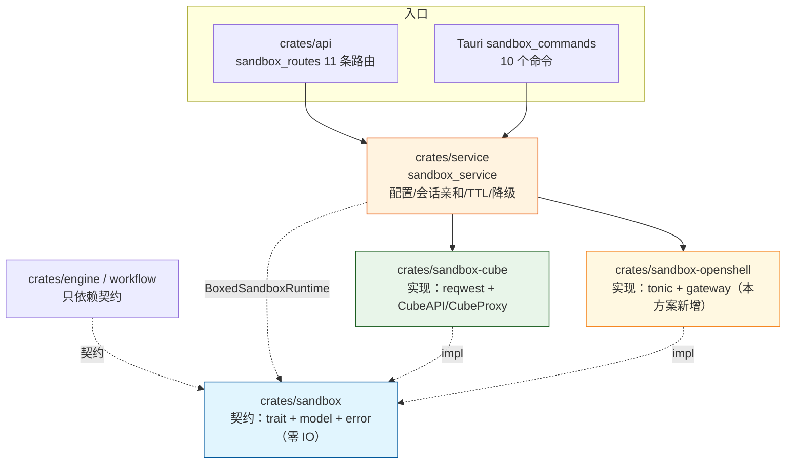
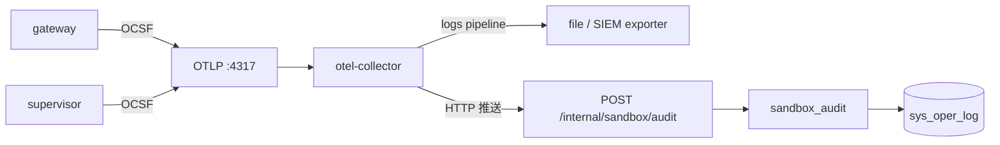

# OpenShell 沙箱整合可行性分析（嵌入式 vs 独立部署）

> 结论先行：**不推荐嵌入式，推荐「独立部署 + 客户端接入」；实现落在新增 crate `sandbox-openshell`，不并入 `crates/sandbox-cube`。**
> 契约仍由 `crates/sandbox` 持有，`service` 通过 `SANDBOX_BACKEND` 在 CubeSandbox / OpenShell / Disabled 之间切换。

---

## 目录

1. [背景与结论](#1-背景与结论)
2. [事实核对：OpenShell 是什么](#2-事实核对openshell-是什么)
3. [两层「嵌入式 vs 独立部署」必须分开看](#3-两层嵌入式-vs-独立部署必须分开看)
4. [仓库现状与既有约束](#4-仓库现状与既有约束)
5. [候选方案对比](#5-候选方案对比)
6. [推荐方案：独立部署 + sandbox-openshell](#6-推荐方案独立部署--sandbox-openshell)
7. [契约映射与语义落差](#7-契约映射与语义落差)
8. [错误模型映射](#8-错误模型映射)
9. [安全边界](#9-安全边界)
10. [构建与依赖影响](#10-构建与依赖影响)
11. [测试方案](#11-测试方案)
12. [实施计划](#12-实施计划)
13. [风险与权衡](#13-风险与权衡)
14. [变更文件清单](#14-变更文件清单)
15. [待确认事项](#15-待确认事项)
16. [变更记录](#16-变更记录)

---

## 1. 背景与结论

需求：把 [NVIDIA OpenShell](https://docs.nvidia.com/openshell/latest/) 接入现有沙箱体系，落在 `sandbox` / `sandbox-cube` 这两个 crate 附近；需要判断**嵌入式**还是**单独部署**。

| 结论 | 内容 |
|------|------|
| 🧭 **部署形态** | **独立部署**（gateway 独立进程/容器/Helm Release），平台侧只做 gRPC 客户端 |
| 📦 **代码归属** | **新增 `crates/sandbox-openshell`**；`crates/sandbox-cube` 保持单协议、零改动 |
| 🧱 **契约** | 扩展 `crates/sandbox`（补 `image` / `command` / `labels` / `policy` / `endpoint`），保持向后兼容 |
| 🔀 **切换方式** | `service::sandbox_service` 增加 `SandboxBackend` 枚举，配置 `SANDBOX_BACKEND=cube\|openshell` |
| 🖥️ **桌面端** | 不可本地部署（Windows 不在官方安装路径内），维持 `SANDBOX_ENABLED=false` 或连内网 gateway |
| 🔀 **调用形态** | 默认 **M2 / M1b：Agent 整体跑在沙箱内**；`SANDBOX_AGENT_IN_SANDBOX=false` 回退 M1a（Agent 在平台进程内，见 §6.6） |
| 📊 **审计** | OCSF → OTel collector，**同时**落 `sys_oper_log`（双通道，见 §6.8） |

否决嵌入式的两条硬理由：

1. **架构上不可嵌入**：OpenShell 是「控制面 gateway + supervisor + compute driver」的分布式运行时，对外只有 gRPC（`:8080`）/ CLI / SDK；gateway 必须能访问容器运行时（`/var/run/docker.sock` 或 Podman socket / K8s API / MicroVM 驱动），还要自带状态库（`OPENSHELL_DB_URL`，缺省 sqlite）与 TLS 证书目录。
2. **安全上不该嵌入**：把 gateway 并进业务进程/容器，等于把 Docker root 等价能力交给平台 API 进程，直接违反本文档 §9 与 Cube 方案 §8.4 的安全边界。

---

## 2. 事实核对：OpenShell 是什么

> 依据 NVIDIA 官方文档 v0.1.8（`/about/architecture`、`/about/installation`、`/how-it-works/gateways/*`、`/how-it-works/sandboxes/*`、`/sdk/rust`）。`/about/support-matrix` 抓取失败，OS 支持范围以安装文档为准，落地前需再核。

| 维度 | 事实 |
|------|------|
| 定位 | 面向 AI Agent 舰队的开源运行时（Apache-2.0），保护文件、凭证与出网 |
| 隔离 | **内核级**：Landlock（文件）+ seccomp（进程）+ 出网代理策略 + OPA；策略支持形式化验证（policy prover） |
| 组件 | **gateway（控制面）** / **supervisor（每沙箱一个，确认隔离边界后才启动 agent）** / **compute driver** / **sandbox workload** |
| 驱动 | Docker、Podman、Kubernetes、MicroVM；**同一套 gateway API**，差异在 workload 形态 |
| 接口 | **gRPC / protobuf 单一控制面**（服务命名空间 `openshell.v1.*`，如 `openshell.v1.SandboxUpdates/UpdateSandbox`；端口 `8080`，`OPENSHELL_GRPC_ENDPOINT`）；**没有 REST 风格的沙箱管理 API**；另有 Prometheus 指标端口（默认关闭、无鉴权）与健康端点 |
| 鉴权 | 网关 JWT（supervisor 用）/ Sandbox JWT（每 generation 一对）/ OIDC Bearer；共享部署可设 `gateway_jwt.ttl_secs` |
| 可观测 | Traces → OTLP；Metrics → Prometheus（`metrics_bind_address`，默认关）；**OCSF 安全事件**三种出口：shorthand 日志 / JSONL 文件 / **OTLP log export（可直送 SIEM）** |
| Rust SDK | `openshell-sdk`：`ClientConfig::new("<gateway-url>")` → `OpenShellClient::connect()`；支持 server-auth TLS + `ca_cert`、OIDC Bearer；**不支持 mTLS 客户端证书**，也不读 CLI 的 gateway 注册表 |
| 发布渠道 | **未发布到 crates.io**（实测 `https://crates.io/api/v1/crates/openshell-sdk` → 404），只提供 `git = "https://github.com/NVIDIA/OpenShell", tag = <release-tag>` |
| 部署 | 系统包（deb/rpm/snap/brew）· 容器 `ghcr.io/nvidia/openshell/gateway` · K8s Helm（`oci://ghcr.io/nvidia/openshell/helm-chart`） |
| 容器驱动前置 | 挂 `/var/run/docker.sock`；**supervisor 二进制必须以同一绝对路径 bind-mount**（`~/openshell/supervisor/openshell-sandbox`）；SELinux 宿主加 `--security-opt label=type:container_runtime_t` |
| 状态 | `Ready` / `Stopped` / `Completed` / `Error(MainProcessFailed…)`；`stop` / `start` **幂等**，保留持久工作区，但**不恢复进程内存与终端历史**，且起新 generation 会作废旧 SSH 会话 |
| 宿主 OS | 官方安装路径覆盖 **Linux / macOS**（驱动为 Docker/Podman/K8s/MicroVM）；**Windows 不在其列** |
| 版本纪律 | 文档明确「SDK 与 gateway 尽量同 release」；当前 0.1.x，破坏性变更频繁 |

### 2.1 与本需求直接相关的四条结论

1. **没有「库形态」的官方接入路径**：能拿到的只有 gRPC 客户端（SDK/CLI/自己写 tonic）。
2. **gateway 需要宿主特权**：容器运行时 socket 或 K8s 凭据 → 与业务后端必须分权。
3. **pause/resume 语义不等价**：Cube 是内存快照，OpenShell 是冷启停（只保工作区）。
4. **依赖未上 crates.io**：git 依赖会打破本仓库「首次构建可离线」的既有承诺。

---

## 3. 两层「嵌入式 vs 独立部署」必须分开看

### 3.1 代码层：能不能把 OpenShell 链进 Rust 进程

| 尝试 | 结果 | 原因 |
|------|------|------|
| `openshell-sdk` 作为依赖、业务进程内直连自己的 gateway | ✅ 可行，但这**不是嵌入**，仍是远程客户端 | SDK 是 tonic 客户端，需要先有可达的 gateway |
| 把 gateway 编进 `assets-server` / Tauri 进程 | ❌ 否决 | 需要容器运行时、状态库、PKI、systemd/特权；且 Windows 桌面无 Landlock/seccomp |
| 同机启动 gateway 子进程（`bootstrap` 里 spawn + 健康检查） | ⚠️ 仅单机可行 | 形态上是「进程外」，仍要 Linux + Docker；排障/升级与平台进程耦合，不建议进产品代码 |

### 3.2 部署层：gateway 与平台后端是否同机

| 拓扑 | 适用 | 评价 |
|------|------|------|
| 桌面端本地 gateway | Windows 桌面 | ❌ 不可行（无官方支持路径） |
| 与 `assets-server` **同容器** | — | ❌ 需把 `docker.sock` 挂进业务容器 = 业务进程等价 root |
| 与 `assets-server` **同机不同容器**（compose sidecar） | 开发 / 单机演示 | ⚠️ 可用，但沙箱是 CPU/内存密集型，噪声邻居；仅建议 dev |
| **独立主机 / 独立 K8s 节点池 + Helm** | 生产 | ✅ **推荐** |

> 因此「嵌入式」在两层都不成立；可讨论的只是「同机 sidecar」这一折中，而它在生产上不推荐。

### 3.3 集成模式分类（Integration Patterns）

> 「调用关系」与「部署形态」是正交的两件事：下表的 M1~M8 **全部要求 OpenShell 独立部署**，只有 M7 属于本文档否决的「嵌入式」。

| # | 模式 | 控制流方向 | OpenShell 侧角色 | 部署要求 | 本仓库落点 | 结论 |
|---|------|-----------|------------------|----------|------------|------|
| **M1** | Backend / Engine（SDK 调用） | 平台 → gateway | 执行引擎 | 独立 | `service::sandbox_service` → `sandbox-openshell` | ✅ 采纳（主路径） |
| **M2** | Agent-in-Sandbox（沙箱托管 Agent） | gateway 托管主进程 | 运行时宿主 | 独立 | `openshell_image` + `openshell_command`；平台只编排/审批 | ✅ **默认形态**（见 §6.6） |
| M3 | Gateway Interceptor（控制面治理插件） | gateway → 外部服务 | 被治理方 | 独立 + 平台 HTTPS 服务 | 审批 / 配额 / DLP / 审计回调 | ⚠️ P6 评估 |
| M4 | Supervisor Middleware（数据面流量插件） | supervisor → 外部服务 | 被治理方 | 独立 + 外部 HTTPS 服务 | 内容脱敏、把模型调用路由回平台 LLM 网关 | ⚠️ P6 评估（高权限） |
| M5 | Driver / Isolation Backend | gateway → 你的驱动 | 被扩展方 | 独立 + Rust 实现 | 企业 secret store / 自研运行时 | ❌ 当前无需求 |
| M6 | CLI 子进程封装 | 平台 spawn `openshell` | 被包装 | 独立 + 宿主装 CLI | 仅 CI 场景；错误不可分类、stdout 需解析 | ❌ 反模式 |
| M7 | 进程内链接（真嵌入） | 同进程 | — | 不可行 | — | ❌ 否决 |
| **M8** | 审计 / 可观测接入 | gateway/supervisor → collector | 被观测方 | 独立 | OCSF → OTel + `sys_oper_log` | ✅ 采纳（见 §6.8） |

```mermaid
graph LR
    subgraph 平台（本仓库）
        SVC[sandbox_service<br/>sandbox-openshell]
        AUD[sandbox_audit<br/>OCSF → sys_oper_log]
    end
    GW[OpenShell gateway]
    SB[sandbox<br/>agent 或 解释器]
    EXT[扩展服务<br/>interceptor / middleware]
    COL[otel-collector]

    SVC -->|M1 gRPC| GW
    GW -->|M2 托管主进程| SB
    GW -->|M3 控制面写操作| EXT
    SB -->|M4 出站 HTTP/WS| EXT
    GW -->|M8 OCSF/OTLP| COL
    COL -->|logs| AUD
    SB -.->|M8 supervisor OCSF| COL

    style SVC fill:#fff8e1,stroke:#f57f17
    style AUD fill:#fff8e1,stroke:#f57f17
    style GW fill:#e8f5e9,stroke:#1b5e20
```

> 扩展点（M3/M4/M5）不是进程内插件：它们是**外部服务**，通过 typed contract（`Describe` 清单协商）+ JWT（`typ=openshell-ext+jwt`、`alg=EdDSA`、`iss=openshell-gateway:<id>`、`aud` 需精确匹配）+ 强制 `https://` 接入。这从机制上排除了「打进同一个二进制」的集成方式。

### 3.4 外部材料核验表（对照 OpenShell v0.1.8 官方文档，2026-11-13）

> 本节用于防止后续设计被未经核实的说法带偏。标注：✅ 有据 · ⚠️ 部分准确/表述失准 · ❓ 官方文档未见 · ❌ 与文档不符。

| 外部说法 | 结论 | 依据 / 正确表述 |
|----------|------|-----------------|
| OpenShell 是可集成的运行时后端与基础设施组件 | ✅ | 架构上控制面/数据面/基础设施三层都有扩展点 |
| 通过「插件系统」嵌入现有平台 | ⚠️ | 有 4 个扩展点（middleware / interceptor / driver / isolation backend），但**都是外部服务 + typed contract + JWT**，无进程内插件 |
| OpenClaw 是 OpenShell 官方托管沙箱后端之一 | ❓ | 官方 Overview 只点名 **Claude Code / OpenCode / Codex / GitHub Copilot CLI**，通篇无 OpenClaw；视为第三方集成，不作本文档依据 |
| Agent 框架可通过 CLI/API 启动隔离环境 | ✅ | 即 M1 / M6；M6 仅适合 CI |
| Gateway 暴露 **RESTful 或 gRPC** 接口 | ❌ | 只有 **gRPC/protobuf 单一控制面**（`:8080`，`OPENSHELL_GRPC_ENDPOINT`）；另有 Prometheus 指标端口（默认关）与健康端点，**无 REST 管理 API** |
| CI/CD 中用沙箱跑不可信测试代码 | ✅ | 合理场景；需独立凭据/配额（本文档列为 P6 观察项） |
| 策略可与 **OIDC** 集成 | ✅ | Gateway 支持 OIDC 用户认证与反向代理鉴权终止 |
| 策略可与 **LDAP** 集成 | ❓ | 文档未见 LDAP；如需要应在网关前置代理完成 |
| 审计日志实时发送外部安全系统（如 Cisco AI Defense） | ✅ 机制 / ❓ 厂商 | 机制是 **OCSF 事件 → OTLP log export**，文档明确可指向「a collector that feeds a **SIEM**」；OCSF 为开放标准，Cisco AI Defense 专用联动未见文档 |
| 「隐私路由机制」在沙箱外自动脱敏 | ⚠️ | 无此命名机制。等价能力：**provider 凭证占位符** + **supervisor middleware**（策略评估之后、凭证注入之前，可检查/改写/拒绝 HTTP 与 WS 流量），脱敏需自行实现 middleware |
| VS Code / IDE 插件 | ❓ | v0.1.8 只提供 CLI + TUI |
| 镜像模式（Mirror Mode）与本地工作区自动同步 | ❓ | 文档未见。最接近的是 `sandbox upload`（尊重 `.gitignore`）与 workspaces，**无双向同步模式** |
| 需 NVIDIA Container Toolkit + GPU 驱动 | ⚠️ 条件成立 | 仅 **GPU 工作负载**需要；OpenShell 本体前提是 Docker/Podman/K8s/MicroVM + Linux/macOS 宿主。本平台沙箱执行 CPU 代码，**不新增该前置** |
| 默认拒绝所有出站网络 | ✅ | default-deny network policy |
| Supervisor 可「动态批准」网络访问 | ⚠️ | 实际是**网络策略运行时可热重载**，非交互式审批；文件系统/进程策略在**建箱时锁定** |
| 需配置 Cgroups 资源限制 | ⚠️ 未文档化 | 资源限制由 compute driver 决定，OpenShell 未作为可配置项文档化 |

---

## 4. 仓库现状与既有约束

当前分层（`docs/知识库模块/CubeSandbox沙箱crate整合设计方案.md` v1.1 已实施）：



已核实的关键约束：

| 位置 | 现状 | 对本方案的影响 |
|------|------|----------------|
| `crates/sandbox/src/runtime.rs` | `SandboxRuntime` trait（含可选 `create_snapshot/rollback/logs`） | 新实现直接挂上，无需改 trait |
| `crates/sandbox/src/model.rs` | `SandboxSpec` 只有 `template_id/...`；`SandboxHandle` 有 Cube 专有 `data_host_suffix`/`envd_port`；`SandboxState` 仅 4 值 | 需**向后兼容**扩展（见 §7） |
| `crates/service/src/sandbox_service.rs:129` | `runtime()` 硬编码 `CubeSandboxRuntime::from_env()`，失败降级 `DisabledRuntime` | 改造成后端选择（唯一必须动逻辑处） |
| `crates/api/src/sandbox_routes.rs` | DTO 全用契约类型；`service_error()` 按文案映射 503/400/500 | **零改动** |
| `crates/api/src/lib.rs:514` | 11 条路由已挂 `protected_routes` | **零改动** |
| `crates/bootstrap/src/config.rs:94` | `[section] key` → `SECTION_KEY`；**只认 String/Integer/Float/Boolean，数组与嵌套表被跳过**（`postgres.read_replicas` 单独特判） | 新配置必须**扁平、标量**（命令列表用逗号串或程序内默认） |
| 根 `Cargo.toml` | `[workspace.dependencies]` 唯一版本来源，**不允许 optional**；members 只能追加 features | `openshell-sdk` 只能放 workspace 表或以 optional 声明在成员 crate |
| `crates/sandbox/Cargo.toml` 注释 | 「契约 crate 刻意零 HTTP / 零 IO 驱动」「未来接 E2B / 本地 Docker 只需再新增一个实现 crate」 | **新增兄弟 crate 才是既定路线** |
| `docs/桌面与Web双形态部署指南.md:98` | 运行期外部依赖清单：PG / S3 / SurrealDB / doc-parser / OTel | 需补一行 OpenShell gateway（按需） |

---

## 5. 候选方案对比

| 维度 | A. 嵌入式（链接进进程 / 进程内起 gateway） | **B. 独立部署 + 新增 `sandbox-openshell`** | C. 独立部署 + 塞进 `sandbox-cube` |
|------|------|------|------|
| 可行性 | ❌ 需容器运行时 + 特权 + 自有 DB/TLS；Windows 不可能 | ✅ | ✅ |
| 与既有分层一致 | ❌ | ✅（对齐 `llm/llm-openai`、`vector/vector-*`） | ❌ 一 crate 两协议栈 |
| 安全 / 隔离 | ❌ 业务进程拿 Docker root | ✅ 分权、分故障域 | ✅ 但依赖树污染 |
| 桌面端影响 | 灾难 | 中：多一个庞大的 gRPC 依赖树 | 大：cube 的用户被迫编入 tonic |
| 可替换 / 可回滚 | ❌ | ✅ `SANDBOX_BACKEND` 一行切换 | ⚠️ |
| 依赖纪律 | — | ✅ `reqwest` 与 `tonic` 物理隔离 | ❌ 冲突 |
| 运维成本 | 低部署 + 高排障 | 中（一套 compose/Helm） | 中 |
| **结论** | 否决 | **采纳** | 否决 |

> 注：本表「嵌入式」**专指 M7（把 gateway 链接进业务进程）**，不含 M1~M6 的客户端/外部服务式集成 —— 后者全部要求独立部署。

否决 A 的补充证据：gateway 的 Docker 驱动要求把 supervisor 二进制以**宿主绝对路径**挂进沙箱容器，并把 `docker.sock` 挂进 gateway —— 这些都不是「库」能承担的职责，而是宿主运维契约。

---

## 6. 推荐方案：独立部署 + sandbox-openshell

### 6.1 crate 结构

```
crates/sandbox-openshell/
├── Cargo.toml          # sandbox + openshell-sdk(git, tag) + async-trait + tokio + serde + tracing + thiserror
├── src/
│   ├── lib.rs          # OpenShellRuntime::from_env() / 重导出
│   ├── client.rs       # OpenShellOptions：gateway_url / token / ca_cert / workspace / 超时；Debug 脱敏
│   ├── convert.rs      # SandboxSpec→gateway 请求、phase→SandboxState、exec 结果转换
│   ├── policy.rs       # 依据 NetworkPolicy / 白名单生成策略 YAML（文件系统 / 网络 / 进程）
│   ├── error.rs        # tonic Status / gRPC Code → SandboxError + hint
│   └── wire.rs         # （可选）SDK 类型与契约类型之间的私有中间层
└── tests/
    └── control.rs      # 假 gateway（tonic server）形状测试 + #[ignore] 真集群端到端
```

**禁止**：`sandbox-openshell` 反向依赖 `service` / `database` / `api`；禁止把 `openshell-sdk` 加到 `crates/sandbox`（契约必须继续零 IO）。

### 6.2 service 接入（唯一逻辑改动）

```rust
/// 沙箱后端（`SANDBOX_BACKEND`，缺省 cube 以保持现有行为）
#[derive(Debug, Clone, Copy, PartialEq, Eq, Default)]
pub enum SandboxBackend {
    #[default]
    Cube,
    OpenShell,
}

// runtime() 内：
if !config.should_enable() {
    return Arc::new(DisabledRuntime);
}
let runtime: Arc<dyn SandboxRuntime> = match config.backend {
    SandboxBackend::Cube => match CubeSandboxRuntime::from_env() { /* 现有逻辑 */ },
    SandboxBackend::OpenShell => match OpenShellRuntime::from_env() { /* 失败同样降级 Disabled */ },
};
```

约定：

1. `should_enable()` 的判定改为「`enabled` 且 **当前后端所需的最小配置齐全**」（Cube：`base_url`；OpenShell：`openshell_gateway_url`）；
2. 初始化失败一律降级 `DisabledRuntime` + `tracing::warn!`，**不允许阻断启动**（沿用既有策略）；
3. `RUNTIME` 仍是 `OnceLock`；为可测性补一个 `#[cfg(test)] fn set_runtime_for_test(Arc<dyn SandboxRuntime>)`。

### 6.3 配置（`apps/backend/.env.example.toml`）

> `bootstrap::config::apply_table` 只映射**标量**，因此全部保持扁平 key；不要写成 `[sandbox.openshell]` 嵌套表。

```toml
# ======================== 沙箱（CubeSandbox / OpenShell）========================
[sandbox]
# 总开关：false = DisabledRuntime（能力不可用但进程正常启动）
enabled = false
# 后端选择：cube（默认，现有行为）| openshell
backend = "cube"

# ---- Cube 段保持原样（base_url / api_key / template_id / data_host_suffix / envd_port / proxy_node_ip / python）----

# ---- OpenShell 段：gateway 是独立部署的服务，平台只做 gRPC 客户端 ----
# gateway 地址（gRPC，缺省端口 8080；TLS 时用 https://）
openshell_gateway_url = "http://127.0.0.1:8080"
# OIDC Bearer（留空 = 无鉴权，仅限内网/本地调试）
openshell_token = ""
# 私有 CA 的 PEM 路径（server-auth TLS 时使用；SDK 不支持 mTLS 客户端证书）
openshell_ca_cert = ""
# 目标 workspace（多租户隔离边界；缺省 default）
openshell_workspace = "default"
# 沙箱工作负载镜像（OpenShell 的“模板”就是容器镜像 + 主进程命令）
openshell_image = ""
# 主进程命令：逗号分隔（apply_table 不支持数组），例如 "python,-u,/opt/agent/main.py"
openshell_command = ""
# 策略文件（YAML 路径）或预置 profile 名；留空用默认策略
openshell_policy = ""
# 建箱后等待 Ready 的超时（秒）
openshell_ready_timeout_secs = 120
```

映射结果：`SANDBOX_BACKEND`、`SANDBOX_OPENSHELL_GATEWAY_URL`、`SANDBOX_OPENSHELL_TOKEN` ……**无需改加载代码**。

### 6.4 部署拓扑

```mermaid
graph LR
    subgraph 平台侧（现有）
        WEB[apps/web] --> BE[assets-server / Tauri]
        BE --> SVC[service::sandbox_service]
        SVC --> CLI[sandbox-openshell<br/>gRPC 客户端]
    end
    subgraph 沙箱基础设施（新增，独立部署）
        GW[OpenShell gateway :8080<br/>状态库/TLS/JWT]
        SUP[supervisor<br/>每沙箱一个]
        DRV[compute driver<br/>docker / podman / k8s / microvm]
        SB[sandbox workload]
    end
    CLI -->|gRPC| GW
    GW --> DRV
    DRV --> SB
    GW --> SUP
    SUP --> SB

    style CLI fill:#fff8e1,stroke:#f57f17
    style GW fill:#e8f5e9,stroke:#1b5e20
```

| 场景 | 交付物 | 说明 |
|------|--------|------|
| 开发 / 单机 | `docker-compose.yml` 增 `openshell-gateway` 服务 | `ghcr.io/nvidia/openshell/gateway:latest`、`-p 127.0.0.1:8080:8080`、`-v openshell-state:/var/openshell`、`-v /var/run/docker.sock:/var/run/docker.sock`、`OPENSHELL_DB_URL=sqlite:/var/openshell/gateway.db`；**与 assets-server 分容器** |
| 生产（K8s） | Helm `oci://ghcr.io/nvidia/openshell/helm-chart` | 独立命名空间 / 独立节点池；平台侧只配 URL + token + CA |
| 桌面端 | 不部署 | `SANDBOX_ENABLED=false`；或连内网 gateway（与 Cube 同路径） |

### 6.5 租户映射

| 平台概念 | OpenShell 概念 | 映射 |
|----------|----------------|------|
| 租户（schema 名） | `workspace`（多租户边界）/ labels | 首选「一租户一 workspace」（需 gateway 侧预建 + OIDC 授权）；退化为 `labels.tenant=<schema>` |
| 用户 / 会话 | `labels` / `annotations` | `user_id` / `session_id`，`list` 用 labels 过滤 |
| `SessionKey` | sandbox 名称/句柄 | 仍由 `service` 的 `DashMap` 做亲和，句柄里存 gateway 侧名称 |

> OpenShell 的多租户 supervisor 仍是**实验特性**；生产若走「一租户一 workspace」，需先确认配额与 RBAC 方案。

### 6.6 Agent 的两种落位：默认沙箱内（M2 / M1b），可回退平台进程（M1a）

**决策**：缺省 **Agent 整体运行在 OpenShell 沙箱内**（§3.3 的 M2，即 M1 的后端模式的"沙箱托管"子形态 M1b）——OpenShell 的设计中心正是「策略 + 凭证占位符 + supervisor 托管」；`SANDBOX_AGENT_IN_SANDBOX=false` 时回退到 **M1a：Agent 在平台进程内，沙箱只执行工具代码**。

| 维度 | **M1b / M2（默认）Agent 在沙箱内** | **M1a（回退）Agent 在平台进程内** |
|------|-----------------------------------|-----------------------------------|
| 推理 / 规划 / 记忆 | 沙箱镜像内的 agent 运行时 | `workflow/src/agent.rs`（adk-graph StateGraph）+ `service::llm_gateway_service` |
| 沙箱职责 | 保护 agent 的**全部** shell / 文件 / 网络 | 只保护「代码/命令执行」这一段 |
| 调用链 | 平台 → `create` + 长驻会话/流式交互 | `agent.rs` → 工具 → `api::skill_routes` → `sandbox_service::exec_code` |
| 换后端改动量 | `sandbox_node` 语义升级（会话化） | **仅装配层**（`sandbox_service.rs`），业务零改动 |
| 凭证 | 可用 OpenShell provider 托管（需按 §9 评审） | 平台持有 LLM Key（符合现有边界） |
| 隔离强度 | 高（agent 的越权尝试同样被策略拦截） | 中（agent 本身在平台进程内运行） |
| 适用 | 第三方/不可信 Skill、长任务、需要联网与文件访问 | 内部可信 Skill、短任务、需要平台上下文（DB / RAG） |

**开关与配置**（`bootstrap::config` 只映射标量，全部扁平）：

```toml
[sandbox]
# true（缺省）= Agent 在沙箱内（M1b/M2）；false = 平台进程内（M1a）
agent_in_sandbox = true
# M1b 时镜像必须自带 agent 运行时；M1a 时只需解释器镜像
openshell_image = ""
openshell_command = ""
```

**对现有代码的精确影响**：

| 文件 | M1b（默认） | M1a（回退） |
|------|-------------|-------------|
| `workflow/src/sandbox_node.rs` | 需扩展：会话句柄复用、流式输出、审批中断 | 不改（`execute(runtime.as_ref(), ...)` 已契约驱动） |
| `workflow/src/agent.rs` | 需重构：agent 生命周期移入沙箱，平台只保留编排 | 不改 |
| `engine/src/skill_sandbox.rs` | 价值下降（策略由 OpenShell YAML 承担），保留为「提交前静态预检」 | 继续做白名单预检 |
| `docs/Zeph+AgentGateway…` Phase 4 的 `engine/sandbox/wasm_runtime.rs` | 建议改为「由 OpenShell 承载第三方工具执行」，避免重复建设 | 同左 |

**语义差异（必须写进用户提示）**：

| 项 | M1b | M1a |
|----|-----|-----|
| 一次执行 vs 长驻会话 | 长驻（有状态、可多轮） | 一次请求-响应 |
| `pause` / `resume` | 冷启停（丢内存态，见 §7.1） | 同左（由后端决定） |
| 超时 | 会话级 + 单次执行两级 | 仅单次执行 |
| 输出 | 流式（stdout/stderr 分片） | 聚合后返回（现有 `ExecResult`） |

### 6.7 与平台 LLM 网关的边界（L1 / L2 / L3）

平台已有 `service::llm_gateway_service::LLMRouter` + `llm_provider` 表 + `llm_call_record` 计量。OpenShell 的 provider / inference supervisor 会接管「模型调用 + 凭证还原」，必须明确归属：

| 路线 | 做法 | 计量 / 密钥 | 结论 |
|------|------|-------------|------|
| **L1（采纳）** | 沙箱内 agent 出网访问**平台 LLM 网关**；OpenShell 网络策略只放行该域名/端口 | 计量、密钥、限流、审计全部留在平台 | ✅ 默认 |
| L2 | 用 OpenShell provider 托管模型凭证 | 凭证与调用记录落在 gateway，与 `llm_call_record` 冲突 | ❌ 不用于平台模型；仅限「沙箱专用第三方模型」并按 §9 评审 |
| L3 | 双轨（内部模型走 provider，对外走平台网关） | 两套计量 | ❌ 复杂度最高 |

L1 的落地要点：

1. 策略 YAML 的网络规则只允许 `llm-gateway.internal:<port>`（由 `NetworkPolicy::AllowDomains` 生成）；
2. 平台 LLM 网关需提供服务间鉴权（复用现有 API Key 机制），并按 `tenant` / `session_id` 计量；
3. 若网关在集群内不可直达，由 supervisor middleware 做一次转发（属 M4，高权限，进 P6 评估）。

### 6.8 审计与可观测接入（OCSF → OTel + `sys_oper_log`）

**决策**：**双通道** —— OCSF 事件既进 OTel（统一可观测），也落 `sys_oper_log`（业务审计可查询）。



#### A. 通道 1：OTel

`gateway.toml`（Helm 部署时放在 `gatewayConfig` 下）：

```toml
[openshell.gateway]
# Prometheus 指标（默认关闭；**无鉴权**，只绑内网）
metrics_bind_address = "127.0.0.1:9090"

[openshell.gateway.otlp]
endpoint = "http://otel-collector:4317"

# OCSF 默认不随 traces 一起导出，必须显式打开
[openshell.gateway.otlp.ocsf]
enabled = true
```

仓库侧 `otel-collector-config.yaml` **已有 logs pipeline**（`otlp → batch → logging/debug`），因此只需按需追加 exporter：

```yaml
exporters:
  file:
    path: /var/log/otel/ocsf.log

service:
  pipelines:
    logs:
      receivers: [otlp]
      processors: [batch]
      exporters: [logging, debug, file]   # 需要 SIEM 时再加 otlphttp
```

> 注意：collector 必须对 **gateway 与每个 sandbox supervisor** 都可达（supervisor 走自己的 OCSF 出口）。

#### B. 通道 2：落 `sys_oper_log`

现状：表已存在（`crates/database/src/sql/knowledge_module_migration.sql:116`，字段 `id/user_id/oper_module/oper_type/oper_content/target_id/ip/client_info/created_at`），但**仓库内没有任何 Rust 代码写入它**（实测 grep 无匹配）。

新增 `crates/service/src/sandbox_audit.rs`，通过 `crates/api` 的内部端点接收 collector 推送：

| OCSF 字段 | `sys_oper_log` 列 | 说明 |
|-----------|-------------------|------|
| class / activity（如 `NET:OPEN … DENIED`） | `oper_module` / `oper_type` | `oper_module='sandbox'`；`oper_type` 归一化为 `policy_denied` / `process_start` / `session_open` / `config_change` |
| 完整 OCSF JSON（截断 8 KiB，含 `event_uid`） | `oper_content` | 原文保留，便于复核 |
| sandbox 名 → 业务 `scope`（`conv:` / `wf:` / `skill:`） | `target_id` | 需业务侧映射；无对应写 `NULL` |
| `src_endpoint.ip` | `ip` | 仅网络类事件 |
| `agent=openshell, sandbox=<name>, generation=<n>` | `client_info` | 便于关联同一次建箱 |
| `labels.user_id` | `user_id` | 缺失写 `NULL`（不伪造） |
| OCSF `time` | `created_at` | **显式写入事件时间**，不要依赖 `DEFAULT NOW()` |

实现要点：

1. **幂等**：OCSF 有 `event_uid` → 首版在应用层按 `oper_content` 内嵌 uid 去重；稳定后增加迁移列 `event_uid VARCHAR(64)` + 唯一索引；
2. **保留期**：`SANDBOX_AUDIT_RETENTION_DAYS`（缺省 180），复用 `crates/api/src/lib.rs` 的 `spawn_cleanup_task()` 模式做定时清理；
3. **脱敏**：写入前把绝对路径归一化为 `<path>`、家目录替换为 `~`；域名与进程名保留（审计价值高）；
4. **背压**：collector 推送失败只记 WARN，不阻塞沙箱主链路；批量写入（例如 200 条/批）；
5. **权限**：内部端点必须**服务间鉴权**（复用 API Key 机制），不挂 `protected_routes`，不对公网暴露。

#### C. 可选：Prometheus 指标

`metrics_bind_address` 打开后，网关在独立端口暴露 API 请求、就绪状态、interceptor 健康度、OCSF 输出与多副本容量指标。**该端点无鉴权**，只允许内网/防火墙可达；与平台现有 OTel/Prometheus 体系对接即可，不新增依赖。

---

## 7. 契约映射与语义落差

### 7.1 `SandboxRuntime` 方法映射

| 契约方法 | OpenShell 侧 | 处理 |
|----------|--------------|------|
| `health` | `client.health()` | 直接映射，`version` 取 gateway 版本 |
| `create` | `create_sandbox(SandboxSpec{name,image,...})` + `wait_ready` | `template_id` → `image`；`metadata` → labels；`env` → env overrides |
| `connect` | 按名称查询 / 等待 Ready | 直接映射 |
| `exec` | `client.exec(name, argv, ExecOptions)` | `code` 分支拼 `python -c`（解释器可配）；`command`+`argv` 直传；`cwd`/`env` 进 options |
| `read_file` / `write_file` | SDK 文件传输 RPC（若未暴露则退化为 `exec` + base64/tar） | 受 `MAX_TRANSFER_BYTES` 约束；退化路径必须写进实现注释 |
| `list_files` | 同上（`ls -la` 解析或 RPC） | 解析失败返回 `Decode` |
| `list` | 按 labels 过滤 | **强制带 `tenant` 过滤**，禁止跨租户枚举 |
| `set_timeout` | 无对应 RPC | `Ok(())` 空实现（注释说明） |
| `pause` | `sandbox stop` | ⚠️ **语义降级**：不保内存快照 |
| `resume` | `sandbox start` | ⚠️ 新 generation，旧 SSH 会话失效 |
| `kill` | `delete_sandbox` + `wait_deleted` | 直接映射 |
| `create_snapshot` / `rollback` | 未见等价能力 | 保持 trait 默认 `Unsupported` |
| `logs` | 若 gateway 暴露则实现，否则 `Unsupported` | 待实测 |

### 7.2 契约扩展（向后兼容，不破坏 `sandbox-cube`）

| 类型 | 变更 | 兼容策略 |
|------|------|----------|
| `SandboxSpec` | 新增 `image: Option<String>`、`command: Vec<String>`、`labels: BTreeMap<String,String>`、`policy_yaml: Option<String>` | 全部 `#[serde(default)]` + `Default`，Cube 实现忽略 |
| `SandboxHandle` | 新增 `endpoint: Option<String>` | 保留 `data_host_suffix` / `envd_port`（Cube 用），OpenShell 填 `""`/`0` |
| `SandboxState` | 不新增枚举值 | `Ready→Running`、`Stopped→Paused`、`Completed/Error/Creating→Unknown`；`Unknown` 分支现有逻辑（kill + 重建）正好适用 |
| `NetworkPolicy` | 不变 | `DenyAll` → 默认全禁策略；`AllowDomains` → 生成 L7 允许规则 |
| 常量 | 不变 | `MAX_*` 在实现层统一校验 |

> 不改 `SandboxState` 的理由：`api` / Tauri / 前端已按 4 值消费；新增枚举值会波及 `utoipa` schema 与前端适配层，收益不足以抵消破坏面。

### 7.3 必须写进用户可见提示的降级

| 场景 | 用户可见 |
|------|----------|
| `pause` 后 `resume` | 「沙箱已重新启动：持久文件保留，**内存中的变量与终端历史已丢失**」 |
| 跨端接管 | 旧交互会话失效，需重新建立 |
| 快照能力 | 503 + 「当前后端不支持快照/回滚」 |

---

## 8. 错误模型映射

`tonic::Status` / gRPC `Code` → `SandboxError`：

| gRPC Code | `SandboxError` | `kind()` | 重试 |
|-----------|----------------|----------|------|
| `Unauthenticated` / `PermissionDenied` | `Auth` | auth | ❌ |
| `NotFound` | `NotFound` | not_found | ❌ |
| `AlreadyExists` / `Aborted` / `FailedPrecondition` | `Conflict` | conflict | ❌ |
| `ResourceExhausted` | `RateLimited`（`retry_after` 取 metadata，缺省 1s） | rate_limited | ✅ |
| `InvalidArgument` / `OutOfRange` | `InvalidRequest { status: 400 }` | invalid_request | ❌ |
| `Unavailable` / `Internal` / `Unknown` / `DataLoss` | `Server { status, message }` | server | ✅ 退避 |
| `DeadlineExceeded` | `Timeout(secs)` | timeout | ⚠️ 仅幂等调用 |
| `Cancelled` | `Cancelled` | cancelled | ❌ |
| `Unimplemented` | `Unsupported` | unsupported | ❌ |
| 传输层（连接/DNS/TLS） | `Transport` | transport | ✅ 1 次 |

`hint()` 需补 OpenShell 专属文案（`SANDBOX_OPENSHELL_GATEWAY_URL`、token、CA、workspace），风格对齐现有 `error.rs`。

---

## 9. 安全边界

沿用并扩展现有 §8.4：

1. **不注入平台主密钥**（LLM Key / DB 串 / S3 凭证 / `JWT_SECRET`）到沙箱；
2. **例外需评审**：OpenShell 的 provider / credential placeholder 机制允许「沙箱专用、最小权限、可撤销」的凭证在**授权端点**还原。允许使用，但必须：独立签发、按沙箱维度撤销、纳入审计，且**不得**与本平台主密钥复用；
3. 出网缺省全禁；白名单落进策略 YAML，**策略文件进 Git 版本化**（可 review、可回滚）；
4. `labels` 只放标识（`tenant` / `user_id` / `session_id`），不放业务数据；`list` 必须按租户过滤；
5. `exec` 的 `user` 不由前端指定（HTTP DTO 不暴露）；
6. 平台侧只持有 gateway 的 **token / CA**，不持有容器运行时凭据；`docker.sock` 只挂给 gateway；
7. 文件传输路径归一化（拒绝 `..`）+ 大小上限；输出长度截断（`MAX_OUTPUT_BYTES`）；
8. **审计数据脱敏与保留期**：OCSF 事件含路径 / 域名 / 进程名，写入前脱敏（家目录 → `~`、绝对路径 → `<path>`），保留期缺省 180 天；
9. **Prometheus 指标端点无鉴权**（OpenShell 明确说明），只绑内网地址或防火墙白名单；
10. **supervisor middleware / gateway interceptor 是高权限组件**（可改写或拒绝流量），必须独立部署、独立评审，不进首版。

---

## 10. 构建与依赖影响

| 项 | 影响 | 应对 |
|----|------|------|
| `openshell-sdk` 未上 crates.io | `Cargo.lock` 出现 git source；**首次/CI 构建需联网**，离线环境需 vendor | 在 `[workspace.dependencies]` 用 `git + tag` 固定；部署文档写明「离线构建需 `cargo vendor`」；`README.md` 的 offline 承诺同步修订 |
| tonic / prost | 新增 gRPC 依赖树；若 SDK 未内置生成代码则**需要 `protoc`** | 落地前实测（`cargo build -p sandbox-openshell` 于干净环境）；若需 `protoc`，写进 README 前置依赖表 |
| workspace 规则 | `[workspace.dependencies]` **不允许 optional** | 若必须让桌面端不编 OpenShell：`openshell-sdk` 以 optional **在 `crates/sandbox-openshell` 本地**声明 + crate feature；但会与「开关走 env 而非 feature」冲突，**建议先无条件编译**，实测后再决策 |
| 二进制体积 | 桌面版显著增大（tonic + TLS） | 与上一条联动评估；必要时把 OpenShell 实现限定在 `server` 二进制 |
| 版本耦合 | SDK 与 gateway 必须同 release | 设计文档 + 部署清单里把两者 tag 绑死，一起升级 |
| 编译时间 | 新增 crate 与依赖 | 可接受（`profile.dev.package."*"` 已 opt-level=2） |
| 审计 / 可观测 | gateway 侧配置，平台无新依赖；`sys_oper_log` 写入复用现有 `sqlx` | 不改 `Cargo.toml`；只新增 service 模块与内部路由 |

---

## 11. 测试方案

| 层级 | 用例 | 方式 | 命令 |
|------|------|------|------|
| `sandbox` 契约 | 新增字段默认值、`endpoint` 兼容性、状态映射不回归 | 单测 | `cargo test -p sandbox` |
| `sandbox-openshell` | 配置解析与 `Debug` 脱敏、phase↔state、labels 生成、策略 YAML 生成、gRPC Code→错误映射 | 纯函数单测 | `cargo test -p sandbox-openshell` |
| `sandbox-openshell` | 建箱/执行/文件/删除的请求形状与元数据（token 头、workspace） | 假 gateway（tonic server + `TcpListener`） | `cargo test -p sandbox-openshell` |
| `sandbox-openshell` | 真集群端到端 | `#[ignore]`，需 `SANDBOX_OPENSHELL_GATEWAY_URL` / `_TOKEN` / `_IMAGE` | `cargo test -p sandbox-openshell -- --ignored` |
| `service` | 后端选择（cube/openshell/disabled）、初始化失败降级、会话复用、TTL 回收 | 注入 stub `SandboxRuntime`（新增 test-only setter） | `cargo test -p service sandbox` |
| `api` | 路由未改动，`service_error` 分类仍正确 | 现有测试 | `cargo test -p api sandbox` |
| 全量 | lint 门禁（`correctness`/`suspicious` = deny） | clippy | `cargo clippy --workspace --all-targets` |
| `sandbox_audit` | OCSF 样例 → `sys_oper_log` 行映射、脱敏、8 KiB 截断、`event_uid` 去重 | 纯函数单测 | `cargo test -p service sandbox_audit` |
| `api` | 内部端点服务间鉴权（无凭据 401）、批量背压、失败不阻塞主链路 | 集成测试 | `cargo test -p api sandbox_audit` |
| 端到端 | `openshell logs` 与 `sys_oper_log` 中同一条事件可按 `event_uid` 对齐 | 冒烟 | 见下方冒烟第 9 步 |

手工冒烟（`SANDBOX_BACKEND=openshell`）：

1. `openshell status` → `Connected` / `Authenticated`；
2. `POST /api/sandbox/sessions` → 200 + 句柄；
3. `POST .../exec`（`print(1+1)`）→ `text == "2"`；
4. `POST .../command`（`ls -la /workspace`）→ stdout 正常；
5. `POST .../files` + `GET .../files` 往返一致（base64）；
6. `POST .../pause` → `POST .../resume` → `exec` 可用，**且提示内存态丢失**；
7. `DELETE` 会话 → `exec` 返回 404/409；
8. `SANDBOX_BACKEND=cube` 重启 → 现有 Cube 链路回归；`enabled=false` → 桌面登录/资产/上传全正常；
9. 触发一次策略拒绝（`curl` 未白名单域名）→ OTel 日志与 `sys_oper_log` 同时出现同一 `event_uid`。

---

## 12. 实施计划

| 阶段 | 内容 | 交付物 | 验收 |
|------|------|--------|------|
| **P0 运维前置** | 部署 gateway（compose 或 Helm），确定 workspace / 镜像 / token / CA；记录 gateway 与 SDK tag | 部署记录 | `openshell status` = Connected；能手工 `sandbox create` + `exec` |
| **P1 契约扩展** | `SandboxSpec.{image,command,labels,policy_yaml}`、`SandboxHandle.endpoint`；补单测 | `crates/sandbox` | `cargo test -p sandbox` / `-p sandbox-cube` 全绿（零回归） |
| **P2 实现 crate** | `crates/sandbox-openshell`（client/convert/policy/error）+ 假 gateway 测试 | 新 crate | `cargo test -p sandbox-openshell` |
| **P3 service 接入** | `SandboxBackend` + `agent_in_sandbox` 开关 + 配置键 + 降级 + test-only setter | `sandbox_service.rs` | `SANDBOX_BACKEND=openshell` 时 exec 走 OpenShell；`cube` 行为不变；开关可回退 M1a |
| **P4 部署与文档** | `.env.example.toml`、`docker-compose.yml`、部署指南补「运行期外部依赖」、本文档、README 索引 | 配置 + 文档 | 按本文档可复现部署 + 冒烟清单通过 |
| **P5 审计与可观测** | gateway OCSF → OTel；`sandbox_audit` 落 `sys_oper_log`（映射 / 脱敏 / 截断 / 去重 / 保留期） | `sandbox_audit.rs` + 内部路由 + collector 配置 | 冒烟第 9 步通过；`sys_oper_log` 可按 `event_uid` 对齐 |
| **P6 可选** | 策略模板化（`NetworkPolicy` + 文件白名单 → YAML）、middleware 脱敏、CI/CD 场景、`logs`/快照能力实测 | 策略文件 + 评估结论 | 策略可 review / 可回滚 |

**里程碑**：P1~P3 完成即「代码可切后端」；P4 完成即「可交付部署」；P5 完成即「审计闭环」；P6 决定是否把 OpenShell 作为主后端。

---

## 13. 风险与权衡

| 风险 | 影响 | 缓解 |
|------|------|------|
| `openshell-sdk` 只能 git 依赖 | 离线/内网构建失败；供应链需审计 | 固定 tag + `cargo vendor`；CI 缓存；文档写明 |
| 0.1.x 破坏性变更 | 升级即编译/行为失败 | tag 绑死；实现细节全收敛在 `sandbox-openshell`；`#[ignore]` 真集群回归 |
| `pause/resume` 语义降级 | 用户丢失内存态变量 | UI/文档明确提示；关键场景仍用 Cube |
| OpenShell 与 Cube 双栈并存 | 运维面翻倍 | 明确「哪类业务用哪个后端」；配置层面隔离；只在一个环境启用 |
| 多租户（workspace）未成熟 | 跨租户越权风险 | labels 强制租户过滤 + `authz` 权限点双保险；上线前做越权测试 |
| 桌面端不可用 | 功能残缺 | 维持 `DisabledRuntime` 友好提示；企业内网提供远端 gateway |
| `docker.sock` 特权 | 宿主机被沙箱逃逸 | gateway 独立宿主/独立节点池；不把 socket 给业务容器 |
| `protoc` / 编译时间 | 开发体验 | 落地前实测；必要时按 §10 走 optional + feature |
| provider 凭证托管与「禁注主密钥」冲突 | 安全边界模糊 | 评审 + 独立签发 + 可撤销 + 审计，写入 §9 |

---

## 14. 变更文件清单

### 新增

| 文件 | 说明 |
|------|------|
| `crates/sandbox-openshell/Cargo.toml` | 依赖：`sandbox` / `openshell-sdk`(git,tag) / `async-trait` / `tokio` / `serde` / `tracing` / `thiserror`（dev: `tonic` 假服务） |
| `crates/sandbox-openshell/src/lib.rs` | `OpenShellRuntime` + `from_env()` |
| `crates/sandbox-openshell/src/client.rs` | `OpenShellOptions`（`Debug` 脱敏 token）、连接与超时 |
| `crates/sandbox-openshell/src/convert.rs` | 规格/状态/结果转换 |
| `crates/sandbox-openshell/src/policy.rs` | 策略 YAML 生成 |
| `crates/sandbox-openshell/src/error.rs` | gRPC Code → `SandboxError` |
| `crates/sandbox-openshell/tests/control.rs` | 假 gateway + `#[ignore]` 端到端 |
| `docs/知识库模块/OpenShell沙箱整合可行性分析（嵌入vs独立部署）.md` | **本文档** |
| `crates/service/src/sandbox_audit.rs` | OCSF → `sys_oper_log` 映射、脱敏、8 KiB 截断、`event_uid` 去重、保留期清理 |
| `crates/api/src/sandbox_audit_routes.rs` | 内部接收端点（服务间鉴权，**不**挂 `protected_routes`，不对公网暴露） |
| 迁移（第二阶段） | `sys_oper_log` 增 `event_uid VARCHAR(64)` + 唯一索引，把幂等从应用层下沉到 DB |

### 修改

| 文件 | 变更 |
|------|------|
| `apps/backend/src-tauri/Cargo.toml` | `[workspace.dependencies]` 增 `sandbox-openshell`（+ `openshell-sdk` git tag） |
| `crates/sandbox/src/model.rs` | `SandboxSpec` 增 `image/command/labels/policy_yaml`；`SandboxHandle` 增 `endpoint`（均带默认值） |
| `crates/sandbox/src/lib.rs` | `pub use` 新类型字段（无破坏） |
| `crates/service/Cargo.toml` | 增 `sandbox-openshell` |
| `crates/service/src/sandbox_service.rs` | `SandboxBackend` + 后端选择 + `should_enable` 分后端 + test-only runtime setter |
| `apps/backend/.env.example.toml` | `[sandbox]` 增 `backend` 与 `openshell_*`（扁平标量） |
| `docker-compose.yml` | 新增 `openshell-gateway` 服务（独立容器） |
| `docs/桌面与Web双形态部署指南.md` | §3.3 运行期外部依赖补「OpenShell gateway（按需）」 |
| `docs/知识库模块/README.md` | 文档索引增一行 |
| `README.md` | 构建前置补 `protoc`（若实测需要）/ 离线构建说明 |
| `otel-collector-config.yaml` | 按需追加 `file` / `otlphttp` exporter（logs pipeline 已存在） |
| `docker-compose.yml` | OCSF/OTLP 出口与 collector 可达性（gateway 与 supervisor 都要能到） |
| `crates/service/src/lib.rs` | `pub mod sandbox_audit;` |
| `crates/api/src/lib.rs` | 挂内部审计端点 + 审计保留期清理任务 |
| `crates/workflow/src/{agent.rs,sandbox_node.rs}` | **仅 M1b（默认形态）**：会话句柄复用、流式输出、审批中断 |
| `apps/backend/.env.example.toml` | 增 `agent_in_sandbox` / `openshell_metrics_bind` / `audit_*`（扁平标量） |

### 不改（零破坏）

| 范围 | 原因 |
|------|------|
| `crates/sandbox-cube/*` | 单协议、单驱动；新增兄弟 crate 才对 |
| `crates/api/src/sandbox_routes.rs` / `lib.rs` 路由 | 只用契约类型 |
| `apps/backend/src-tauri/src/commands/sandbox_commands.rs` | 同上 |
| `crates/engine` | 只依赖契约；`SkillSandbox` 保留「提交前静态预检」职责，不因 M1b 下线 |
| `crates/workflow` | **仅 M1a 回退形态不改**；M1b 默认形态需会话化改造（见上表「修改」） |
| `crates/bootstrap` | `[sandbox]` 段自动映射 |
| 数据库 / `sys_menu` | 后端切换不产生新权限点 |

---

## 15. 待确认事项

### 15.1 已定决策（本次评审确认）

| 项 | 决策 | 落点 |
|----|------|------|
| Agent 落位 | **默认 M2 / M1b：Agent 整体跑在沙箱内**；`SANDBOX_AGENT_IN_SANDBOX=false` 回退 M1a（平台进程内） | §6.6 |
| 审计通道 | **双写**：OCSF → OTel collector，**同时**落 `sys_oper_log` | §6.8 |
| 模型调用归属 | **L1**：沙箱内 agent 出网访问平台 LLM 网关 | §6.7 |
| 代码归属 | 新增 `crates/sandbox-openshell`，`sandbox-cube` 不动 | §5、§6.1 |

### 15.2 待确认

| # | 问题 | 影响 |
|---|------|------|
| 1 | OpenShell 是**替换 Cube** 还是**并存**（Web/K8s 用 OpenShell，现网保留 Cube）？ | 决定契约是否做「后端无关宽模型」，还是各实现自带扩展字段 |
| 2 | 生产宿主是已有 **K8s** 还是单机 Docker？ | 决定 P4 交付 Helm 还是 compose |
| 3 | 能否接受 `openshell-sdk` 的 **git tag 依赖**？ | 不能则退路：自建 tonic 客户端 + vendored `.proto`，或封装 `openshell` CLI 子进程（不推荐） |
| 4 | 是否需要「一租户一 workspace」？ | 决定 gateway 侧 RBAC/配额方案与 `labels` 兜底策略 |
| 5 | `pause/resume` 语义降级是否可接受？ | 不可接受则该后端只提供 `create/exec/kill`，`pause/resume` 返回 `Unsupported` |
| 6 | 审计幂等是否第二阶段就上 `event_uid` 列？ | 决定是否新增迁移；首版用应用层去重 |
| 7 | `SANDBOX_AUDIT_RETENTION_DAYS` 取多少（缺省 180）？ | 决定清理任务与归档策略 |
| 8 | 是否允许 supervisor middleware 做内容脱敏（M4，高权限）？ | 决定 P6 是否引入该组件；不引入则脱敏留在 `sandbox_audit` 落库前 |

---

## 16. 变更记录

| 日期 | 版本 | 变更 |
|------|------|------|
| 2026-11-13 | v1.0 | 初稿：核对 OpenShell v0.1.8 架构/接口/部署与 SDK 发布状态；给出「嵌入式 vs 独立部署」两层辨析；确定独立部署 + 新增 `crates/sandbox-openshell`、契约向后兼容扩展、错误映射、安全边界、实施计划与变更清单 |
| 2026-11-13 | v1.1 | 补充：①§3.3 集成模式 M1~M8（含"调用关系与部署形态正交"）；②§3.4 外部材料核验表（OpenClaw / RESTful / Mirror Mode / Cisco AI Defense 等 16 条逐条核验）；③§6.6 Agent 默认落位沙箱内（M1b/M2）+ `SANDBOX_AGENT_IN_SANDBOX` 回退 M1a；④§6.7 模型调用走 L1（平台 LLM 网关）；⑤§6.8 OCSF 审计双通道（OTel + `sys_oper_log`）；⑥§9/§10/§11/§12/§14 同步（新增 P5 审计、`sandbox_audit` 模块与内部端点） |

---

*文档结束*
