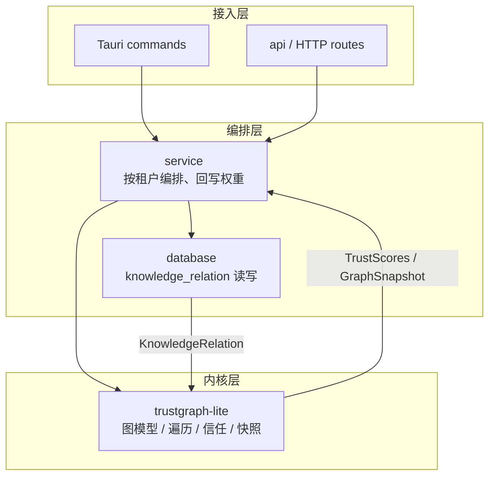

# trustgraph-lite 轻量级信任图谱内核设计方案

> 纯内存、零 IO 的信任 / 知识图谱算法内核：与存储解耦，供 `service` / `api` / Tauri 复用，对齐 `crates/vector` 的「契约与实现分离」模式

---

## 目录

1. [设计目标](#1-设计目标)
2. [现状与问题](#2-现状与问题)
3. [定位与边界](#3-定位与边界)
4. [分层架构](#4-分层架构)
5. [数据模型](#5-数据模型)
6. [信任模型](#6-信任模型)
7. [查询与遍历 API](#7-查询与遍历-api)
8. [错误模型](#8-错误模型)
9. [复杂度与容量上限](#9-复杂度与容量上限)
10. [依赖与构建](#10-依赖与构建)
11. [测试方案](#11-测试方案)
12. [实施计划](#12-实施计划)
13. [风险与权衡](#13-风险与权衡)
14. [变更文件清单](#14-变更文件清单)
15. [变更记录](#15-变更记录)

---

## 1. 设计目标

| 目标 | 说明 | 优先级 |
|------|------|--------|
| 🧠 **纯内存图内核** | 节点 / 边 / 权重全部驻留内存，单次查询 O(V+E)，不触达数据库与网络 | P0 |
| 🧩 **存储无关** | 不依赖 `sqlx` / `reqwest` / `vector`；`database` 负责读写，本 crate 只做计算 | P0 |
| 🔒 **确定性** | 遍历顺序固定（`BTreeMap`），同一输入永远得到同一输出，便于快照比对与单测 | P0 |
| 📈 **信任传播** | 带衰减的迭代信任分，直接消费 `knowledge_relation.relation_weight` 作为边权 | P1 |
| 🔎 **子图查询** | 邻接查询、k-hop、最短路径、top-k | P1 |
| 🧾 **快照导出** | 输出 `{nodes, edges}`，与 `get_knowledge_graph` 规划的返回形状对齐 | P1 |
| 📦 **双形态可嵌入** | 桌面（Tauri）与无头服务（`assets-server`）共用同一份实现 | P2 |

**非目标**（本轮不做）：持久化与事务、分布式（Pulsar / Cassandra / Neo4j）、向量召回（属 `crates/vector`）、LLM 实体抽取、GraphRAG 编排、前端力导向布局。

---

## 2. 现状与问题

| 位置 | 现状 | 问题 |
|------|------|------|
| `docs/知识库与知识图谱架构设计.md` §2.3 | 已设计 `knowledge_relation`（`source_id` / `source_type` / `target_id` / `target_type` / `relation_type` / `relation_weight` / `auto_discovered`） | 仅停留在设计稿，尚无读写实现 |
| 同文档 §3.3 `get_knowledge_graph` | 规划为直接返回 `(Vec<GraphNode>, Vec<GraphEdge>)` | 图结构拼装与遍历若写在 SQL 函数里，无法复用也无法单测 |
| `crates/service/src/knowledge_service.rs` | 只有知识树 / 知识条目 CRUD 与 RAG 调用 | 没有任何图遍历、路径、信任计算能力 |
| `crates/vector` | 解决「相似」召回 | 无法表达「A 引用 B、B 衍生自 C」的路径语义 |
| 全仓 | 无 `petgraph` 等图库；也没有 trust / graph 命名的 crate | 图算法一旦散落，桌面端与 HTTP 端会各写一遍 |

> 结论：图谱能力需要一个独立、无 IO、可单测的内核 crate，由 `service` 负责按租户灌数据。

---

## 3. 定位与边界

### 3.1 trustgraph-lite 是什么

- 轻量级「信任图谱」内核：以三元组 `(subject, predicate, object)` 为基础，为节点维护信任分。
- **输入**：调用方（`database` + `service`）从 `{schema}.knowledge_relation` 读出后灌入内存图。
- **输出**：信任分、邻接 / k-hop 子图、最短路径、与前端对齐的 `{nodes, edges}` 快照。

### 3.2 不是什么

| 维度 | 完整 TrustGraph（上游项目） | trustgraph-lite |
|------|------------------------------|-----------------|
| 部署形态 | Pulsar + Cassandra + 多服务编排 | 单进程内存库 |
| 数据规模 | 亿级、分布式 | 单租户万级节点（见 §9） |
| 能力范围 | 图 RAG、Agent 编排、多模态 | 图结构 + 信任传播 + 快照 |
| 外部依赖 | 消息队列、图 / 列数据库 | 仅 `serde` / `serde_json` / `thiserror` |

### 3.3 为什么不用 `petgraph`

workspace 当前没有该依赖；本 crate 只需要邻接表 + BFS / Dijkstra / 迭代传播，自实现约 300 行即可，避免新增一棵依赖树。若后续需要更复杂的图算法，可在**不改变对外 API** 的前提下替换内部存储结构。

### 3.4 依赖方向（硬约束）

`trustgraph-lite` ← `service` ← `api` / 桌面命令。本 crate **不得**反向依赖 `database` / `service` / `api` / `vector`，也不得引入任何数据库或 HTTP 驱动。

---

## 4. 分层架构



| 层 | 职责 | 是否在本 crate |
|----|------|----------------|
| `database` | 读写 `{schema}.knowledge_relation`，返回行模型 | 否 |
| `service` | 按租户构建图、调用内核、把结果回写 / 返回 | 否 |
| `trustgraph-lite` | 图模型、遍历、信任传播、快照 | **是** |

---

## 5. 数据模型

### 5.1 标识

- `NodeId = i64`（Snowflake）：与 `asset_knowledge.id` / 资产表主键同源。
- 序列化为**字符串**，沿用仓库《前端大整数精度丢失问题(Snowflake ID)》的约定，避免 JS `Number` 丢精度。
- `EdgeId = u64`：内核本地自增，仅用于内部定位；业务唯一键是 `(from, relation, to)`，数据库主键不进入内核。

### 5.2 类型定义

```rust
pub type NodeId = i64;
pub type EdgeId = u64;

pub struct Node {
    pub id: NodeId,
    pub kind: NodeKind,
    pub label: String,
}

pub enum NodeKind { Knowledge, Asset, Document }

pub enum RelationKind {
    RelatedTo,
    References,
    DerivedFrom,
    BelongsTo,
    DependsOn,
}

pub struct Edge {
    pub id: EdgeId,
    pub from: NodeId,
    pub to: NodeId,
    pub relation: RelationKind,
    pub weight: f32,          // 0.0 ~= 1.0，映射 knowledge_relation.relation_weight
    pub directed: bool,       // related_to 双向；其余单向
    pub auto_discovered: bool,
}

pub struct Triple {
    pub subject: NodeId,
    pub predicate: RelationKind,
    pub object: NodeId,
}
```

### 5.3 关系类型与方向

| 关联类型 | 说明 | 方向性 |
|----------|------|--------|
| `related_to` | 相关（弱关联） | 双向 |
| `references` | 引用（强关联） | 单向 |
| `derived_from` | 衍生自 | 单向 |
| `belongs_to` | 属于某个分类 | 单向 |
| `depends_on` | 理解依赖 | 单向 |

> 与 `docs/知识库与知识图谱架构设计.md` §5 保持一致；方向性存放在 `Edge.directed`，由 `database` 按 `relation_type` 映射。

### 5.4 不变量

1. 同一 `(from, relation, to)` 只保留一条边；`upsert_edge` 覆盖权重，`insert_edge` 重复时报 `DuplicateEdge`。
2. `weight` 在入口处 clamp 到 `[0.0, 1.0]`；`NaN` 归零。
3. 自环允许存在，但**默认不参与**信任传播（`TrustConfig::include_self_loops` 可开）。
4. 删除节点级联删除其全部关联边。

---

## 6. 信任模型

### 6.1 定义

节点 `i` 的信任分 `t_i ∈ [0,1]`，种子分 `s_i`（业务给定，例如按 `permission_level`：`public = 1.0` / `internal = 0.6` / `secret = 0.3`），边权 `w_ji`。迭代传播：

```
t_i^(k+1) = (1 - α) · s_i + α · Σ_{j∈N(i)} (w_ji · t_j^(k)) / Σ_{j∈N(i)} w_ji
```

- `α ∈ (0,1)`：传播系数（damping），默认 `0.85`；
- 收敛判定：`max_i |t_i^(k+1) - t_i^(k)| < ε`，`ε` 默认 `1e-4`；
- 迭代上限默认 `32`，达到上限仍未收敛不算失败，只在报告里标注；
- 无入边（`Σ w = 0`）的节点保持 `t_i = s_i`；
- 每轮结束后整体 clamp 到 `[0,1]`，防止权重累计发散。

### 6.2 配置

```rust
pub struct TrustConfig {
    pub damping: f32,          // α，默认 0.85
    pub epsilon: f32,          // 默认 1e-4
    pub max_iterations: u32,   // 默认 32
    pub include_self_loops: bool, // 默认 false
}

impl Default for TrustConfig { /* ... */ }
```

### 6.3 确定性与复杂度

- 邻居按 `NodeId` 升序遍历并累加（`BTreeMap`），消除 `HashMap` 迭代顺序导致的浮点差异；
- 单次迭代 `O(V + E)`，最坏 `O(max_iterations · (V + E))`；
- 返回 `TrustReport { scores, iterations, converged }`，调用方可据此决定是否提高上限。

---

## 7. 查询与遍历 API

| 方法 | 签名 | 说明 |
|------|------|------|
| `insert_node` | `fn insert_node(&mut self, node: Node) -> GraphResult<()>` | 重复 ID 返回 `NodeExists` |
| `upsert_node` | `fn upsert_node(&mut self, node: Node) -> GraphResult<()>` | 覆盖 `kind` / `label` |
| `remove_node` | `fn remove_node(&mut self, id: NodeId) -> GraphResult<Node>` | 级联删除关联边 |
| `insert_edge` | `fn insert_edge(&mut self, edge: Edge) -> GraphResult<EdgeId>` | 重复三元组报错 |
| `upsert_edge` | `fn upsert_edge(&mut self, edge: Edge) -> GraphResult<EdgeId>` | 幂等更新权重 |
| `remove_edge` | `fn remove_edge(&mut self, triple: &Triple) -> GraphResult<Edge>` | |
| `neighbors` | `fn neighbors(&self, id: NodeId, dir: Direction) -> Vec<&Edge>` | `Out` / `In` / `Both` |
| `k_hop` | `fn k_hop(&self, roots: &[NodeId], depth: u32) -> GraphResult<Subgraph>` | BFS，深度 `1..=MAX_DEPTH` |
| `shortest_path` | `fn shortest_path(&self, from: NodeId, to: NodeId) -> Option<Vec<NodeId>>` | 无权 BFS |
| `weighted_path` | `fn weighted_path(&self, from: NodeId, to: NodeId) -> Option<(f32, Vec<NodeId>)>` | Dijkstra，代价 `1 - weight` |
| `subgraph` | `fn subgraph(&self, ids: &[NodeId]) -> Subgraph` | 诱导子图 |
| `trust_scores` | `fn trust_scores(&self, seeds: &BTreeMap<NodeId, f32>, cfg: &TrustConfig) -> TrustReport` | 见 §6 |
| `top_k_by_trust` | `fn top_k_by_trust(&self, report: &TrustReport, k: usize) -> Vec<(NodeId, f32)>` | 分数降序、`NodeId` 升序的稳定排序 |
| `snapshot` | `fn snapshot(&self, report: Option<&TrustReport>) -> GraphSnapshot` | 输出 `{nodes, edges}` |

### 7.1 快照形状（与前端对齐）

```rust
pub struct GraphNode {
    pub id: String,           // NodeId 转字符串，规避 JS 精度丢失
    pub label: String,
    pub kind: NodeKind,
    pub trust: Option<f32>,
}

pub struct GraphEdge {
    pub source: String,
    pub target: String,
    pub relation: RelationKind,
    pub weight: f32,
}

pub struct GraphSnapshot {
    pub nodes: Vec<GraphNode>,
    pub edges: Vec<GraphEdge>,
}
```

> 与 `knowledge_service::get_knowledge_graph` 规划的 `(Vec<GraphNode>, Vec<GraphEdge>)` 一一对应：内核产出快照，`service` 直接透传给 `api` / Tauri。

---

## 8. 错误模型

```rust
#[derive(Debug, thiserror::Error)]
pub enum GraphError {
    #[error("node {0} already exists")]
    NodeExists(NodeId),
    #[error("node {0} not found")]
    NodeNotFound(NodeId),
    #[error("edge not found")]
    EdgeNotFound,
    #[error("duplicate edge {subject} -{predicate:?}-> {object}")]
    DuplicateEdge { subject: NodeId, predicate: RelationKind, object: NodeId },
    #[error("node limit exceeded: {limit}")]
    TooManyNodes { limit: usize },
    #[error("edge limit exceeded: {limit}")]
    TooManyEdges { limit: usize },
    #[error("depth {depth} exceeds limit {limit}")]
    DepthExceeded { depth: u32, limit: u32 },
    #[error("invalid trust config: {0}")]
    InvalidTrustConfig(&'static str),
}

pub type GraphResult<T> = Result<T, GraphError>;
```

原则：

1. 不定义 `From<sqlx::Error>` / `From<reqwest::Error>`，内核与 IO 解耦；
2. 错误只描述**结构性**问题（不存在、重复、超限），业务错误留在 `service`；
3. 所有错误都可通过 `match` 区分，不使用 `String` 传参。

---

## 9. 复杂度与容量上限

| 项 | 内部结构 | 复杂度 |
|----|----------|--------|
| 节点表 | `BTreeMap<NodeId, Node>` | `O(log V)` |
| 出边表 | `BTreeMap<NodeId, BTreeMap<(RelationKind, NodeId), Edge>>` | `O(log V + log E)` |
| 入边表 | 同上，按 `to` 建立镜像 | `O(log V + log E)` |
| k-hop / 无权最短路 | BFS | `O(V + E)` |
| 加权最短路 | Dijkstra（二叉堆） | `O((V + E) log V)` |
| 信任传播 | 迭代 | `O(iter · (V + E))` |

| 常量 | 默认值 | 说明 |
|------|--------|------|
| `MAX_NODES` | 100_000 | 单租户内存图节点上限 |
| `MAX_EDGES` | 500_000 | 单租户内存图边上限 |
| `MAX_DEPTH` | 8 | k-hop 深度上限，防止子图爆炸 |
| `MAX_FANOUT` | 1_000 | 单节点出边上限 |

内存估算：1 万节点 / 5 万边约 10 MB（含 `String` label），满足桌面端常驻；超过 `MAX_NODES` 时 `service` 应改为按中心节点裁剪子图后构建。

---

## 10. 依赖与构建

根 `apps/backend/src-tauri/Cargo.toml` 的 `[workspace.dependencies]`：

```toml
# 轻量级信任/知识图谱内核：纯内存、零 IO，service 负责从 knowledge_relation 构建
trustgraph-lite = {path = "crates/trustgraph-lite"}
```

成员 `crates/trustgraph-lite/Cargo.toml` 只做继承，不写版本号：

```toml
[package]
edition = "2024"
name = "trustgraph-lite"
version = "0.1.0"

[lints]
workspace = true

[dependencies]
serde.workspace = true
serde_json.workspace = true
thiserror.workspace = true
```

- 依赖方向：`trustgraph-lite` → 仅 `serde` / `serde_json` / `thiserror`；
- 不引入 `sqlx` / `reqwest` / `redis` / `lancedb`，保证 `cargo check -p trustgraph-lite` 与 `crates/ast` 的 CMake / wasm 前置条件无关；
- 校验命令：

```bash
cd apps/backend/src-tauri
cargo check -p trustgraph-lite
cargo test -p trustgraph-lite
cargo clippy -p trustgraph-lite --all-targets -- -D warnings
cargo fmt -p trustgraph-lite -- --check
```

---

## 11. 测试方案

| 用例 | 断言 |
|------|------|
| 节点增删 | 重复插入返回 `NodeExists`；删除节点后关联边一并消失 |
| 边去重 | 同一 `(from, relation, to)` 二次 `insert_edge` 返回 `DuplicateEdge`；`upsert_edge` 更新权重且不新增边 |
| 权重归一 | `-1.0` → `0.0`、`NaN` → `0.0`、`2.0` → `1.0` |
| 自环 | 默认不参与传播；`include_self_loops = true` 时参与 |
| k-hop | `depth = 0` 只含 root；环形图不重复访问；超过 `MAX_DEPTH` 返回 `DepthExceeded` |
| 最短路 | 不可达返回 `None`；同节点返回 `[id]`；双向边可反向通行 |
| 信任传播 | 两节点链式传播结果与手算一致；不收敛时 `converged == false` 且不 panic |
| 确定性 | 同一图两次 `trust_scores` 得到逐位相同的 `Vec<(NodeId, f32)>` |
| 快照 | `serde_json` 往返一致；`GraphNode.id` 序列化为 JSON 字符串 |
| 容量 | 超过 `MAX_NODES` / `MAX_EDGES` / `MAX_FANOUT` 分别返回对应错误 |

> 全部为纯内存单元测试，不依赖数据库、不依赖 tokio，`cargo test -p trustgraph-lite` 即可跑完。

---

## 12. 实施计划

| 阶段 | 内容 | 状态 |
|------|------|------|
| Phase 0 | 本设计文档 + `docs/知识库模块/README.md` 索引 | ✅ 本次完成 |
| Phase 1 | crate 骨架（`Cargo.toml` / `lib.rs` / 模块空壳）+ 根工作区登记 | ✅ 本次完成 |
| Phase 2 | `model` / `graph`：节点、边、邻接表、增删查 + 单测 | ⬜ 待排期 |
| Phase 3 | `traverse` / `trust` / `snapshot`：k-hop、最短路、信任传播、快照 + 单测 | ⬜ 待排期 |
| Phase 4 | `database` 读写 `knowledge_relation`、`service` 按租户构图 | ⬜ 待排期 |
| Phase 5 | `api` / Tauri 命令暴露、前端图谱页对接 | ⬜ 待排期 |

---

## 13. 风险与权衡

| 风险 | 影响 | 缓解 |
|------|------|------|
| 内存放大 | 万级节点可接受，十万级需评估 | `MAX_*` 上限 + 按中心节点裁剪子图 |
| 无持久化 | 进程重启后需重建 | `knowledge_relation` 是唯一事实源，内存图只是缓存 |
| 信任模型主观 | 参数不当会导致全图趋同 | 暴露 `TrustConfig`，默认值可被业务覆盖，报告里返回 `iterations` / `converged` |
| 与完整 TrustGraph 能力差距 | 无 Agent / 图 RAG / 多模态 | 边界写死在本 crate；未来以适配器方式接入，不修改内核 API |
| `i64` → JS 精度 | 前端图谱节点 ID 失真 | 快照统一序列化为 `String` |
| 多租户串图 | 跨租户数据越权 | 由 `service` 按 schema 构建独立实例，内核不感知租户 |
| 浮点不确定性 | 同一图不同机器结果有细微差异 | 固定遍历顺序；测试用 `1e-6` 比较；快照不输出中间迭代值 |

---

## 14. 变更文件清单

| 文件 | 操作 | 说明 |
|------|------|------|
| `docs/知识库模块/trustgraph-lite轻量级信任图谱内核设计方案.md` | 新增 | 本设计文档 |
| `docs/知识库模块/README.md` | 修改 | 文档索引追加一行 |
| `apps/backend/src-tauri/Cargo.toml` | 修改 | `[workspace.dependencies]` 登记 `trustgraph-lite` |
| `apps/backend/src-tauri/Cargo.lock` | 自动更新 | `cargo check -p trustgraph-lite` 生成 |
| `apps/backend/src-tauri/crates/trustgraph-lite/Cargo.toml` | 新增 | crate 清单，依赖全部继承 workspace |
| `apps/backend/src-tauri/crates/trustgraph-lite/src/lib.rs` | 新增 | crate 文档 + 模块声明 |
| `apps/backend/src-tauri/crates/trustgraph-lite/src/error.rs` | 新增 | 错误类型（Phase 1 空壳） |
| `apps/backend/src-tauri/crates/trustgraph-lite/src/model.rs` | 新增 | 图数据模型（Phase 1 空壳） |
| `apps/backend/src-tauri/crates/trustgraph-lite/src/graph.rs` | 新增 | 邻接表存储（Phase 1 空壳） |
| `apps/backend/src-tauri/crates/trustgraph-lite/src/traverse.rs` | 新增 | 遍历与路径（Phase 1 空壳） |
| `apps/backend/src-tauri/crates/trustgraph-lite/src/trust.rs` | 新增 | 信任传播（Phase 1 空壳） |
| `apps/backend/src-tauri/crates/trustgraph-lite/src/snapshot.rs` | 新增 | 快照导出（Phase 1 空壳） |

---

## 15. 变更记录

| 日期 | 变更 |
|------|------|
| 2026-11-11 | 初版：设计文档 + crate 骨架（Phase 0 / 1），确立「纯内存、零 IO、确定性」三条边界 |

