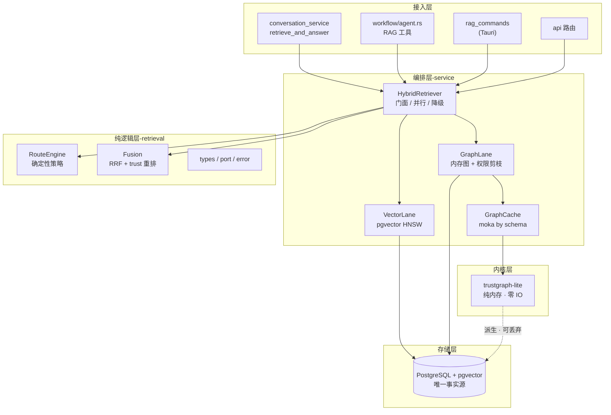

# 混合路由（Hybrid Routing）架构设计方案

> **定位**：在《Rust原生多模态解析+pgvector多模态RAG设计文档_V1.7整合版》的单通道向量检索之上，叠加 `trustgraph-lite` 图内核，构建「确定性路由 → 双通道召回 → RRF 融合 → 信任重排」的检索编排层。
>
> **边界**：`trustgraph-lite` 内核**一行不改**；pgvector 仍是唯一权威存储；V1.7 只允许 `moka`，不引入任何新中间件；图只是进程内派生缓存，可随时丢弃。
>
> **默认行为**：`route_enabled = false` 时，检索结果与现状**逐字段一致**（golden test 守住）。

---

## 目录
1. [版本边界与非目标](#1-版本边界与非目标)
2. [现状核对与差距](#2-现状核对与差距)
3. [总体架构](#3-总体架构)
4. [路由引擎](#4-路由引擎)
5. [通道设计](#5-通道lane设计)
6. [融合与信任重排](#6-融合与信任重排)
7. [节点映射与 DDL 增量](#7-节点映射与-ddl-增量)
8. [多模态路由](#8-多模态路由)
9. [缓存体系改造](#9-缓存体系改造)
10. [配置体系](#10-配置体系)
11. [可观测、灰度与回滚](#11-可观测灰度与回滚)
12. [实施阶段与验收](#12-实施阶段与验收)
13. [风险与权衡](#13-风险与权衡)
14. [待决策清单](#14-待决策清单)
15. [变更文件清单](#15-变更文件清单)
16. [变更记录](#16-变更记录)

---

## 1. 版本边界与非目标

### 1.1 版本归属

| 版本 | 范围 | 状态 |
|---|---|---|
| **V1.7.1（本文档）** | 纯逻辑路由 crate + 向量通道门面重构 + 影子评估；**默认全关** | 可先落地，不阻塞 V1.7 放行 |
| **V1.8** | 图通道全量（依赖 `trustgraph-lite` Phase 2–3）+ 自动关联边 + 多模态下推 | 待内核完成后再排期 |

> 本文档**不推翻** V1.7 任何结论（pgvector 唯一权威源、moka 进程缓存、禁 lancedb/valkey/redis）。它只在检索链路**前面**加一层编排。

### 1.2 与 V1.7 铁律的对齐

| V1.7 铁律 | 是否违反 | 说明 |
|---|:---:|---|
| pgvector 是唯一权威主存储 | ❌ 不违反 | 图通道不存任何事实数据，全部派生自 PG |
| 缓存不承担正确性，可随时清空 | ❌ 不违反 | 图快照是 moka 缓存，清空后自动重建 |
| 缓存不存完整 chunk 文本 | ❌ 不违反 | 图通道结果只存 `(chunk_id, score, node_id, path)` |
| `staged` 版本检索不可见 | ❌ 不违反 | 构图只读 `active_doc_version` 的边 |
| 会话记忆 `sess:` 与向量 `rag:` 前缀隔离 | ❌ 不违反 | 新增 key 仍在 `rag:` 前缀下 |
| V1.7 只用 moka | ❌ 不违反 | 图快照缓存用 moka，未引入 valkey/redis/lancedb |
| 禁止硬编码向量维度 | ❌ 不违反 | 路由不感知维度，维度仍由 `sys_system_config` 管控 |

### 1.3 非目标（明确不做）

1. ❌ **LLM 生成查询计划 / 查询分解**：热路径不叠加第二次大模型调用，破坏「同输入同输出」的确定性。
2. ❌ **Pulsar 集群分发图**：`crates/mq` 保持零接线，见《trustgraph集群消息总线（Pulsar）客户端基建设计方案》。
3. ❌ **Neo4j / Memgraph / 完整上游 TrustGraph**。
4. ❌ **cross-encoder 精排 / LLM rerank**（V1.9 再评估）。
5. ❌ **`image_vector` 图像向量通道**：V1.7 该列恒为 NULL，只预留枚举位。
6. ❌ **修改 `trustgraph-lite` 内核 API**，或让内核感知 IO。

### 1.4 与 trustgraph-lite 的边界声明

内核文档（`docs/知识库模块/trustgraph-lite轻量级信任图谱内核设计方案.md:39`）已把「GraphRAG 编排」列为**非目标**。本文档遵守该结论：

| 能力 | 归属 |
|---|---|
| 图结构、邻接、k-hop、最短路、信任传播、快照 | `crates/trustgraph-lite`（**不改**） |
| 路由决策、通道编排、融合、重排、缓存、降级 | `crates/retrieval`（新增，纯逻辑）+ `crates/service`（适配器） |
| 从 PG 读关系构图 | `crates/service`（内核依旧零 IO） |

---

## 2. 现状核对与差距

> 以下全部为**代码/文档实证**，是方案边界的依据。

| 事实 | 证据 | 对混合路由的影响 |
|---|---|---|
| 当前检索是**单通道 + 假相似度**：`0.0 AS similarity`、`ORDER BY dc.id` | `crates/service/src/rag_service.rs:94-156` | 路由层必须同时包住「老表 `document_chunk`」与「V1.7 新表 `rag_chunk`」（V1.7 §12 D2 选 B 双表并存） |
| `RetrieveParams` 只有 6 个字段，无路由/模态/解释字段 | `crates/database/src/models.rs:1202-1210` | 需**向后兼容扩字段**（`#[serde(default)]`），调用点 6 处：`conversation_service.rs:450/504/1264/1445`、`workflow/src/agent.rs:543`、`rag_commands` |
| `trustgraph-lite` 目前**只有骨架**（`model.rs` 仅 TODO 注释），Phase 2/3 未开工 | `crates/trustgraph-lite/src/model.rs:1-7`；内核文档 §12 | 图通道必须做成**可缺省的 trait 端口**，内核未就绪时自动退化 vector-only |
| 内核文档明确把「GraphRAG 编排」列为非目标 | 内核文档 `:39` | 路由/融合/编排必须在内核**外面** |
| `knowledge_relation` 用 BIGINT 主键、`relation_weight REAL`、`auto_discovered` | `docs/知识库与知识图谱架构设计.md:84-96` | 图节点 ID 天然 BIGINT，与 `trustgraph_lite::NodeId = i64` 对齐 |
| V1.7 `rag_chunk.doc_id / chunk_id` 是 **TEXT（sha256）**，且无 `asset_id` | V1.7 文档 `:189`、`:187-214` | **最大缺口**：TEXT 主键无法直接进图，必须补节点映射（见 §7） |
| `rag_chunk` 有 `text_vector` / `image_vector(NULL)` / `source_type` / `start_ms/end_ms` | V1.7 文档 `:195-206` | 多模态路由可按 `source_type` + 时间窗下推 SQL，无需新表 |
| 缓存 key 是七元组，**不含路由信息** | V1.7 文档 `:385-400` | 上混合路由必须扩 key，否则出现「跨模式脏缓存」 |
| `apply_table` **只映射标量**，嵌套表被 `_ => continue` 丢弃 | `crates/bootstrap/src/config.rs:84-91` | 配置必须是 `[rag]` 下**扁平 key**（如 `route_enabled`），**不能用 `[rag.route]`** |
| 表名在文档与代码中不一致：文档写 `asset_knowledge`，代码是 `knowledge_asset` | `tenant_tables.sql:864`；`docs/知识库与知识图谱架构设计.md:687` | 实现以代码为准；本文档统一写 `{schema}.knowledge_asset`，列入 D-H7 |

### 2.1 两条 RAG 世界并存

```text
现状（已实现）                                 V1.7（待实现）
asset_knowledge.id ──► document_chunk.asset_id      doc_meta.doc_id(sha256) ──► rag_chunk.doc_id
                       embedding vector(1536)                              text_vector vector(768)
                       RAGRetriever::retrieve()                            §4.5 检索 SQL
```

混合路由必须**先兼容现状、再切 V1.7**，不能等 V1.7 完成才开工，也不能写死在其中一套上。因此引入 `RAG_STORE` 配置选择 Lane 适配器：

| `RAG_STORE` | 通道适配器 | 图节点来源 |
|---|---|---|
| `document_chunk`（现状默认） | `DocumentChunkLane` | `document_chunk.asset_id` → `NodeKind::Asset` |
| `rag_chunk`（V1.7） | `RagChunkLane` | `doc_meta.node_id` → `NodeKind::Document` |

> 这条设计让 **R2/R3 在图内核未完成时也能交付**：现有 `document_chunk.asset_id` 已能直接对接 `knowledge_relation` 的 `source_type='asset'`。

### 2.2 现状调用链（改造点定位）

```text
conversation_service::retrieve_and_answer   (:437 / :486 / :1181 / :1264 附近)
workflow::agent                             (:543)
rag_commands                                (Tauri 命令)
        └──► RAGRetriever::retrieve(&RetrieveParams)   ← 唯一收口点，签名保持不变
                    └──► [新增] HybridRetriever::retrieve
```

**结论**：只需在 `RAGRetriever::retrieve` 内部换实现，6 个调用点零改动。这也是选择「门面委托」而非「重命名函数」的原因。

---

## 3. 总体架构

### 3.1 分层图



> **依赖方向铁律**：`retrieval` 不依赖 `service` / `database` / `api`；`trustgraph-lite` 不依赖 `retrieval`；只有 `service` 同时认识三者。

### 3.2 crate 与模块划分

| 位置 | 职责 | 依赖 | 新增 |
|---|---|---|:---:|
| `crates/retrieval/src/types.rs` | `RouteMode` / `LaneKind` / `LaneSpec` / `RoutePlan` / `RetrievedChunk` / `LaneStats` / `RetrievalOutcome` | serde / serde_json | ✅ |
| `crates/retrieval/src/route.rs` | `RouteEngine`：信号 → 计划，纯函数 | 同上 | ✅ |
| `crates/retrieval/src/fusion.rs` | RRF、doc 级 trust 加成、去重、预算截断 | 同上 | ✅ |
| `crates/retrieval/src/policy.rs` | 词法规则表（意图词 / 关系词 / 模态词）、`RoutePolicy` 配置结构 | 同上 | ✅ |
| `crates/retrieval/src/port.rs` | `VectorLane` / `GraphLane` trait（端口） | async-trait | ✅ |
| `crates/retrieval/src/error.rs` | `RetrievalError`（结构性错误，不含 sqlx 类型） | thiserror | ✅ |
| `crates/service/src/retrieval/mod.rs` | `HybridRetriever`：并行、超时、降级、hydrate | database / retrieval | ✅ |
| `crates/service/src/retrieval/vector_lane.rs` | `DocumentChunkLane` / `RagChunkLane` | database | ✅ |
| `crates/service/src/retrieval/graph_lane.rs` | 构图、图缓存、k-hop、权限剪枝 | database / trustgraph-lite | ✅ |
| `crates/service/src/rag_service.rs` | 保留 `RAGRetriever` 门面，委托 `HybridRetriever` | 同上 | ✏️ |

> `crates/*` 已在 `[workspace] members` 中（`apps/backend/src-tauri/Cargo.toml:21`），新增 crate 只需在 `[workspace.dependencies]` 登记一行（该文件 `:1-12` 规定版本唯一来源）。

### 3.3 为什么适配器放 `service` 而不是新 crate

`VectorLane` 需要租户 schema：`database::schema_prefix()` 是 **task-local**（`crates/database/src/lib.rs:84`），只有经 `service` 上下文（`with_schema` / `switch_tenant`）才拿得到。若把适配器下沉到 `retrieval-pgvector`，就必须把 `database` + `sqlx` 依赖一起下沉，反而破坏「纯逻辑可单测」的初衷。

### 3.4 四个备选方案与否决理由

| 备选 | 否决原因 |
|---|---|
| 路由写进 `trustgraph-lite` | 违反内核「零 IO / 只做图算法」，且内核文档明确排除 GraphRAG 编排 |
| 路由塞进 `rag_service.rs` 单文件 | 无法脱离 DB/租户上下文单测；策略与 SQL 纠缠，回归成本高 |
| 新建 `retrieval-pgvector` crate | task-local schema 跨 crate 不可用，反而要把 `database` 依赖下沉 |
| 用 LLM 做意图路由 | 热路径延迟 + 成本 + 不确定性，违反 V1.7 确定性要求 |

### 3.5 门面保持签名不变

```rust
// crates/service/src/rag_service.rs
impl RAGRetriever {
    /// 签名与返回类型保持不变，内部委托给 HybridRetriever。
    pub async fn retrieve(params: &RetrieveParams) -> Result<Vec<ChunkResult>, String> {
        crate::retrieval::hybrid().retrieve(params).await
    }
}
```

`HybridRetriever` 用 `OnceLock` 持有进程级单例（与 `database::get_read_pool()` 的取用方式一致），懒初始化 moka 图缓存与策略配置。

---

## 4. 路由引擎

### 4.1 输入信号（全部确定性、可单测）

| 信号 | 来源 | 用途 |
|---|---|---|
| `intent` | 词法规则（`policy.rs`）：关系词命中 → `Relational`；描述词命中 → `Descriptive`；两者都命中 → `Mixed` | 决定是否开图通道、遍历方向 |
| `anchors` | 资产编号 / 合同号 / 文档标题 / ID 正则 + 内存 label 索引精确命中 | 图通道的 root seeds；无锚点时不允许 `GraphOnly` |
| `modality` | 附件类型 + query 中「图 / 照片 / 视频 / 录音 / 第 N 分钟」 | 下推 `source_type` / `start_ms..end_ms` |
| `scope` | `bind_tree_node_id`、`perm_hash` | 图遍历按权限剪枝，防越权 |
| `graph_coverage` | 当前租户图节点数 / 边数 / `graph_version` | `< route_graph_min_nodes` 直接关图通道（冷启动保护） |
| `budget` | `max_tokens`、`route_latency_budget_ms` | 决定是否并行、k-hop 深度、是否放弃图通道 |
| `store` | `RAG_STORE` 配置 | 选择 Lane 适配器（`document_chunk` / `rag_chunk`） |

### 4.2 输出结构

```rust
// crates/retrieval/src/types.rs
#[derive(Debug, Clone, Copy, PartialEq, Eq, Serialize, Deserialize)]
pub enum RouteMode { Vector, Graph, Hybrid }

#[derive(Debug, Clone, Copy, PartialEq, Eq, Serialize, Deserialize)]
pub enum LaneKind {
    Vector,
    Graph,
    Lexical,     // 预留：pg_trgm / tsvector 关键词道
    ImageVector, // 预留：V1.8 TEI 图像向量
}

#[derive(Debug, Clone, Copy, PartialEq, Eq, Serialize, Deserialize)]
pub enum SeedSource { Anchors, VectorTopN }

#[derive(Debug, Clone, PartialEq, Serialize, Deserialize)]
pub struct LaneSpec {
    pub kind: LaneKind,
    pub weight: f32,        // RRF 权重
    pub top_k: usize,       // 本 lane 召回上限（含过采样）
    pub oversample: u8,     // vector 默认 4，对齐 V1.7 §6.3
    pub depth: u8,          // graph 默认 1，Hybrid 上限 2
    pub seed_from: SeedSource,
}

#[derive(Debug, Clone, Copy, PartialEq, Eq, Serialize, Deserialize)]
pub enum FusionKind { Rrf { k: u32 }, Linear }

#[derive(Debug, Clone, PartialEq, Serialize, Deserialize)]
pub struct TrustRerank {
    pub lambda: f32,        // final = rrf * (1 + lambda * trust)
    pub min_trust: f32,     // 低于该值不参与加成
}

#[derive(Debug, Clone, PartialEq, Serialize, Deserialize)]
pub struct QueryFilters {
    pub source_types: Vec<String>, // text / pdf / document / image / audio / video
    pub start_ms: Option<i64>,
    pub end_ms: Option<i64>,
    pub tree_node_id: Option<i64>,
    pub perm_hash: String,
}

#[derive(Debug, Clone, PartialEq, Serialize, Deserialize)]
pub struct Budget { pub max_tokens: i32, pub max_items: usize }

#[derive(Debug, Clone, PartialEq, Serialize, Deserialize)]
pub struct RoutePlan {
    pub mode: RouteMode,
    pub lanes: Vec<LaneSpec>,
    pub fusion: FusionKind,
    pub trust: Option<TrustRerank>,
    pub filters: QueryFilters,
    pub budget: Budget,
    pub policy_version: String,
    /// 解释信息，**不参与缓存 key 哈希**（见 §4.6）
    #[serde(default, skip_serializing_if = "Vec::is_empty")]
    pub reasons: Vec<RouteReason>,
}

#[derive(Debug, Clone, PartialEq, Eq, Serialize, Deserialize)]
pub enum RouteReason {
    RouteDisabled,
    GraphColdStart { nodes: usize },
    BudgetGuard,
    IntentRelational,
    IntentDescriptive,
    IntentMixed,
    AnchorsFound { count: usize },
    NoAnchorsSeedFromVector,
    ModalityFilter { kinds: Vec<String> },
    ExplicitMode(RouteMode),
}
```

### 4.3 决策规则

| 条件（按顺序评估，首个命中即返回） | 结果 |
|---|---|
| `!route_enabled` | `Vector`，reason `RouteDisabled` |
| `route_default_mode` 显式为 `vector` / `graph` / `hybrid` | 直接采用，reason `ExplicitMode` |
| `graph_coverage.nodes < route_graph_min_nodes` | `Vector`，reason `GraphColdStart` |
| `latency_budget_ms < graph_cost_budget_ms`（默认 120ms） | `Vector`，reason `BudgetGuard` |
| `intent == Descriptive` | `Vector` |
| `intent == Relational` && 有锚点 | `Hybrid`，`graph.seed_from = Anchors` |
| `intent == Relational` && 无锚点 | `Hybrid`，`graph.seed_from = VectorTopN` |
| `intent == Mixed` | `Hybrid`，`graph.seed_from = VectorTopN` |
| 兜底 | `Vector` |

```text
default_weight: vector = 1.0, graph = 0.6   (route_graph_weight)
default_depth : 1 (Hybrid) / 2 (Graph 显式模式)
default_top_k: vector = top_k * 4 (过采样), graph = top_k * 2
```

> **重要**：`GraphOnly` 只有在用户/上层**显式**指定 `route_default_mode=graph` 时才可能出现；`auto` 永远不会产出纯图结果（图通道只做增强，不做唯一召回源）。

### 4.4 词法规则表（`policy.rs` 默认值）

| 类别 | 默认词表（可配置，改动需升 `policy_version`） |
|---|---|
| 关系词 → `Relational` | 关联、关系、引用、被引用、依赖、上游、下游、属于、影响、牵连、同系列、衍生、出处、来源 |
| 描述词 → `Descriptive` | 是什么、定义、含义、怎么、如何、步骤、说明、总结、概览、区别 |
| 模态词 → `modality` | 图片、截图、照片、图纸、视频、录像、录音、音频、第 N 分钟、时间点 |

规则实现要求：

1. **子串匹配即可**，不引入分词器 / 正则引擎依赖（避免新增依赖树）；
2. 词表按 `&'static [&'static str]` 常量存放，顺序固定；
3. 命中位置与命中词写入 `reasons`，便于线上复盘误判。

### 4.5 确定性保证

| 要求 | 做法 |
|---|---|
| 无随机、无时钟、无 IO | `RouteEngine::plan()` 是纯函数，只吃 `RouteSignal` 结构体 |
| 顺序稳定 | 规则按固定顺序短路求值；`anchors` 用 `BTreeSet<NodeId>` 排序 |
| 浮点稳定 | 权重只做乘法与比较，不做累加链式求和 |
| 可回归 | 同一 `RouteSignal` 连续 1000 次调用，`serde_json` 输出**逐字节一致** |

### 4.6 与缓存 key 的关系

```rust
// 只哈希影响检索结果的字段，不含 reasons（否则改解释文案会导致缓存全失效）
pub fn plan_hash(plan: &RoutePlan) -> String {
    let core = serde_json::json!({
        "mode": plan.mode,
        "lanes": plan.lanes,
        "fusion": plan.fusion,
        "trust": plan.trust,
        "filters": plan.filters,
        "budget": plan.budget,
        "policy_version": plan.policy_version,
    });
    hex::encode(Sha256::digest(core.to_string().as_bytes()))
}
```

> `filters.perm_hash` 已在 key 中单列（沿用 V1.7 七元组），此处保留是为了「同 plan 语义完整」，不会重复破坏命中率。

---

## 5. 通道设计

### 5.1 端口定义（`crates/retrieval/src/port.rs`）

```rust
use async_trait::async_trait;
use std::sync::Arc;

pub type NodeId = i64;

pub struct LaneRequest<'a> {
    pub query: &'a str,
    pub query_vector: Option<Arc<Vec<f32>>>,
    pub top_k: usize,
    pub oversample: u8,
    pub filters: &'a QueryFilters,
    pub budget: Budget,
}

#[async_trait]
pub trait VectorLane: Send + Sync {
    async fn search(&self, req: &LaneRequest<'_>) -> Result<Vec<RetrievedChunk>, RetrievalError>;
}

#[derive(Debug, Clone, Default)]
pub struct GraphCoverage {
    pub nodes: usize,
    pub edges: usize,
    pub version: String, // 由 max(updated_at) + 计数派生
}

#[async_trait]
pub trait GraphLane: Send + Sync {
    fn coverage(&self) -> GraphCoverage;
    /// `Ok(GraphHits::default())` 表示图不可用/为空，调用方按降级处理，**不报错**
    async fn search(
        &self,
        req: &LaneRequest<'_>,
        seeds: &[NodeId],
        depth: u8,
    ) -> Result<GraphHits, RetrievalError>;
}

pub struct GraphHits {
    /// (节点, 信任分, 到 seed 的路径)，按信任分降序、NodeId 升序稳定排序
    pub nodes: Vec<(NodeId, f32, Vec<NodeId>)>,
}
```

> 图端口刻意**不返回 chunk**：图通道只负责「哪些文档/资产更相关」，映射到分片是 §6.5 的确定性规则。这样图内核与分片结构解耦。

### 5.2 向量通道（主通道）

#### 5.2.1 三种运行态（必须区分，否则 golden test 无法成立）

| `RAG_USE_VECTOR` | `route_enabled` | 行为 | 用途 |
|---|---|---|---|
| `false`（现状默认） | `false` | 扫表 `ORDER BY dc.id`、`similarity = 0.0` | **改造前基线**，golden test 的对照 |
| `true` | `false` | 真实向量检索（过采样×4、真实 cosine） | V1.7 单通道基线 |
| `true` | `true` | 真实向量 + 可选图通道 + 融合 | 本文档目标态 |

> 上表解释了为什么 R2 阶段「行为零变化」是可达的：`route_enabled=false` 且 `RAG_USE_VECTOR=false` 时，`LegacyScanLane` 逐字复用现有 SQL。

#### 5.2.2 适配器

| 适配器 | 表 | 图节点映射 | 说明 |
|---|---|---|---|
| `LegacyScanLane` | `document_chunk` | `asset_id` | 现状复刻，`similarity=0.0`，只用于回滚与对照 |
| `DocumentChunkLane` | `document_chunk` | `asset_id` | 真实向量版；`dc.embedding` 为 `vector(1536)` |
| `RagChunkLane` | `rag_chunk` | `doc_meta.node_id` | V1.7 版；`text_vector` 维度由配置管控 |

#### 5.2.3 检索 SQL 约束

1. `ORDER BY` 直接使用 `<=>`，**不包 `1-()`**，保证命中 HNSW（V1.7 §4.5）。
2. 过采样 `top_k * 4`，业务层再 `min_similarity` 过滤 + 预算截断。
3. `rag_chunk` 版必须带 `c.doc_version = m.active_doc_version`、`m.status='active'`、`c.is_deleted=false`、`c.text_vector IS NOT NULL`。
4. 多模态过滤：`($n::text[] IS NULL OR c.source_type = ANY($n))`、`start_ms/end_ms` 时间窗。
5. **不 JOIN `doc_meta` 取正文**：正文在 hydrate 阶段统一取（V1.7「缓存只存 chunk_id」的配套要求）。

### 5.3 图通道（增强通道）

#### 5.3.1 构图输入

```sql
-- 人工/同步边
SELECT source_id, source_type, target_id, target_type, relation_type, relation_weight
FROM {schema}.knowledge_relation WHERE deleted = 0;

-- 自动关联边（仅当前生效版本）
SELECT d.node_id AS source_id, t.node_id AS target_id, r.relation_weight
FROM {schema}.rag_doc_relation r
JOIN {schema}.doc_meta d ON d.doc_id = r.doc_id AND d.active_doc_version = r.doc_version
JOIN {schema}.doc_meta t ON t.doc_id = r.target_doc_id
WHERE d.deleted = 0 AND t.deleted = 0;
```

节点灌入：

| 来源 | `NodeKind` | `NodeId` |
|---|---|---|
| `knowledge_asset` / `assets` | `Asset` / `Knowledge` | 表主键（BIGINT，天然 Snowflake） |
| `doc_meta` | `Document` | `doc_meta.node_id`（见 §7） |

#### 5.3.2 图缓存（进程内 moka）

```rust
struct CachedGraph {
    graph: trustgraph_lite::TrustGraph,
    coverage: GraphCoverage,
    built_at: std::time::Instant,
}

// key 必须含 schema；绝不跨租户共享
let cache: moka::future::Cache<String, Arc<CachedGraph>> = Cache::builder()
    .max_capacity(cfg.graph_cache_max_tenants as u64)
    .weigher(|_k, v: &Arc<CachedGraph>| v.graph.edge_count().min(u32::MAX as usize) as u32)
    .max_weighted_capacity(cfg.graph_cache_max_edges)
    .time_to_live(Duration::from_secs(cfg.graph_cache_ttl_sec))
    .build_async();
```

| 参数 | 默认 | 说明 |
|---|---|---|
| `graph_cache_ttl_sec` | 300 | 绝对过期；到期后台重建 |
| `graph_cache_max_tenants` | 16 | 最多缓存租户数，LRU 淘汰 |
| `graph_cache_max_edges` | 200_000 | 加权容量，防单表爆炸 |
| `route_graph_min_nodes` | 20 | 低于此值视为空图，直接关图通道 |

新鲜度：`coverage.version` 与库中 `max(updated_at)` + 计数不一致 → 同步重建（同一 schema 内 single-flight，避免并发重复构图）。

#### 5.3.3 查询流程

```text
1. seeds 过滤：丢弃图中不存在的 NodeId（内核 k_hop 对未知 root 会返回 NodeNotFound）
2. seeds 为空 → 直接返回 GraphHits::default()（降级，不报错）
3. sub = graph.k_hop(&seeds, depth)              // 内核 §7，BFS
4. trust = graph.trust_scores(&seed_scores, &TrustConfig::default())
5. ranked = graph.top_k_by_trust(&trust, graph_top_k)
6. 对每个节点求到 seed 的最短路作为路径证据（可选，路径长度 <= depth）
7. 按 trust 降序、NodeId 升序稳定排序后返回
```

`seed_scores` 来源优先级：

1. 若该 seed 在向量通道已命中 → 用其 cosine 相似度（更贴合 query）；
2. 否则用 `permission_level` 映射（内核文档 §6.1：`public=1.0` / `internal=0.6` / `secret=0.3`）。

#### 5.3.4 权限剪枝（安全红线）

| 环节 | 要求 |
|---|---|
| seed 选取 | 只从当前用户可访问集合取；不可访问节点不得作为 root |
| 遍历 | BFS 遇到无权节点**不跨越**（既不返回也不继续扩展），防止「借道」泄露 |
| 返回 | 节点 → 文档 → 分片，全程再校验一次权限（防御纵深） |
| 缓存 | 图缓存按 schema 隔离；**权限剪枝在查询期做，不写进共享图** |

> 这一条不可省：内核不知道租户与权限，剪枝必须在 `service` 适配器完成。

### 5.4 预留通道

| 通道 | 状态 | 约束 |
|---|---|---|
| `Lexical` | 仅枚举占位，`execute` 返回 `Unsupported` | 路由层不得生成该 lane，直到 D-H5 决策通过 |
| `ImageVector` | 仅枚举占位 | 仅当 `image_vector IS NOT NULL` 且 V1.8 TEI 就绪才可能被选中 |

### 5.5 降级矩阵

| 场景 | 行为 | 用户可见影响 |
|---|---|---|
| 图内核未实现（`NoopGraphLane`） | `coverage.nodes = 0` → 路由强制 `Vector` | 无（等同现状） |
| 图构建超时 / 超 `MAX_NODES` | 本次请求跳过图通道，`reasons` 记录 | 召回略降，不报错 |
| 图 lane 超过 `latency_budget_ms` | `tokio::time::timeout` 取消，返回已完成的向量结果 | 延迟可控 |
| `knowledge_relation` 为空 | `GraphColdStart` | 无 |
| 向量 lane 失败 | 返回错误（主通道不可降级） | 与现状一致 |
| 融合阶段某 lane 结果为空 | 另一 lane 结果原样返回（RRF 自然处理） | 无 |

---

## 6. 融合与信任重排

### 6.1 为什么用 RRF 而不是加权求和

| 方案 | 问题 | 结论 |
|---|---|---|
| 线性加权 `α·cos + β·trust` | 两分数不同量纲（cosine 为距离派生、trust 为传播概率），需归一化，且分布随 query 漂移 | ❌ |
| CombSUM / CombMNZ | 需要跨 query 可比的分数量级 | ❌ |
| 学习排序 / cross-encoder | 需训练数据与模型推理，热路径成本高 | ❌（V1.9 再议） |
| **RRF（Reciprocal Rank Fusion）** | 只用 rank，无需标定，对异常分鲁棒，行业默认基线 | ✅ |

### 6.2 两级融合

**第一级：分片级 RRF（多通道 → 统一排序）**

```text
rrf(c) = Σ_{l ∈ lanes}   w_l / (k + rank_l(c))      k = route_rrf_k (默认 60)
```

- `rank_l(c)` 从 **1** 开始；某 lane 未命中该分片则该 lane 贡献 0；
- `w_l`：`vector = 1.0`、`graph = route_graph_weight`（默认 0.6）；
- 单通道（`route_enabled=false` 或图降级）时退化为 `1.0 / (k + rank)`，**排序与向量原始序完全一致**——这是行为兼容的关键。

**第二级：文档级信任加成（rerank-only）**

```text
final(c) = rrf(c) × (1 + λ · trust(doc(c)))        λ = route_trust_lambda (默认 0.2)
```

| 要点 | 约定 |
|---|---|
| `trust` 取值 | 图通道返回的 doc 节点信任分，已归一化到 `[0,1]` |
| 无图通道 / 节点无 trust | `trust = 0` → `final = rrf`，与纯向量完全一致 |
| 作用范围 | **只重排已召回的候选，不新增候选**（不扩召回） |
| 粒度 | **doc 级**（同一文档内所有分片共享同一 trust），避免分片间自相矛盾 |
| 低于 `min_trust` | 不加成（防止噪声节点被放大） |

### 6.3 参数取值理由

| 参数 | 默认 | 理由 |
|---|---|---|
| `route_rrf_k` | 60 | RRF 原始论文与 Elasticsearch/Vespa 默认值；k 越大 rank 差异越平滑 |
| `route_trust_lambda` | 0.2 | trust=1.0 时最多提升 20%，足以跨越 1–2 个名次，但不足以颠覆 RRF 的强信号 |
| `route_graph_weight` | 0.6 | 图通道是**增强**而非替代，权重低于向量；0.6 时「向量 rank 3 + 图 rank 1」略低于「向量 rank 1 + 图 rank 3」 |
| `route_per_doc_chunk_cap` | 3 | 控制单文档霸榜；与 V1.7「按文档聚组」一致 |

#### 6.3.1 算例（k=60, w_v=1.0, w_g=0.6, λ=0.2）

| 分片 | 向量 rank | 图 rank | doc trust | rrf | final |
|---|:---:|:---:|:---:|---|---|
| A | 1 | 3 | 0.9 | 1/61 + 0.6/63 = 0.025917 | ×1.18 = **0.030582** |
| B | 3 | 1 | 0.5 | 1/63 + 0.6/61 = 0.025709 | ×1.10 = **0.028280** |
| C | 2 | — | 0.95 | 1/62 = 0.016129 | ×1.19 = **0.019194** |

排序 `A > B > C`：图通道把「向量略差但结构上更相关」的 A 提到首位，同时 C 虽信任最高但因只被单通道命中而未越级——这就是设计想要的**温和纠偏**。

### 6.4 去重与稳定排序

```rust
// 1) 去重：同一 (doc 内 chunk_id) 被多 lane 命中 → RRF 累加，保留最大 trust
// 2) 三重稳定排序（全部用确定性的比较函数）
chunks.sort_by(|a, b| {
    b.score.total_cmp(&a.score)          // score desc（total_cmp 处理 NaN）
        .then_with(|| a.chunk_id.cmp(&b.chunk_id))       // chunk_id asc
        .then_with(|| b.doc_version.cmp(&a.doc_version)) // doc_version desc
});
```

| 要求 | 做法 |
|---|---|
| 不依赖哈希迭代顺序 | 用 `Vec` + `HashMap<ChunkKey, usize>` 索引，最终只按 `Vec` 排序 |
| 浮点确定性 | `f32::total_cmp`；禁止 `partial_cmp().unwrap()` |
| 跨 lane 同分 | 由 `chunk_id` 决出，保证同输入同输出 |

### 6.5 文档 → 分片的选择规则

图通道返回的是**文档节点**，必须映射到分片。规则固定如下（`per_doc_chunk_cap` 生效）：

```text
对每个候选文档 d（按 doc 级 final 降序）：
  ① 先取「向量通道已命中的 d 的分片」，按 rrf 降序
  ② 若不足 cap 个，按 chunk_index 升序 从 d 的其余分片补齐
  ③ 超过 cap 的丢弃，计入 truncated_by_cap 指标
  ④ 文档内分片权重 = 该 doc 的 trust（同一 trust）
```

> 「向量命中的优先」这一条很关键：它保证图通道**不会用低质分片挤掉高质量分片**；`chunk_index` 兜底则保证图独有文档也能给出「开头部分」这种最常用的上下文。

### 6.6 预算截断

| 规则 | 说明 |
|---|---|
| 逐条累计 token | 用现有估算口径；无估算器时按 `chars / 2` 保守估计 |
| 超出 `max_tokens` 即停 | 保持已排好的顺序，**不做二次重排** |
| `max_items` 上限 | 与 `top_k` 取小值 |
| 至少保留 1 条 | 防止预算配置过小导致 0 召回 |
| 截断可观测 | 记录 `truncated_by_budget` 与丢弃条数 |

### 6.7 显式不做

1. ❌ 分数归一化（破坏 RRF 的无标定优势）；
2. ❌ 二次精排模型（延迟与成本不可控）；
3. ❌ 跨文档 MMR 去冗余（V1.9）；
4. ❌ 用 trust 直接乘 cosine（量纲混淆，且会污染通道内排序）；
5. ❌ 在融合阶段再回表（回表只发生在 hydrate，一次）。

---

## 7. 节点映射与 DDL 增量

### 7.1 身份缺口（本方案最大的落地障碍）

| 侧 | 标识 | 类型 |
|---|---|---|
| 图内核 | `trustgraph_lite::NodeId` | `i64`（`crates/trustgraph-lite/src/model.rs:3` 明确「沿用 Snowflake i64 主键」） |
| `knowledge_relation` | `source_id` / `target_id` | `BIGINT` |
| V1.7 `rag_chunk` | `doc_id` / `chunk_id` | **`TEXT`（sha256 十六进制）** |
| 现状 `document_chunk` | `asset_id` | `BIGINT` ✅ 可直接进图 |

> 即：**现状能进图，V1.7 不能**。必须在 `doc_meta` 上补一列稳定的 BIGINT 节点号。

### 7.2 三种映射方案

| 方案 | 做法 | 结论 |
|---|---|---|
| **A. `doc_meta.node_id BIGINT`** | 入库时用 `utils::snowflake::next_id()` 生成，永久不变 | ✅ **采纳**（可反查、无碰撞、与 `knowledge_relation` 同构） |
| B. `sha256(doc_id)` 截断为 i64 | 无需 DDL | ❌ 有碰撞风险，且图上节点无法反查文档；重命名/迁移语义丢失 |
| C. 图内核改用字符串 ID | 改 `NodeId = String` | ❌ 违反内核边界（内核已定 `i64`），且破坏 `knowledge_relation` 对齐 |

### 7.3 DDL 增量（幂等，随租户表初始化执行）

```sql
-- ① doc_meta：补图节点号与资产软引用
ALTER TABLE {schema}.doc_meta ADD COLUMN IF NOT EXISTS node_id  BIGINT;
ALTER TABLE {schema}.doc_meta ADD COLUMN IF NOT EXISTS asset_id BIGINT;

-- 唯一：同一租户内一个节点只对应一个文档；允许 NULL（未回填的历史行）
CREATE UNIQUE INDEX IF NOT EXISTS uk_doc_meta_node_id
    ON {schema}.doc_meta (node_id) WHERE node_id IS NOT NULL;
CREATE INDEX IF NOT EXISTS idx_doc_meta_asset_id
    ON {schema}.doc_meta (asset_id) WHERE asset_id IS NOT NULL;

COMMENT ON COLUMN {schema}.doc_meta.node_id  IS '信任图谱节点号（Snowflake），供 trustgraph-lite 使用；不变式：建档后永不修改';
COMMENT ON COLUMN {schema}.doc_meta.asset_id IS '关联资产（软引用 {schema}.knowledge_asset.id），不设外键以兼容历史数据与跨库迁移';
```

**不建外键的理由**：

1. 历史 `doc_meta` 行可能没有对应资产（外部同步文档）；
2. 租户库迁移/重建期间 `knowledge_asset` 可能尚未创建，FK 会阻塞建表；
3. 外键在批量回填时产生全表校验开销；
4. 一致性改用「定期体检 SQL + 报警」保证（见 §11.1 的 `doc_meta_orphan_total`）。

### 7.4 回填（可重复执行、分批）

```rust
// crates/service/src/retrieval/backfill.rs（R4 阶段交付，随启动或手动触发）
pub async fn backfill_doc_node_id(pool: &PgPool, batch: usize) -> Result<u64, sqlx::Error> {
    let mut total = 0u64;
    loop {
        let ids: Vec<String> = sqlx::query_scalar(&format!(
            "SELECT doc_id FROM {}.doc_meta WHERE node_id IS NULL AND deleted = 0 \
             ORDER BY created_at LIMIT $1",
            schema_prefix()
        )).bind(batch as i64).fetch_all(pool).await?;
        if ids.is_empty() { break; }

        for doc_id in ids {
            // 生成 Snowflake 后按 doc_id 条件更新，天然幂等（并发下最多重复生成，不会写错行）
            let node_id = utils::snowflake::next_id() as i64;
            total += sqlx::query(&format!(
                "UPDATE {}.doc_meta SET node_id = COALESCE(node_id, $1), updated_at = updated_at \
                 WHERE doc_id = $2",
                schema_prefix()
            )).bind(node_id).bind(&doc_id).execute(pool).await?.rows_affected();
        }
    }
    Ok(total)
}
```

| 要点 | 说明 |
|---|---|
| 幂等 | `COALESCE(node_id, $1)` 保证已有值不被覆盖；重复跑安全 |
| 不触发图重建 | 回填不改 `updated_at`（`updated_at = updated_at`），避免无意义新鲜度抖动 |
| 未回填行 | 构图时跳过并计入 `graph_skipped_no_node` 指标，**不报错** |
| 新文档 | 建档流程内直接生成，不依赖回填 |

### 7.5 自动关联边：新建 `rag_doc_relation`（不复用 `knowledge_relation`）

```sql
CREATE TABLE IF NOT EXISTS {schema}.rag_doc_relation (
    id              BIGINT PRIMARY KEY,                        -- Snowflake（utils::snowflake::next_id）
    doc_id          TEXT   NOT NULL,                           -- 源文档（sha256）
    doc_version     BIGINT NOT NULL,                            -- 源文档版本：边随版本重建
    target_doc_id   TEXT   NOT NULL,
    relation_type   VARCHAR(32) NOT NULL DEFAULT 'related_to',  -- 与内核 RelationKind 对齐
    relation_weight REAL   NOT NULL DEFAULT 0.5,                -- 相似度，作为边权重
    method          VARCHAR(16) NOT NULL DEFAULT 'vector',      -- vector | manual | rule
    auto_discovered BOOLEAN NOT NULL DEFAULT TRUE,
    created_at      TIMESTAMPTZ NOT NULL DEFAULT NOW(),
    deleted         BOOLEAN NOT NULL DEFAULT FALSE,
    CONSTRAINT uk_rag_doc_relation UNIQUE (doc_id, doc_version, target_doc_id, relation_type)
);

CREATE INDEX IF NOT EXISTS idx_rag_doc_relation_src
    ON {schema}.rag_doc_relation (doc_id, doc_version) WHERE deleted = FALSE;
CREATE INDEX IF NOT EXISTS idx_rag_doc_relation_tgt
    ON {schema}.rag_doc_relation (target_doc_id) WHERE deleted = FALSE;
```

**为什么不复用 `knowledge_relation`**（`docs/知识库与知识图谱架构设计.md:84-96`）：

| 理由 | 说明 |
|---|---|
| 类型不兼容 | `knowledge_relation.source_id` 是 `BIGINT`，V1.7 文档侧是 `TEXT`；塞进去只能存 `node_id`，而 `node_id` 是回填出来的派生值 |
| **缺版本维度** | `knowledge_relation` 没有 `doc_version`，自动边一旦写入就会把 **staged 文档** 暴露给检索，直接违反 V1.7 铁律 3 |
| 生命周期不同 | 自动边要「按版本整批重算」，人工边要「长期保留 + 审计」；混表会导致人工关系被误删 |
| 可回滚 | 关掉 `auto_link_enabled` 只需 `DELETE FROM rag_doc_relation`（一行），不污染人工数据 |

### 7.6 自动边生成规则（`auto_link_enabled=false` 默认关闭）

```sql
-- 文档级向量 = 该文档当前生效版本所有分片向量的均值（pgvector 原生 avg 聚合，无需新表）
WITH d AS (
  SELECT m.doc_id, avg(c.text_vector) AS v
  FROM {schema}.doc_meta m
  JOIN {schema}.rag_chunk c ON c.doc_id = m.doc_id AND c.doc_version = m.active_doc_version
  WHERE m.deleted = 0 AND m.status = 'active'
    AND c.is_deleted = false AND c.text_vector IS NOT NULL
  GROUP BY m.doc_id
)
SELECT a.doc_id, b.doc_id, 1 - (a.v <=> b.v) AS sim
FROM d a JOIN d b ON a.doc_id <> b.doc_id
WHERE 1 - (a.v <=> b.v) >= $1        -- auto_link_threshold，默认 0.78
ORDER BY a.doc_id, sim DESC
LIMIT $2;                            -- 每个 doc 取 top_n，默认 8
```

| 规则 | 约定 |
|---|---|
| 触发时机 | 文档 `active_doc_version` 变更后的后台任务（**不在入库热路径**） |
| 写入版本 | `doc_version = active_doc_version`（staged 阶段永不写边） |
| 幂等 | 先 `DELETE FROM rag_doc_relation WHERE doc_id=$1 AND doc_version=$2 AND method='vector'`，再批量插入 |
| 对称 | `related_to` 视为无向：写入单向后构图时双向添加（内核 `Edge.directed = false`） |
| 反向清理 | 源文档版本回滚 → 旧 version 的边自然不被构图 SQL 读到，无需删除 |

### 7.7 构图规模保护

| 保护 | 阈值 | 超限行为 |
|---|---|---|
| 节点数 | `graph_max_nodes`（默认 200_000） | 放弃构建，`coverage.nodes=0` → 降级 vector |
| 边数 | `graph_cache_max_edges`（默认 200_000） | 同上 |
| 单租户内存 | 由 `max_weighted_capacity` 控制 | 淘汰最久未用租户的图 |
| 构建设计时 | `graph_build_timeout_ms`（默认 3000） | 超时放弃本次构建，下个请求重试 |

### 7.8 分片回表（hydrate）SQL

```sql
-- V1.7 形态：按 (doc_id, doc_version) 批量取，cap 由 row_number 保证
WITH picked AS (
  SELECT c.chunk_id, c.doc_id, c.doc_version, c.chunk_index, c.logical_path,
         c.source_type, c.page_no, c.file_name, c.start_ms, c.end_ms, c.text,
         row_number() OVER (PARTITION BY c.doc_id ORDER BY c.chunk_index) AS rn
  FROM {schema}.rag_chunk c
  WHERE c.doc_id = ANY($1) AND c.doc_version = $2 AND c.is_deleted = false
)
SELECT * FROM picked WHERE rn <= $3 ORDER BY doc_id, chunk_index;
```

- `$1` 来自融合后的候选文档集合，`$2` 由 `doc_meta.active_doc_version` 提供，`$3 = route_per_doc_chunk_cap`；
- **一次往返**取完全部正文，禁止逐条 query（N+1）；
- 正文只在本次请求内使用，不写缓存（V1.7 铁律）。

### 7.9 权限与多租户

| 维度 | 约定 |
|---|---|
| 租户 | 一切 SQL 走 `schema_prefix()`；图缓存 key 含 schema；**绝不跨租户共享图对象** |
| 文档权限 | 构图前按 `permission_json` / `knowledge_tree` 权限过滤节点（§5.3.4） |
| 缓存键 | `perm_hash` 已进入检索缓存 key，避免不同权限用户命中同一结果 |
| 图缓存 | 只缓存「结构」，不缓存「某用户的可见子图」——剪枝每次按当前用户执行 |

---

## 8. 多模态路由

### 8.1 原则

V1.7 只有 `text_vector` 可用、`image_vector` 恒为 NULL（`:206`）。所以在 V1.7.1 中，「多模态路由」**不是跨模态向量检索**，而是：

> **把用户的模态意图翻译成 SQL 谓词（`source_type` + `start_ms/end_ms`），并在返回结果里带上定位信息。**

不做 CLIP 类跨模态编码（V1.8 TEI 就绪后再评估）。

### 8.2 场景映射表

| 用户问法 | 路由决策 | 下推谓词 |
|---|---|---|
| 「这份合同的违约条款」 | 无模态过滤 | 无 |
| 「那张设备照片上的标签」 | `source_types = ['image','pdf']` | `source_type = ANY(...)` |
| 「视频第 12 分钟讲了什么」 | `source_types = ['video','audio']` + 时间窗 | `start_ms <= t+15000 AND end_ms >= t-15000` |
| 「PDF 附件里的报价单」 | `source_types = ['pdf','document']` | `source_type = ANY(...)` |
| 「和 A 项目相关的资料」 | 关系意图 → 混合路由 | 无模态过滤 + 图通道 |

### 8.3 时间窗规则

```text
命中点 t（毫秒）→ 窗口 [t - 15000, t + 15000]（前后各 15s）
无具体时间点（只说「视频」）→ 不加时间窗，只按 source_type 过滤
```

- 时间窗在 **SQL 层**下推（`rag_chunk.start_ms/end_ms` 已建索引）；
- 窗口边界可能与分片边界错位，依赖 V1.7 的分片 `overlap`（默认 10%）兜底；
- 页码（`page_no`）**不做 SQL 下推**（无索引，会退化为全表扫描），只在 hydrate 后做后过滤。

### 8.4 返回结构约束

`ChunkResult` 向后兼容扩展（全部 `#[serde(default)]`，老前端不受影响）：

```rust
pub struct ChunkResult {
    // …现有字段保持不变…
    #[serde(default)] pub source_type: Option<String>,
    #[serde(default)] pub page_no: Option<i32>,
    #[serde(default)] pub start_ms: Option<i64>,
    #[serde(default)] pub end_ms: Option<i64>,
    #[serde(default)] pub doc_id: Option<String>,   // sha256(doc_id)，TEXT，不转 i64
}
```

| 规则 | 说明 |
|---|---|
| 图片 / 音视频分片 | `text` 常为空 → **不拼进 prompt**，但保留在 citations 中，前端可跳转播放器 / 高亮页面 |
| 时间信息 | 以 `start_ms/end_ms` 返回，前端负责格式化，后端不做 `mm:ss` 字符串 |
| 大整数 | `doc_id` 是 sha256 字符串，**绝不能**转 i64 下发（会触发 JS 精度问题） |

### 8.5 V1.8 预留

| 项 | 前提 | 落点 |
|---|---|---|
| `ImageVector` 通道 | TEI 支持图像嵌入 + `image_vector IS NOT NULL` | `LaneKind::ImageVector` 已在枚举中占位 |
| 图像 query 编码 | 用户上传图片作为 query | 需新增 `/rag/search-by-image` 入口，**不在 V1.7.1 范围** |

---

## 9. 缓存体系改造

### 9.1 现有 key 与新增维度

现有命中缓存 key（V1.7 `:394`，6 段业务维度，文档称「七元组」含 `rag:hits` 前缀）：

```text
rag:hits:{schema}:{embedding_model_version}:{chunk_strategy_version}:{top_k}:{perm_hash}:{sha256(normalized_query_text)}
```

新增维度 **2 个**，最终 8 段业务维度：

```text
rag:hits:{schema}:{embedding_model_version}:{chunk_strategy_version}:{top_k}:{perm_hash}:{route_mode}:{plan_hash}:{sha256(normalized_query_text)}
                                                                       ^^^^^^^^^^^^^^^^^^^^^^
                                                                       新增：模式 + 计划哈希
```

| 新增段 | 取值 | 作用 |
|---|---|---|
| `route_mode` | `vector` / `graph` / `hybrid` | 防止「同一 query 在纯向量与混合模式下互串结果」 |
| `plan_hash` | `sha256(plan 核心字段)`（§4.6，**不含 reasons**） | 权重、深度、过滤条件、`policy_version` 任一变化即失效 |

### 9.2 关键决策：`route_enabled=false` 时沿用旧 key（逐字节一致）

```rust
fn hits_cache_key(ctx: &CacheCtx) -> String {
    if !ctx.route_enabled {
        // 与 V1.7 现状完全一致的旧格式，保证灰度期零行为变化
        format!("rag:hits:{}:{}:{}:{}:{}:{}", ctx.schema, ctx.emb_ver, ctx.chunk_ver,
                ctx.top_k, ctx.perm_hash, ctx.query_hash)
    } else {
        format!("rag:hits:{}:{}:{}:{}:{}:{}:{}:{}", ctx.schema, ctx.emb_ver, ctx.chunk_ver,
                ctx.top_k, ctx.perm_hash, ctx.mode, ctx.plan_hash, ctx.query_hash)
    }
}
```

**不做双读回填**，理由：

1. `local_cache_ttl_sec` 默认仅 **60s**，切换后最多 60 秒内多几次回源，代价可忽略；
2. 旧 key 的结果是「纯向量、`similarity=0.0`」语义，若被混合模式双读命中，会返回**语义不等价**的旧结果，反而引入脏数据；
3. 少一条代码路径 = 少一类线上事故。

### 9.3 缓存内容仍不含正文

```rust
#[derive(Clone, Serialize, Deserialize)]
pub struct CachedHit {
    pub chunk_id: String,      // V1.7 是 sha256 TEXT；现状是 BIGINT，统一转 String
    pub score: f32,            // 融合后 final score
    pub lanes: u8,             // 位掩码：bit0=vector, bit1=graph（用于 explain，不含正文）
}
```

- 命中后仍要 **hydrate 回表取正文**（V1.7 铁律 2）；
- 缓存写的是**融合后**结果，因此图结构变化最多造成 `ttl`（60s）内的轻微陈旧，可接受；
- 不缓存 `reasons` / `path`（体积大且只用于调试，按需在 `explain=true` 时重算）。

### 9.4 图快照缓存

```text
rag:graph:{schema}:{graph_version}      value: Arc<CachedGraph>（结构，不含任何 query 结果）
```

| 维度 | 说明 |
|---|---|
| 前缀 | `rag:`，与会话 `sess:` 严格隔离；清空向量缓存不会误清会话，反之亦然 |
| 可丢弃 | 清空后下次请求重建，功能无损（V1.7 铁律 1） |
| 不跨租户 | key 含 `schema`，`max_capacity` = `graph_cache_max_tenants` |

### 9.5 查询向量缓存

`rag:qvec:{embedding_model_version}:{sha256(normalized_query_text)}` **保持不变**：query → 向量与路由无关，混合路由复用同一份向量。

---

## 10. 配置体系

### 10.1 落点约束（**必须扁平**）

`crates/bootstrap/src/config.rs:84-91` 的 `apply_table` 只处理标量：

```rust
// 现状实现（截取）
for (k, v) in table.iter() {
    match v {
        toml::Value::String(s) => { /* … */ }
        toml::Value::Integer(i) => { /* … */ }
        toml::Value::Boolean(b) => { /* … */ }
        _ => continue,   // ← 嵌套表/数组被静默丢弃
    }
}
```

因此：

| 写法 | 结果 |
|---|---|
| `[rag]` + `route_enabled = false` | ✅ 生效 |
| `[rag]` + `[rag.route]` + `enabled = false` | ❌ **被静默丢弃**，配置看似写了但永不生效（最危险的失败模式） |
| `[rag]` + `route = { enabled = false }` | ❌ 同上 |

> 这条约束必须写进评审 checklist：**任何 `[rag.*]` 子表一律打回**。

### 10.2 新增配置全表（追加到 V1.7 `[rag]` 段，全部默认关闭）

| Key | 默认 | 取值范围 | 生效阶段 | 说明 |
|---|---|:---:|:---:|---|
| `route_enabled` | `false` | bool | R2 | 总开关；`false` 时逐字节等同现状 |
| `route_default_mode` | `"auto"` | `auto`/`vector`/`graph`/`hybrid` | R2 | `auto` 走词法规则；显式值跳过规则 |
| `route_shadow_enabled` | `false` | bool | R5 | 影子模式：只记录「若开启会怎样」，不改变返回 |
| `route_policy_version` | `"v1"` | 字符串 | R2 | 词法规则版本，进入 `plan_hash` |
| `route_latency_budget_ms` | `800` | 100–5000 | R2 | 整条检索链路预算 |
| `graph_cost_budget_ms` | `120` | 10–2000 | R2 | 低于此值直接关图通道 |
| `route_graph_min_nodes` | `20` | 0–1e6 | R2 | 空图保护 |
| `route_graph_depth` | `1` | 1–2 | R3 | Hybrid 固定 1；显式 `graph` 模式可用 2 |
| `route_graph_seed_from_vector` | `true` | bool | R3 | 无锚点时用向量 TopN 作 seed |
| `route_graph_weight` | `0.6` | 0.0–1.0 | R3 | RRF 中图通道权重 |
| `route_fusion` | `"rrf"` | `rrf`/`linear` | R6 | `linear` 仅供 A/B 对照，不推荐 |
| `route_rrf_k` | `60` | 1–1000 | R3 | RRF 平滑常数 |
| `route_trust_lambda` | `0.2` | 0.0–1.0 | R3 | 信任加成系数 |
| `route_per_doc_chunk_cap` | `3` | 1–20 | R3 | 单文档分片上限 |
| `rag_store` | `"document_chunk"` | `document_chunk`/`rag_chunk` | R0 | 通道适配器选择 |
| `graph_cache_ttl_sec` | `300` | 10–3600 | R3 | 图快照 TTL |
| `graph_cache_max_tenants` | `16` | 1–256 | R3 | 图缓存租户上限 |
| `graph_cache_max_edges` | `200000` | 1000–5e6 | R3 | 图缓存加权容量 |
| `graph_max_nodes` | `200000` | 1000–5e6 | R3 | 构图节点上限，超限放弃 |
| `graph_build_timeout_ms` | `3000` | 100–60000 | R3 | 构图超时 |
| `auto_link_enabled` | `false` | bool | R6 | 自动关联边总开关 |
| `auto_link_threshold` | `0.78` | 0.0–1.0 | R6 | 文档级相似度阈值 |
| `auto_link_top_n` | `8` | 1–50 | R6 | 每文档最多关联数 |

### 10.3 `.env.example.toml` 追加片段

```toml
# ============ 混合路由（Hybrid Routing，V1.7.1）============
# 总开关：false 时检索行为与当前完全一致（golden test 守护）
route_enabled = false
route_default_mode = "auto"
route_shadow_enabled = false
route_policy_version = "v1"

# 延迟与预算
route_latency_budget_ms = 800
graph_cost_budget_ms = 120

# 图通道
route_graph_min_nodes = 20
route_graph_depth = 1
route_graph_seed_from_vector = true
route_graph_weight = 0.6

# 融合
route_fusion = "rrf"
route_rrf_k = 60
route_trust_lambda = 0.2
route_per_doc_chunk_cap = 3

# 存储形态：document_chunk（现状）| rag_chunk（V1.7）
rag_store = "document_chunk"

# 图快照缓存（moka，进程内）
graph_cache_ttl_sec = 300
graph_cache_max_tenants = 16
graph_cache_max_edges = 200000
graph_max_nodes = 200000
graph_build_timeout_ms = 3000

# 自动关联边（默认关闭，开启前须完成 R6 评估）
auto_link_enabled = false
auto_link_threshold = 0.78
auto_link_top_n = 8
```

### 10.4 校验规则

| 时机 | 规则 | 失败行为 |
|---|---|---|
| 启动解析 | 上面「取值范围」越界 / 枚举非法 | **fail-fast 退出**（与 `crates/gateway/src/config.rs:57-63` 的 `bail!` 风格一致） |
| 启动解析 | `route_enabled=false` 但其它 key 写错 | 仍然校验（防止灰度时才炸） |
| 运行期 | `RouteEngine::plan()` 内部不合法（如 lanes 为空） | 记 `error!`，回退 `Vector` 计划，**不中断检索** |
| 运行期 | 图通道异常 | 降级（§5.5），不中断 |

### 10.5 配置 → 代码触点

| Key | 读取位置 |
|---|---|
| `route_*` / `rag_store` | `bootstrap::config::RagConfig` → `service::retrieval::HybridRetriever::new()` |
| `graph_*` | `service::retrieval::graph_lane::GraphLaneImpl::new()`（构建 moka 缓存） |
| `auto_link_*` | `service::retrieval::auto_link`（后台任务，R6） |

---

## 11. 可观测、灰度与回滚

### 11.1 指标（命名沿用 `rag_` 前缀）

| 指标 | 类型 | 标签 | 说明 |
|---|---|---|---|
| `rag_retrieve_total` | counter | `route_mode` / `degraded` | 总请求量 |
| `rag_lane_latency_seconds` | histogram | `lane` | 各通道耗时（vector / graph / hydrate） |
| `rag_route_decisions_total` | counter | `reason` | 路由理由分布（发现词表误判） |
| `rag_graph_coverage` | gauge | `schema_bucket` | 图节点数（0 说明内核未就绪或空图） |
| `rag_graph_build_seconds` | histogram | — | 构图耗时 |
| `rag_graph_build_failures_total` | counter | `reason` | 超时 / 超限 / SQL 失败 |
| `rag_graph_cache_hits_total` | counter | `result` | 图缓存命中率 |
| `rag_rerank_moved_total` | counter | — | 信任重排导致名次变化的分片数 |
| `rag_truncated_total` | counter | `by` = `cap` / `budget` | 截断量（评估 cap/预算是否过紧） |
| `rag_shadow_diff_total` | counter | — | 影子模式与现状结果差异条数 |
| `doc_meta_orphan_total` | gauge | — | `node_id IS NULL AND status='active'` 的文档数（**应为 0**） |

### 11.2 日志与 explain

```rust
// RetrieveParams 向后兼容扩展（6 个调用点无需改动）
pub struct RetrieveParams {
    // …现有 6 个字段不变…
    #[serde(default)] pub explain: bool,     // 默认 false，不影响现有调用
    #[serde(default)] pub route_mode: Option<String>,  // 透传覆盖（调试 / 前端强制模式）
}
```

`explain = true` 时，返回体追加：

```json
{
  "route": {
    "mode": "hybrid",
    "reasons": ["IntentRelational", "NoAnchorsSeedFromVector"],
    "plan_hash": "9f2c…",
    "lanes": [
      {"kind": "vector", "top_k": 40, "hits": 12, "ms": 23},
      {"kind": "graph",  "top_k": 20, "hits": 7,  "ms": 9, "degraded": false}
    ],
    "truncated": {"by_cap": 2, "by_budget": 0}
  }
}
```

日志要求：`trace_id` + `schema` + `plan_hash` + `route_mode` 四要素齐全，便于按计划哈希复盘；**日志不得打印 chunk 正文**（只打 `chunk_id` 前 12 位）。

### 11.3 灰度三步

| 步骤 | 配置 | 观察 | 放行条件 |
|---|---|---|---|
| S1 影子 | `route_shadow_enabled=true`，`route_enabled=false` | `rag_shadow_diff_total`、误判词表 | 差异可解释、无 panic，≥3 天 |
| S2 白名单 | `route_enabled=true` + 内部租户（1 个） | P95 延迟、`degraded` 比例、`rag_rerank_moved_total` | P95 增量 ≤ 15%，图降级率 < 5% |
| S3 全量 | `route_enabled=true` | 全量指标 + 用户反馈 | 离线评测达标（§12.4），连续 7 天无回滚 |
| S4 自动边 | `auto_link_enabled=true`（单独灰度，独立回滚） | 图密度、召回变化、人工关系是否被影响 | 与 S3 相同标准 |

> 影子模式是**纯旁路**：计划照常生成、图通道照常查询，但返回体仍是现状结果，只额外记一条差异日志。它把「路由策略是否合理」与「是否影响用户」彻底解耦。

### 11.4 三级回滚

| 级别 | 动作 | 影响面 | 恢复时间 |
|---|---|---|---|
| **L1（首选）** | `route_enabled=false` | 立即回到单通道；缓存 key 切回旧格式，旧条目自然失效 | 秒级（配置热更新） |
| **L2** | `auto_link_enabled=false` + `DELETE FROM {schema}.rag_doc_relation WHERE method='vector'` | 移除全部自动边，保留人工关系 | 分钟级 |
| **L3** | `RAG_USE_VECTOR=false`（V1.7 §10.2） | 回到 `document_chunk` 扫表链路 | 需重启 |
| L0（兜底） | 代码回滚 | 全部 DDL 均为 `ADD COLUMN IF NOT EXISTS` / `CREATE TABLE IF NOT EXISTS`，**回滚无需改表** | 一次发布 |

> 关键性质：**混合路由的引入不产生任何破坏性 DDL**。所有新增列均可空、所有新增表均独立，代码回滚后旧代码完全无视它们。

---

## 12. 实施阶段与验收

### 12.1 阶段表

| 阶段 | 内容 | 人日 | 依赖 | 关键验收 |
|---|---|:---:|---|---|
| **R0 契约冻结** | `crates/retrieval` 骨架（`types`/`port`/`policy`/`error`）+ `rag_store` 读取 + workspace 登记 | 2 | 无 | `cargo check -p retrieval` 通过；`cargo tree` 未新增 sqlx/pgvector 副本 |
| **R1 现状打平** | `LegacyScanLane` 逐字复刻现有 SQL；`HybridRetriever` 门面接入；`route_enabled=false` | 3 | R0 | 6 个调用点的返回结果与改造前**逐字段一致**（golden test） |
| **R2 路由引擎 + 影子** | `RouteEngine` 全规则 + `policy.rs` 词表 + 影子日志 | 4 | R1 | 同输入 1000 次 plan 逐字节一致；影子差异可解释 |
| **R3 图通道** | 构图、moka 缓存、`k_hop`、trust、权限剪枝、降级 | 5 | R2 + 内核 Phase 2/3（*见 12.2*） | 图降级时结果与 R1 一致；10 万边构图 < 3s |
| **R4 节点映射** | `doc_meta.node_id/asset_id` DDL + 回填任务 + 覆盖率指标 | 3 | R1 | 回填跑两次 `node_id` 不变（幂等）；`doc_meta_orphan_total = 0` |
| **R5 融合与重排** | RRF + trust 加成 + `per_doc_chunk_cap` + 稳定排序 + 预算 | 4 | R3、R4 | 单通道模式排序 == 向量原始序；cap/去重/预算单测全绿 |
| **R6 多模态 + 自动边 + 灰度** | `source_type`/时间窗下推；`rag_doc_relation` 生成与评估；三级灰度 | 5 | R5 | 离线 recall@10 相对基线提升 ≥ 5%，P95 延迟增量 ≤ 15% |
| **合计** | | **26** | | |

### 12.2 依赖门禁（不满足则降级交付）

| 依赖 | 未满足时的交付方式 |
|---|---|
| `trustgraph-lite` Phase 2/3 未完成 | R3 只交付 `NoopGraphLane` + 基于 `MockGraphLane` 的全链路单测；图通道生产不启用 |
| V1.7 `rag_chunk` 未落地 | `rag_store="document_chunk"`，图节点走 `NodeKind::Asset`（`document_chunk.asset_id` 天然 BIGINT，**无需 node_id 映射**） |
| V1.7 `doc_meta` 未落地 | R4 顺延，不影响 R1/R2/R3/R5 在图节点=Asset 形态下完成 |
| Embedding 服务未就绪 | Vector 通道继续 `LegacyScanLane`（`similarity=0.0`），路由与融合仍可单测 |

> 这张表是本方案「不被 V1.7 与图内核阻塞」的保证：**R0–R3 在今天的代码上就能开工**（`document_chunk.asset_id` + `knowledge_relation` 已具备构图条件）。

### 12.3 验收命令

```bash
cd apps/backend/src-tauri

# 1) 纯逻辑层单测（无需数据库）
cargo test -p retrieval

# 2) 服务层集成测试（需要 PG）
cargo test -p service --features integration retrieval

# 3) 静态检查（CI 门禁）
cargo clippy -p retrieval -p service --all-targets -- -D warnings
cargo fmt --all -- --check

# 4) 依赖唯一性（V1.7 §9.2 约束）
cargo tree -d | grep -E 'sqlx|pgvector|opentelemetry' || echo 'no duplicate deps'
```

### 12.4 离线评测集（R6 放行依据）

| 项 | 要求 |
|---|---|
| 规模 | 50–100 条人工标注 query（含 30% 关系型问题） |
| 标注 | 每条给出 gold doc 集合（不要求 gold chunk） |
| 指标 | `recall@5` / `recall@10` / `MRR` / `P50` / `P95` 延迟 |
| 通过线 | `recall@10` 相对单通道基线 **+5%** 以上；`P95` 增量 **≤ 15%**；`recall@5` 不得下降 |
| 回归 | 描述型问题（`Descriptive`）结果与单通道一致（不允许被图通道污染） |

---

## 13. 风险与权衡

| # | 风险 | 触发条件 | 影响 | 缓解措施 |
|---|---|---|---|---|
| 1 | **图陈旧** | 关系变更后未失效缓存；TTL 内读到旧结构 | 结果轻微过时 | TTL 300s；关系写入路径主动 `invalidate(schema)`；L1 回滚 |
| 2 | **图爆炸** | 自动边 `top_n=8` 且文档规模增长 | 内存与构图耗时线性增长 | `graph_max_nodes` / `graph_cache_max_edges` 硬上限；超限直接降级；`auto_link_enabled` 默认关 |
| 3 | **信任分主观** | 初始分/边权重设置不贴合业务 | 重排结果反直觉 | λ=0.2 保守；影子模式量化；λ 可配为 0（等价关闭） |
| 4 | **跨租户串图** | schema 混用 / 缓存 key 漏 schema | **数据泄露（最高危）** | key 必含 schema；多租户集成测试断言；评审红线 |
| 5 | **TEXT→i64 缺口** | 历史文档未回填 `node_id` | 图通道漏召回 | 构图跳过并计数；`doc_meta_orphan_total = 0` 作为上线门禁 |
| 6 | **冷启动延迟** | 首次请求触发构图（最大 3s） | 首个用户感知慢 | 启动预热 + `graph_build_timeout_ms` + 后台重建 + 超时降级 |
| 7 | **缓存 key 膨胀** | 8 段 key + 长 schema 名 | 内存/哈希开销 | 沿用 `local_cache_max_entries`；必要时对 schema 段取 sha256 前 16 位 |
| 8 | **依赖体积** | 内核 crate 引入重依赖 | 编译时间上升 | 内核仅允许 `serde` + `thiserror`（零 IO、零第三方图库） |
| 9 | **单文档霸榜** | 高 trust 文档在图中被多次扩展 | 结果同质化 | `per_doc_chunk_cap=3` + trust 作用于 doc 级（非 chunk 级） |
| 10 | **配置静默失效** | 误写 `[rag.route]` 子表 | 开关不生效，误以为已开启 | §10.1 约束 + 启动期日志打印实际生效值 + 评审 checklist |

---

## 14. 待决策清单

| 编号 | 决策点 | 选项 | **推荐** | 理由 | 决策时点 |
|---|---|---|---|---|---|
| **D-H1** | 版本归属 | 并入 V1.7 / 独立 V1.7.1 / 等 V1.8 | **独立 V1.7.1，增量交付** | 不阻塞 V1.7 放行，且 R0–R3 今天即可开工 | 立即 |
| **D-H2** | 融合算法 | 线性加权 / RRF / 学习排序 | **RRF（k=60）** | 无需标定、对异常分鲁棒、行业基线 | R5 前 |
| **D-H3** | 信任作用粒度 | chunk 级 / doc 级 | **doc 级** | 同文档分片共享 trust，避免文档内自相矛盾 | R5 前 |
| **D-H4** | 自动边存储 | 复用 `knowledge_relation` / 新建 `rag_doc_relation` | **新建表** | `knowledge_relation` 无 `doc_version`，会泄漏 staged 文档 | R6 前 |
| **D-H5** | 关键词通道 | 立即实现 / 仅预留枚举 | **仅预留 `LaneKind::Lexical`** | 图通道收益未验证前不叠加第三种召回源 | R6 复盘时 |
| **D-H6** | LLM 查询分解 | 做 / 不做 | **不做** | 热路径第二次大模型调用，破坏确定性与延迟预算 | 立即 |
| **D-H7** | 表名统一 | 文档改代码 / 代码改文档 | **以代码 `knowledge_asset` 为准，文档跟进修正** | 代码是既成事实，改表名成本与风险都更高 | R4 前 |

**V1.9 再评估（不在本文档范围）**：cross-encoder 精排、跨文档 MMR 去冗余、`ImageVector` 跨模态检索、图通道 PPR 传播（替代 k-hop）。

---

## 15. 变更文件清单

### 15.1 新增

| 路径 | 说明 |
|---|---|
| `apps/backend/src-tauri/crates/retrieval/Cargo.toml` | 纯逻辑 crate，依赖仅 serde / serde_json / thiserror / async-trait |
| `…/crates/retrieval/src/lib.rs` | 模块导出 |
| `…/crates/retrieval/src/{types,route,fusion,policy,port,error}.rs` | 见 §3.2 |
| `…/crates/retrieval/tests/route_determinism.rs` | 1000 次同输入一致性 |
| `…/crates/retrieval/tests/fusion_rrf.rs` | RRF / cap / budget / 稳定排序 |
| `…/crates/service/src/retrieval/mod.rs` | `HybridRetriever` |
| `…/crates/service/src/retrieval/vector_lane.rs` | `LegacyScanLane` / `DocumentChunkLane` / `RagChunkLane` |
| `…/crates/service/src/retrieval/graph_lane.rs` | `GraphLaneImpl` / `NoopGraphLane` |
| `…/crates/service/src/retrieval/backfill.rs` | `doc_meta.node_id` 回填 |
| `docs/知识库模块/混合路由（Hybrid Routing）架构设计方案.md` | 本文档 |

### 15.2 修改

| 路径 | 改动 |
|---|---|
| `apps/backend/src-tauri/Cargo.toml` | `[workspace.dependencies]` 增加 `retrieval`；`crates/*` 已覆盖无需改 members |
| `…/crates/service/Cargo.toml` | 依赖 `retrieval`、`trustgraph-lite`（feature 可选）、`moka` |
| `…/crates/service/src/lib.rs` | 注册 `pub mod retrieval;` |
| `…/crates/service/src/rag_service.rs` | `RAGRetriever::retrieve` 委托 `HybridRetriever` |
| `…/crates/database/src/models.rs` | `RetrieveParams` 增 `explain` / `route_mode`；`ChunkResult` 增定位字段（全部 `serde(default)`） |
| `…/crates/database/src/sql/tenant_tables.sql` | `doc_meta` 增列 + `rag_doc_relation` 建表（幂等） |
| `…/crates/bootstrap/src/config.rs` | `RagConfig` 增 23 个扁平字段 + 校验 |
| `apps/backend/.env.example.toml` | 追加 §10.3 片段 |
| `TODO.md` | 追加 R0–R6 任务条目 |
| `docs/知识库模块/README.md` | 索引追加本文档 |
| `docs/知识库模块/trustgraph-lite轻量级信任图谱内核设计方案.md` | §1 补一句：编排在 `retrieval`/`service`，内核不变 |
| `docs/Rust原生多模态解析+pgvector多模态RAG设计文档_V1.7整合版.md` | §8 补一行交叉引用（不改变 V1.7 结论） |

### 15.3 不改（明确边界）

`crates/trustgraph-lite/**`（内核零改动）、`crates/mq/**`（Pulsar 零接线）、`conversation_service.rs` 等 6 个调用点（签名不变）。

---

## 16. 变更记录

| 版本 | 日期 | 变更 |
|---|---|---|
| v1.0 | 2026-11-28 | 初稿：路由引擎、双通道、两级融合、节点映射、多模态、缓存、配置、灰度回滚、R0–R6、D-H1~D-H7 |

---

> **关联文档**
> - 《Rust原生多模态解析+pgvector多模态RAG设计文档_V1.7整合版》——存储、检索 SQL、缓存铁律的权威来源
> - 《知识库与知识图谱架构设计》——`knowledge_relation` / 多跳查询设计
> - 《trustgraph-lite轻量级信任图谱内核设计方案》——图内核 API、信任传播、容量约束
> - 《trustgraph集群消息总线（Pulsar）客户端基建设计方案》——V1.8 集群分发（本文档不接线）
